# Evidencia de sesión 10: CRUD de vehículos por core-service

| Proyecto | Integrantes y versión |
|---|---|
| VehicleControlApp Web · DazaDev | Ivan Dario Madrid Daza, trabajo individual. Versión 1.0 del 25 de noviembre de 2026. Cerrada el 25 de noviembre de 2026. |

**Por qué hago este trabajo.** Desde la sesión 9, Katerin puede ingresar a su cuenta, pero la web-app todavía no guarda nada: core-service solo lee el perfil y un vehículo. Sigo con la **semana 7 de la cartilla del instructor, «CRUD completo a través del core service»**. CRUD quiere decir crear, consultar, editar y eliminar. Lo hago con los **vehículos**, porque cada ingreso, gasto y documento pertenece a uno. La numero como sesión 10, en el orden en que vengo trabajando.

**Mis decisiones del 23 de noviembre de 2026:**
- **Revisión del cierre.** Le pedí a Claude Code revisar el cierre de las sesiones 8 y 9 como revisor independiente. Encontró 14 hallazgos; ninguno bloquea la presentación en el SENA. El informe, con el prompt de la revisión, está en mi carpeta `Asesor_Técnico/Sesión_9/revision-cierre-sesiones-8-9.md`.
  - Decidí no reabrir las sesiones 8 y 9 y corregir siete hallazgos en un **paso 0** de esta sesión, antes del CRUD (apartado 3).
  - Dejé A1 y A5 (renovar la sesión en un solo paso y probar dos renovaciones a la vez) para la **sesión 11**. La semana 8 de la cartilla trata justo de transacciones y concurrencia.

  **Nota posterior (27 de noviembre de 2026).** La sesión 11 terminó siendo la identidad visual, y la 12, el registro de ingresos. A1 y A5 quedan para la semana 8 de la cartilla, que haré después de completar la primera versión en las sesiones 13 a 15.
- **Validación con class-validator,** la librería que la guía de NestJS que cita la cartilla (R19) muestra primero.
- **El contrato de la API va en esta evidencia y en el README,** sin Swagger.
- **Un vehículo desactivado no se reactiva** por ahora; sigue «Por definir», como en la evidencia de sesiones 4 y 5.

**Mis decisiones del 25 de noviembre de 2026:**
- Aprobé el plan, con los valores del apartado 3, y revisé los tres prompts.
- Decidí usar la skill **Modern Web Guidance**, del equipo de Google Chrome, para diseñar la parte visual. Una skill es un conjunto de instrucciones que Claude Code consulta para un tipo de tarea; esta trae guías de HTML, CSS, formularios y accesibilidad. Antes lo consulté con el instructor, y me dijo que sí puedo usarla. Material UI y la identidad visual de la sesión 8 siguen mandando.
- Decidí hacer **un solo commit con el código de los tres prompts, al terminar,** en lugar de un `fix` para el paso 0 y un `feat` para el CRUD, como decía el plan.
- No agregué al prompt 3 las pautas de diseño de Android que me propuso Claude Code.
- Durante el prompt 3 aprobé corregir la flota, que se pasaba 3 px a 360 px de ancho, y decidí dejar el aviso de Vite por el tamaño del código para la semana 11.
- Después de probar las pantallas en mi navegador con Neon, pedí seguir con el commit del código.
- Pedí subir los commits a GitHub y que Claude Code guardara los scripts de prueba en `Asesor_Técnico/Sesión_10` y rehiciera los dos que se habían perdido.
- Cerré la sesión con la fecha real, el 25 de noviembre de 2026, en su versión 1.0.

**Alcance.**
- **Se hace:** crear, consultar, editar, desactivar y eliminar vehículos (S02, S07, S08 y la parte de flota y detalle de S06), con sus pantallas.
- **Siguen pendientes:** ingresos, gastos, documentos y categorías, y los próximos vencimientos y totales del mes de S06.
- **No se publica en internet:** todo funciona en mi equipo.

**Autoría.** Escribo en primera persona lo que decidí, aprobé o pedí hacer. Claude Code redactó los prompts y esta evidencia según lo que le pedí, y ejecuta los prompts y las comprobaciones a medida que se los envío.

## 1. Cumplimiento de la semana 7 de la cartilla

La cartilla pide, como entregable, un primer CRUD integrado, con endpoints documentados y operaciones GraphQL internas versionadas. La columna de la derecha se completa con lo comprobado en el apartado 5.

| Lo que pide la cartilla | Dónde se cubre | Resultado comprobado |
|---|---|---|
| Paso 1: module, controller, service y DTO de la entidad | Prompt 2: `src/vehiculos/` con `dto/`, `graphql/`, module, controller y service | Hecho el 25 de noviembre: 42 pruebas unitarias del módulo y 29 de los DTO, sin errores (apartado 5) |
| Paso 2: queries y mutations internas con variables | Prompt 2: `src/vehiculos/graphql/vehiculos.graphql.ts` | Hecho: cinco operaciones fijas, con los datos como variables y el filtro por la cuenta de la sesión. La e2e comprueba que un body con una consulta GraphQL responde 400 |
| Paso 3: validación, autorización por recurso y contrato REST | Prompt 1 (`ValidationPipe`) y prompt 2. Contrato en el apartado 3 | Hecho: la e2e comprueba que la otra cuenta recibe 404 al ver, editar o eliminar, y cada rechazo del contrato. Ejemplos en el prompt 2 (apartado 5) |
| Paso 4: listado, detalle y formulario en React con el cliente HTTP | Prompt 3: `src/features/vehiculos/` y `src/api/vehiculos.api.ts` | Hecho el 25 de noviembre: la flota, el detalle y el formulario, probados en Chrome, 21 de 21 (apartado 5) |
| Paso 5: probar persistencia, errores, búsqueda y paginación según el dominio | Pruebas e2e, Chrome y mi prueba real con Neon. Sin búsqueda ni paginación (ver abajo) | Hecho. Con el Hasura falso: e2e, la demostración, 32 de 32, y las pantallas en Chrome, 21 de 21. Con Neon: la demostración, 32 de 32, y mi prueba en el navegador, «Todo bien.» (apartado 5) |
| Diferenciar el estado del formulario de los datos remotos, y actualizar después de escribir | Prompt 3: `useDatosRemotos` y el estado propio del formulario | Hecho: después de guardar, la web-app pasa al detalle, que vuelve a pedir el vehículo; después de desactivar, recarga el detalle; después de eliminar, vuelve a pedir la flota |
| Carga, vacío, error y éxito | Prompt 3 | Hecho: indicador de carga, «Aún no tienes vehículos», aviso de error con «Reintentar» cuando sirve, y «Vehículo guardado.», «Vehículo desactivado.» y «Vehículo eliminado.» (capturas 15 a 17) |
| Criterio: todas las operaciones de la web pasan por NestJS | La web-app solo conoce `VITE_API_URL` | Hecho: en Chrome, todas las peticiones fueron a core-service, y el código compilado no contiene «hasura», «admin-secret» ni «JWT_SECRET» |
| Criterio: los cambios persisten al recargar | Chrome con el Hasura falso y mi prueba con Neon | Hecho: con Neon, en mi demostración, el cambio seguía guardado al volver a pedirlo, y en mi navegador el vehículo de prueba y su edición siguieron después de recargar. En Chrome, con el Hasura falso, recargar conservó los cambios |
| Criterio: no se pueden modificar campos reservados enviando un body manual | Prompts 1 y 2: un campo que no está en el DTO responde 400 | Hecho: `usuario_id`, `id` y `creado_en` responden 400 al crear y al editar, y el vehículo no cambia (e2e). Con Neon, `usuario_id` respondió 400 al crear y al editar |
| Criterio: el listado muestra errores y resultados coherentes | Prompt 3 | Hecho: sin core-service, la flota muestra el error con «Reintentar» y se recupera; los conteos no cuentan los desactivados, que van al final |
| Preguntas: ¿qué recibe el controller y qué decide el service?, ¿cómo interpreta el core una respuesta GraphQL con `errors`? | Apartado 3 | Respondidas y confirmadas con el prompt 2 |

**Diferencias con la cartilla:**
- **Sin repository.** La cartilla lo da como opcional. Las consultas se agrupan en `graphql/`.
- **Sin búsqueda ni paginación.** Katerin administra una pequeña flota (evidencia de sesión 1). Si crece, se agregan a `GET /api/vehiculos`.
- **El cliente HTTP sigue en `src/api/`,** no en `services/api-client.ts`, como se decidió en la sesión 9.
- **Sin Swagger,** por mi decisión del 23 de noviembre. El contrato está en el apartado 3.
- **S06 queda en parte.** La flota y el detalle, sin vencimientos ni registros del mes, que llegan con S03 a S05.

## 2. Registro de trabajo real

| Fecha real | Trabajo realizado | Comprobación o resultado | Archivos |
|---|---|---|---|
| 23 nov 2026 | Le pedí a Claude Code revisar el cierre de las sesiones 8 y 9 con un prompt de revisión, sin cambiar nada | 14 hallazgos, ninguno bloquea la presentación. Sin cambios en el repositorio: 62 pruebas unitarias y 17 e2e sin errores, lint y compilación sin errores y `npm audit` con 0 vulnerabilidades | Informe en `Asesor_Técnico/Sesión_9` |
| 23 nov 2026 | Decidí corregir los hallazgos en esta sesión. Claude Code guardó el informe y anotó en el pendiente de la recarga doble la precisión sobre el margen de gracia | Las sesiones 8 y 9 siguen cerradas | `Asesor_Técnico/Sesión_9` |
| 23 nov 2026 | Revisé con Claude Code la semana 7 de la cartilla. Respondí cuatro preguntas: A1 y A5 a la sesión 11, class-validator, contrato sin Swagger y sin reactivar vehículos | Claude Code confirmó en la documentación de Hasura que las mutaciones de una misma petición se ejecutan en una sola transacción | Plan |
| 25 nov 2026 | Claude Code copió el plan a `Asesor_Técnico`, a mi pedido, y lo aprobé. Después redactó este borrador con los tres prompts | Revisé los tres prompts y estoy de acuerdo | Esta evidencia |
| 25 nov 2026 | Decidí usar la skill Modern Web Guidance para la parte visual, con el visto bueno del instructor. Claude Code la buscó, revisó qué trae y la instaló solo para este proyecto. Agregó al prompt 3 cómo usarla | Es del equipo de Google Chrome, con licencia Apache 2.0, y está en el catálogo oficial de plugins de Claude. Solo trae instrucciones: para buscar una guía, ejecuta su programa con `npx`. Una búsqueda de prueba, «confirmation modal dialog», devolvió 10 guías. La instalación no cambia el repositorio | Prompt 3 |
| 25 nov 2026 | Le pedí a Claude Code ejecutar el prompt 1 (paso 0), sin pegarlo. Instaló class-validator y class-transformer y cambió core-service, la web-app y el README | 82 pruebas unitarias y 19 e2e sin errores; compilación, lint y `npm audit` sin errores; 11 de 11 comprobaciones en Chrome y 17 de 17 en el recorrido de la sesión 9 | Prompt 1 (apartado 5) |
| 25 nov 2026 | Le pasé a Claude Code el enlace del repositorio de Android, con capturas, para comparar el diseño antes del prompt 3, y le dije «Sigamos». Intentó hacer el commit `fix` del prompt 1, pero la herramienta lo detuvo sin hacerlo, y siguió con el prompt 2. Agregó @nestjs/mapped-types y cambió core-service | 140 pruebas unitarias y 32 e2e sin errores; compilación, lint y `npm audit` sin errores; nombres de las restricciones confirmados en un PostgreSQL temporal; demostración con un Hasura falso, 32 de 32, y las dos regresiones en Chrome, 11 de 11 y 17 de 17 | Prompt 2 (apartado 5) |
| 25 nov 2026 | Ejecuté `demo-vehiculos.mjs` con mi `.env`, contra Neon y Hasura Cloud, y le pasé el resultado a Claude Code. Decidí hacer un solo commit con el código de los tres prompts, al terminar | 32 de 32. Neon quedó con los mismos vehículos | Prompt 2 (apartado 5) |
| 25 nov 2026 | Decidí no agregar al prompt 3 las pautas de diseño de Android y le pedí a Claude Code ejecutarlo, sin pegarlo. Cambió la web-app y el README, y tomó las capturas | Compilación, 140 pruebas unitarias, 32 e2e, lint y `npm audit` sin errores; 21 de 21 en el recorrido de vehículos en Chrome y 17 de 17 en el de la sesión 9 | Prompt 3 (apartado 5) |
| 25 nov 2026 | Respondí dos preguntas de Claude Code durante el prompt 3: aprobé corregir la flota a 360 px y dejar el aviso de Vite para la semana 11 | Después del arreglo, ninguna página se pasa de 360 px | Prompt 3 (apartado 5) |
| 25 nov 2026 | Le pedí a Claude Code que me guiara paso a paso para probar las pantallas en mi navegador con Neon y Hasura Cloud, y seguí su guía | Le respondí «Todo bien.»: crear, recargar, editar y eliminar el vehículo de prueba funcionó | Prompt 3 (apartado 5) |
| 25 nov 2026 | Le dije a Claude Code «Sigamos». Hizo el commit `feat` con el código de los tres prompts, comprobó una copia limpia y actualizó esta evidencia, el README, el contexto, `AGENTS.md` y las notas de las evidencias 4 y 9 | Commit `8298672`. En la copia limpia, sin `.env`: compilación, 140 pruebas unitarias, 32 e2e, lint y `npm audit` sin errores | Código y documentación |
| 25 nov 2026 | Le pedí a Claude Code subir los commits, guardar los scripts de prueba en `Asesor_Técnico/Sesión_10` y rehacer `demo-vehiculos.mjs` y `paso0.mjs`. Le aclaré que mi revisión del teclado y el foco ya había quedado bien | Push de los dos commits. Claude Code recuperó los dos scripts del historial de la sesión y los ejecutó desde esa carpeta con el Hasura falso: el paso 0 en Chrome con el código final, 11 de 11; la demostración, 32 de 32, y el recorrido de vehículos, 21 de 21 | Scripts en `Asesor_Técnico/Sesión_10` |
| 25 nov 2026 | Decidí cerrar la sesión con la fecha real, la de hoy | Versión 1.0, con su PDF en `Asesor_Técnico/Sesión_10`, el commit `docs`, el push y la etiqueta `sesion-10-v1.0` | Esta evidencia |

## 3. Cómo funcionará el CRUD

Términos que se usan en este apartado:
- **DTO:** una clase que describe qué datos acepta una ruta y con qué reglas. NestJS rechaza lo que no cumpla, antes de llegar al servicio.
- **Restricción:** una regla de la base de datos, como «la placa no se repite en una cuenta». Si se incumple, la base rechaza el cambio.
- **Filas afectadas:** cuántos registros cambió una edición o una eliminación. Si es 0, el vehículo no existía en esa cuenta.

### Paso 0: ajustes de la revisión del cierre

| Hallazgo | Qué pasa hoy | Cómo queda |
|---|---|---|
| A3 | El filtro de errores convierte cualquier 400 y cualquier 403 en el mismo mensaje | Cada error conserva su sentido. Los errores de validación traen un mensaje por campo |
| A8 | Algunas respuestas de error no tienen la forma `{ codigo, mensaje }` | Todas la tienen. `GET /api/health/hasura` se retira con el panel |
| A4 | Una cuenta desactivada sigue leyendo sus datos hasta 15 minutos | Deja de recibirlos en 1 minuto como máximo |
| A7 | La web espera sin límite una respuesta que no llega | Espera 15 segundos y avisa |
| A6 | Si la sesión no se puede comprobar al abrir la página, la web pide la contraseña sin decir por qué | Distingue «sin sesión» de «no se pudo comprobar», con un botón «Reintentar» |
| A2 | Si el cierre de sesión falla, la web dice que se cerró, pero al recargar vuelve a entrar | Avisa que no se pudo cerrar y deja intentarlo otra vez |
| A14 | La web repite cualquier petición rechazada con 401 | Solo la repite si el token venció |

### Contrato de la API de vehículos

Todas las rutas exigen sesión. La cuenta sale del token, nunca del body ni de la dirección.

| Método y ruta | Recibe | Responde |
|---|---|---|
| `GET /api/vehiculos` | Nada | 200 con `{ vehiculos, conteos: { vehiculos, taxis, particulares } }` |
| `GET /api/vehiculos/:id` | El id en la ruta | 200 con el vehículo y `registros: { ingresos, gastos, documentos }` |
| `POST /api/vehiculos` | `placa`, `marca`, `modelo`, `tipo`, `habilitado_indrive`, `conductor` y `cuota_diaria` | 201 con el vehículo creado |
| `PATCH /api/vehiculos/:id` | Los mismos campos, todos opcionales, y `activo: false` para desactivar | 200 con el vehículo actualizado |
| `DELETE /api/vehiculos/:id` | El id en la ruta | 204 |

**Rechazos:**

| Código | Cuándo |
|---|---|
| 400 `DATOS_INVALIDOS` | Falta un dato, un valor no tiene la forma esperada, el body trae un campo que no está permitido (como `usuario_id`) o el id no es válido. Trae `campos`, con un mensaje por campo |
| 401 `SESION_REQUERIDA` | Sin sesión, con un token vencido o con la cuenta desactivada |
| 404 `VEHICULO_NO_ENCONTRADO` | El vehículo no existe o es de otra cuenta |
| 409 `PLACA_REPETIDA` | La cuenta ya tiene esa placa |
| 409 `VEHICULO_CON_INGRESOS` | Se intenta cambiar el tipo, o quitar inDrive, a un vehículo con ingresos |
| 409 `VEHICULO_CON_REGISTROS` | Se intenta eliminar un vehículo con ingresos, gastos o documentos |
| 422 `TIPO_INCOHERENTE` | Un taxi sin cuota o con inDrive, o un particular con cuota o conductor |
| 503 `SERVICIO_NO_DISPONIBLE` | Hasura no responde o rechaza la consulta por otro motivo |

### Valores que aprobé el 25 de noviembre de 2026

| Tema | Valor |
|---|---|
| Placa | Obligatoria. Se quitan los espacios y se pasa a mayúsculas. Solo letras y números, hasta 10. Única en la cuenta; otra cuenta puede tener la misma |
| Marca y modelo | Obligatorios, hasta 60 caracteres cada uno |
| Taxi | Cuota diaria obligatoria: un entero en pesos, de 0 en adelante. Conductor opcional, hasta 80 caracteres. Sin inDrive |
| Particular | Puede estar habilitado para inDrive. Sin cuota ni conductor |
| Editar con ingresos | No cambia de tipo ni deja de estar habilitado para inDrive, como dice S07 |
| Desactivar | `PATCH` con `{ "activo": false }` responde 200 con el vehículo, no 204 como decía S08: así la web muestra el resultado sin otra consulta. `activo: true` responde 400, porque reactivar sigue «Por definir» |
| Eliminar | Solo sin ingresos, gastos ni documentos. Con registros, la web ofrece desactivarlo |
| Vehículo inactivo | Se consulta y se puede editar, porque ninguna regla lo impide |
| Flota | Primero los activos, ordenados por placa. Los conteos cuentan solo los activos |
| Cuenta desactivada | Deja de recibir datos en 1 minuto como máximo |
| Tiempo límite de la web | 15 segundos por petición |

### Respuestas a las preguntas de la revisión

Las escribí antes del prompt 2, y el prompt 2 las confirmó (apartado 5).

- **¿Qué recibe el controller y qué decide el service?** El controller recibe la ruta, el id, el body ya validado por el DTO y la cuenta de la sesión, y se los pasa al service. El service decide: aplica las reglas del tipo, de la placa y de los registros, arma la operación GraphQL con variables, revisa las filas afectadas y traduce los rechazos.
- **¿Cómo interpreta el core una respuesta GraphQL con `errors`?** Hasura puede responder HTTP 200 con una lista `errors`. El cliente interno la revisa siempre y lanza un error con sus códigos y el nombre de la restricción que falló, sin el resto del mensaje. El service traduce las restricciones conocidas: placa repetida y vehículo con registros responden 409. Cualquier otro error responde 503 con un mensaje amable, y el registro guarda solo el tipo y el código.

## 4. Pruebas previstas

| Prueba | Cómo se hará | Resultado |
|---|---|---|
| Errores, validación y cuenta desactivada (paso 0) | Pruebas unitarias y e2e | Hecha el 25 de noviembre: 20 pruebas unitarias y 2 e2e nuevas, todas sin errores (apartado 5) |
| Tiempo límite, renovación fallida al abrir y cierre fallido (paso 0) | Chrome sin pantalla, con core-service detenido o lento | Hecha el 25 de noviembre: 11 de 11 (apartado 5) |
| CRUD de vehículos y reglas | Pruebas unitarias y e2e con un Hasura simulado en memoria y las dos cuentas ficticias | Hecha el 25 de noviembre: 71 pruebas unitarias de vehículos, donde antes había 10, y 13 e2e nuevas, todas sin errores (apartado 5) |
| Nombres de las restricciones | PostgreSQL temporal con la migración inicial | Hecha el 25 de noviembre, con PostgreSQL 15.18 (apartado 5) |
| Pantallas | Chrome sin pantalla, con un Hasura falso local, en claro y oscuro, a 1280 × 800 y 360 × 800 | Hecha el 25 de noviembre: 21 de 21 en el recorrido, 23 capturas y la regresión de la sesión 9, 17 de 17 (apartado 5) |
| Teclado y foco | Chrome sin pantalla y revisión en mi navegador | Hecha: en Chrome, el recorrido completo se hizo con el teclado y el foco se vio en cada control. En mi navegador, mi revisión quedó bien |
| Secretos | `git grep` y búsqueda en el código compilado de la web | Hecha después del prompt 3 y otra vez al cerrar, el 25 de noviembre: sin secretos en el repositorio, y el código compilado de la web sin «hasura», «admin-secret» ni «JWT_SECRET» |
| Clon limpio | `npm ci`, compilación y pruebas sin `.env` | Hecha el 25 de noviembre, con el commit `8298672`: todo sin errores (apartado 5) |
| Prueba real con Neon | Un script de demostración que ejecuto yo y que deja Neon como estaba, y una recarga en mi navegador | Hecha el 25 de noviembre: el script con mi `.env`, 32 de 32, y mi prueba en el navegador, «Todo bien.» (apartado 5) |

## 5. Registro de prompts

| Rol | Quién o qué herramienta |
|---|---|
| Redacción y ejecución | Claude Code (Claude Opus 5.5) |
| Revisión y envío | Ivan Dario Madrid Daza revisa cada texto del documento y pide ejecutarlo |

**Origen del prompt 1.** Sale de la revisión del cierre del 23 de noviembre de 2026. El prompt de esa revisión y sus hallazgos están en el informe de `Asesor_Técnico/Sesión_9`.

### Prompt 1 · Paso 0: ajustes de la revisión del cierre (25 de noviembre de 2026)

**Antes de enviarlo:** el 25 de noviembre le dije a Claude Code que revisé los tres prompts y estoy de acuerdo. Después le pedí seguir con el prompt 1, sin pegarlo.

Texto exacto enviado:

```text
[Rol] Actúa como desarrollador full stack con experiencia en NestJS, React y manejo de errores en APIs. Explícame las decisiones en lenguaje sencillo.

[Objetivo] Corrige los hallazgos A2, A3, A4, A6, A7 y A14 de la revisión del cierre de las sesiones 8 y 9, y la parte de A8 sobre la forma de los errores, y deja lista la validación con DTO para el CRUD de vehículos.

[Contexto]
- El 23 de noviembre de 2026 Claude Code revisó el cierre de las sesiones 8 y 9. Decidí corregir estos hallazgos antes del CRUD de la semana 7. A1 y A5 quedan para la sesión 11.
- A3: ErroresFilter atrapa todo BadRequestException y ForbiddenException. Con ValidationPipe, los errores de validación perderían su detalle por campo, y cualquier 403 diría ORIGEN_NO_PERMITIDO.
- A8: las rutas inexistentes, los errores 500 y GET /api/health/hasura no responden con { codigo, mensaje }.
- A4: SesionGuard solo valida el JWT. Una cuenta desactivada sigue leyendo sus vehículos hasta que vence su token, 15 minutos.
- A7: requestJson no tiene tiempo límite. Una renovación colgada bloquea la página y, por navigator.locks, las demás pestañas.
- A6: si la renovación al abrir la página falla por algo distinto de un 401, la web lleva a /ingresar sin aviso.
- A2: si DELETE /api/sesion falla, la web dice que cerró la sesión, pero la cookie sigue válida y al recargar se recupera.
- A14: conSesion repite cualquier petición después de un 401, y las rutas que no son /sesion usan credentials: 'same-origin'.
- La semana 7 de la cartilla pide validar con DTO y pipes (R19). Elegí class-validator.
- En NestJS 12.4, la protección contra CSRF lanza ForbiddenException con mensajes que empiezan por «Cross-origin request detected», y el adaptador de Express convierte el JSON mal escrito en BadRequestException.
- Aprobé: los errores de validación responden 400 { codigo: "DATOS_INVALIDOS", mensaje, campos }; una cuenta desactivada deja de recibir datos en 1 minuto como máximo, y la web espera 15 segundos por respuesta.

[Datos o archivos]
- Asesor_Técnico/Sesión_9/revision-cierre-sesiones-8-9.md (fuera del repositorio)
- apps/core-service/src: configure-app.ts, common/, auth/, hasura/ y health/
- apps/core-service/test: app.e2e-spec.ts, acceso.e2e-spec.ts y hasura-simulado.ts
- apps/web-app/src: api/api-client.ts y features/auth/
- README.md

[Restricciones]
- Agrega class-validator y class-transformer en su versión latest. Si alguna trae scripts de instalación, detente y avísame.
- En configure-app.ts, registra un ValidationPipe global con whitelist, forbidNonWhitelisted y transform. Su exceptionFactory responde, con errorApi(), 400 DATOS_INVALIDOS, «Revisa los datos marcados.» y campos, con un mensaje por campo en español sencillo. ErrorApi suma campos como opcional.
- Cambia ErroresFilter para que toda respuesta de error tenga { codigo, mensaje }: un error que ya lo trae se envía igual; HasuraError responde 503 SERVICIO_NO_DISPONIBLE, como hoy; el JSON mal escrito, 400 DATOS_INVALIDOS sin repetir lo enviado; solo el ForbiddenException de la protección contra CSRF, 403 ORIGEN_NO_PERMITIDO; una ruta que no existe, 404 RUTA_NO_ENCONTRADA; otro HttpException, un código y un mensaje genéricos según su estado, y cualquier otro error, 500 ERROR_INTERNO, registrando solo su tipo.
- GET /api/health/hasura se retira en el prompt 2. Por ahora, que sus errores usen errorApi() con el mismo mensaje de HasuraError.
- Crea en src/auth/ un servicio que consulte si la cuenta está activa y guarde la respuesta en memoria durante 60 segundos por cuenta. SesionGuard lo usa: una cuenta desactivada recibe 401 SESION_REQUERIDA. Si Hasura falla, responde 503 y no deja pasar. Corrige el comentario de sesion.service.ts que dice que una cuenta desactivada ya no recibe datos.
- En la web-app:
  - requestJson usa un tiempo límite de 15 segundos; si se vence, el mensaje es «core-service no respondió a tiempo. Vuelve a intentarlo.»;
  - conSesion renueva y repite solo si el 401 trae SESION_REQUERIDA;
  - las rutas que no son /sesion usan credentials: 'omit';
  - si la renovación al abrir la página falla con un 401, todo sigue como hoy; si falla por otro motivo, la página muestra «No pudimos comprobar tu sesión. Revisa la conexión y vuelve a intentarlo.» con un botón «Reintentar»;
  - si DELETE /api/sesion falla, la sesión no se da por cerrada: el botón muestra «No pudimos cerrar tu sesión. Revisa la conexión y vuelve a intentarlo.» y se vuelve a habilitar.
- Ningún mensaje ni registro lleva contraseñas, hashes, tokens ni secretos.
- Agrega pruebas unitarias de cada caso del filtro, del exceptionFactory, del servicio de cuentas activas y del guard con una cuenta desactivada. El Hasura simulado aprende la consulta nueva.
- Actualiza en el README lo que cambie con estos ajustes.
- No cambies Neon, Hasura Cloud ni los .env. No hagas commits ni push.

[Formato de salida] Archivos creados o cambiados, con una frase cada uno; los comandos ejecutados, y una tabla con cada hallazgo, el cambio y su comprobación con el resultado real.

[Criterios de aceptación]
- npm run build, npm test, npm run test:e2e, npm run lint y npm audit terminan bien desde la raíz, y npm install-scripts ls no muestra paquetes bloqueados nuevos.
- La e2e comprueba: un JSON mal escrito responde 400 sin repetir lo enviado; una ruta inexistente responde 404 con { codigo, mensaje }; una cuenta desactivada con un token vigente recibe 401 en GET /api/vehiculos/:id, y un POST desde otro sitio sigue respondiendo 403 ORIGEN_NO_PERMITIDO.
- En Chrome, con el Hasura falso: con core-service detenido, la página muestra el aviso de A6 y «Reintentar» funciona al encenderlo; con core-service lento, el aviso de A7 aparece a los 15 segundos, y con el cierre fallido la sesión sigue abierta y el aviso de A2 se ve.
- Las pruebas que ya existían siguen pasando, salvo las que este cambio corrige a propósito, y se explica cuáles.
```

**Archivos creados o cambiados**

| Archivo | Qué cambió |
|---|---|
| `apps/core-service/package.json` y `package-lock.json` | Agregan class-validator 0.15.1 y class-transformer 0.5.1. Con ellas llegan validator, libphonenumber-js y @types/validator. Ninguna trae scripts de instalación |
| `apps/core-service/src/common/errores.ts` | `ErrorApi` suma `campos`, opcional. `errorApi()` lo recibe como cuarto dato, y `esErrorApi()` reconoce un cuerpo con `{ codigo, mensaje }` |
| `apps/core-service/src/common/validacion.ts` | Nuevo. Crea el `ValidationPipe` global y su `exceptionFactory`: 400 `DATOS_INVALIDOS`, «Revisa los datos marcados.» y un mensaje por campo. Un campo que el DTO no declara recibe «Este campo no está permitido.» |
| `apps/core-service/src/configure-app.ts` | Registra el `ValidationPipe`, para que core-service y las pruebas e2e lo usen igual |
| `apps/core-service/src/common/errores.filter.ts` | Atrapa todos los errores. Uno que ya trae `{ codigo, mensaje }` sale igual; los demás reciben un código según su tipo (tabla «Cada hallazgo») |
| `apps/core-service/src/auth/cuentas-activas.service.ts` | Nuevo. Pregunta a Hasura si la cuenta está activa, con la consulta `CuentaActiva`, y recuerda la respuesta un minuto por cuenta |
| `apps/core-service/src/auth/sesion.reglas.ts` | Suma `MEMORIA_CUENTA_ACTIVA_MS`, el minuto que aprobé |
| `apps/core-service/src/auth/sesion.guard.ts` y `auth.module.ts` | El guard rechaza con 401 `SESION_REQUERIDA` el token de una cuenta desactivada. El módulo registra el servicio nuevo |
| `apps/core-service/src/auth/sesion.service.ts` | Corrige el comentario del perfil: el guard recuerda la cuenta hasta un minuto, y el perfil la rechaza en el acto porque ya lee su fila |
| `apps/core-service/src/health/health.controller.ts` | El 503 de `/api/health/hasura` usa `errorApi()`, con el mismo mensaje de `HasuraError` |
| `apps/core-service/src/common/errores.filter.spec.ts`, `common/validacion.spec.ts` y `auth/cuentas-activas.service.spec.ts` | Nuevas pruebas unitarias: 7 del filtro, 6 de la validación y 5 del servicio |
| `apps/core-service/src/auth/sesion.guard.spec.ts` y `health/health.controller.spec.ts` | 2 pruebas nuevas del guard y los cambios que explica «Pruebas que cambiaron a propósito» |
| `apps/core-service/test/hasura-simulado.ts` | Responde la consulta `CuentaActiva` |
| `apps/core-service/test/app.e2e-spec.ts` y `test/acceso.e2e-spec.ts` | Una e2e de rutas que no existen y otra de la cuenta desactivada |
| `apps/web-app/src/api/api-client.ts` | Tiempo límite de 15 segundos, con su mensaje, y `credentials: 'omit'` fuera de `/sesion` |
| `apps/web-app/src/features/auth/acceso-context.ts` y `AccesoProvider.tsx` | El estado nuevo `'sin-conexion'` y `reintentar()`. `conSesion` repite solo con `SESION_REQUERIDA`. `cerrarSesion` ya no da la sesión por cerrada si core-service no lo confirma |
| `apps/web-app/src/features/auth/CargandoSesion.tsx`, `RutaProtegida.tsx` y `PaginaIngreso.tsx` | Con `'sin-conexion'` muestran el aviso de A6 con «Reintentar», en lugar de pedir la contraseña |
| `apps/web-app/src/features/auth/BotonCerrarSesion.tsx` | Si el cierre falla, muestra el aviso de A2 en la parte de abajo de la pantalla y vuelve a habilitar el botón, con el foco en él |
| `README.md` | Solución de problemas, cómo se comporta la sesión, forma de los errores y descripción de las pruebas e2e |

**Comprobaciones en el repositorio**, desde la raíz, con Node 24.22.2 y npm 12.2.3:

| Comprobación | Comando | Resultado real |
|---|---|---|
| Scripts de instalación | `npm install-scripts ls`, antes y después de instalar | «No packages with unreviewed install scripts.» las dos veces |
| Instalación | `npm install class-validator@latest class-transformer@latest --workspace apps/core-service` | 5 paquetes agregados y `found 0 vulnerabilities` |
| Compilación | `npm run build` | Código de salida 0. Vite avisa que el código de la web-app pasa de 500 kB (observaciones) |
| Pruebas unitarias | `npm test` | 82 pruebas en 12 archivos, sin errores. Antes eran 62 en 9 archivos |
| Pruebas e2e | `npm run test:e2e` | 19 pruebas en 2 archivos, sin errores. Antes eran 17 |
| Lint | `npm run lint` | Código de salida 0, sin avisos |
| Dependencias | `npm audit` | `found 0 vulnerabilities` |
| Código compilado de la web | Búsqueda de «hasura» y «admin-secret» en `apps/web-app/dist` | 0 archivos |
| Archivos que no debían cambiar | `git status` | Sin cambios en los `.env`, en `infra/hasura/` ni en el prototipo. No se tocaron Neon ni Hasura Cloud |

**Comprobaciones en Chrome**, sin pantalla, con el Hasura falso de la sesión 9, core-service compilado desde una carpeta sin `.env` y las claves de prueba falsas. Claude Code copió los scripts de la sesión 9 a una carpeta temporal y les agregó tres cosas: la consulta `CuentaActiva` en el Hasura falso, una forma de detener core-service y otra de ocupar el puerto 3000 con un servidor que nunca responde, como un core-service colgado. El script nuevo, `paso0.mjs`, dio 11 de 11:

| Comprobación | Resultado real |
|---|---|
| A6 · Con sesión, se detiene core-service y se recarga la página | Sigue en `/`, con «No pudimos comprobar tu sesión. Revisa la conexión y vuelve a intentarlo.» y el botón «Reintentar». No pide la contraseña |
| A6 · «Reintentar» con el teclado, todavía sin core-service | Vuelve a avisar, y el foco queda visible en «Reintentar» |
| A6 · Se enciende core-service y se pulsa «Reintentar» | «Hola, Titular de prueba». Red: `/api/sesion/renovar 200` y el perfil |
| A2 · Con sesión, se detiene core-service y se pulsa «Cerrar sesión» | Sigue en `/`, con «No pudimos cerrar tu sesión. Revisa la conexión y vuelve a intentarlo.». El botón vuelve a estar habilitado y tiene el foco |
| A2 · Se enciende core-service y se recarga | La sesión continúa: no se había cerrado, y la página no dijo que sí |
| A2 · El aviso a 360 px | Cabe sin desplazamiento horizontal: el documento mide 360 px de ancho |
| A2 · El aviso se cierra con su botón | Se cierra |
| A2 · Con core-service encendido, «Cerrar sesión» | Vuelve a `/ingresar` con «Cerraste tu sesión.». Al recargar, `/api/sesion/renovar 401` |
| A7 · core-service colgado al ingresar | A los 15,0 segundos: «core-service no respondió a tiempo. Vuelve a intentarlo.», y el botón vuelve a decir «Ingresar» |
| A7 · core-service colgado al abrir la página | Muestra «Comprobando tu sesión…» y, a los 15,3 segundos, el aviso de A6 con «Reintentar» |
| Consola | Sin errores de la página |

**Regresión.** El recorrido de la sesión 9 (`recorrido.mjs`), con el Hasura falso que ya conoce `CuentaActiva`, dio 17 de 17: ingreso con el teclado, recarga, dos pestañas que recargan a la vez, renovación ante un 401, cierre con el teclado, segunda cuenta, límite de intentos y consola sin errores.

**Cada hallazgo:**

| Hallazgo | Cambio | Comprobación y resultado real |
|---|---|---|
| A3 | `ValidationPipe` global con `whitelist`, `forbidNonWhitelisted` y `transform`. El filtro solo convierte en `ORIGEN_NO_PERMITIDO` el 403 de la protección contra CSRF; otro 403 es `ACCESO_DENEGADO`. El JSON mal escrito sigue en 400 `DATOS_INVALIDOS`, sin repetir lo enviado | Unitarias del filtro y de la validación, sin errores. e2e: el JSON mal escrito responde 400 sin la contraseña, y el ingreso, la renovación y el cierre desde otro sitio responden 403 `ORIGEN_NO_PERMITIDO` (pruebas de la sesión 9, sin cambios) |
| A8, la forma de los errores | Toda respuesta de error de `/api` trae `{ codigo, mensaje }`: 404 `RUTA_NO_ENCONTRADA`, 500 `ERROR_INTERNO`, otros errores con un código general, y el 503 de `/api/health/hasura` con `SERVICIO_NO_DISPONIBLE` | Unitarias del filtro y del controller de salud. e2e: `GET /api/no-existe` y `PUT /api/health` responden 404 con `{ codigo, mensaje }` |
| A4 | El guard pregunta si la cuenta está activa y recuerda la respuesta un minuto. Si Hasura falla, responde 503 y no deja pasar | Unitarias del servicio, incluido el minuto, y del guard. e2e: después de desactivar la cuenta, el perfil responde 401 en el acto; `GET /api/vehiculos/1` sigue respondiendo 200 a los 59 segundos y responde 401 a los 61. El token de una cuenta que ya estaba desactivada recibe 401 |
| A7 | 15 segundos por petición, con su mensaje | Chrome: 15,0 s al ingresar y 15,3 s al abrir la página |
| A6 | Un 401 al abrir lleva a `/ingresar`, como antes; otra falla muestra el aviso con «Reintentar» | Chrome: 3 comprobaciones. La regresión confirma que, sin sesión, `/` sigue llevando a `/ingresar` |
| A2 | Si el cierre falla, la sesión no se da por cerrada | Chrome: 5 comprobaciones |
| A14 | `conSesion` repite solo con 401 `SESION_REQUERIDA`, y las rutas que no son `/sesion` usan `credentials: 'omit'` | Regresión: ante el 401 de un token firmado con otra clave, renueva una vez y repite; con la sesión cerrada en otra pestaña, vuelve a `/ingresar` con «Tu sesión terminó…». `'omit'` no cambia lo que se envía hoy, porque la cookie solo va a `/api/sesion`; ahora queda explícito |

**Pruebas que cambiaron a propósito:**
- `health.controller.spec.ts`, «responde 503 con el mensaje del error cuando Hasura falla». Antes esperaba un `ServiceUnavailableException`. Ahora espera 503 con `{ codigo: "SERVICIO_NO_DISPONIBLE", mensaje }`, con el mismo mensaje (A8).
- `app.e2e-spec.ts`, «GET /api/health/hasura con sesión responde 503…». Antes esperaba `{ message, error, statusCode }` con «Hasura no está configurado…». Ahora el guard consulta Hasura antes de llegar a la ruta (A4), así que responde 503 `SERVICIO_NO_DISPONIBLE` con el mensaje general (A8).
- `sesion.guard.spec.ts`. El guard recibe el servicio nuevo. Las pruebas que ya existían esperan lo mismo, y dos de ellas comprueban además que no se consulta la cuenta en una ruta pública ni con un token inválido.

**Ajustes:** no hice ninguno en el texto del prompt.

**Observaciones:**
- **Qué mensaje se muestra por campo.** class-validator revisa las reglas de un campo de abajo hacia arriba. En la primera prueba, con la placa vacía, el primer mensaje era «La placa tiene hasta 10 caracteres.» y no «Escribe la placa.». Claude Code cambió la función para tomar el mensaje de la regla escrita más arriba en el DTO, donde va la más básica: que el campo exista y sea del tipo correcto. Los DTO del prompt 2 siguen ese orden.
- **Códigos generales.** El prompt pedía un código y un mensaje generales para los demás errores. Claude Code eligió `ACCESO_DENEGADO` («No tienes permiso para hacer esta acción.»), `SOLICITUD_RECHAZADA` («No pudimos atender esta solicitud.») y `ERROR_INTERNO` («Algo falló en core-service. Intenta de nuevo en unos minutos.»). Para una ruta que no existe, el mensaje es «Esa dirección no existe en core-service.».
- **Fuera de `/api`.** Una ruta como `/otra-ruta` sigue recibiendo la página 404 de Express, en HTML. NestJS solo atiende las rutas que no existen dentro del prefijo `api`, y la web-app solo usa ese prefijo. Quedó anotado en el README.
- **`/api/health/hasura` muestra menos detalle.** Como el guard consulta Hasura antes, si Hasura falla la respuesta suele traer el mensaje general, y la causa queda en la terminal de core-service. Solo se ve la causa en la respuesta si el guard ya tenía la cuenta en memoria. Esta ruta se retira en el prompt 2.
- **La página de ingreso también ofrece reintentar.** Si al abrir `/ingresar` core-service no responde, se ve el mismo aviso de A6, porque tampoco se podría ingresar. Un 401 muestra el formulario, como antes.
- **Foco.** Mientras espera, el botón se desactiva y pierde el foco. Si la petición falla, el foco vuelve a «Reintentar» o a «Cerrar sesión», para intentarlo otra vez con el teclado. El aviso del cierre se cierra con su botón o con Escape, no con un clic en otra parte de la página.
- **Tamaño de la web-app.** El código pasó de 496,69 kB a 504,41 kB, sobre todo por el componente del aviso del cierre (`Snackbar`). Vite avisa desde los 500 kB; no es un error. El prompt 3 también usará `Snackbar` para los avisos de éxito, así que lo decido allí: dividir el código por páginas o ajustar el límite del aviso.
- **La memoria de un minuto** vale para un solo proceso de core-service, igual que el límite de intentos. Se revisa al publicar, en la semana 11.
- **Scripts de Chrome.** Quedaron en una carpeta temporal. Según el plan, se guardan en `Asesor_Técnico/Sesión_10` al cerrar la sesión. Así se hizo el 25 de noviembre (ver «Scripts de prueba», al final del prompt 3).

### Prompt 2 · CRUD de vehículos en core-service (25 de noviembre de 2026)

**Antes de enviarlo:** el 25 de noviembre, después del resultado del prompt 1, le pasé a Claude Code el enlace del repositorio de Android, que tiene capturas, para comparar el diseño antes del prompt 3. En el mismo mensaje le dije «Sigamos», sin pegar el prompt.

Texto exacto enviado:

```text
[Rol] Actúa como desarrollador backend con experiencia en NestJS, Hasura y diseño de APIs REST. Explícame las decisiones en lenguaje sencillo.

[Objetivo] Implementa en core-service el CRUD de vehículos (S02, S07, S08 y la flota y el detalle de S06), con DTO validados, operaciones GraphQL con variables y autorización por cuenta, y retira GET /api/health/hasura.

[Contexto]
- Sigo la semana 7 de la cartilla. Pide module, controller, service y DTO del recurso; operaciones GraphQL con variables, agrupadas por capacidad; que el core valide, filtre por el ámbito autorizado y responda con su propio formato; comprobar las filas afectadas al actualizar o borrar, y que no se puedan modificar campos reservados enviando un body manual.
- La evidencia de sesiones 4 y 5 define la tabla vehiculos, S02, S06, S07 y S08 y sus reglas: la cuenta sale de la sesión; un recurso de otra cuenta responde 404, y el servicio traduce por su nombre las restricciones de la base.
- La tabla vehiculos ya existe en Neon, con unique (usuario_id, placa) y las reglas de tipo. Hasura la expone con sus relaciones ingresos, gastos y documentos. No hace falta migración.
- Con el prompt 1 ya existen el ValidationPipe global, los errores DATOS_INVALIDOS con campos, el filtro de errores y el guard que revisa si la cuenta está activa.
- Desde la sesión 9 existe GET /api/vehiculos/:id en src/vehiculos/.
- Aprobé estos valores: la placa se guarda sin espacios y en mayúsculas, solo con letras y números, hasta 10, y es única en la cuenta; marca y modelo son obligatorios, hasta 60; un taxi tiene cuota diaria entera de 0 en adelante, puede tener conductor (hasta 80) y no tiene inDrive; un particular puede estar habilitado para inDrive y no tiene cuota ni conductor; un vehículo con ingresos no cambia de tipo ni deja de estar habilitado para inDrive; desactivar es PATCH con { "activo": false } y responde 200 con el vehículo; activo true responde 400, porque reactivar sigue por definir; solo se elimina un vehículo sin ingresos, gastos ni documentos; un vehículo inactivo se consulta y se puede editar; la flota muestra primero los activos, ordenados por placa, y sus conteos cuentan solo los activos.
- Elegí documentar el contrato en la evidencia y el README, sin Swagger.

[Datos o archivos]
- apps/core-service/src: vehiculos/, hasura/, common/, health/ y app.module.ts
- apps/core-service/test: app.e2e-spec.ts, acceso.e2e-spec.ts y hasura-simulado.ts
- infra/hasura/migrations/default/1794872424463_modelo_inicial/up.sql e infra/hasura/metadata/metadata.json
- docs/evidencia-sesion-4-modelo-datos-servicios.md, apartados 2 y 3
- docs/evidencia-sesion-10-crud-vehiculos.md, apartado 3

[Restricciones]
- Organiza src/vehiculos/ como la cartilla: dto/, graphql/ con las operaciones, module, controller y service. Sin repository.
- Agrega @nestjs/mapped-types en su versión latest para PartialType. Si trae scripts de instalación, detente y avísame.
- Endpoints: GET /api/vehiculos responde 200 con { vehiculos, conteos: { vehiculos, taxis, particulares } }; GET /api/vehiculos/:id, 200 con el vehículo y registros: { ingresos, gastos, documentos }; POST /api/vehiculos, 201 con el vehículo; PATCH /api/vehiculos/:id, 200 con el vehículo, y DELETE /api/vehiculos/:id, 204. Si el vehículo no es de la cuenta, 404 VEHICULO_NO_ENCONTRADO; si el id no es válido, 400 DATOS_INVALIDOS.
- Los DTO solo aceptan placa, marca, modelo, tipo, habilitado_indrive, conductor y cuota_diaria; el de edición, además, activo, que solo acepta false. Cualquier otro campo, como usuario_id, id o creado_en, responde 400.
- El service arma el objeto para Hasura campo por campo, sin copiar el DTO. Al editar, junta lo guardado con lo nuevo y valida el resultado: un tipo incoherente responde 422 TIPO_INCOHERENTE, y cambiar el tipo o quitar inDrive con ingresos, 409 VEHICULO_CON_INGRESOS. Eliminar con registros responde 409 VEHICULO_CON_REGISTROS.
- Las operaciones usan variables: el insert con vehiculos_insert_input, y update_vehiculos y delete_vehiculos con where por el id y el usuario_id de la sesión. Si afectan 0 filas, 404.
- HasuraError guarda los nombres de las restricciones que trae el mensaje de error de Hasura, sin el resto del mensaje. vehiculos_usuario_id_placa_key se traduce a 409 PLACA_REPETIDA, y la clave foránea de ingresos, gastos o documentos al eliminar, a 409 VEHICULO_CON_REGISTROS. Confirma esos nombres en un PostgreSQL temporal con la migración inicial, sin tocar Neon.
- Retira GET /api/health/hasura y lo que solo él usa. GET /api/health queda igual.
- Agrega pruebas unitarias del service y de los DTO, y una e2e nueva, test/vehiculos.e2e-spec.ts. El Hasura simulado aprende las operaciones nuevas y responde a una placa repetida y a eliminar con registros con errores como los de Hasura.
- Escribe en el scratchpad un script de demostración para que yo lo ejecute con mi .env. Pide las dos contraseñas sin mostrarlas, solo imprime códigos de respuesta y elimina el vehículo de prueba al terminar, para dejar Neon como estaba.
- No cambies la web-app, el README, Neon, Hasura Cloud ni los .env. No hagas commits ni push.

[Formato de salida] Archivos creados o cambiados, con una frase cada uno; los comandos ejecutados; el contrato de cada endpoint, con un ejemplo de body y de respuesta; una tabla de comprobaciones con su resultado real, y los pasos para que yo pruebe con mi .env.

[Criterios de aceptación]
- npm run build, npm test, npm run test:e2e, npm run lint y npm audit terminan bien desde la raíz, y npm install-scripts ls no muestra paquetes bloqueados nuevos.
- La e2e comprueba: crear 201, listar, ver, editar 200, eliminar 204 y después ver 404; un campo reservado en el body responde 400 y el vehículo no cambia; la otra cuenta recibe 404 al ver, editar o eliminar; una placa repetida responde 409 en la misma cuenta y 201 en la otra; un tipo incoherente responde 422; cambiar el tipo con ingresos, 409; eliminar con registros, 409, y desactivarlo, 200; activo true, 400; sin sesión, 401, y un POST desde otro sitio, 403.
- Ningún body acepta una consulta GraphQL ni la clave de Hasura, y las consultas no se arman con texto de la usuaria.
- GET /api/health responde igual que antes y GET /api/health/hasura responde 404 RUTA_NO_ENCONTRADA.
```

**Archivos creados o cambiados** (todos en `apps/core-service/`, salvo el `package-lock.json` de la raíz)

| Archivo | Qué cambió |
|---|---|
| `package.json` y `package-lock.json` | Agregan @nestjs/mapped-types 12.0.1, sin scripts de instalación |
| `src/vehiculos/dto/crear-vehiculo.dto.ts` | Nuevo. Los siete campos que se aceptan al crear, con sus reglas y mensajes. Limpia la placa (sin espacios y en mayúsculas), la marca, el modelo y el conductor. Un conductor en blanco queda vacío (`null`) |
| `src/vehiculos/dto/actualizar-vehiculo.dto.ts` | Nuevo. Los mismos campos, todos opcionales, con `PartialType`, y `activo`, que solo acepta `false` |
| `src/vehiculos/graphql/vehiculos.graphql.ts` | Nuevo. Las cinco operaciones: `FlotaDeLaCuenta`, `VehiculoDeLaCuenta` (con cuántos ingresos, gastos y documentos tiene), `CrearVehiculo`, `ActualizarVehiculo` y `EliminarVehiculo` |
| `src/vehiculos/vehiculos.service.ts` | Reescrito. Lista, consulta, crea, edita, desactiva y elimina con las reglas que aprobé, y traduce las restricciones de la base |
| `src/vehiculos/vehiculos.controller.ts` | Las cinco rutas. Revisa el id y le pasa al servicio el DTO ya validado y la cuenta de la sesión |
| `src/hasura/hasura.errors.ts` y `hasura.service.ts` | `HasuraError` guarda los nombres de las restricciones que trae el mensaje de error, sin el resto. `esRechazoPor()` le pregunta al error si la base lo rechazó por una restricción dada |
| `src/health/`: service, controller, module, DTO y sus pruebas | Retiran `GET /api/health/hasura` y su consulta. `GET /api/health` queda igual |
| `src/vehiculos/vehiculos.spec.ts` y `src/vehiculos/dto/vehiculo.dto.spec.ts` | 42 pruebas del servicio y del controller, donde antes había 10, y 29 pruebas nuevas de los DTO |
| `src/hasura/hasura.service.spec.ts` | Una prueba nueva: el error guarda solo los nombres de las restricciones |
| `test/hasura-simulado.ts` | Aprende las cinco operaciones. Aplica la placa única, las reglas del tipo y las claves foráneas con sus nombres reales, y rechaza los campos que no son de la tabla, como Hasura |
| `test/vehiculos.e2e-spec.ts` | Nueva. 13 pruebas e2e del CRUD |
| `test/app.e2e-spec.ts` y `test/acceso.e2e-spec.ts` | Usan `/api/vehiculos` donde usaban `/api/health/hasura` («Pruebas que cambiaron a propósito») |

Fuera del repositorio, en la carpeta temporal de Claude Code: el script de demostración `demo-vehiculos.mjs`, que es nuevo, y el Hasura falso de las pruebas en Chrome, que aprendió las operaciones nuevas y ahora tiene los mismos vehículos que Neon.

**Contrato con ejemplos.** Los datos son ficticios, de las pruebas e2e. Todas las rutas llevan `Authorization: Bearer <token de acceso>`.

`POST /api/vehiculos` con este body:

```json
{ "placa": " tlv 144 ", "marca": "Marca de ejemplo", "modelo": "2014", "tipo": "TAXI", "cuota_diaria": 70000, "conductor": "Conductor de prueba" }
```

Responde 201:

```json
{ "id": 4, "placa": "TLV144", "marca": "Marca de ejemplo", "modelo": "2014", "tipo": "TAXI", "habilitado_indrive": false, "conductor": "Conductor de prueba", "cuota_diaria": 70000, "activo": true }
```

`GET /api/vehiculos` responde 200 con la flota y los conteos, que solo cuentan los activos:

```json
{ "vehiculos": [ { "id": 2, "placa": "ABC123", "...": "..." }, { "id": 4, "placa": "TLV144", "...": "..." }, { "id": 1, "placa": "XYZ789", "...": "..." } ], "conteos": { "vehiculos": 3, "taxis": 2, "particulares": 1 } }
```

`GET /api/vehiculos/4` responde 200 con el vehículo y sus registros:

```json
{ "id": 4, "placa": "TLV144", "...": "...", "activo": true, "registros": { "ingresos": 0, "gastos": 0, "documentos": 0 } }
```

`PATCH /api/vehiculos/4` con `{ "cuota_diaria": 75000, "conductor": "" }` responde 200 con el vehículo completo, ya con `"cuota_diaria": 75000` y `"conductor": null`. Con `{ "activo": false }` responde 200 con `"activo": false`.

`DELETE /api/vehiculos/4` responde 204, sin cuerpo.

Rechazos, tal como los responde core-service:

| Caso | Respuesta |
|---|---|
| Body con `usuario_id` | 400 `{ "codigo": "DATOS_INVALIDOS", "mensaje": "Revisa los datos marcados.", "campos": { "usuario_id": "Este campo no está permitido." } }` |
| Placa `ABC-123` | 400 con `"campos": { "placa": "La placa lleva solo letras y números, hasta 10." }` |
| Id `abc` en la ruta | 400 `{ "codigo": "DATOS_INVALIDOS", "mensaje": "El número del vehículo no es válido." }` |
| Vehículo de otra cuenta | 404 `{ "codigo": "VEHICULO_NO_ENCONTRADO", "mensaje": "No encontramos ese vehículo en tu cuenta." }` |
| Placa repetida en la cuenta | 409 `{ "codigo": "PLACA_REPETIDA", "mensaje": "Ya tienes un vehículo con esa placa.", "campos": { "placa": "Ya tienes un vehículo con esa placa." } }` |
| Taxi sin cuota | 422 `{ "codigo": "TIPO_INCOHERENTE", "mensaje": "Un taxi necesita su cuota diaria.", "campos": { "cuota_diaria": "Un taxi necesita su cuota diaria." } }` |
| Cambiar el tipo de un vehículo con ingresos | 409 `VEHICULO_CON_INGRESOS`, «Este vehículo ya tiene ingresos: no puede cambiar de tipo ni dejar de estar habilitado para inDrive.» |
| Eliminar un vehículo con registros | 409 `VEHICULO_CON_REGISTROS`, «Este vehículo tiene ingresos, gastos o documentos. Desactívalo para conservarlos.» |
| `{ "activo": true }` | 400 con `"campos": { "activo": "Por ahora un vehículo desactivado no se puede reactivar." }` |

**Comprobaciones en el repositorio**, desde la raíz, con Node 24.22.2 y npm 12.2.3:

| Comprobación | Comando | Resultado real |
|---|---|---|
| Scripts de instalación | `npm install-scripts ls`, después de instalar | «No packages with unreviewed install scripts.» |
| Instalación | `npm install @nestjs/mapped-types@latest --workspace apps/core-service` | `found 0 vulnerabilities`. `npm ls` muestra @nestjs/mapped-types@12.0.1 |
| Compilación | `npm run build` | Código de salida 0. Vite repite el aviso de los 500 kB (504,41 kB), porque la web-app no cambió |
| Pruebas unitarias | `npm test` | 140 pruebas en 13 archivos, sin errores. Antes eran 82 en 12 archivos |
| Pruebas e2e | `npm run test:e2e` | 32 pruebas en 3 archivos, sin errores. Antes eran 19 en 2 archivos |
| Lint | `npm run lint` | Código de salida 0, sin avisos |
| Dependencias | `npm audit` | `found 0 vulnerabilities` |
| Código compilado de la web | Búsqueda de «hasura» y «admin-secret» en `apps/web-app/dist` | 0 archivos |
| Secretos | `git grep` de claves de Hasura, cadenas de conexión y `JWT_SECRET` con valor, también en los archivos nuevos | Sin resultados |
| Archivos que no debían cambiar | `git status` | Este prompt no cambió la web-app, el README, los `.env` ni `infra/hasura/`. Los cambios de la web-app y del README que muestra `git status` son del prompt 1, todavía sin commit. No se tocaron Neon ni Hasura Cloud |

**Nombres de las restricciones.** Claude Code creó un PostgreSQL 15.18 temporal en su carpeta temporal, le aplicó la migración inicial (`up.sql`), probó con datos ficticios y lo borró al terminar:

| Comprobación | Resultado real |
|---|---|
| Restricciones de `vehiculos` | `vehiculos_usuario_id_placa_key` (placa única en la cuenta), `vehiculos_check` (un taxi no tiene inDrive), `vehiculos_check1` (solo un taxi tiene conductor), `vehiculos_check2` (solo un taxi tiene cuota, y siempre), `vehiculos_cuota_diaria_check`, `vehiculos_placa_check`, `vehiculos_tipo_check` y `vehiculos_usuario_id_fkey` |
| Claves foráneas que apuntan a `vehiculos` | `ingresos_vehiculo_id_fkey`, `gastos_vehiculo_id_fkey` y `documentos_vehiculo_id_fkey` |
| Placa repetida en la misma cuenta | `ERROR:  duplicate key value violates unique constraint "vehiculos_usuario_id_placa_key"` |
| La misma placa en otra cuenta | Se guarda |
| Eliminar un vehículo con un documento | `ERROR:  update or delete on table "vehiculos" violates foreign key constraint "documentos_vehiculo_id_fkey" on table "documentos"` |
| Un taxi con inDrive | `ERROR:  new row for relation "vehiculos" violates check constraint "vehiculos_check"` |

PostgreSQL también agrega un detalle con los datos del registro, como la cuenta y la placa. core-service no lo guarda: de cada error solo toma el nombre de la restricción.

**Demostración con un Hasura falso.** Antes de dármela, Claude Code probó `demo-vehiculos.mjs` contra core-service compilado, desde una carpeta sin `.env`, conectado por HTTP al Hasura falso. Ese Hasura responde los rechazos con mensajes de la misma forma que los de Hasura, y tiene los mismos vehículos que Neon: XYZ789, con un ingreso, un gasto y un documento, en la cuenta titular, y KLM456 en la segunda. Resultado: «Resultado: 32 de 32 comprobaciones como se esperaba.». Comprobó:
- crear el particular de prueba PRUEBA10, verlo en la flota y consultarlo;
- la segunda cuenta recibe 404 al verlo, editarlo o eliminarlo;
- `usuario_id` en el body responde 400 al crear y al editar, y el vehículo no cambia;
- un taxi sin cuota responde 422;
- la placa repetida responde 409 al crear y al editar, y la misma placa en la segunda cuenta se guarda (y se elimina);
- editar y volver a consultar muestra el cambio;
- eliminar XYZ789 responde 409 `VEHICULO_CON_REGISTROS`;
- desactivar responde 200: el vehículo queda al final de la flota y los conteos vuelven a los del inicio; reactivar responde 400;
- sin token, 401, y crear desde otro sitio, 403;
- eliminar PRUEBA10 responde 204; después, consultarlo responde 404, y la flota queda como al inicio;
- cerrar las dos sesiones responde 204.

El registro de core-service no mostró contraseñas, hashes, tokens ni secretos.

**Regresión en Chrome.** Con el Hasura falso actualizado, el recorrido de la sesión 9 (`recorrido.mjs`) dio 17 de 17 y el del paso 0 (`paso0.mjs`), 11 de 11. La web-app todavía no usa las rutas nuevas.

**Pruebas que cambiaron a propósito:**
- `vehiculos.spec.ts` se reescribió. Las 10 pruebas que tenía siguen: buscar con el id y la cuenta, 404 de otra cuenta, siete id inválidos y el id más alto. Ahora el detalle trae los registros, y los id inválidos también se prueban al editar y al eliminar.
- `health.service.spec.ts` y `health.controller.spec.ts` quedan con una prueba cada una: las de `/api/health/hasura` se retiraron con la ruta.
- `hasura.service.spec.ts`: la prueba de los errores de GraphQL espera, además, `restricciones: ["ingresos_check1"]`.
- `app.e2e-spec.ts`: las dos pruebas de `/api/health/hasura` (exige sesión, y 503 sin Hasura) ahora usan `GET /api/vehiculos`. La de rutas inexistentes suma `GET /api/health/hasura`, que responde 404 `RUTA_NO_ENCONTRADA`.
- `acceso.e2e-spec.ts`: donde contaba los vehículos de cada cuenta con `/api/health/hasura`, ahora pide la flota a `/api/vehiculos` y compara las placas. La prueba de la cuenta desactivada también usa `/api/vehiculos`.

**Ajustes:** no hice ninguno en el texto del prompt.

**Observaciones:**
- **Una prueba más de lo pedido.** Claude Code agregó una e2e que confirma que core-service permite `PATCH` y `DELETE` desde la web-app en la verificación previa del navegador (CORS). Sin eso, las pantallas del prompt 3 no podrían editar ni eliminar.
- **Qué hace `PartialType`.** Al editar, cada campo es opcional, pero si llega se revisa con las mismas reglas de crear. Con la opción `skipNullProperties: false`, un `null` también se revisa: la placa no puede llegar en `null`, pero el conductor y la cuota sí, porque `null` quiere decir «sin conductor» o «sin cuota».
- **La cuota llega como número.** `"70000"`, entre comillas, responde 400 «Escribe la cuota en pesos, sin decimales.»: el formulario del prompt 3 debe enviar un número.
- **Si nada cambia, no se escribe.** Una edición con los mismos valores guardados responde 200 con el vehículo, sin escribir en Hasura.
- **Editar y eliminar consultan primero.** El servicio lee el vehículo y sus registros antes de cambiarlo, para aplicar las reglas de S07 y S08. Al eliminar, la clave foránea de la base es una segunda barrera: si llegara un registro entre la consulta y la eliminación, la base la rechaza y core-service responde el mismo 409. Al cambiar el tipo no hay esa segunda barrera; esa diferencia de tiempos entre dos peticiones es un tema de concurrencia, de la sesión 11 (semana 8). Hoy no hay forma de registrar ingresos, así que no puede pasar.
- **El nombre de la restricción viene del mensaje de Hasura.** Lo confirmaron PostgreSQL, el Hasura simulado y el Hasura falso, y después Hasura Cloud, en mi demostración con Neon: la placa repetida respondió 409.
- **El script de demostración de la sesión 9** (`demo-dos-cuentas.mjs`) usaba `/api/health/hasura` para contar los vehículos. Con la ruta retirada, esa comprobación ya no funciona. La demostración de esta sesión la reemplaza.
- **El panel de verificación de la web-app** solo usa `GET /api/health`, así que sigue funcionando. Se retira en el prompt 3.

**Pasos para que pruebe con mi `.env`:**
1. Desde la raíz del repositorio, con Node 24 (`fnm use`), enciendo core-service: `npm run dev:api`.
2. En otra terminal ejecuto `node demo-vehiculos.mjs`, con la ruta que me dio Claude Code. No lee los `.env`.
3. Escribo la contraseña de cada cuenta de prueba; no se ven en pantalla.
4. El script imprime solo códigos de respuesta, placas y conteos. Crea PRUEBA10 en cada cuenta y lo elimina al terminar; si algo falla a mitad de camino, intenta eliminarlo antes de salir. Así Neon queda como estaba.
5. Le paso a Claude Code lo que imprimió, para registrarlo aquí tal cual.

**Prueba real con Neon y Hasura Cloud (25 de noviembre).** Encendí core-service con mi `.env` (`npm run dev:api`) y, en otra terminal, ejecuté `demo-vehiculos.mjs`. Escribí las dos contraseñas sin que se vieran en pantalla. Esto es lo que imprimió, tal cual:

```text
Contraseña de titular@ejemplo.test:
OK    Ingreso de titular@ejemplo.test: esperado 200, obtenido 200 (Titular de prueba)
Contraseña de segunda.prueba@example.com:
OK    Ingreso de segunda.prueba@example.com: esperado 200, obtenido 200 (Segunda titular de prueba)
OK    Flota de la titular: esperado 200, obtenido 200
      Placas: XYZ789. Conteos: {"vehiculos":1,"taxis":1,"particulares":0}
OK    Flota de la segunda cuenta: esperado 200, obtenido 200
      Placas: KLM456
OK    Crear el particular de prueba (placa «prueba 10»): esperado 201, obtenido 201 (guardado como PRUEBA10, id 3)
OK    La flota incluye PRUEBA10: esperado true, obtenido true (conteos {"vehiculos":2,"taxis":1,"particulares":1})
OK    Ver PRUEBA10: esperado 200, obtenido 200 (registros {"ingresos":0,"gastos":0,"documentos":0})
OK    La segunda cuenta pide verlo: esperado 404, obtenido 404
OK    La segunda cuenta intenta editarlo: esperado 404, obtenido 404
OK    La segunda cuenta intenta eliminarlo: esperado 404, obtenido 404
OK    Crear con usuario_id en el body: esperado 400, obtenido 400 (usuario_id)
OK    Editar con usuario_id en el body: esperado 400, obtenido 400 (usuario_id)
OK    PRUEBA10 no cambió: esperado Marca de prueba, obtenido Marca de prueba
OK    Crear un taxi sin cuota: esperado 422, obtenido 422 (TIPO_INCOHERENTE)
OK    Crear otra vez PRUEBA10 en la misma cuenta: esperado 409, obtenido 409 (PLACA_REPETIDA)
OK    Cambiar la placa de PRUEBA10 a XYZ789: esperado 409, obtenido 409 (PLACA_REPETIDA)
OK    Crear PRUEBA10 en la segunda cuenta: esperado 201, obtenido 201
OK    Eliminar PRUEBA10 de la segunda cuenta: esperado 204, obtenido 204
OK    Editar PRUEBA10: esperado 200, obtenido 200
OK    Al volver a pedirlo, el cambio sigue guardado: esperado Demo editado / false, obtenido Demo editado / false
      XYZ789 tiene registros: {"ingresos":1,"gastos":1,"documentos":1}
OK    Eliminar XYZ789: esperado 409, obtenido 409 (VEHICULO_CON_REGISTROS)
OK    Desactivar PRUEBA10: esperado 200 / false, obtenido 200 / false
OK    Los conteos vuelven a los del inicio (no cuentan inactivos): esperado {"vehiculos":1,"taxis":1,"particulares":0}, obtenido {"vehiculos":1,"taxis":1,"particulares":0}
OK    PRUEBA10 queda al final de la flota: esperado PRUEBA10, obtenido PRUEBA10
OK    Reactivar PRUEBA10: esperado 400, obtenido 400 (DATOS_INVALIDOS)
OK    Flota sin token: esperado 401, obtenido 401
OK    Crear desde otro sitio: esperado 403, obtenido 403 (ORIGEN_NO_PERMITIDO)
OK    Eliminar PRUEBA10: esperado 204, obtenido 204
OK    Ver PRUEBA10 después de eliminarlo: esperado 404, obtenido 404
OK    La flota quedó como al inicio: esperado XYZ789, obtenido XYZ789
OK    Cierre de sesión de titular@ejemplo.test: esperado 204, obtenido 204
OK    Cierre de sesión de segunda.prueba@example.com: esperado 204, obtenido 204

Resultado: 32 de 32 comprobaciones como se esperaba.
```

Esta prueba confirma con Hasura Cloud:
- **El nombre de la restricción.** Llega en el mensaje de error: la placa repetida respondió 409 `PLACA_REPETIDA` al crear y al editar, y no 503.
- **Los tipos de las operaciones.** `vehiculos_insert_input` y `vehiculos_set_input` existen como los usa core-service: crear respondió 201 y editar, 200.
- **Los conteos de registros.** Las relaciones de `vehiculos` responden: XYZ789 tiene un ingreso, un gasto y un documento, como en los datos de prueba.
- **La cuenta sale de la sesión.** La segunda cuenta recibió 404 con PRUEBA10 de la titular, y pudo guardar su propia PRUEBA10.

Lo que no confirma: el 409 al eliminar XYZ789 lo dio el conteo de registros, la primera barrera. La segunda, la clave foránea de la base, solo se probó con PostgreSQL y con los Hasura de prueba.

**Cómo quedó Neon.** Los vehículos quedaron como al inicio: XYZ789 en la titular y KLM456 en la segunda cuenta. PostgreSQL no reutiliza los id de los vehículos eliminados, así que el próximo tendrá un id mayor que 3. Las dos sesiones que abrió la prueba quedaron cerradas en la tabla `sesiones`.

### Prompt 3 · Pantallas de vehículos en React (25 de noviembre de 2026)

**Antes de enviarlo:** el 25 de noviembre, después de mi prueba con Neon, Claude Code me propuso agregar al prompt 3 pautas de diseño tomadas de las capturas de la app Android. Decidí no agregarlas y dejar el prompt como estaba. Le pedí ejecutarlo sin pegarlo. Mientras lo ejecutaba, le dije «Sigamos» y respondí dos preguntas suyas (ver «Decisiones durante el prompt»).

Texto exacto enviado:

```text
[Rol] Actúa como desarrollador frontend con experiencia en React, TypeScript, Material UI, React Router y accesibilidad. Explícame las decisiones en lenguaje sencillo.

[Objetivo] Construye en la web-app la flota, el detalle y el formulario para agregar o editar un vehículo, con desactivar y eliminar, usando la API de core-service, y retira el panel de verificación.

[Contexto]
- Sigo la semana 7 de la cartilla: React consume la API del core; listado, detalle y formulario con Material UI; diferenciar el estado del formulario de los datos remotos (R03 y R04); actualizar los datos después de escribir, y mostrar carga, vacío, error y éxito.
- Con el prompt 2, core-service tiene GET y POST /api/vehiculos y GET, PATCH y DELETE /api/vehiculos/:id, con errores { codigo, mensaje } y, en la validación, campos. El contrato está en el apartado 3 de la evidencia de sesión 10.
- La evidencia de sesión 3 diseña las pantallas 08 (Mis vehículos y su estado vacío), 09 y 10 (formulario de particular y de taxi), 11 y 12 (detalle), 27 (editar) y 28 (confirmar desactivación o eliminación), y propone las rutas /vehiculos, /vehiculos/nuevo, /vehiculos/:id y /vehiculos/:id/editar.
- La web-app tiene la base visual de la sesión 8 (AppShell, SectionCard, EmptyState, StatusChip y BackButton) y, desde la sesión 9, AccesoProvider con conSesion. No tiene librerías de datos remotos ni de formularios.
- Decidí retirar el panel de verificación cuando el inicio pase a ser la flota. GET /api/perfil sigue en core-service.
- Las reglas del formulario son las que aprobé para core-service.
- Con el visto bueno del instructor, uso la skill Modern Web Guidance, del equipo de Google Chrome, para la parte visual.

[Datos o archivos]
- apps/web-app/src: api/, app/routes/, features/auth/, components/, types/ y theme/
- docs/evidencia-sesion-3-diseno-pantallas.md: pantallas 08 a 12, 27 y 28, y apartado 7
- docs/evidencia-sesion-10-crud-vehiculos.md, apartado 3
- README.md

[Restricciones]
- src/api/vehiculos.api.ts y src/types/vehiculo.ts revisan la forma de cada respuesta. Las páginas y sus componentes van en src/features/vehiculos/, y las rutas en src/app/routes/AppRoutes.tsx. / lleva a /vehiculos.
- Los datos remotos se cargan con un hook propio que usa conSesion y expone el estado, los datos, el error y recargar. El formulario lleva su propio estado. Sin dependencias nuevas.
- Mis vehículos: saludo con el nombre, conteos, tarjetas con placa, marca y modelo y etiquetas de tipo, inDrive e Inactivo, el botón «Agregar vehículo», el estado vacío y, si hay un error, un aviso con «Reintentar».
- Detalle: los datos, con la cuota en pesos; cuántos registros tiene; volver; «Editar», y «Desactivar» si tiene registros o «Eliminar» si no, con un diálogo que explique qué pasa en cada caso.
- Formulario para crear y editar: el tipo Taxi o Particular cambia los campos (taxi: conductor opcional y cuota; particular: habilitado para inDrive); la placa se ve en mayúsculas; la cuota usa teclado numérico; revisa los datos antes de enviar; muestra los errores de campos y PLACA_REPETIDA debajo de su campo, y los demás en una alerta; si el vehículo tiene ingresos, bloquea el tipo y explica por qué, y Cancelar vuelve a la flota al crear o al detalle al editar.
- Avisos de éxito que el lector de pantalla anuncie: «Vehículo guardado.», «Vehículo desactivado.» y «Vehículo eliminado.».
- Retira HealthPanel, health.api.ts, types/health.ts, Inicio.tsx, TarjetaCuenta.tsx y perfil.api.ts, si nada más los usa.
- En el README, reescribe las secciones que dependían del panel y de /api/health/hasura, y agrega el contrato de vehículos y cómo probarlo.
- Usa el tema y los componentes existentes, con textos en español sencillo que le hablen directamente a la usuaria. Etiquetas visibles, foco visible, uso con teclado, diálogos que devuelven el foco al cerrar, modo claro y oscuro, y 360 px sin desplazamiento horizontal.
- Consulta Modern Web Guidance para el formulario, el diálogo de confirmación, los avisos y el diseño responsive. Si una guía choca con Material UI o con la identidad visual de la sesión 8, mandan estos dos: explícame el choque. No agregues polyfills ni dependencias.
- No cambies core-service, la guía visual, Neon, Hasura Cloud ni los .env. No hagas commits ni push.

[Formato de salida] Archivos creados o cambiados, con una frase cada uno; los comandos ejecutados; qué guías de Modern Web Guidance usaste y para qué; una tabla de comprobaciones con su resultado real, y capturas de las páginas en claro y oscuro, a 1280 × 800 y 360 × 800.

[Criterios de aceptación]
- npm run build, npm test, npm run test:e2e, npm run lint y npm audit terminan bien desde la raíz.
- En Chrome, con el Hasura falso: crear un taxi y un particular; una placa repetida muestra su mensaje debajo del campo; editar; desactivar un vehículo con registros; eliminar uno sin registros; recargar conserva los cambios, y sin core-service la flota muestra el error con «Reintentar».
- Todo se puede hacer solo con el teclado, con el foco visible, y las páginas no tienen desplazamiento horizontal a 360 px.
- El código compilado no contiene «hasura», «admin-secret» ni «JWT_SECRET».
```

**Archivos creados o cambiados** (todos en `apps/web-app/src/`, salvo el README y las capturas)

| Archivo | Qué cambió |
|---|---|
| `api/api-client.ts` | `ApiError` guarda los mensajes por campo (`campos`). Las peticiones aceptan `PATCH` y `DELETE`. Se retira `getJson`, que solo usaba el panel |
| `types/vehiculo.ts` | Nuevo. Los tipos del contrato de vehículos, como los responde core-service |
| `api/vehiculos.api.ts` | Nuevo. Las seis llamadas a core-service (listar, ver, crear, editar, desactivar y eliminar). Revisa la forma de cada respuesta antes de dársela a la página |
| `features/vehiculos/useDatosRemotos.ts` | Nuevo. El hook de datos remotos: carga con `conSesion` y expone el estado, los datos, el error y `recargar`. `useVehiculo(id)` lo usa para un vehículo |
| `features/vehiculos/EstadoDeCarga.tsx` | Nuevo. Muestra el indicador de carga, el aviso de error o el contenido. «Reintentar» solo aparece cuando sirve: sin respuesta o con un error del servidor |
| `features/vehiculos/AvisoExito.tsx` | Nuevo. El aviso de éxito, dentro de la página, en una región que el lector de pantalla anuncia |
| `features/vehiculos/vehiculo-formato.ts` | Nuevo. La cuota en pesos, el nombre del tipo, los plurales y el aviso que viaja con la navegación |
| `features/vehiculos/vehiculo-formulario.ts` | Nuevo. El estado del formulario y sus reglas, con los mismos mensajes de core-service; ubica los errores del servidor en su campo y arma los datos que se envían según el tipo |
| `features/vehiculos/PaginaFlota.tsx` | Nuevo. «Mis vehículos» (pantalla 08) |
| `features/vehiculos/PaginaVehiculo.tsx` | Nuevo. El detalle (pantallas 11 y 12), con «Editar» y «Desactivar» o «Eliminar» |
| `features/vehiculos/DialogoQuitarVehiculo.tsx` | Nuevo. La confirmación para desactivar o eliminar (pantalla 28) |
| `features/vehiculos/FormularioVehiculo.tsx` | Nuevo. El formulario para agregar o editar (pantallas 09, 10 y 27) |
| `features/vehiculos/PaginaFormularioVehiculo.tsx` | Nuevo. Las páginas «Agregar vehículo» y «Editar», con su «Volver» |
| `features/vehiculos/IconoVehiculo.tsx`, `EtiquetasVehiculo.tsx` y `Dato.tsx` | Nuevos. El círculo con el ícono del tipo, las etiquetas y el par nombre y valor, que usan la flota y el detalle |
| `app/routes/AppRoutes.tsx` | Las cuatro rutas de vehículos, dentro de las rutas con sesión. `/` y cualquier otra dirección llevan a `/vehiculos` |
| Retirados: `components/HealthPanel.tsx`, `api/health.api.ts`, `types/health.ts`, `app/routes/Inicio.tsx`, `features/auth/TarjetaCuenta.tsx` y `api/perfil.api.ts` | Antes de borrarlos, Claude Code buscó quién los usaba en `src/`, `guia-visual.html`, `index.html` y `vite.config.ts`: solo se usaban entre ellos |
| `README.md` | Reescribe el estado actual, el paso 5 de «Ejecutar», las pruebas e2e, la solución de problemas, la conexión con Hasura, el paso 4 del ingreso, la matriz de rutas y las referencias técnicas. Agrega la sección «Vehículos», con las pantallas, el contrato, las reglas, los errores y cómo probarlo |
| `docs/evidencia-sesion-10/capturas/` | 23 capturas: 17 numeradas, que están en esta evidencia, y seis combinaciones más de modo y ancho |

Fuera del repositorio, en la carpeta temporal de Claude Code: el Hasura falso, rehecho (ver «Problemas encontrados»), el recorrido de vehículos (`recorrido-vehiculos.mjs`), el script de capturas (`capturas-vehiculos.mjs`), el recorrido de la sesión 9 adaptado a la flota y dos scripts de diagnóstico, uno del ancho a 360 px y otro del contraste. Al cerrar la sesión, Claude Code los guardó en `Asesor_Técnico/Sesión_10`.

**Comandos ejecutados**, desde la raíz, con Node 24.22.2 y npm 12.2.3:
- `npm run build`, `npm test`, `npm run test:e2e`, `npm run lint` y `npm audit`.
- `grep -r -l -i -E "hasura|admin-secret|JWT_SECRET" apps/web-app/dist`.
- `git grep` de claves de Hasura, cadenas de conexión y `JWT_SECRET` con valor, y la misma búsqueda en los archivos nuevos.
- `npx -y modern-web-guidance@latest search` y `retrieve`, con la telemetría apagada (`DISABLE_TELEMETRY=1`) y búsquedas genéricas, sin nombres del proyecto.
- `node recorrido-vehiculos.mjs`, `node capturas-vehiculos.mjs` y `node recorrido.mjs`, en la carpeta temporal. Cada uno enciende el Hasura falso, core-service compilado desde una carpeta sin `.env` y Vite, y los apaga al terminar.

**Guías de Modern Web Guidance** (programa 1.0.2, consultado el 25 de noviembre de 2026):

| Guía | Para qué la usé | Regla que se aplicó |
|---|---|---|
| `forms` | El formulario: un campo debajo de otro, el tipo en un grupo con leyenda, la casilla de inDrive, la cuota con teclado numérico, la placa sin corrector, la revisión al salir de un campo editado y el foco en el primer error | «Validate on `blur` (if edited) to avoid premature warnings while typing, and reset error states on `input` as soon as the user fixes the value, and route the focus to the first error or summary on `submit`.» El botón «Guardar» solo se desactiva después de un envío válido: «DON'T disable submit buttons to block validation» |
| `dialog` | La confirmación para desactivar o eliminar: título y texto enlazados, foco en la opción segura, Escape para cerrar y foco de vuelta al botón que lo abrió | «DO put `autofocus` on the safe action (such as Cancel or Keep) in a destructive confirmation.» |
| `persistent-toast-notifications` | Los avisos de éxito: no usé un aviso flotante que se esconde solo, sino uno dentro de la página, en una región que existe desde que se abre | «DON'T surface toasts in scenarios where focus redirection may be used at the same time.» Después de desactivar, el foco pasa al título; después de guardar o eliminar, la web-app cambia de página |
| `css-layout` | El arreglo de la flota a 360 px: la columna de tarjetas pasó de `1fr` a `minmax(0, 1fr)` | «Do NOT use `overflow: hidden` to mask layout issues — fix them at the source.» |

También busqué la guía `responsive-design` y la `validate-input-after-interaction`. La primera trata de consultas por contenedor y unidades del visor, que no hicieron falta; la segunda repite, para un campo, la regla de `forms`.

**Dónde chocó una guía con Material UI.** Mandaron Material UI y la identidad de la sesión 8, como pide el prompt:
- **Diálogo.** La guía pide el `<dialog>` nativo del navegador, abierto con `showModal()`, y dice que no hace falta código para devolver el foco. Usé el `Dialog` de Material UI, que trae el tema en claro y oscuro y ya encierra el foco y lo devuelve al cerrar; las dos cosas se comprobaron en Chrome. La guía también pide `autofocus` en «Cancelar». Con el diálogo de Material UI, la primera prueba mostró que el foco se quedaba en el diálogo entero, así que el foco pasa a «Cancelar» cuando termina la animación de apertura.
- **Avisos.** Material UI trae `Snackbar`, un aviso flotante que se esconde solo. Para los avisos de éxito usé `Alert`, también de Material UI, dentro de la página, por la regla de la guía. El aviso de cierre fallido del prompt 1 sigue con `Snackbar`, porque este prompt no lo tocaba.
- **Validación.** La guía usa la validación del navegador, con `:user-invalid`. Los campos de Material UI muestran el error con sus propiedades `error` y `helperText`, que ponen `aria-invalid` y `aria-describedby`. Las reglas de la guía se aplicaron con ese mecanismo.

**Comprobaciones en el repositorio**, desde la raíz, con el código final:

| Comprobación | Comando | Resultado real |
|---|---|---|
| Compilación | `npm run build` | Código de salida 0. Vite avisa que el código de la web-app pasa de 500 kB: 557,46 kB (173,66 kB comprimido). Antes del prompt 3 eran 504,41 kB (ver «Decisiones durante el prompt») |
| Pruebas unitarias | `npm test` | 140 pruebas en 13 archivos, sin errores. Son las de core-service; la web-app todavía no tiene pruebas (A9, semana 10) |
| Pruebas e2e | `npm run test:e2e` | 32 pruebas en 3 archivos, sin errores |
| Lint | `npm run lint` | Código de salida 0, sin avisos |
| Dependencias | `npm audit` | `found 0 vulnerabilities`. El prompt no agregó dependencias |
| Código compilado de la web | Búsqueda de «hasura», «admin-secret» y «JWT_SECRET» en `apps/web-app/dist` | 0 archivos |
| Secretos | `git grep` y búsqueda en los archivos nuevos | Sin secretos. La única coincidencia es un secreto equivocado a propósito, `secreto-incorrecto`, que la evidencia de sesión 7 ya documentaba |
| Archivos que no debían cambiar | `git status` y fechas de los `.env` | Este prompt no cambió core-service, la guía visual, los `.env.example` ni `infra/hasura/`. Los `.env` conservan sus fechas del 7 y del 23 de noviembre. No se tocaron Neon ni Hasura Cloud |

**Comprobaciones en Chrome** sin pantalla, con el Hasura falso, core-service compilado desde una carpeta sin `.env` y las claves de prueba falsas. El recorrido de vehículos se hizo solo con el teclado: Tab hasta cada control, Enter, Espacio, flechas y Escape. Para reemplazar el texto de un campo, el script lo seleccionó con `select()`, como un Cmd+A. Resultado: 21 de 21.

| Comprobación | Resultado real |
|---|---|
| Al ingresar, la web-app abre la flota | Ruta `/vehiculos`, título «Mis vehículos · Control Vehicular», saludo «Hola, Titular de prueba», conteos 1 vehículo, 1 taxi y 0 particulares, y la tarjeta XYZ789 |
| Orden con Tab en la flota | «Cerrar sesión» → modo oscuro → «Agregar vehículo», con el foco visible |
| Guardar el formulario vacío | Mensajes «Escribe la placa.», «Escribe la marca.», «Escribe el modelo.» y «Elige si es taxi o particular.»; el foco va a la placa, con `aria-invalid="true"` y descrita por su mensaje. No se envió ninguna petición |
| Placa y cuota antes de enviar | «abc 123» se ve como «ABC123». La cuota «70,5» muestra «Escribe la cuota en pesos, sin decimales.» sin enviar nada. El campo de la cuota tiene `inputmode="numeric"` |
| Crear un taxi | 201 y paso al detalle, con «Vehículo guardado.» y la cuota «$ 70.000» |
| Cancelar al crear | Vuelve a la flota |
| Placa repetida | El particular con placa XYZ789 recibe 409 y muestra «Ya tienes un vehículo con esa placa.» debajo de la placa, con el foco en ella y sin alerta general. El tipo se eligió con la flecha |
| Crear un particular | QWE456 queda guardado, con las etiquetas «Particular» e «inDrive» |
| Cancelar al editar | Vuelve al detalle |
| Editar el taxi | El formulario carga los datos guardados, con la cuota «70.000»; después de guardar, el detalle muestra «$ 75.000» |
| Un vehículo con ingresos no cambia de tipo | En XYZ789, los dos radios están desactivados, con la explicación «Este vehículo ya tiene ingresos, así que no puede cambiar de tipo.», y Tab los salta |
| El diálogo de desactivar | Título «¿Desactivar XYZ789?» y su texto, enlazados al diálogo. El foco empieza en «Cancelar», tres Tab lo mantienen adentro, y Escape lo cierra y devuelve el foco a «Desactivar» |
| Desactivar XYZ789, que tiene 3 registros | 200, «Vehículo desactivado.», la nota de vehículo desactivado y la etiqueta «Inactivo»; el foco pasa al título, porque el botón desaparece |
| La flota sin el desactivado | Conteos 2 vehículos, 1 taxi y 1 particular, con la nota «Los conteos no incluyen los vehículos desactivados.», y XYZ789 al final |
| Eliminar QWE456, sin registros | Su diálogo explica que es definitivo; 204, «Vehículo eliminado.» y vuelta a la flota sin QWE456 |
| Recargar | La flota y la cuota de $ 75.000 siguen; el aviso de éxito no se repite; QWE456 responde «No encontramos ese vehículo en tu cuenta.» |
| Vehículo de otra cuenta e id inválido | `/vehiculos/2` (KLM456, de la segunda cuenta): «No encontramos ese vehículo en tu cuenta.». `/vehiculos/abc`: «El número del vehículo no es válido.». Ninguno ofrece «Reintentar», porque no serviría |
| Sin core-service | La flota muestra «No se pudo conectar con core-service. Revisa que esté en marcha y vuelve a intentarlo.» con «Reintentar». Con core-service otra vez encendido, «Reintentar» carga la flota |
| 360 px | La flota, el detalle, el formulario nuevo, la edición y la página de error miden 360 px, sin desplazamiento horizontal |
| Foco visible | Ningún control alcanzado con Tab quedó sin foco visible |
| Consola | Sin errores ni avisos |

**Otras comprobaciones en Chrome:**
- **Capturas.** El script de capturas tomó 23 y midió el ancho de cada página: ninguna se pasa del ancho de la ventana. Consola sin errores.
- **Contraste.** La explicación del tipo bloqueado mide 5,86:1 en claro y 8,19:1 en oscuro (ver «Problemas encontrados»).
- **Regresión de la sesión 9.** Claude Code adaptó `recorrido.mjs` a la flota: ahora espera «Mis vehículos» donde esperaba «Hola, Titular de prueba» como título, y la flota donde esperaba el perfil. Resultado: 17 de 17, con la recarga, dos pestañas que recargan a la vez, la renovación ante un 401, el cierre con el teclado, la segunda cuenta, que solo ve KLM456, y el límite de intentos.
- **Lo que no se repitió.** Las 11 comprobaciones del paso 0 en Chrome (`paso0.mjs`) no se repitieron, porque el script se perdió (ver «Problemas encontrados»). El recorrido de vehículos volvió a probar la flota sin core-service, y el código de A2, A6 y A7 no cambió en este prompt. Al cerrar la sesión, Claude Code recuperó el script, lo adaptó a la flota y lo repitió con el código final: 11 de 11 (ver «Scripts de prueba», más abajo).

Todo se probó con emulación del navegador en Chrome sin pantalla, no en un celular real ni en otros navegadores. Después lo probé yo en mi navegador, con Neon (al final de este prompt).

**Capturas.** Datos ficticios, con el Hasura falso. Las de 1280 × 800 y 360 × 800 son emulación del navegador.

**Captura 01.** Mis vehículos en modo claro, a 1280 × 800.

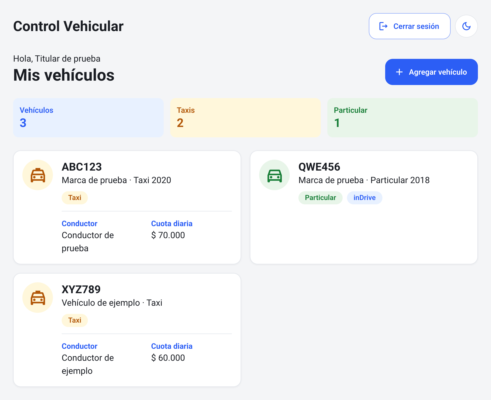

**Captura 02.** Mis vehículos en modo oscuro, a 1280 × 800.

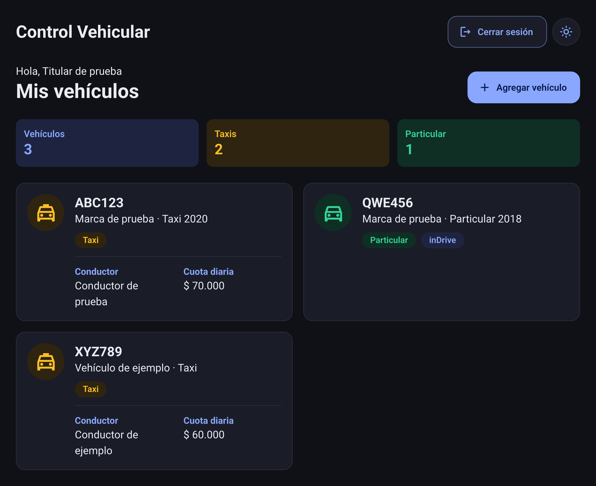

**Captura 03.** Mis vehículos en modo claro, a 360 × 800: los conteos en tres columnas y una tarjeta debajo de otra.

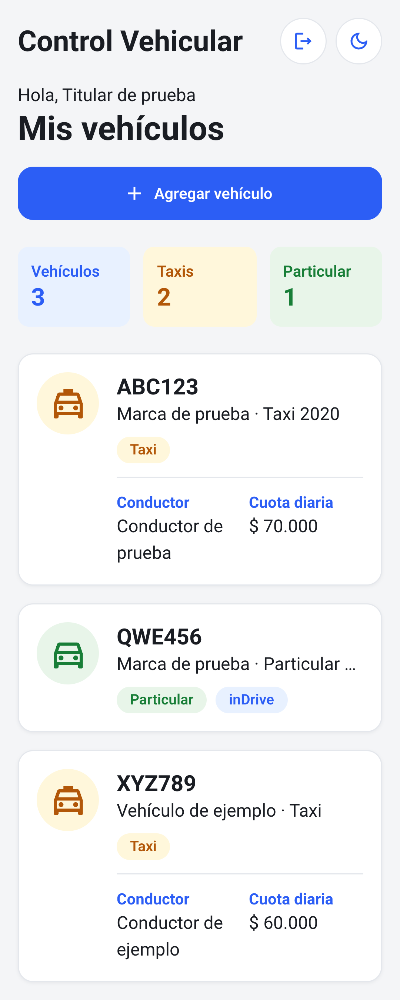

**Captura 04.** Mis vehículos en modo oscuro, a 360 × 800. La línea «Marca de prueba · Particular 2018» se corta con puntos suspensivos y ya no ensancha la página.

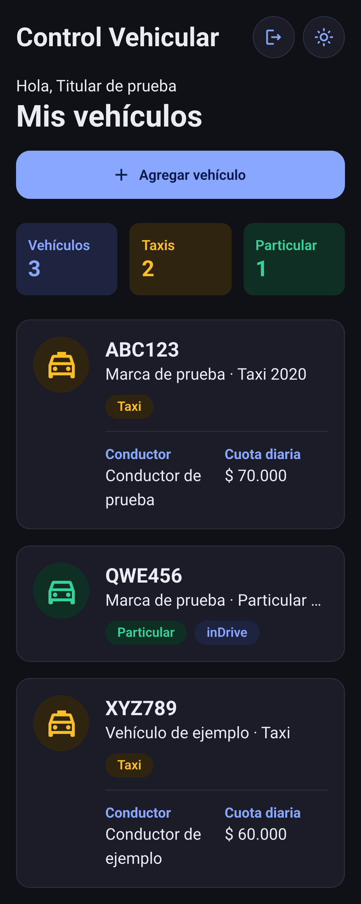

**Captura 05.** Detalle del taxi ABC123 en modo claro, a 1280 × 800: sin registros, ofrece «Eliminar».

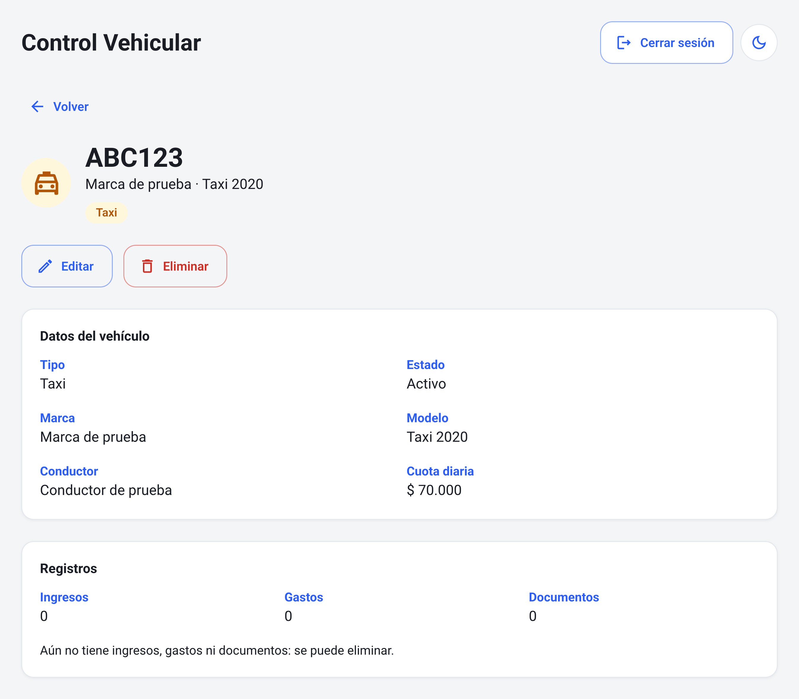

**Captura 06.** El mismo detalle en modo oscuro, a 360 × 800.

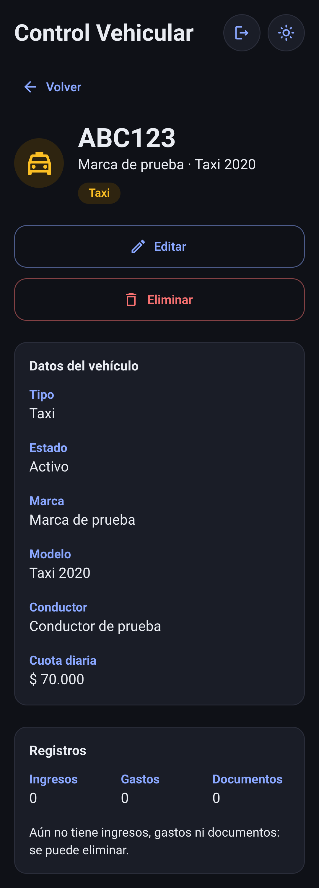

**Captura 07.** Edición de XYZ789 en modo oscuro, a 1280 × 800: tiene ingresos, así que el tipo está bloqueado y se explica por qué.

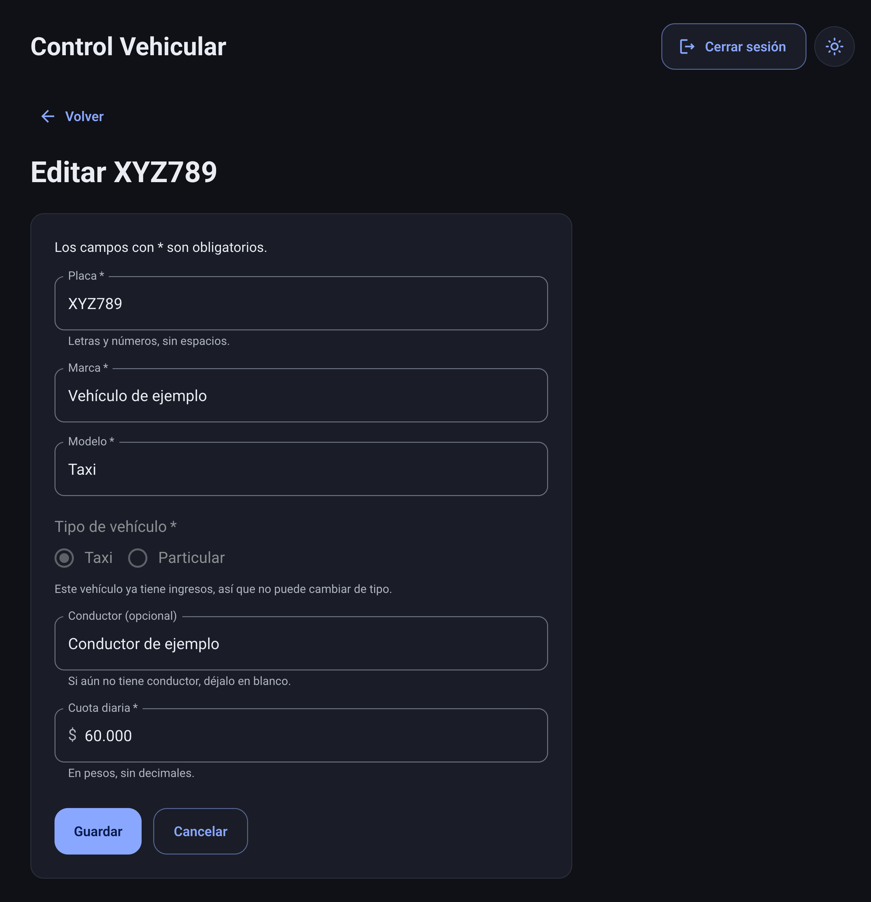

**Captura 08.** La misma edición en modo claro, a 360 × 800.

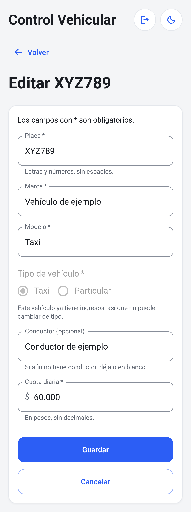

**Captura 09.** Confirmación para desactivar XYZ789 en modo claro, a 1280 × 800.

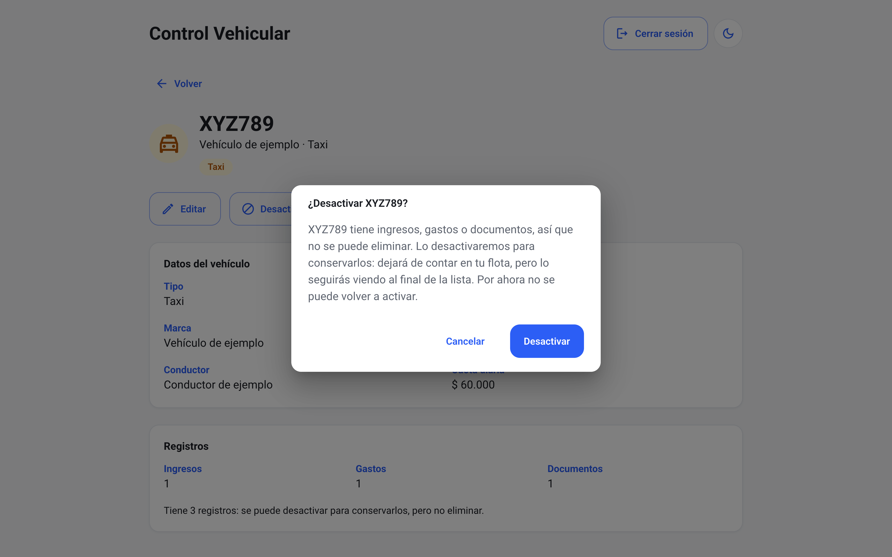

**Captura 10.** La misma confirmación en modo oscuro, a 360 × 800.

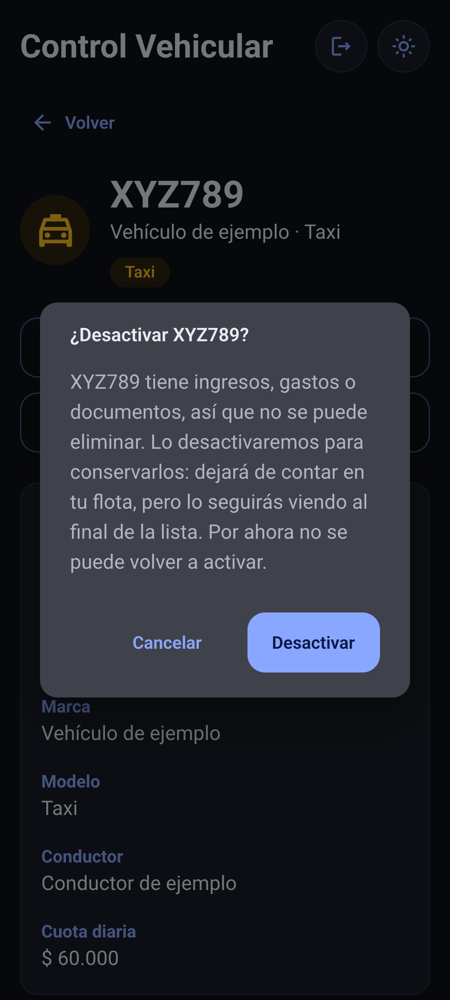

**Captura 11.** «Agregar vehículo» enviado vacío, a 360 × 800: cada campo obligatorio muestra su mensaje.

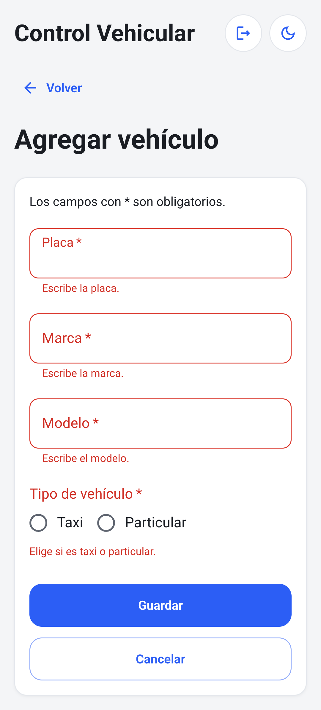

**Captura 12.** Placa repetida, a 360 × 800: el mensaje de core-service queda debajo de la placa.

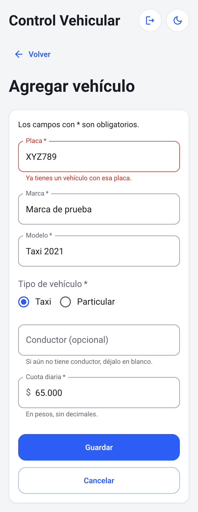

**Captura 13.** XYZ789 después de desactivarlo, a 360 × 800: el aviso de éxito, la etiqueta «Inactivo», la nota y solo el botón «Editar».

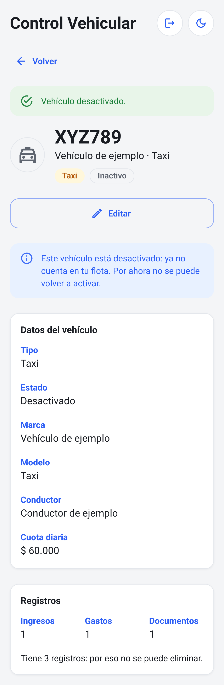

**Captura 14.** Confirmación para eliminar QWE456, que no tiene registros, a 360 × 800.

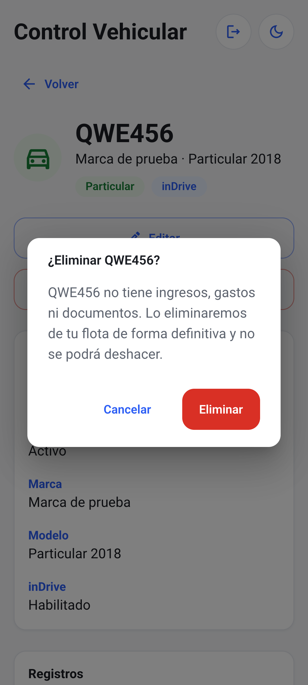

**Captura 15.** La flota después de eliminar QWE456, a 360 × 800: el aviso de éxito, la nota de los conteos y XYZ789 inactivo al final.

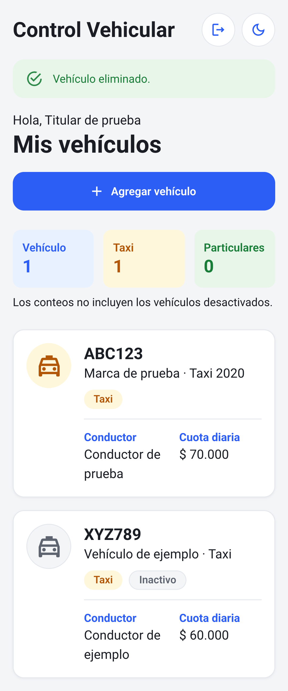

**Captura 16.** La flota sin core-service, a 360 × 800.

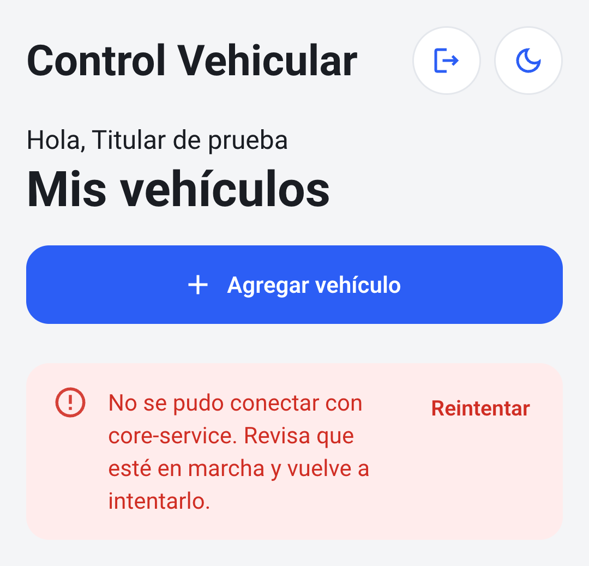

**Captura 17.** Una cuenta sin vehículos, a 360 × 800: la segunda cuenta después de eliminar KLM456 en el Hasura falso.

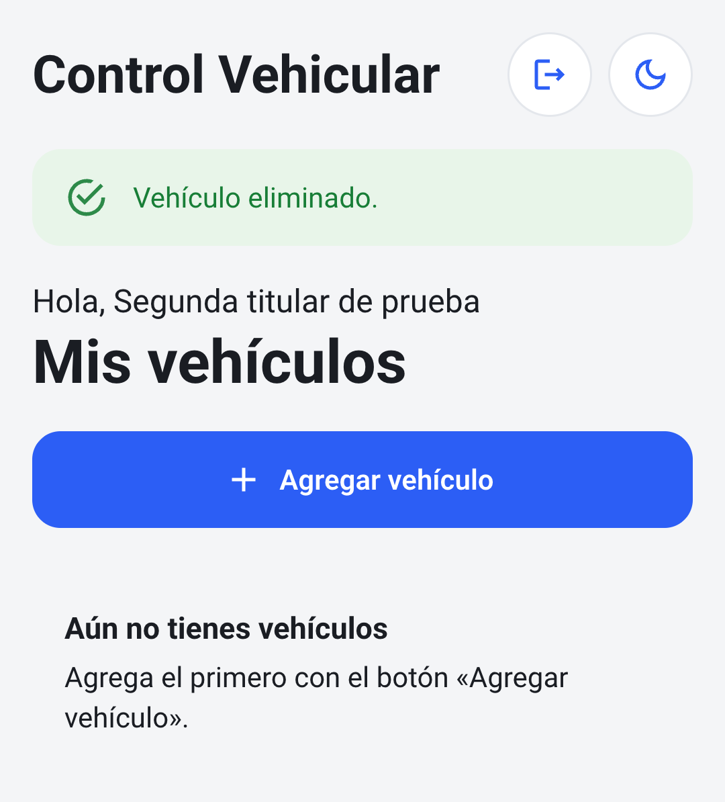

**Decisiones durante el prompt.** Claude Code me hizo dos preguntas, y respondí:
- **La flota a 360 px.** Las capturas mostraron que la flota medía 363 px y se desplazaba 3 px a lo ancho. Como pide AGENTS.md, Claude Code me lo reportó antes de tocar el código. Aprobé el arreglo de una línea, `minmax(0, 1fr)`, y repetir el recorrido y las capturas.
- **El aviso de Vite.** El código de la web-app pasó de 504,41 kB a 557,46 kB. Decidí dejar el aviso como está y revisarlo en la semana 11, al publicar, cuando el tiempo de carga en el celular importe más. No subí el límite del aviso ni dividí el código.

**Ajustes:** no hice ninguno en el texto del prompt.

**Observaciones:**
- **Datos remotos y formulario, por separado.** `useDatosRemotos` guarda lo que llega de core-service; el formulario guarda lo que la usuaria escribe. Después de guardar, la web-app pasa al detalle, que vuelve a pedir el vehículo. Mientras recarga, la página conserva los datos anteriores, para no desaparecer ni perder el foco.
- **Reglas repetidas a propósito.** El formulario revisa las mismas reglas de core-service, con los mismos mensajes, para avisar antes de enviar. core-service las vuelve a revisar. Si una regla cambia allá, hay que cambiarla en `vehiculo-formulario.ts` y en `types/vehiculo.ts`.
- **El tipo empieza sin elegir.** Al agregar, ni taxi ni particular vienen marcados: los campos de cada tipo aparecen al elegirlo. La cuota acepta «70000», «70.000» o «$ 70.000».
- **«Atrás» después de guardar o eliminar.** La web-app reemplaza la página del formulario o del vehículo eliminado en el historial, así que «Atrás» no vuelve a un formulario ya guardado ni a un vehículo que no existe.
- **El aviso de éxito no se repite al recargar.** Viaja con la navegación y se borra en cuanto se muestra.
- **El estado vacío.** `EmptyState` usa el mismo gris del fondo de la página, así que en la flota se ve como texto con margen y no como un recuadro (captura 17). Se lee bien; si quiero que resalte, se puede poner dentro de una tarjeta. No lo cambié.
- **Cerrar sesión sigue con su aviso flotante.** Es del prompt 1 y queda igual.

**Mi prueba en el navegador con Neon y Hasura Cloud (25 de noviembre).** Le pedí a Claude Code que me guiara paso a paso. Encendí core-service con mi `.env` y la web-app, cada una en su terminal, y seguí su guía:
1. Ingresar con la cuenta titular y ver la flota con XYZ789.
2. Abrir XYZ789 y ver sus registros; abrir el diálogo «Desactivar» y cancelarlo, sin desactivar.
3. Guardar el formulario vacío y ver los mensajes; escribir la placa `xyz789` y ver «Ya tienes un vehículo con esa placa.».
4. Crear el particular PRB001, habilitado para inDrive, y recargar.
5. Editarlo como taxi con cuota de 70.000, ver «$ 70.000» y recargar.
6. Volver a la flota y ver que los conteos suben en uno.
7. Eliminarlo y volver a la flota con «Vehículo eliminado.» y XYZ789 sin cambios.

La guía también tenía tres pasos opcionales: el modo oscuro, 360 px en las herramientas del navegador y la segunda cuenta, que solo debía ver KLM456. Le respondí a Claude Code: «Todo bien.». No anoté cuáles pasos opcionales hice ni en qué navegador.

**Commit y copia limpia (25 de noviembre).** Le dije a Claude Code «Sigamos». Hizo el commit `8298672`, «feat: agregar el CRUD de vehículos», con el código de los tres prompts: 64 archivos. El README y esta evidencia van en el commit `docs`. Después clonó ese commit en su carpeta temporal, sin ningún `.env`, y lo comprobó con Node 24.22.2 y npm 12.2.3:

| Comprobación | Comando | Resultado real |
|---|---|---|
| Instalación igual al lockfile | `npm ci` | Código de salida 0, `found 0 vulnerabilities` |
| Compilación | `npm run build` | Código de salida 0, con el aviso de Vite. Sin `.env`, el código de la web-app mide 556,52 kB; con el `.env.example` copiado como `.env`, 557,46 kB: el mismo archivo que en mi carpeta (ver «Problemas encontrados») |
| Pruebas unitarias | `npm test` | 140 pruebas en 13 archivos, sin errores |
| Pruebas e2e | `npm run test:e2e` | 32 pruebas en 3 archivos, sin errores |
| Lint | `npm run lint` | Código de salida 0 |
| Dependencias | `npm audit` | `found 0 vulnerabilities` |
| Código compilado de la web | Búsqueda de «hasura», «admin-secret» y «JWT_SECRET» en `apps/web-app/dist` | 0 archivos |

**Scripts de prueba (25 de noviembre, al cerrar).** Le pedí a Claude Code guardar los scripts de esta sesión en `Asesor_Técnico/Sesión_10/scripts-prueba-vehiculos/` y rehacer los dos que se perdieron. Recuperó `demo-vehiculos.mjs` y `paso0.mjs` del historial de la sesión, con el ajuste que le hizo a `paso0.mjs` en el prompt 1, y volvió a agregar a `servicios.mjs` la función que simula un core-service colgado. Guardó `paso0.mjs` dos veces: tal como se usó en el prompt 1 (`paso0-original.mjs`) y adaptado a la flota, porque con sesión la web ya no abre el inicio con la tarjeta «Tu cuenta», sino «Mis vehículos». La adaptación cambia solo cómo reconoce la página con sesión. Desde esa carpeta, con el Hasura falso y el código final:

| Script | Resultado real |
|---|---|
| `navegador/paso0.mjs` (A6, A2 y A7 en Chrome) | 11 de 11. El ingreso y la apertura de la página avisaron a los 15,0 y 15,1 segundos con core-service colgado |
| `navegador/recorrido-vehiculos.mjs` | 21 de 21: «Todas las comprobaciones salieron bien.» |
| `demo-vehiculos.mjs` | 32 de 32, con las contraseñas falsas del Hasura falso |

La carpeta tiene un `LEEME.md` que explica cada script y cómo usarlo.

## 6. Problemas encontrados

| Problema | Causa | Solución |
|---|---|---|
| Con la placa vacía, la validación mostraba «La placa tiene hasta 10 caracteres.» en lugar de «Escribe la placa.» (prueba unitaria del prompt 1) | class-validator revisa las reglas de abajo hacia arriba, y la función tomaba el primer mensaje | Tomar el mensaje de la regla escrita más arriba en el DTO, donde va la más básica |
| La e2e de rutas inexistentes falló con `/otra-ruta`: respondió 404 en HTML (prompt 1) | NestJS solo atiende las rutas inexistentes dentro de `/api`; fuera de ese prefijo responde Express | La prueba quedó dentro de `/api`, que es lo único que usa la web-app. El límite está en el README y en las observaciones del prompt 1 |
| La primera ejecución en Chrome dio 10 de 11 (prompt 1) | El script comparaba el texto del aviso de A6 incluyendo el del botón «Reintentar» | Claude Code corrigió el script, no la página, para leer solo el mensaje. Dio 11 de 11 |
| El PostgreSQL temporal no arrancaba (prompt 2) | La ruta de su carpeta temporal pasaba del largo máximo que acepta PostgreSQL para su conexión local (103 caracteres) | Lo arrancó solo con conexión por red, en `127.0.0.1` y el puerto 55432 |
| La primera ejecución de las pruebas unitarias del prompt 2 dio 10 fallas en `vehiculos.spec.ts` | La preparación de cada prueba, `beforeEach(() => request.mockReset())`, devolvía la función simulada de Hasura. Vitest toma una función devuelta como limpieza y la llamó al terminar cada prueba, sin datos | Claude Code lo encontró con una prueba mínima aparte y escribió la preparación entre llaves, sin devolver nada. Las 140 pruebas pasaron. El código de core-service no cambió |
| La carpeta temporal de Claude Code quedó vacía antes de las pruebas en Chrome del prompt 3 | Esa carpeta se puede vaciar sola, por ejemplo al reiniciar el equipo o en una limpieza de rutina; Claude Code no la borró. Se perdieron `demo-vehiculos.mjs`, `paso0.mjs` y el Hasura falso de esta sesión | Claude Code copió los scripts de la sesión 9, que estaban en `Asesor_Técnico/Sesión_9`, y rehízo el Hasura falso con las reglas de `test/hasura-simulado.ts`. Al cerrar la sesión recuperó `demo-vehiculos.mjs` y `paso0.mjs` del historial de la sesión y guardó todos los scripts en `Asesor_Técnico/Sesión_10`, donde no se borran solos |
| La primera compilación del prompt 3 falló con dos errores de tipos | En Material UI 9, `Radio` y `Checkbox` no aceptan `inputRef`. Además, la función de desactivar o eliminar devolvía a veces un vehículo y a veces nada | La referencia del campo pasó a `slotProps.input.ref`, y esa función quedó como `async`, sin devolver nada |
| Lint avisó «Calling setState synchronously within an effect» en `AvisoExito.tsx` | El aviso de éxito se copiaba al estado dentro del efecto | El aviso se muestra un momento después, con un temporizador. Así, además, el lector de pantalla encuentra la región ya en la página cuando llega el texto |
| El primer recorrido de vehículos en Chrome dio 20 de 21: al abrir el diálogo, el foco quedaba en el diálogo entero y no en «Cancelar» | Con el diálogo de Material UI, `autoFocus` en el botón no se sostuvo en la prueba | El foco pasa a «Cancelar» cuando termina la animación de apertura. Dio 21 de 21 |
| Las capturas mostraron que la flota medía 363 px a 360 px de ancho, pero la comprobación del script decía que estaba bien | La columna de tarjetas usaba `1fr`, que crece hasta el ancho de su contenido más largo, y «Marca de prueba · Particular 2018» no se parte. El script comparaba con el ancho de la ventana, y en la emulación móvil Chrome agranda la ventana cuando el contenido se pasa | Claude Code me lo reportó antes de tocar el código, y aprobé el arreglo: `minmax(0, 1fr)`. Los scripts comparan ahora con el ancho pedido, 360 px |
| En la copia limpia, la primera pasada de la compilación, las e2e y el lint terminó con `Unknown command: "run build"` | El script de Claude Code guardaba cada comando en una variable, y zsh se la pasó a npm como una sola palabra | Claude Code repitió los tres comandos bien escritos: sin errores. El proyecto no cambió |
| La compilación de la copia limpia midió 556,52 kB, y la de mi carpeta, 557,46 kB | La copia no tenía `apps/web-app/.env`. Sin `VITE_API_URL`, Vite compila la petición como si siempre fallara con «Falta configurar VITE_API_URL…» y deja fuera el resto: ese paquete no contiene «no respondió a tiempo» | Con el `.env.example` copiado como `.env`, la copia dio el mismo archivo que mi carpeta, `index-Tn6TeFu0.js`. No hay diferencia de código |
| En la edición de un vehículo con ingresos, la explicación del tipo bloqueado tenía un contraste de 2,68:1 en modo claro, por debajo del 4,5:1 que exige WCAG para el texto | Material UI pone en gris de «desactivado» todo el grupo de radios, también su texto de ayuda | La explicación lleva el gris de las demás ayudas: 5,86:1 en claro y 8,19:1 en oscuro. La leyenda del grupo sigue en gris, porque es parte del control desactivado |

## 7. Pendientes y próximo paso

| Pendiente | Responsable | Fecha |
|---|---|---|
| Revisar el tamaño del código de la web-app (557,46 kB; Vite avisa desde 500 kB) | Ivan, con Claude Code | Por definir: semana 11, al publicar |
| A1 y A5: renovar la sesión en un solo paso y probar dos renovaciones a la vez | Ivan, con Claude Code | Por definir: sesión 11, con la semana 8 de la cartilla |
| A9 y A10: pruebas de la web-app y scripts de la demostración | Ivan, con Claude Code | Por definir: semana 10 |
| A12 y A13: lo que hay que cambiar al publicar | Ivan, con Claude Code | Por definir: semana 11 |
| Evitar que una recarga doble cierre la sesión (A11) | Ivan, con Claude Code | Por definir: después de presentar el trabajo final en el SENA |
| Si se puede reactivar un vehículo | Ivan | Por definir |
| Desde cuándo aplica una cuota nueva del taxi | Ivan | Por definir |

## Fuentes

- «Cartilla de acompañamiento técnico» del instructor: semana 7, «CRUD completo a través del core service», páginas 18 y 19. También la página 4 (estructura del monorepo) y la semana 8, páginas 20 y 21, para decidir dónde van A1 y A5.
- Referencias de la semana 7 en la cartilla: R19, NestJS, «Validation» (docs.nestjs.com/techniques/validation), consultada el 23 de noviembre de 2026, y R21, NestJS, «OpenAPI», que no se usa por mi decisión.
- Documentación de Hasura sobre varias mutaciones en una petición y sobre las mutaciones de actualización, consultada el 23 de noviembre de 2026.
- Modern Web Guidance, del equipo de Google Chrome (github.com/GoogleChrome/modern-web-guidance y developer.chrome.com/docs/modern-web-guidance), revisada el 25 de noviembre de 2026. Su programa estaba en la versión 1.0.2. En el prompt 3 usé sus guías `forms`, `dialog`, `persistent-toast-notifications` y `css-layout`.
- class-validator 0.15.1, class-transformer 0.5.1 y @nestjs/mapped-types 12.0.1, las versiones `latest` de npm el 25 de noviembre de 2026.
- Migración inicial de la base (`infra/hasura/migrations/default/1794872424463_modelo_inicial/up.sql`) y datos de prueba (`infra/hasura/seeds/default/`), aplicados en un PostgreSQL 15.18 temporal el 25 de noviembre de 2026 para confirmar los nombres de las restricciones.
- NestJS 12.4: los mensajes de la protección contra CSRF (`@nestjs/core/security/cross-origin-protection.js`) y cómo el adaptador de Express convierte los errores del cuerpo (`mapException` en `@nestjs/platform-express`), leídos en el código instalado el 25 de noviembre de 2026.
- [Evidencia de sesiones 4 y 5](evidencia-sesion-4-modelo-datos-servicios.md): tabla `vehiculos`, S02, S06, S07 y S08, reglas comunes y códigos de respuesta.
- [Evidencia de sesión 3](evidencia-sesion-3-diseno-pantallas.md): pantallas 08 a 12, 27 y 28, y rutas propuestas.
- [Evidencia de sesión 9](evidencia-sesion-9-acceso.md): acceso, guard y consulta de un vehículo.
- Informe de la revisión del cierre de las sesiones 8 y 9, del 23 de noviembre de 2026, en `Asesor_Técnico/Sesión_9`.

## Historial de versiones

| Versión | Fecha | Cambios |
|---|---|---|
| Borrador | 25 de noviembre de 2026 | Plan aprobado, diseño del CRUD, paso 0 de la revisión del cierre y los tres prompts, que revisé. Skill Modern Web Guidance instalada para la parte visual y agregada al prompt 3. |
| Borrador | 25 de noviembre de 2026 | Resultado del prompt 1 (paso 0): archivos, comprobaciones en el repositorio y en Chrome, cada hallazgo, observaciones y problemas encontrados. |
| Borrador | 25 de noviembre de 2026 | Resultado del prompt 2 (CRUD en core-service): archivos, contrato con ejemplos, comprobaciones, nombres de las restricciones, demostración con un Hasura falso, regresión en Chrome, observaciones y pasos para mi prueba con Neon. |
| Borrador | 25 de noviembre de 2026 | Mi prueba real con Neon y Hasura Cloud, 32 de 32, y mi decisión de hacer un solo commit con el código de los tres prompts. |
| Borrador | 25 de noviembre de 2026 | Resultado del prompt 3 (pantallas de vehículos): archivos, guías de Modern Web Guidance y sus choques con Material UI, comprobaciones en el repositorio y en Chrome, 17 capturas, mis dos decisiones durante el prompt, observaciones y problemas encontrados. Cumplimiento de la cartilla, pruebas y pendientes actualizados. |
| 0.1 | 25 de noviembre de 2026 | Mi prueba en el navegador con Neon y Hasura Cloud. Commit del código y copia limpia sin `.env`. Notas en las evidencias 4 y 9, y README, contexto y `AGENTS.md` actualizados. |
| 1.0 | 25 de noviembre de 2026 | Versión de cierre. Mi revisión del teclado y el foco. Scripts de prueba recuperados y guardados en `Asesor_Técnico/Sesión_10`, con el paso 0 repetido con el código final, 11 de 11. Push de los commits y PDF. |
