# Evidencia de sesión 11: identidad visual y pantalla de ingreso

| Proyecto | Integrantes y versión |
|---|---|
| VehicleControlApp Web · DazaDev | Ivan Dario Madrid Daza, trabajo individual. Versión 1.0 del 27 de noviembre de 2026. Cerrada el 27 de noviembre de 2026. |

**Por qué hago este trabajo.** Antes de seguir con la semana 8 de la cartilla, quise dedicarle un tiempo a la parte visual, empezando por la página de ingreso: es lo primero que ve la usuaria y todavía tenía el aspecto básico de la sesión 9. El mismo 25 de noviembre de 2026 también reorganicé el README, como registré en el [contexto del proyecto](contexto-proyecto.md).

**Numeración.** Este trabajo es la sesión 11, en el orden en que vengo trabajando. La semana 8 de la cartilla será la sesión 12. Por eso A1 y A5 (renovar la sesión en un solo paso y probar dos renovaciones a la vez), que la [evidencia de sesión 10](evidencia-sesion-10-crud-vehiculos.md) dejó para la «sesión 11», pasan a la sesión 12.

**Mis decisiones del 25 de noviembre de 2026:**
- Ver maquetas antes de tocar el código y seguir la forma de trabajo de la sesión 8: plan, prompts que reviso antes de enviarlos y esta evidencia. Una maqueta es un dibujo de la pantalla que se puede probar, pero que no cambia el código de la web.
- Numerar este trabajo como sesión 11, y la semana 8 como sesión 12.
- De las tres propuestas de la maqueta (A, B y C), elegí la C, «Franja de bienvenida».
- Pedí además un ícono más moderno, en el que se aprecie mejor el vehículo, y una letra moderna, con un toque personal, que no se note hecha con IA.

**Mis decisiones del 26 de noviembre de 2026:**
- Elegí la letra **Barlow**. Reemplaza a Roboto, que había elegido el 20 de noviembre al basar la identidad en la app Android ([evidencia de sesión 8](evidencia-sesion-8-base-visual.md)). Los colores, las tarjetas, las etiquetas y el modo claro u oscuro no cambian.
- Pedí que el ícono fuera más realista, como las imágenes de taxi y de vehículo particular de la app Android.
  - Claude Code no usó las fotos de esa app, porque muestran modelos reales con el logo de la marca y su origen no está documentado.
  - En su lugar, dibujó un carro original en vista de tres cuartos.
- Pedí que el carro se pareciera a un **Hyundai i25**. El dibujo no lleva el logo ni el nombre de la marca, para que la marca de la app no dependa de un fabricante.
- Elegí la opción **«Taxi y sedán»**: el sedán plateado adelante y un taxi amarillo compacto detrás, para mostrar los dos tipos de vehículo de la app. También elegí la **línea de vía** en la franja. Con eso quedó definido el diseño.
- Aprobé el plan de esta sesión.
- Decidí que los carros **reemplacen los íconos de taxi y particular** de las tarjetas de vehículos: el taxi amarillo para los taxis y el sedán plateado para los particulares.

**Mi decisión del 27 de noviembre de 2026:**
- Las etiquetas «Correo» y «Contraseña» no se veían bien: parecían interferir con la casilla donde se escriben los datos. Claude Code me recomendó dejar la etiqueta fija encima de la casilla, por fuera del borde, y acepté. Pedí aplicarlo a todos los formularios de la app, también a los que vienen con ingresos, gastos y documentos.
- Decidí cambiar los dibujos de los vehículos por imágenes generadas con IA, con un estilo de ilustración más realista. Generé el sedán blanco con ChatGPT y, cuando ChatGPT llegó a su límite, el taxi con Gemini, a partir del mismo sedán. Las dos imágenes no tienen logos, nombres de fabricantes ni placas con letras o números. Aprobé la propuesta de Claude Code: las imágenes reemplazan los dibujos en el ingreso y en las tarjetas de vehículos, y el ícono de la pestaña y del encabezado se queda como estaba, porque una imagen detallada no se distingue a 16 o 32 px.
- Katerin vio las imágenes nuevas y las aprobó (según le conté a Claude Code el mismo día). Vio las imágenes, no las pantallas de la app con ellas.
- Numeración, como nota posterior: la sesión 12 terminó siendo el registro de ingresos, y la semana 8 de la cartilla queda para después de completar la primera versión (sesiones 13 a 15).

**Alcance.**
- **Se hace:**
  - la letra Barlow en todas las páginas;
  - el ícono en la pestaña del navegador y en el encabezado;
  - los carros en lugar de los íconos de taxi y particular, en la flota y en el detalle de cada vehículo;
  - la página de ingreso y la de comprobación de sesión con la franja de bienvenida;
  - los errores debajo de cada campo del ingreso;
  - desde el 27 de noviembre, las etiquetas fijas encima de las casillas en todos los formularios;
  - desde el 27 de noviembre, las imágenes del sedán y el taxi generadas con IA en lugar de los dibujos, salvo en el ícono.
- **No cambia:** los colores, las demás pantallas (salvo la letra, el ícono del encabezado y los íconos de los vehículos), el flujo de acceso, core-service, Hasura y la base de datos.
- **No se publica en internet:** todo funciona en mi equipo.

**Revisión de Katerin.** El 26 de noviembre de 2026, Katerin vio la maqueta de esta sesión: la franja de bienvenida, la letra Barlow y los carros. Le pareció bien y no pidió cambios. Los carros en las tarjetas de vehículos no estaban en la maqueta. Su revisión no es una aprobación de pantallas, reglas, ingreso ni arquitectura. Las etiquetas encima de las casillas (prompt 3) tampoco estaban en la maqueta. El 27 de noviembre aprobó las imágenes nuevas del prompt 4.

**Autoría.** Escribo en primera persona lo que decidí, aprobé o pedí hacer. Claude Code hizo las maquetas y dibujó los carros con un script de Python según lo que le pedí. Las imágenes del prompt 4 las generé yo con ChatGPT y Gemini, y Claude Code las preparó para la app. También redactó los prompts y esta evidencia, y ejecuta los prompts y las comprobaciones a medida que se los envío.

## 1. Relación con la cartilla

Este trabajo no es una semana de la cartilla: es una decisión mía, como la base visual de la sesión 8. Mejora lo que pide la semana 3 sobre la interfaz.

| Lo que pide la cartilla | Dónde se ve | Resultado comprobado |
|---|---|---|
| Semana 3, paso 3: tipografía, componentes comunes y comportamiento en el celular | Barlow en el tema, el ícono en el encabezado y la franja de bienvenida (prompts 1 y 2) | 118 de 118 y 39 de 39 en Chrome, a 1280 y 360 px, en claro y oscuro, sin desplazamiento a lo ancho |
| Semana 3, paso 4: etiquetas, mensajes, foco de teclado y estados de carga y error | Errores por campo, «Comprobando tu sesión…» y «No pudimos comprobar tu sesión» con «Reintentar» (prompt 2) | Los estados, el orden con Tab, el foco visible y el árbol de accesibilidad, comprobados en Chrome (prompt 2) |

## 2. Registro de trabajo real

| Fecha real | Trabajo realizado | Comprobación o resultado | Archivos |
|---|---|---|---|
| 25 nov 2026 | Le pedí a Claude Code mejorar la parte visual, empezando por la página de ingreso. Acordamos ver maquetas antes de tocar el código y numerar este trabajo como sesión 11. Revisé tres propuestas y elegí la C | Maquetas en una página privada, con la vista de escritorio y la de celular, en claro y oscuro, y los estados del formulario | Copia de la maqueta en `Asesor_Técnico/Sesión_11/maquetas-ingreso/` |
| 26 nov 2026 | Elegí Barlow. Pedí un carro más realista y después que se pareciera a un i25. Elegí «Taxi y sedán» con la línea de vía | Claude Code dibujó los carros y revisó la maqueta con capturas en Chrome, en claro y oscuro | Script y dibujos en `Asesor_Técnico/Sesión_11/maquetas-ingreso/carros/` |
| 26 nov 2026 | Aprobé el plan. Claude Code redactó este borrador con los dos prompts | Plan copiado en `Asesor_Técnico/Sesión_11/plan-identidad-visual.md` | Esta evidencia |
| 26 nov 2026 | Katerin vio la maqueta de esta sesión: la franja de bienvenida, la letra Barlow y los carros | Le pareció bien y no pidió cambios | — |
| 26 nov 2026 | Al revisar el borrador, decidí que los carros reemplacen los íconos de taxi y particular. Claude Code lo agregó al prompt 1 | En una vista previa, los dos carros se distinguen dentro del círculo de 56 px de las tarjetas, en claro y oscuro, y en gris cuando el vehículo está desactivado | Esta evidencia |
| 26 nov 2026 | Le pedí a Claude Code subir el commit del README a GitHub | `git push`: `main` pasó de `ded2b64` a `99aa38f` | — |
| 26 nov 2026 | Le pedí seguir con los prompts, y Claude Code ejecutó el prompt 1. Detuve mis servidores para su prueba y elegí cómo resolver el encabezado a 360 px | Compilación, pruebas, lint y dependencias sin errores; 118 de 118 en Chrome | Ver el prompt 1 |
| 26 nov 2026 | Le pedí seguir con el prompt 2, y Claude Code lo ejecutó. Detuve otra vez mis servidores para su prueba | Compilación, pruebas, lint y dependencias sin errores; 39 de 39 en Chrome | Ver el prompt 2 |
| 27 nov 2026 | Le conté a Claude Code que las etiquetas del ingreso parecían interferir con la casilla. Acepté su recomendación de dejarlas fijas encima y pedí aplicarlo a todos los formularios (prompt 3) | Compilación, pruebas y lint sin errores; 149 de 149 en Chrome | Ver el prompt 3 |
| 27 nov 2026 | Le pedí a Claude Code cambiar los dibujos por una imagen que generé con ChatGPT. Me explicó que la escena completa solo servía para el ingreso y me dio los prompts para generar cada carro por separado. Generé el sedán con ChatGPT y el taxi con Gemini, y Katerin aprobó las imágenes. Aprobé usarlas en el ingreso y las tarjetas, y dejar el ícono (prompt 4) | Compilación, pruebas y lint sin errores; 120 de 120 y 39 de 39 en Chrome | Ver el prompt 4 |
| 27 nov 2026 | Probé en Edge, con Neon y Hasura Cloud, el ingreso, la flota con las imágenes nuevas y los formularios con las etiquetas encima, en claro y oscuro. Decidí cerrar la sesión | Todo salió bien. Commit `feat` del código de los prompts 3 y 4, documentación de cierre y PDF | Ver «Mi prueba en el navegador» |

## 3. El diseño que se implementa

### Cómo llegué al diseño

Revisé cuatro versiones de la maqueta, cada una a partir de lo que pedí en la anterior:

1. **Tres propuestas para el ingreso (A, B y C).** Elegí la C: una franja azul suave con el nombre de la app, sobre la que se monta la tarjeta de ingreso.
2. **La C con opciones de ícono, letra y detalle.** Probé cuatro letras (Roboto, Barlow, Figtree y Bricolage Grotesque) y elegí Barlow, que se inspira en las placas de los carros y las señales de las carreteras de California.
3. **Un carro realista** en vista de tres cuartos, en plateado, en azul, y con un taxi.
4. **El carro con la forma de un i25:**
   - sedán de cuatro puertas, con techo curvo que baja a una cajuela corta;
   - una ventanita detrás de la puerta trasera;
   - faros alargados hacia atrás y parrilla hexagonal con barras;
   - una línea en el costado que sube hacia los stops.

Las maquetas son una página privada. Su copia, con el script que dibuja los carros, está en mi carpeta `Asesor_Técnico/Sesión_11/maquetas-ingreso/`.

### Valores que aprobé el 26 de noviembre de 2026

| Tema | Valor |
|---|---|
| Letra | Barlow, en pesos 400, 500, 600 y 700, con el paquete `@fontsource/barlow` 5.3.0, la versión `latest`. La letra queda dentro de la web, como Roboto hoy: no depende de internet al abrir la app. La escala de tamaños de la sesión 8 no cambia |
| Letra de respaldo | Mientras carga Barlow, la letra del sistema se ajusta para ocupar el mismo espacio y que el texto no salte (`font-size-adjust: from-font`). Donde el navegador no lo soporte, no cambia nada |
| Franja | Fondo azul suave del tema (#E8F1FF en claro y #1E2440 en oscuro). Muestra los dos carros, «Control Vehicular» y la frase «Organiza la información de tus vehículos en un solo lugar.». La línea de vía es punteada, con el azul principal al 30 %. El botón del sol o la luna va arriba a la derecha |
| Dónde va la franja | En el ingreso y en la página que comprueba la sesión, que se ve un instante al abrir cualquier página de la app |
| Contraste en la franja | La frase da 5,15:1 en claro y 7,41:1 en oscuro; el nombre, 14,84:1 y 12,84:1. El mínimo de WCAG para texto normal es 4,5:1 |
| Tarjeta de ingreso | Título «Ingresa a tu cuenta». Sale el subtítulo «Escribe el correo y la contraseña de tu cuenta.», porque la frase de la franja lo reemplaza |
| Errores del ingreso | Debajo de cada campo: «Escribe tu correo.» y «Escribe tu contraseña.». Reemplazan el aviso «Escribe tu correo y tu contraseña.». Aparecen al pulsar «Ingresar» y se quitan al escribir. Los rechazos de core-service y «Cerraste tu sesión.» siguen arriba de la tarjeta |
| Teclado del celular | El correo no se corrige ni empieza con mayúscula, y su tecla Enter dice «Siguiente». En la contraseña, la tecla Enter dice «Ir» |
| Botón del ojo | Se llama siempre «Mostrar contraseña» y avisa al lector de pantalla si está activado |
| Ícono | El sedán plateado sobre un cuadro azul. Va en la pestaña del navegador y a la izquierda de «Control Vehicular» en el encabezado: 32 px, y 28 px en pantallas angostas |
| Íconos de los vehículos | El taxi amarillo para los taxis y el sedán plateado para los particulares, en la flota y en el detalle. Van dentro del mismo círculo de color de 56 px, con el dibujo de 46 px de ancho. Si el vehículo está desactivado, el carro se ve en gris |
| Dibujos | Son decorativos: el lector de pantalla no los anuncia, porque el nombre ya está escrito. No llevan el logo ni el nombre de ningún fabricante |

### Dónde quedan los dibujos

Los dibujos son archivos SVG, un formato de dibujo que se ve nítido en cualquier tamaño:
- `apps/web-app/src/assets/marca/bienvenida.svg`: el taxi y el sedán juntos, para la franja;
- `apps/web-app/src/assets/marca/icono.svg`: el cuadro azul con el sedán, para la pestaña y el encabezado;
- `apps/web-app/src/assets/marca/taxi.svg` y `particular.svg`: cada carro por separado, para las tarjetas de vehículos.

Los genera un script de Python que no entra en la app ni le agrega dependencias. El script queda en mi carpeta `Asesor_Técnico/Sesión_11/maquetas-ingreso/carros/`, como los scripts de prueba de la sesión 10.

**Nota posterior (27 de noviembre de 2026, prompt 4).** `bienvenida.svg`, `taxi.svg` y `particular.svg` se reemplazaron por imágenes WebP generadas con IA: `bienvenida-600.webp` y `bienvenida-900.webp`, `taxi-138.webp` y `particular-138.webp`, todas en `apps/web-app/src/assets/marca/` y reunidas en `imagenes.ts`. `icono.svg` sigue igual. Los SVG anteriores quedan en el historial de git y en la carpeta de las maquetas.

### Qué tomo de la app Android

- **Lo que tomo:**
  - la idea de mostrar el taxi en amarillo y el particular en plateado;
  - del taxi, el letrero en el techo y la franja de cuadros, como en su ilustración.
- **Lo que no uso:** las fotos de los vehículos. Las pantallas y funciones de Android siguen fuera del diseño web.

## 4. Pruebas previstas

| Qué se prueba | Cómo |
|---|---|
| Compilación, lint, pruebas y dependencias | `npm run build`, `npm run lint`, `npm test`, `npm audit` y `npm install-scripts ls` desde la raíz, con Node 24 y npm 12 |
| Código compilado | `apps/web-app/dist` contiene Barlow y el ícono, ya no contiene Roboto, y sigue sin «hasura» ni la guía visual |
| Ingreso a 1280 × 800 y 360 × 800, en claro y oscuro | En Chrome, con el Hasura falso de la sesión 10: formulario, campos vacíos con su error y el foco, «no coinciden», «Comprobando tu sesión…», «No pudimos comprobar tu sesión» con «Reintentar», y «Cerraste tu sesión.» |
| Teclado | El orden del foco con Tab y el foco visible |
| Ancho del celular | Sin desplazamiento horizontal a 360 px en el ingreso, la flota, el detalle y el formulario |
| Íconos de los vehículos | En la flota y en el detalle, cada taxi muestra el taxi y cada particular, el sedán; un vehículo desactivado, el carro en gris |
| Ícono | La petición del ícono de la pestaña responde 200, y el ícono se ve en el encabezado. Lo compruebo en Chrome; en otros navegadores no lo pruebo |
| Prueba en mi navegador | Abro la web, ingreso con mi cuenta de prueba y reviso las páginas en claro y oscuro |

La vista de celular se comprueba en emulación del navegador, no en un dispositivo real.

## 5. Registro de prompts

| Rol | Quién o qué herramienta |
|---|---|
| Redacción y ejecución | Claude Code (Claude Opus 5.5) |
| Revisión y envío | Ivan Dario Madrid Daza revisa cada texto del documento y pide ejecutarlo |

### Prompt 1 · Letra, marca e íconos de los vehículos (26 de noviembre de 2026)

**Antes de enviarlo:** el 26 de noviembre, al revisar el borrador, decidí que los carros reemplacen los íconos de taxi y particular, y Claude Code lo agregó a este prompt. Después le pedí seguir con los prompts, sin pegarlo.

Texto exacto enviado:

```text
[Rol] Actúa como desarrollador frontend con experiencia en React, TypeScript, Material UI, SVG y accesibilidad. Explícame las decisiones en lenguaje sencillo.

[Objetivo] Cambia la letra de la web-app a Barlow y agrega la marca con los dibujos que elegí en la maqueta: el ícono del sedán en la pestaña del navegador y en el encabezado de todas las páginas, y los carros en lugar de los íconos de taxi y particular de los vehículos.

[Contexto]
- El 20 de noviembre de 2026 basé la identidad de la web-app en la de Android, con la letra Roboto (sesión 8).
- El 26 de noviembre de 2026, después de revisar las maquetas, elegí la letra Barlow y, como marca, un sedán con la forma de un Hyundai i25 junto a un taxi amarillo compacto. Los dibujos son originales y no llevan el logo ni el nombre de ningún fabricante.
- Los dibujos salen del script de Python de las maquetas, guardado fuera del repositorio. El ícono es el sedán plateado sobre un cuadro azul con degradado; el dibujo de bienvenida pone el sedán adelante y el taxi detrás.
- El mismo día decidí que los carros reemplacen los íconos de Material UI de taxi y particular: el taxi amarillo para los taxis y el sedán plateado para los particulares.
- @fontsource/barlow 5.3.0 es la versión latest. Barlow no tiene versión variable.
- La guía visually-stable-font-fallbacks de Modern Web Guidance recomienda font-size-adjust: from-font para que la letra de respaldo ocupe lo mismo mientras carga la principal.
- Material UI y la identidad de la sesión 8 mandan sobre cualquier guía.

[Datos o archivos]
- Asesor_Técnico/Sesión_11/maquetas-ingreso/ (la maqueta y el script de los carros, fuera del repositorio)
- apps/web-app: package.json, index.html y guia-visual.html
- apps/web-app/src: theme/AppTheme.tsx, theme/theme.ts, components/layout/AppShell.tsx, features/vehiculos/IconoVehiculo.tsx y guia/GuiaVisual.tsx

[Restricciones]
- Agrega @fontsource/barlow en su versión latest, con los pesos 400, 500, 600 y 700, y quita @fontsource-variable/roboto. Si trae scripts de instalación, detente y avísame.
- En el tema, la letra es "Barlow", con system-ui, -apple-system, "Segoe UI", Arial y sans-serif de respaldo, y body lleva font-size-adjust: from-font. La escala de tamaños no cambia.
- Genera con el script bienvenida.svg, icono.svg, taxi.svg y particular.svg en src/assets/marca/. Cada archivo se sostiene solo, sin letras ni imágenes externas.
- index.html y guia-visual.html usan icono.svg como ícono de la pestaña.
- En AppShell, el ícono va a la izquierda de «Control Vehicular», de 32 px, y de 28 px en pantallas angostas. Es decorativo: alt="".
- En IconoVehiculo, el círculo de 56 px y sus colores no cambian: el carro, de 46 px de ancho, reemplaza el ícono de Material UI. Si el vehículo está desactivado, el carro se ve en gris. Sigue siendo decorativo.
- En la guía visual, agrega una sección «Marca» con el dibujo de bienvenida y el ícono en 16, 32 y 48 px, y la tarjeta de ejemplo usa el taxi. La guía sigue fuera de la compilación.
- Si a 360 px el encabezado de la flota se desborda con «Cerrar sesión» y el botón de modo, detente y muéstrame la captura con opciones antes de cambiar el CSS.
- No cambies los colores, core-service, Neon, Hasura Cloud ni los .env. No hagas commits ni push.

[Formato de salida] Archivos creados o cambiados, con una frase cada uno; los comandos ejecutados, y una tabla con cada comprobación y su resultado real.

[Criterios de aceptación]
- npm run build, npm test, npm run lint y npm audit terminan bien desde la raíz, y npm install-scripts ls no muestra paquetes bloqueados nuevos.
- apps/web-app/dist contiene Barlow y el ícono, ya no contiene Roboto y sigue sin «hasura» ni la guía visual.
- En Chrome, las páginas de vehículos y la guía visual se ven con Barlow, en claro y oscuro; el ícono se ve en el encabezado; cada vehículo muestra su carro, en gris si está desactivado, y la petición del ícono de la pestaña responde 200.
- A 360 × 800 no hay desplazamiento horizontal en la flota, el detalle ni el formulario.
```

**Archivos creados o cambiados** (todos en `apps/web-app/`, salvo el `package-lock.json` de la raíz y las capturas)

| Archivo | Qué cambió |
|---|---|
| `package.json` y `package-lock.json` | Entra `@fontsource/barlow` 5.3.0 y sale `@fontsource-variable/roboto` |
| `src/assets/marca/` | Nuevos: `bienvenida.svg` (25 KB), `icono.svg` (13 KB), `taxi.svg` (13 KB) y `particular.svg` (12 KB). Cada uno empieza con una nota: dibujo original, sin logo ni nombre de fabricante, hecho con un script que está fuera del repositorio |
| `src/theme/AppTheme.tsx` | Carga Barlow en los pesos 400, 500, 600 y 700, en lugar de Roboto |
| `src/theme/theme.ts` | La letra es Barlow, con las letras del sistema de respaldo, y `body` lleva `font-size-adjust: from-font`. La escala de tamaños no cambia |
| `index.html` y `guia-visual.html` | El ícono de la pestaña, `icono.svg` |
| `src/components/layout/AppShell.tsx` | El ícono a la izquierda de «Control Vehicular», de 32 px, y de 28 px en pantallas de menos de 600 px. En esas pantallas, el nombre usa el tamaño de h3 (ver «Decisiones durante el prompt») |
| `src/features/vehiculos/IconoVehiculo.tsx` | El taxi o el sedán, de 46 px, en lugar de los íconos de Material UI, dentro del mismo círculo de 56 px. Si el vehículo está desactivado, el carro se ve en gris |
| `src/guia/GuiaVisual.tsx` | La sección «Marca», con el dibujo de bienvenida sobre el azul de la franja y el ícono en 16, 32 y 48 px. La tarjeta de ejemplo usa `IconoVehiculo`, con el taxi |
| `docs/evidencia-sesion-11/capturas/` | Las capturas 1 a 5 de esta evidencia |

Fuera del repositorio, en `Asesor_Técnico/Sesión_11/`:
- `maquetas-ingreso/carros/marca.py`: genera los cuatro SVG con el script de las maquetas.
- `scripts-prueba-marca/prueba-marca.mjs`: la prueba en Chrome, con su resultado (`resultado.txt`) y sus 28 capturas. Usa el Hasura falso y las herramientas de Chrome de la sesión 10, sin copiarlas.

**Comandos ejecutados**, desde la raíz, con Node 24.22.2 y npm 12.2.3:
- `npm view @fontsource/barlow`, `npm install @fontsource/barlow@latest -w apps/web-app` y `npm uninstall @fontsource-variable/roboto -w apps/web-app`.
- `npm install-scripts ls`, antes y después de cambiar las dependencias.
- `python3 -I marca.py apps/web-app/src/assets/marca`.
- `npm run build`, `npm test`, `npm run test:e2e`, `npm run lint` y `npm audit`.
- Búsquedas en `apps/web-app/dist`: Barlow, Roboto, «hasura», «admin-secret», «JWT_SECRET» y la guía visual.
- `node prueba-marca.mjs`: enciende el Hasura falso, core-service compilado desde una carpeta sin `.env` y Vite, y los apaga al terminar.

**Guías de Modern Web Guidance** (consultadas el 26 de noviembre de 2026, con la telemetría apagada y búsquedas sin nombres del proyecto):

| Guía | Para qué la usé | Regla que se aplicó |
|---|---|---|
| `visually-stable-font-fallbacks` | La letra de respaldo mientras carga Barlow | «Use the `from-font` keyword to let the browser extract the ratio from your primary web font.» Está disponible en los navegadores principales desde julio de 2024; donde no lo esté, la letra se ve en su tamaño normal |
| `icons` | El ícono del encabezado, los carros y los dibujos de la guía | «Mark decorative SVGs with `aria-hidden="true"`». Aquí son imágenes con `alt=""`, que el lector de pantalla tampoco anuncia: el nombre de la app y el tipo de vehículo ya están escritos |

La guía `icons` desaconseja usar `` con filtros para darle a un ícono un color del tema. Aquí el filtro solo pasa el carro a gris cuando el vehículo está desactivado; no busca un color del tema.

**Comprobaciones en el repositorio**, desde la raíz:

| Comprobación | Comando | Resultado real |
|---|---|---|
| Scripts de instalación | `npm install-scripts ls` | «No packages with unreviewed install scripts.», antes y después de cambiar las dependencias |
| Compilación | `npm run build` | Código de salida 0. Vite repite el aviso de los 500 kB: 557,13 kB (173,53 kB comprimido). Antes eran 557,46 kB; bajó un poco porque la web ya no usa los íconos de taxi y carro de Material UI |
| Pruebas unitarias | `npm test` | 140 pruebas en 13 archivos, sin errores |
| Pruebas e2e | `npm run test:e2e` | 32 pruebas en 3 archivos, sin errores |
| Lint | `npm run lint` | Código de salida 0. En la web-app: «Found 0 warnings and 0 errors.» |
| Dependencias | `npm audit` | `found 0 vulnerabilities` |
| Letra en el código compilado | Archivos de `apps/web-app/dist/assets` | 24 archivos de Barlow: los pesos 400, 500, 600 y 700 en latín, latín extendido y vietnamita, cada uno en `woff2` y `woff`. El navegador solo descarga los que necesita el texto |
| Roboto | Búsqueda en `apps/web-app/dist` | Ningún archivo de la letra Roboto. Queda una mención en el código de Material UI: el nombre de su letra por defecto, que el tema reemplaza |
| Ícono y carros | `apps/web-app/dist` | `index.html` enlaza `/assets/icono-CkCRffiN.svg`. También están `taxi.svg` y `particular.svg`, con nombre único. `bienvenida.svg` no está, porque hasta el prompt 2 solo lo usa la guía visual |
| Secretos y guía visual | Búsqueda de «hasura», «admin-secret» y «JWT_SECRET» en `apps/web-app/dist` | 0 archivos. La guía visual tampoco está |
| Archivos que no debían cambiar | `git status` y fechas de los `.env` | Solo cambiaron archivos de la web-app y el `package-lock.json`. Los `.env` conservan sus fechas del 7 y del 23 de noviembre. No se tocaron core-service, Neon ni Hasura Cloud |

**Comprobaciones en Chrome**, sin pantalla, con el Hasura falso, core-service compilado desde una carpeta sin `.env` y las claves de prueba falsas. La prueba crea un taxi (ABC123) y un particular (QWE456), y desactiva XYZ789, que tiene registros. Después revisa la flota, el detalle de los tres vehículos, el formulario de edición y la guía visual, a 1280 × 800 y 360 × 800, en claro y oscuro: 24 páginas. Resultado: 118 de 118.

| Comprobación | Resultado real |
|---|---|
| Ícono de la pestaña | La página enlaza `/src/assets/marca/icono.svg`, de tipo `image/svg+xml`, y la petición responde 200 |
| Letra | En las 24 páginas, la letra del texto es Barlow y está cargada. El ajuste de la letra de respaldo vale 0,506: la proporción de las minúsculas de Barlow |
| Ícono del encabezado | Cargado y con `alt=""` en las 24 páginas: 32 px a 1280 y 28 px a 360 |
| Encabezado | En las 24 páginas, el contenido queda dentro de su ancho y «Control Vehicular» ocupa una línea |
| Carros de la flota | ABC123 muestra el taxi y QWE456 el sedán, a color; XYZ789, el taxi en gris. Los tres miden 46 px y tienen `alt=""` |
| Carros del detalle | Cada vehículo muestra su carro, y XYZ789 en gris |
| Ancho | A 360 px, ninguna página se desplaza a lo ancho. A 1280 px, el documento mide 1280 px, o 1265 cuando aparece la barra de desplazamiento vertical |
| Guía visual | La sección «Marca» tiene sus cuatro imágenes cargadas, y la tarjeta de ejemplo muestra el taxi |
| Consola | Sin errores ni avisos |

La vista de 360 px es una emulación del navegador, no un celular real. El ícono de la pestaña lo comprobé solo en Chrome.

**Captura 1.** La flota a 1280 × 800, en claro: el ícono junto al nombre, el taxi y el sedán a color, y XYZ789 desactivado, en gris.

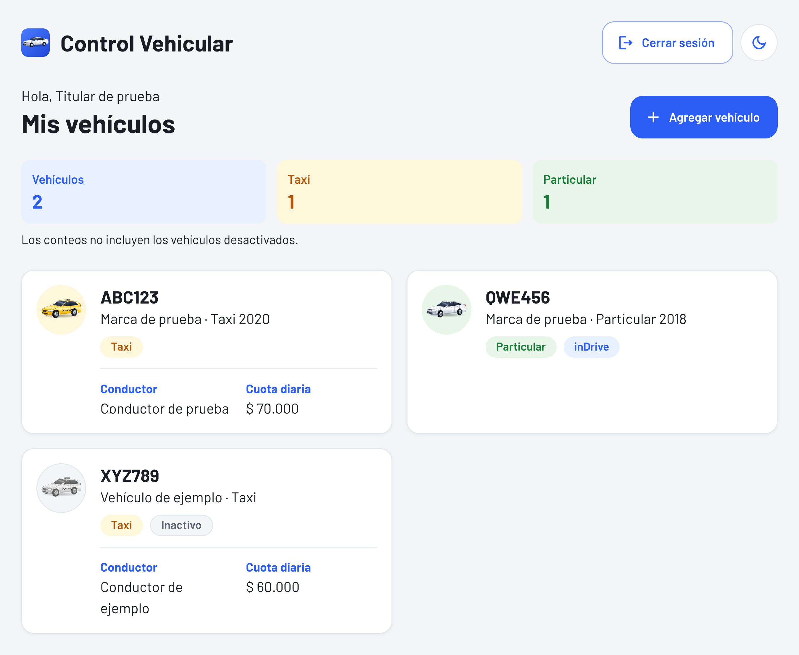

**Captura 2.** La flota a 360 × 800, en oscuro: «Control Vehicular» en una línea, con el ícono de 28 px.

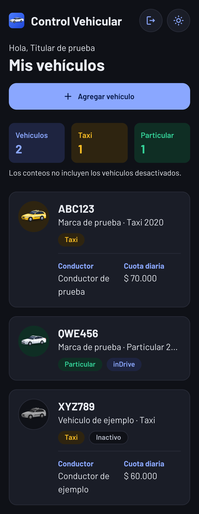

**Captura 3.** El detalle de un particular a 1280 × 800, en claro.

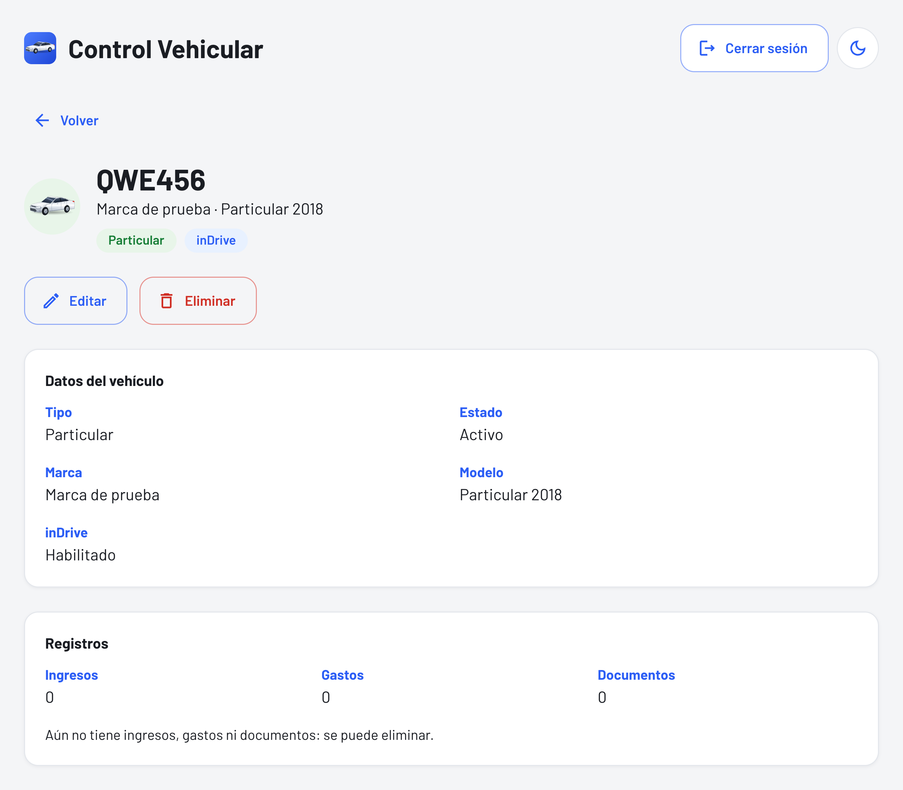

**Captura 4.** El detalle de un vehículo desactivado a 360 × 800, en claro.

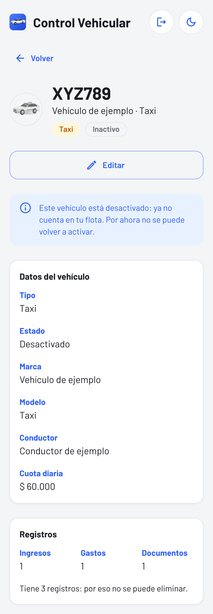

**Captura 5.** La sección «Marca» de la guía visual a 1280 × 800: el dibujo de bienvenida y el ícono en 16, 32 y 48 px.

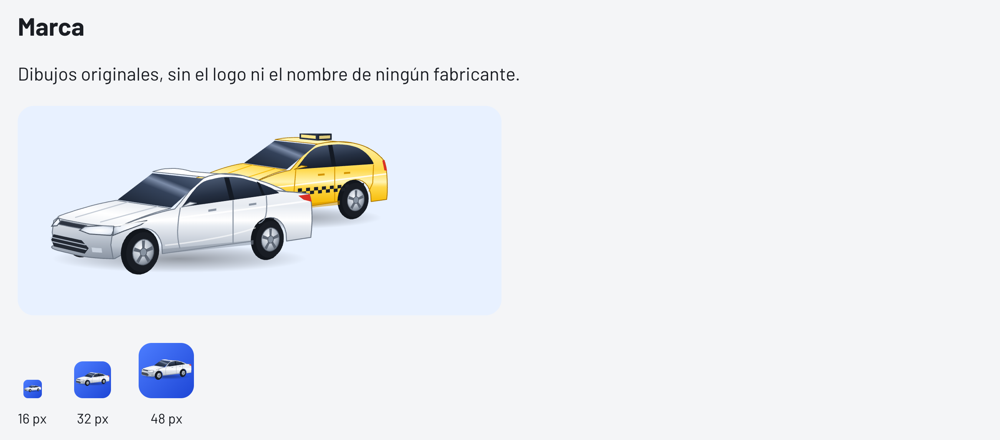

**Decisiones durante el prompt.** Claude Code me hizo dos preguntas, y respondí:
- **Los puertos.** Mis servidores de core-service y de la web-app usaban los puertos 3000 y 5173, que necesita la prueba en Chrome: core-service solo acepta la web-app en el 5173. Los detuve para la prueba.
- **El encabezado a 360 px.** Con el ícono, «Control Vehicular» ya no cabía en una línea junto a «Cerrar sesión» y el botón de modo: necesitaba 198 px y tenía 180. No se salía de la pantalla, pero ocupaba dos líneas, y en la sesión 10 ocupaba una. Como pide AGENTS.md, Claude Code me lo reportó antes de cambiar el CSS, con cuatro opciones: el nombre más pequeño, quitar el ícono en el celular, achicar el ícono y el nombre, o dejar dos líneas. Elegí la primera: en pantallas de menos de 600 px, el nombre usa el tamaño de h3 (22 px) y ocupa 167 px. En escritorio no cambia.

**Ajustes:** no hice ninguno en el texto del prompt.

**Observaciones:**
- **Barlow es más angosta que Roboto.** Botones, etiquetas y textos ocupan un poco menos. En las 24 páginas no se encontró nada que se saliera de su lugar.
- **El ajuste de la letra de respaldo.** No medí cuánto se mueve el texto mientras carga Barlow; la prueba solo comprobó que el ajuste está activo.
- **Los dibujos van en archivos aparte.** Cada uno pesa más de 4 KB, así que Vite los deja como archivos con nombre único, que el navegador guarda y no vuelve a descargar.

### Prompt 2 · Pantalla de ingreso con la franja (26 de noviembre de 2026)

**Antes de enviarlo:** el 26 de noviembre, después del resultado del prompt 1, le escribí a Claude Code «Listo, sigamos con el prompt 2», sin pegarlo.

Texto exacto enviado:

```text
[Rol] Actúa como desarrollador frontend con experiencia en React, TypeScript, Material UI, formularios accesibles y diseño responsive. Explícame las decisiones en lenguaje sencillo.

[Objetivo] Rediseña la página de ingreso y la de comprobación de sesión con la propuesta C de la maqueta, «Franja de bienvenida».

[Contexto]
- El 25 de noviembre de 2026 elegí la propuesta C, y el 26 cerré su diseño: los dos carros, la línea de vía, Barlow y el ícono del prompt 1.
- La franja tiene el fondo azul suave del tema, el dibujo de bienvenida, «Control Vehicular», la frase «Organiza la información de tus vehículos en un solo lugar.», el botón de modo arriba a la derecha y una línea punteada, como de vía, que pasa por detrás de la tarjeta.
- CargandoSesion se ve al abrir cualquier página mientras se comprueba la sesión, y también cuando core-service no responde.
- La maqueta siguió las guías autofill-sign-in-form, validate-input-after-interaction y forms de Modern Web Guidance: errores debajo de cada campo después de intentar ingresar, que se quitan al corregir; atributos para el teclado del celular, y el formulario en la mitad de arriba de la pantalla del celular.
- Ese mismo día Katerin vio la maqueta y le pareció bien.
- Medí el contraste de la franja: la frase da 5,15:1 en claro y 7,41:1 en oscuro, y el nombre, 14,84:1 y 12,84:1.

[Datos o archivos]
- La maqueta aprobada: Asesor_Técnico/Sesión_11/maquetas-ingreso/ingreso-control-vehicular.html
- apps/web-app/src: features/auth/PaginaIngreso.tsx y CargandoSesion.tsx, components/layout/ (AppShell.tsx y ColorModeToggle.tsx), theme/ y assets/marca/bienvenida.svg

[Restricciones]
- Crea components/layout/PantallaBienvenida.tsx: un header con la franja y un main con la tarjeta, de 440 px como máximo, montada sobre la franja, con las medidas de la maqueta en el celular y desde 600 px. El dibujo es decorativo (alt="") y la línea de vía no se lee en voz alta.
- PaginaIngreso y CargandoSesion usan PantallaBienvenida en lugar de AppShell.
- La tarjeta de ingreso tiene el título «Ingresa a tu cuenta» como h1, con el tamaño de h2. Quita el subtítulo «Escribe el correo y la contraseña de tu cuenta.».
- Al pulsar «Ingresar» con campos vacíos, cada uno muestra debajo «Escribe tu correo.» o «Escribe tu contraseña.», y el foco va al primero vacío. El mensaje se quita al escribir en ese campo. Reemplazan el aviso «Escribe tu correo y tu contraseña.». Los rechazos de core-service siguen en el aviso de arriba de la tarjeta, igual que «Cerraste tu sesión.».
- El correo lleva spellCheck desactivado, autoCapitalize="none" y enterKeyHint="next"; la contraseña, enterKeyHint="go". El botón del ojo se llama siempre «Mostrar contraseña» y usa aria-pressed.
- Conserva el título de la pestaña, «Ingresando…», el foco a la contraseña después de un rechazo y, en CargandoSesion, el foco en «Reintentar» si vuelve a fallar.
- No cambies AccesoProvider, las rutas, las demás páginas, core-service, Neon, Hasura Cloud ni los .env. No hagas commits ni push.

[Formato de salida] Archivos creados o cambiados, con una frase cada uno; los comandos ejecutados; una tabla con cada estado de la pantalla y su comprobación con el resultado real, y las guías de Modern Web Guidance aplicadas.

[Criterios de aceptación]
- npm run build, npm test y npm run lint terminan bien desde la raíz.
- En Chrome, con el Hasura falso, la página de ingreso se ve como la maqueta a 1280 × 800 y a 360 × 800, en claro y oscuro, sin desplazamiento horizontal, y el formulario empieza en la mitad de arriba del celular.
- Funcionan: campos vacíos con su error y el foco, correo o contraseña que no coinciden, «Comprobando tu sesión…», «No pudimos comprobar tu sesión» con «Reintentar», y «Cerraste tu sesión.».
- Con Tab se recorre la página en orden y el foco se ve, y el lector de pantalla no anuncia los dibujos.
```

**Archivos creados o cambiados** (todos en `apps/web-app/src/`, salvo las capturas)

| Archivo | Qué cambió |
|---|---|
| `components/layout/PantallaBienvenida.tsx` | Nuevo. Un `header` con la franja: el dibujo de bienvenida (`alt=""`), «Control Vehicular», la frase, el botón de modo arriba a la derecha y la línea de vía, que es solo un fondo, sin texto. Un `main` con la tarjeta de 440 px como máximo, montada 32 px sobre la franja en el celular y 56 px desde 600 px. Las medidas son las de la maqueta |
| `features/auth/PaginaIngreso.tsx` | Usa `PantallaBienvenida`. Título «Ingresa a tu cuenta» como `h1` con el tamaño de `h2`, sin el subtítulo. Errores debajo de cada campo, foco en el primero vacío y el error se quita al escribir. Atributos del teclado del celular, `name` en los dos campos y el botón del ojo con nombre fijo y `aria-pressed`. Enter en el correo lleva a la contraseña si falta (ver «Lo que agregó Claude Code») |
| `features/auth/CargandoSesion.tsx` | Usa `PantallaBienvenida`: «Comprobando tu sesión…», centrado en la tarjeta, o el aviso con «Reintentar». La lógica del foco no cambió |
| `docs/evidencia-sesion-11/capturas/` | Las capturas 6 a 9 de esta evidencia |

Fuera del repositorio, en `Asesor_Técnico/Sesión_11/scripts-prueba-marca/`: `prueba-ingreso.mjs`, la prueba en Chrome, con su resultado (`resultado-ingreso.txt`) y sus 10 capturas.

**Comandos ejecutados**, desde la raíz, con Node 24.22.2 y npm 12.2.3:
- `npx -y modern-web-guidance@latest retrieve` de las cuatro guías, con la telemetría apagada.
- `npm run build`, `npm test`, `npm run test:e2e`, `npm run lint`, `npm audit` y `npm install-scripts ls`.
- La búsqueda de «hasura», «admin-secret» y «JWT_SECRET» en `apps/web-app/dist`.
- `node prueba-ingreso.mjs`: enciende el Hasura falso, core-service compilado desde una carpeta sin `.env` y Vite. Para «Comprobando» y «Sin conexión» deja core-service colgado o apagado, como la prueba de la sesión 10.

**Guías de Modern Web Guidance** (consultadas otra vez el 26 de noviembre de 2026, con la telemetría apagada y sin nombres del proyecto):

| Guía | Para qué la usé | Regla que se aplicó |
|---|---|---|
| `autofill-sign-in-form` | Los atributos de los campos y el formulario arriba en el celular | «Username and email inputs hold identifiers, not prose. Add `spellcheck="false"` so the browser does not rewrite them into something the account does not match.» También «Use the `enterkeyhint` attribute on form inputs to set the mobile keyboard enter key label.» |
| `validate-input-after-interaction` | Cuándo aparece el error y cómo se lee | «DO list the error message in the field's `aria-describedby`, after any hint, only while the field is invalid, so screen readers read it with the field.» |
| `forms` | Los errores por campo y el botón del ojo | «**DON'T** trigger validation errors or `aria-live` error announcements on every keystroke while the user is typing (validate on submit or `blur`, and clear errors on `input` once resolved).» Y «**DO** provide an accessible toggle `<button type="button">` with `aria-pressed` allowing users to unmask password input.» |
| `accessibility` | Los dibujos, el título y el nombre del botón del ojo | «**Do apply `alt=""` to decorative visuals:** This prevents screen readers from announcing them.» Y «**Don't repeat state information already exposed by ARIA inside the label**», por eso el nombre del ojo ya no cambia |

**Lo que no apliqué de las guías:**
- **Material UI manda.** La guía de validación usa `:user-invalid`, del navegador. Los campos de Material UI muestran el error con `error` y `helperText`, que ponen `aria-invalid` y `aria-describedby`, como en la sesión 10.
- **El enlace «¿Olvidaste tu contraseña?».** La guía del ingreso lo pide, pero la recuperación de contraseña es de una fase posterior.
- **El aviso escondido del botón del ojo.** El ejemplo de la guía `forms` le agrega al botón una descripción escondida que advierte que la contraseña se verá en la pantalla. No estaba en el prompt; no la agregué.
- **La tecla Enter de la contraseña.** La guía del ingreso sugiere `done` para el último campo; el prompt pedía `go`, «Ir», y quedó así.
- **`aria-live` en los errores.** Al pulsar «Ingresar», el foco va al primer campo vacío, y el lector de pantalla lee su error con el campo. Por eso no agregué una región que los anuncie.

**Comprobaciones en el repositorio**, desde la raíz:

| Comprobación | Comando | Resultado real |
|---|---|---|
| Compilación | `npm run build` | Código de salida 0. Vite repite el aviso de los 500 kB: 558,87 kB (174,15 kB comprimido), 1,74 kB más que después del prompt 1. Ahora `bienvenida.svg` (25,32 kB) también está en el código compilado |
| Pruebas unitarias | `npm test` | 140 pruebas en 13 archivos, sin errores |
| Pruebas e2e | `npm run test:e2e` | 32 pruebas en 3 archivos, sin errores |
| Lint | `npm run lint` | Código de salida 0. En la web-app: «Found 0 warnings and 0 errors.» |
| Dependencias | `npm audit` y `npm install-scripts ls` | `found 0 vulnerabilities` y «No packages with unreviewed install scripts.». El prompt no agregó dependencias |
| Código compilado de la web | Búsqueda de «hasura», «admin-secret» y «JWT_SECRET» en `apps/web-app/dist` | 0 archivos |
| Archivos que no debían cambiar | `git status` y fechas de los `.env` | No cambiaron `AccesoProvider`, las rutas, las demás páginas ni core-service. Los `.env` conservan sus fechas del 7 y del 23 de noviembre. No se tocaron Neon ni Hasura Cloud |

**Comprobaciones en Chrome**, sin pantalla, con el Hasura falso, core-service compilado desde una carpeta sin `.env` y las claves de prueba falsas. Resultado: 39 de 39.

| Estado o comprobación | Resultado real |
|---|---|
| Formulario a 1280 y 360 px, en claro y oscuro | Sin desplazamiento a lo ancho, letra Barlow y título de la pestaña «Ingresar · Control Vehicular». La franja tiene el dibujo (300 px en escritorio y 220 px en el celular, `alt=""`), «Control Vehicular», la frase y el botón de modo. La tarjeta mide 440 px en escritorio y se monta 56 px sobre la franja; en el celular mide 328 px y se monta 32 px |
| Línea de vía | Punteada, con el azul principal al 30 %: `rgba(44, 94, 245, 0.3)` en claro y `rgba(138, 167, 255, 0.3)` en oscuro. Su contenido es `""`: no hay texto que leer |
| El formulario arriba en el celular | A 360 × 800, el correo empieza a 306 px, en la mitad de arriba (400 px) |
| Campos | Correo: `type="email"`, `autocomplete="username"`, `spellcheck="false"`, `autocapitalize="none"`, `enterkeyhint="next"` y obligatorio. Contraseña: `type="password"`, `autocomplete="current-password"`, `enterkeyhint="go"` y obligatoria |
| Botón del ojo | Se llama «Mostrar contraseña» antes y después de pulsarlo. `aria-pressed` pasa de `false` a `true` y la contraseña se ve |
| Lector de pantalla | El árbol de accesibilidad de Chrome no expone ninguna imagen. Tiene un solo título, «Ingresa a tu cuenta», un encabezado y un contenido principal |
| Orden con Tab y foco visible | Botón de modo → correo → contraseña → «Mostrar contraseña» → «Ingresar». Los botones muestran un contorno de 2 px, y los campos, un borde de 2 px |
| Campos vacíos | «Escribe tu correo.» y «Escribe tu contraseña.» debajo de cada campo, sin aviso arriba. El foco va al correo, con `aria-invalid="true"`, descrito por «Escribe tu correo.» |
| Al escribir en el correo | Su error se quita, y el de la contraseña se queda |
| Solo falta la contraseña | Aparece solo «Escribe tu contraseña.», con el foco en ella |
| Enter en el correo sin contraseña | El foco pasa a la contraseña, sin errores y sin salir de `/ingresar` |
| Al enviar | El botón dice «Ingresando…» y se desactiva |
| Contraseña que no coincide | Aviso «El correo o la contraseña no coinciden.» arriba, foco en la contraseña y ningún error por campo |
| Cerrar sesión | Después de ingresar y cerrar sesión, el ingreso muestra «Cerraste tu sesión.» |
| Comprobando la sesión | Con core-service colgado, «Comprobando tu sesión…» se ve en la tarjeta, sobre la franja, sin desplazamiento a lo ancho |
| Sin conexión | A los 15 segundos: «No pudimos comprobar tu sesión. Revisa la conexión y vuelve a intentarlo.» con «Reintentar» |
| Reintentar | Con core-service apagado, vuelve a fallar y el foco regresa a «Reintentar». Con core-service encendido, aparece el formulario |
| Consola | Sin errores ni avisos |

La vista de 360 px es una emulación del navegador, no un celular real. El árbol de accesibilidad es el que Chrome entrega a los lectores de pantalla; no probé con un lector de pantalla real.

**Captura 6.** El ingreso a 1280 × 800, en claro, como la maqueta.

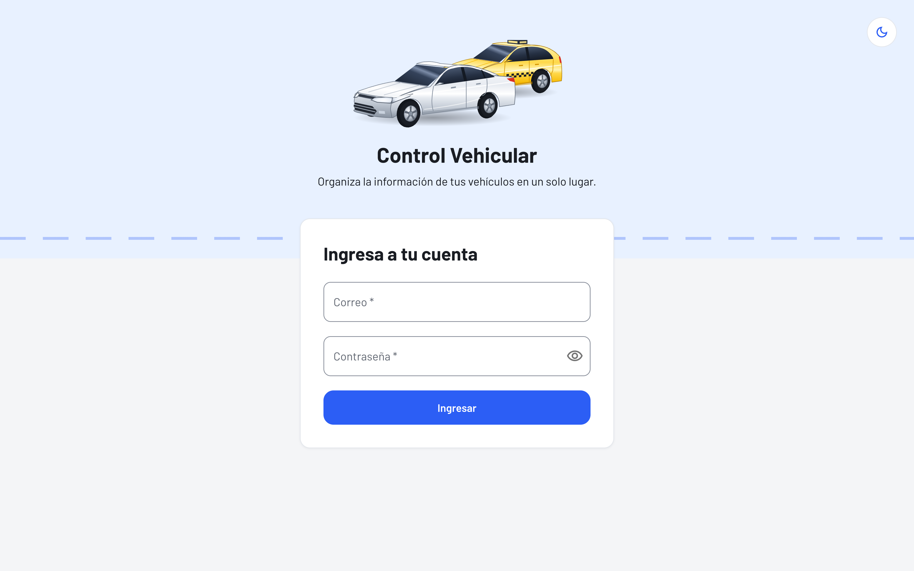

**Captura 7.** Los campos vacíos a 360 × 800: cada error debajo de su campo y el foco en el correo.

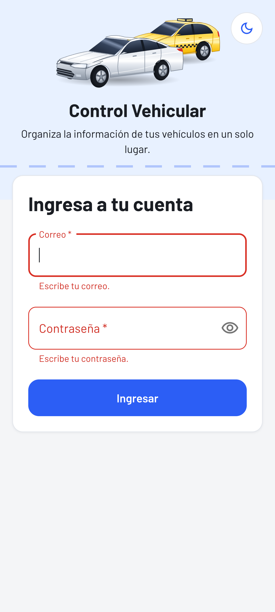

**Captura 8.** Una contraseña que no coincide, a 360 × 800, en oscuro.

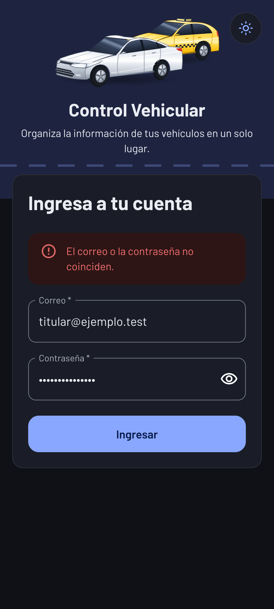

**Captura 9.** Sin conexión con core-service, a 360 × 800: el aviso con «Reintentar» dentro de la tarjeta.

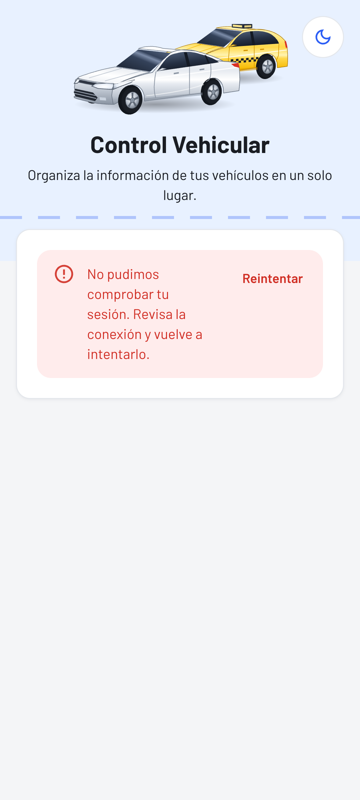

**Decisiones durante el prompt.** Claude Code me pidió otra vez los puertos 3000 y 5173 para la prueba en Chrome, y detuve mis servidores.

**Lo que agregó Claude Code sin estar en el prompt.** En el celular, la tecla Enter del correo dice «Siguiente». Sin otro cambio, al pulsarla con la contraseña vacía, el formulario se enviaba y marcaba «Escribe tu contraseña.» antes de que la escribiera. Claude Code hizo que, en ese caso, Enter lleve a la contraseña. Si la contraseña ya está escrita, por ejemplo porque el navegador la llenó, Enter envía el formulario como antes. Claude Code me lo consultó al terminar, y el 26 de noviembre decidí dejarlo así.

**Ajustes:** no hice ninguno en el texto del prompt.

**Observaciones:**
- **El color de la línea de vía.** Material UI 9 trae `theme.alpha()`, que aplica la transparencia al color del modo activo. Así la línea toma el azul de cada modo sin repetir colores en el código (ver «Problemas encontrados»).
- **Los avisos siguen dentro del formulario**, arriba de los campos, como en la maqueta y como antes.
- **«Comprobando tu sesión…» con la franja.** Se ve un instante al abrir cualquier página. Si core-service no responde, la franja se queda hasta que aparece el aviso, a los 15 segundos.

### Prompt 3 · Etiquetas encima de las casillas (27 de noviembre de 2026)

**Antes de enviarlo:** el 27 de noviembre, al acordar el orden para completar la primera versión, le pedí a Claude Code cambiar las etiquetas del ingreso, porque «la palabra correo y contraseñas no se ven bien, estan como interfiriendo en la casilla donde se colocan los datos». En sus capturas de Chrome las etiquetas se movían como espera Material UI. Por eso me explicó dos causas posibles: que el navegador autocomplete los datos y la etiqueta se quede encima, o que no me guste la etiqueta sobre el borde. Me recomendó, en cualquiera de los dos casos, dejar la etiqueta fija encima de la casilla, y me preguntó si aplicarlo a todos los formularios. No le envié una captura. Le respondí con el texto de abajo, y no fue un prompt redactado con los siete elementos: los registro como los interpretó Claude Code.

Texto exacto enviado:

```text
Si, hagamos la recomendación que me das y apliquemoslo a todo. Gracias.
```

| Elemento | Cómo se interpretó |
|---|---|
| Rol | No se indicó. Claude Code actuó como desarrollador frontend del repositorio |
| Objetivo | Dejar la etiqueta de cada campo fija encima de su casilla, para que no se cruce con el borde ni con los datos |
| Contexto | La conversación anterior: mi comentario sobre las etiquetas del ingreso y la recomendación de Claude Code |
| Datos o archivos | El tema de Material UI (`theme/theme.ts`) y los formularios de la web-app |
| Restricciones | «Aplicarlo a todo»: a todos los formularios, actuales y futuros. Las de siempre: no tocar core-service, Neon, Hasura Cloud ni los `.env`, y no hacer commits ni push |
| Formato de salida | No se indicó. Claude Code entregó el cambio, las comprobaciones y esta parte de la evidencia |
| Criterios de aceptación | No se indicaron. Se interpretaron así: ninguna etiqueta toca el borde ni los datos, sigue enlazada con su campo, no se mueve al escribir y se lee bien en claro y oscuro, a 1280 y 360 px |

**Archivos cambiados** (todos en `apps/web-app/src/`, salvo las capturas)

| Archivo | Qué cambió |
|---|---|
| `theme/theme.ts` | La etiqueta (`MuiInputLabel`) queda siempre arriba (`shrink`) y en el flujo de la página, con 6 px hasta la casilla, en lugar de flotar sobre el borde. El borde de la casilla (`MuiOutlinedInput`) ya no abre el hueco para la etiqueta. Las etiquetas y los títulos de grupo, como «Tipo de vehículo», comparten tamaño (14 px), peso (500) y color de texto principal (`MuiFormLabel`). Como está en el tema, aplica a todos los formularios, también a los que vengan |
| `features/vehiculos/PaginaIngresos.tsx` | Al campo «Fecha» se le quitó `shrink`: el tema ya lo pone, y pasarlo en el campo volvía a abrir el hueco del borde |
| `guia/GuiaVisual.tsx` | El mismo ajuste en el campo «Fecha» de la guía visual |
| `docs/evidencia-sesion-11/capturas/` | Las capturas 10 a 13 de esta evidencia |

Fuera del repositorio, en `Asesor_Técnico/Sesión_11/scripts-prueba-marca/`: `prueba-etiquetas.mjs`, la prueba en Chrome, con su resultado (`resultado-etiquetas.txt`) y sus 7 capturas.

**Comandos ejecutados**, desde la raíz, con Node 24.22.2 y npm 12.2.3:
- `npx -y modern-web-guidance@latest search` y `retrieve` de las guías `forms` y `autofill-sign-in-form`, con la telemetría apagada y sin nombres del proyecto.
- `npm run build`, `npm test`, `npm run test:e2e` y `npm run lint`.
- La búsqueda de «hasura», «admin-secret» y «JWT_SECRET» en `apps/web-app/dist`.
- `node prueba-etiquetas.mjs`: enciende el Hasura falso, core-service compilado desde una carpeta sin `.env` y Vite, como las pruebas de los prompts 1 y 2.

**Guía de Modern Web Guidance** (27 de noviembre de 2026):

| Guía | Para qué la usé | Regla que se aplicó |
|---|---|---|
| `forms` | Dónde va la etiqueta y cuánto espacio la separa de la casilla | «**DO** place `<label>` elements before text inputs, `<textarea>`, and `<select>` controls in the DOM and stack them visually above the control for faster scanning.» Y «**DO** ensure the vertical margin between a label and its input is less than the margin between form groups»: 6 px de la etiqueta a su casilla, y 16 px o más entre un campo y el siguiente |

**Comprobaciones en el repositorio**, desde la raíz:

| Comprobación | Comando | Resultado real |
|---|---|---|
| Compilación | `npm run build` | Código de salida 0. Vite repite el aviso de los 500 kB: 562,16 kB (175,05 kB comprimido). El aumento frente al prompt 2 incluye también lo agregado en la sesión 12 |
| Pruebas unitarias | `npm test` | 146 pruebas en 14 archivos, sin errores |
| Pruebas e2e | `npm run test:e2e` | 34 pruebas en 3 archivos, sin errores |
| Lint | `npm run lint` | Código de salida 0 |
| Código compilado de la web | Búsqueda de «hasura», «admin-secret» y «JWT_SECRET» en `apps/web-app/dist` | 0 archivos |
| Archivos que no debían cambiar | `git status` y fechas de los `.env` | Solo cambiaron los tres archivos de la tabla. Los `.env` conservan sus fechas del 7 y del 23 de noviembre. No se tocaron core-service, Neon ni Hasura Cloud |

**Comprobaciones en Chrome**, sin pantalla, con el Hasura falso y las claves de prueba falsas, a 1280 × 800 y 360 × 800, en claro y oscuro. Resultado: 149 de 149.

| Pantalla | Qué se revisó | Resultado real |
|---|---|---|
| Ingreso, vacío, con datos y con los errores de campos vacíos | Cada etiqueta enlazada con su campo, encima de la casilla y dentro de su ancho, sin hueco en el borde, y su contraste | «Correo» y «Contraseña» a 6 px sobre la casilla, sin hueco (0 px), 14 px y peso 500. Contraste de 16,88:1 en claro y 14,21:1 en oscuro; con error, 5,12:1 en claro |
| Ingreso, al escribir | Que la etiqueta no se mueva | Las etiquetas quedan en el mismo lugar con los campos vacíos y llenos (395 y 497 px a 1280; 306 y 408 px a 360) |
| Nuevo vehículo, editar un taxi y registrar ingreso | Lo mismo en cada campo | Placa, marca, modelo, conductor, cuota diaria, fecha, valor recibido, motivo y nota: todas a 6 px, sin hueco, con contraste de 4,5:1 o más |
| Guía visual | Lo mismo, incluida la lista de categorías | Fecha, categoría, valor (con error) y descripción, bien. En la lista de opciones, Material UI dibuja la etiqueta como texto enlazado con `aria-labelledby`, no como `<label>` |
| Ancho | Desplazamiento horizontal | Ninguno en ninguna pantalla |
| Consola | Errores y avisos | Ninguno |

La vista de 360 px es una emulación del navegador, no un celular real. El autocompletado de un navegador con datos guardados no se puede reproducir en esta prueba; lo cubre que la etiqueta ya no cambia de lugar con el contenido de la casilla.

**Captura 10.** El ingreso a 1280 × 800, en claro, con las etiquetas encima de las casillas.

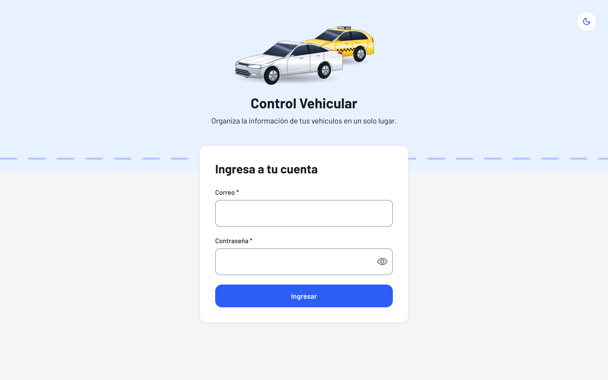

**Captura 11.** El ingreso con datos a 360 × 800, en oscuro: la etiqueta no toca el correo ni la contraseña.

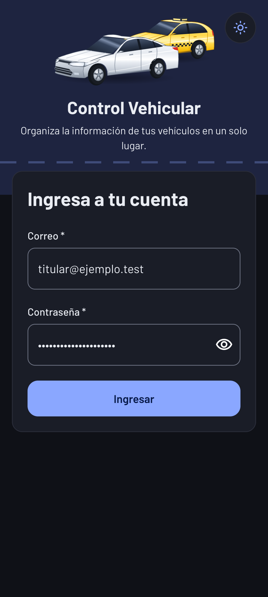

**Captura 12.** El formulario de nuevo vehículo a 360 × 800, en claro.

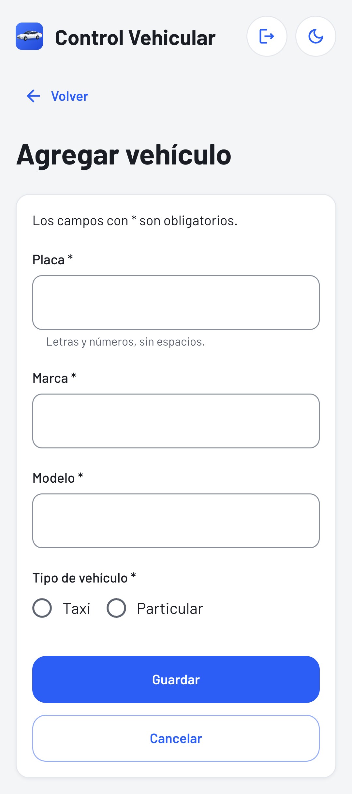

**Captura 13.** Editar un taxi a 1280 × 800, en oscuro: las etiquetas de las casillas y el título del grupo «Tipo de vehículo» tienen el mismo estilo.

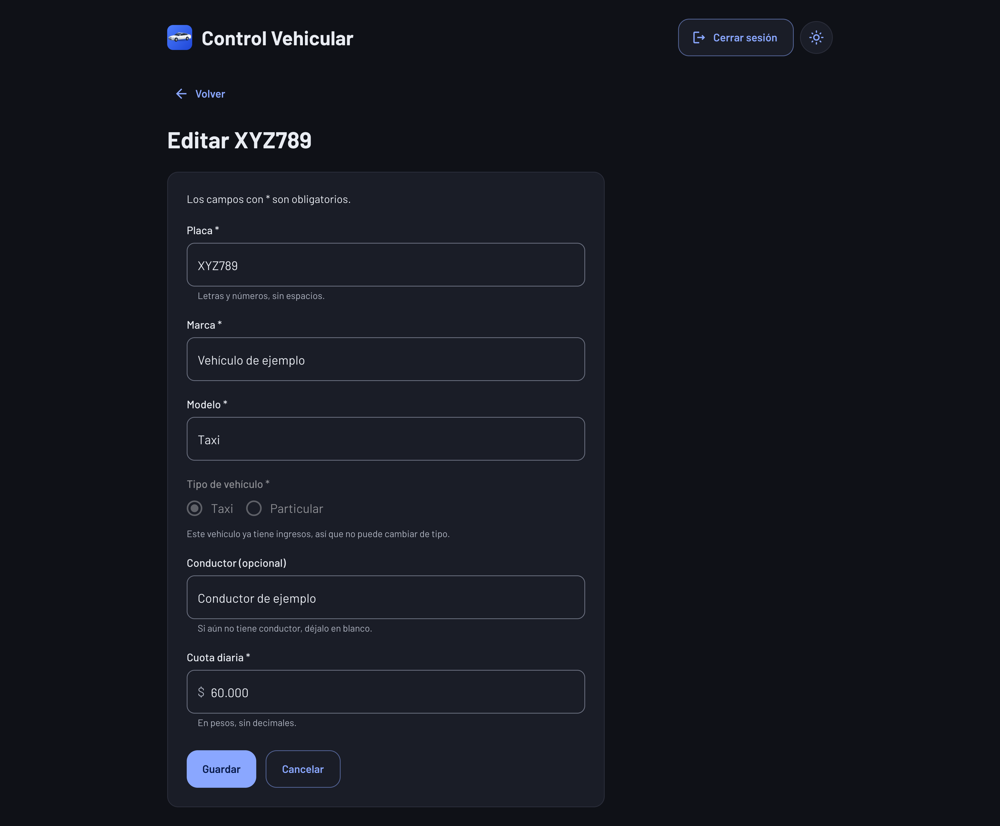

**Decisiones durante el prompt:** ninguna. Los puertos estaban libres y no tuve que detener mis servidores.

**Observaciones:**
- **El texto de ayuda sigue un poco más adentro que la etiqueta**, alineado con el texto de la casilla, como lo dibuja Material UI. No lo cambié porque no estaba en lo que acordamos.
- **Un problema anterior, de la sesión 12.** En la pantalla de ingresos a 360 px, «Control Vehicular» se parte en dos líneas, porque el encabezado tiene además el botón «Volver al vehículo», que repite el «Volver» de la página. No lo cambié: según AGENTS.md, un problema de diseño que se ve en una captura se reporta antes de tocar el código. Queda para la sesión 13, que trabaja esa pantalla.
- **La pantalla de ingresos en la prueba** mostró «No pudimos consultar tus datos en este momento», porque el Hasura falso de la sesión 10 no conoce la tabla de ingresos. No es un error de la app; por eso esa captura no está en la evidencia.

### Prompt 4 · Imágenes de los vehículos generadas con IA (27 de noviembre de 2026)

**Antes de enviarlo:** el 27 de noviembre le mostré a Claude Code una imagen que generé con ChatGPT: un sedán blanco y un taxi amarillo sobre un fondo azul oscuro con una ciudad, un halo y un pin de ubicación. Le pedí cambiar por ella la imagen que veníamos usando para los vehículos. Claude Code me explicó que la escena completa servía para la franja del ingreso, pero no para los círculos de 56 px de las tarjetas ni para el ícono, y que pesaba 1,8 MB. Me recomendó generar cada carro por separado, con fondo transparente, y me dio los prompts:

```text
Usando como referencia la imagen anterior, genera solo el sedán blanco, con el mismo estilo, la misma iluminación y el mismo nivel de detalle.

Requisitos:
- Fondo transparente (PNG con transparencia real). Sin ciudad, sin halo, sin pin de ubicación, sin reflejo en el piso y sin sombra.
- Vista de tres cuartos desde adelante, con el frente del carro mirando hacia la izquierda.
- El carro completo, sin cortes, centrado y ocupando casi todo el ancho de la imagen, con un pequeño margen alrededor.
- Sin logos, emblemas ni nombres de marcas. Sin placa o con la placa en blanco, sin letras ni números.
- Formato horizontal de 1600 × 900 píxeles.
```

Con ese prompt, ChatGPT generó el sedán, con estilo de ilustración y contorno negro. Después ChatGPT no me dejó generar más imágenes. Claude Code me explicó que no puede generar imágenes y me propuso usar Gemini, que edita una imagen adjunta. Le adjunté el sedán con este prompt:

```text
Convierte este sedán blanco en un taxi amarillo, sin cambiar nada más: el mismo estilo de ilustración, el mismo contorno negro, el mismo ángulo, el mismo tamaño y el mismo encuadre. Pinta la carrocería de amarillo, agrega un letrero «TAXI» en el techo y una franja de cuadros negros en las puertas. Sin logos, nombres de empresas, teléfonos ni placa con letras o números. Fondo transparente; si no puedes, fondo blanco liso, sin sombra ni reflejo.
```

Gemini lo entregó con fondo blanco. Claude Code revisó las dos imágenes:
- el sedán tiene fondo transparente real y el taxi no tiene marca de agua visible;
- ninguna tiene logos, nombres ni números.

Le quitó el fondo al taxi y me mostró una vista previa en los tamaños de la app, en claro y oscuro. Propuso usarlas en el ingreso y las tarjetas y dejar el ícono como estaba. Respondí con el texto de abajo, que no fue un prompt redactado con los siete elementos: los registro como los interpretó Claude Code.

Texto exacto enviado:

```text
Respuestas:
1. Si.
2. Fue el mismo que me diste.
3. Katerin ya aprobó estas nuevas imágenes.
Gracias
```

| Elemento | Cómo se interpretó |
|---|---|
| Rol | No se indicó. Claude Code actuó como desarrollador frontend del repositorio |
| Objetivo | Reemplazar los dibujos de los vehículos por las imágenes del sedán y del taxi en la franja del ingreso, las tarjetas de vehículos y el detalle, y dejar el ícono |
| Contexto | Las imágenes generadas con ChatGPT y Gemini, la vista previa aprobada y la aprobación de Katerin |
| Datos o archivos | Las imágenes originales; `PantallaBienvenida.tsx`, `IconoVehiculo.tsx` y `GuiaVisual.tsx` |
| Restricciones | La propuesta que aprobé: el ícono no cambia. Las de siempre: no tocar core-service, Neon, Hasura Cloud ni los `.env`, y no hacer commits ni push |
| Formato de salida | No se indicó. Claude Code entregó el cambio, las comprobaciones y esta parte de la evidencia |
| Criterios de aceptación | No se indicaron. Se interpretaron así: las imágenes se ven nítidas y con el tamaño de antes en claro y oscuro, a 1280 y 360 px, sin halo blanco en el modo oscuro, y pesan mucho menos que los originales |

**Cómo se prepararon las imágenes,** con un script de Python que no entra en la app:
- **Taxi:** se le quitó el fondo blanco desde los bordes y se suavizó 1 px el contorno, para que no quede un halo blanco en el modo oscuro.
- **Sedán:** ChatGPT lo dejó casi opaco (99 %), y se dejó totalmente opaco.
- **Recorte:** a los dos se les recortó el espacio sobrante.
- **Pareja de bienvenida:** se armó con el taxi atrás y el sedán adelante, como en la vista previa.
- **Formato:** todas se guardaron en WebP.

| Archivo | Tamaño | Peso |
|---|---|---|
| `bienvenida-600.webp` | 600 × 309 px | 40,3 kB |
| `bienvenida-900.webp` | 900 × 463 px | 70,4 kB |
| `taxi-138.webp` | 138 × 62 px | 5,6 kB |
| `particular-138.webp` | 138 × 71 px | 4,9 kB |

Los originales pesaban 1,2 MB (sedán) y 0,5 MB (taxi).

**Archivos creados o cambiados** (en `apps/web-app/src/`, salvo las capturas)

| Archivo | Qué cambió |
|---|---|
| `assets/marca/imagenes.ts` | Nuevo. Reúne las imágenes con su tamaño y su proporción: la pareja de bienvenida en dos tamaños (`srcSet` y `sizes`) y un carro de 138 px por tipo de vehículo |
| `assets/marca/*.webp` | Nuevos: las cuatro imágenes de la tabla anterior |
| `assets/marca/bienvenida.svg`, `taxi.svg` y `particular.svg` | Eliminados: los reemplazan las imágenes nuevas |
| `components/layout/PantallaBienvenida.tsx` | La franja usa la pareja nueva, con `width` y `height`, y con `fetchpriority="high"` porque es lo más grande de la pantalla al abrirla. Sigue siendo decorativa (`alt=""`) |
| `features/vehiculos/IconoVehiculo.tsx` | Las tarjetas y el detalle usan el carro nuevo de cada tipo, con su proporción. El círculo de color y el gris del vehículo desactivado no cambian |
| `guia/GuiaVisual.tsx` | La sección «Marca» muestra la pareja nueva y explica el origen de las imágenes |
| `docs/evidencia-sesion-11/capturas/` | Las capturas 14 a 17 de esta evidencia |

**Fuera del repositorio,** en `Asesor_Técnico/Sesión_11/imagenes-ia/`:
- las imágenes originales: la escena de referencia, el sedán y el taxi;
- las versiones sin fondo y la vista previa;
- `procesar-imagenes.py`, que vuelve a generar las cuatro WebP. Lo comprobé: produce archivos idénticos a los de la app.

En `scripts-prueba-marca/` queda la prueba `prueba-imagenes.mjs`, con su resultado y sus capturas.

**Comandos ejecutados**, desde la raíz, con Node 24.22.2 y npm 12.2.3:
- `npx -y modern-web-guidance@latest search` y `retrieve` de las guías `deliver-optimized-decorative-images` y `performance`, con la telemetría apagada y sin nombres del proyecto.
- `npm run build`, `npm test`, `npm run test:e2e` y `npm run lint`.
- `node prueba-imagenes.mjs` (copia de la prueba del prompt 1, con las imágenes nuevas) y `node prueba-ingreso.mjs` (la prueba del prompt 2, sin cambios).

**Guías de Modern Web Guidance** (27 de noviembre de 2026):

| Guía | Para qué la usé | Regla que se aplicó |
|---|---|---|
| `performance` | El formato, los tamaños y la prioridad de las imágenes | «**DO** serve modern formats (AVIF / WebP / JPEG XL)», «**DO** apply explicit `width` and `height` attributes» y «**DON'T** omit the `sizes` attribute when using `srcset`». Para la imagen del ingreso: «**DO** use `fetchpriority="high"` on the LCP images» |
| `deliver-optimized-decorative-images` | Si las imágenes decorativas iban en CSS o en HTML | Su advertencia: las imágenes de CSS no las descubre a tiempo el navegador, así que una imagen grande al abrir la página debe ir en «a standard HTML `` or `<picture>` tag». Por eso la pareja sigue en un `` |

**Lo que no apliqué de las guías:**
- **AVIF ni `<picture>`.** WebP ya lo entienden todos los navegadores actuales, y un segundo formato duplicaría los archivos sin una ganancia que se note en imágenes de este tamaño.
- **`loading="lazy"` en las tarjetas.** Cada carro pesa unos 5 kB y se repite en todas las tarjetas del mismo tipo, así que el navegador lo descarga una sola vez.
- **Un tamaño de 92 px para las tarjetas.** Lo probé, pero Vite mete en el JavaScript las imágenes de menos de 4 kB y el archivo principal creció 8 kB. Con una sola versión de 138 px, nítida hasta en pantallas 3x, el JavaScript quedó como antes.

**Comprobaciones en el repositorio**, desde la raíz:

| Comprobación | Comando | Resultado real |
|---|---|---|
| Compilación | `npm run build` | Código de salida 0. Vite repite el aviso de los 500 kB: 562,40 kB (175,16 kB comprimido), casi igual que después del prompt 3. Las cuatro WebP salen como archivos aparte |
| Pruebas unitarias | `npm test` | 146 pruebas en 14 archivos, sin errores |
| Pruebas e2e | `npm run test:e2e` | 34 pruebas en 3 archivos, sin errores |
| Lint | `npm run lint` | Código de salida 0 |

**Comprobaciones en Chrome**, sin pantalla, con el Hasura falso y las claves de prueba falsas, a 1280 × 800 y 360 × 800, en claro y oscuro:

| Prueba | Resultado real |
|---|---|
| `prueba-imagenes.mjs` | 120 de 120 |
| Imagen del ingreso a 1280 px | `bienvenida-900.webp` a 300 × 154 px, con `fetchpriority="high"`, `width` y `height` de 900 × 463, `sizes` «(min-width: 600px) 300px, 220px» y `alt=""` |
| Imagen del ingreso a 360 px | La misma imagen a 220 × 113 px. En una pantalla 3x, Chrome elige la de 900 px |
| Flota, detalle y edición | El taxi y el particular a 46 px, con la imagen de 138 px. El vehículo desactivado, en gris. Además, las mismas revisiones del prompt 1: Barlow, el ícono del encabezado a 32 px, «Control Vehicular» en una línea y nada a lo ancho |
| Guía visual | La sección «Marca», con sus cuatro imágenes cargadas |
| Consola | Sin errores ni avisos |
| `prueba-ingreso.mjs` (prompt 2, sin cambios) | 39 de 39: la franja con la imagen nueva (300 y 220 px), los estados del ingreso, el teclado y la accesibilidad siguen igual |

La vista de 360 px es una emulación del navegador, no un celular real.

**Captura 14.** El ingreso a 1280 × 800, en claro, con la pareja nueva.

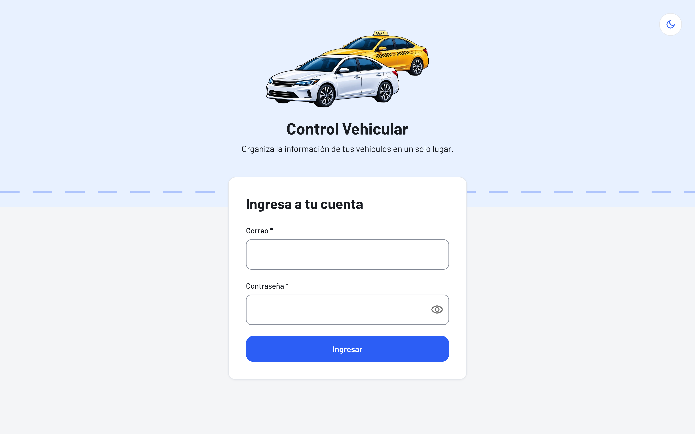

**Captura 15.** El ingreso a 360 × 800, en oscuro: sin halo blanco alrededor de los carros.

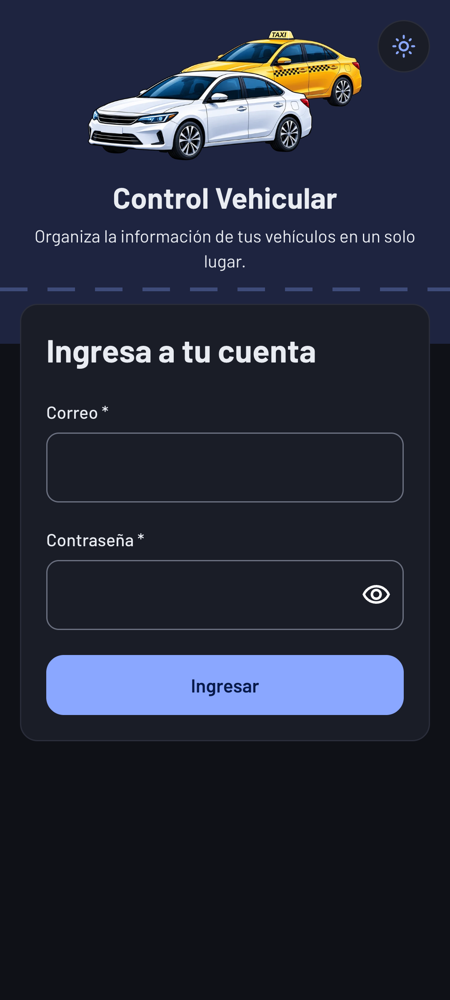

**Captura 16.** La flota a 360 × 800, en claro: el taxi, el particular y el taxi desactivado en gris.

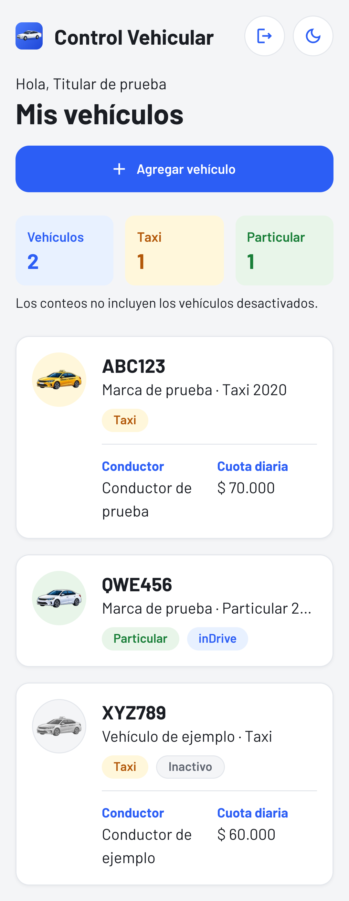

**Captura 17.** El detalle de un particular a 1280 × 800, en oscuro.

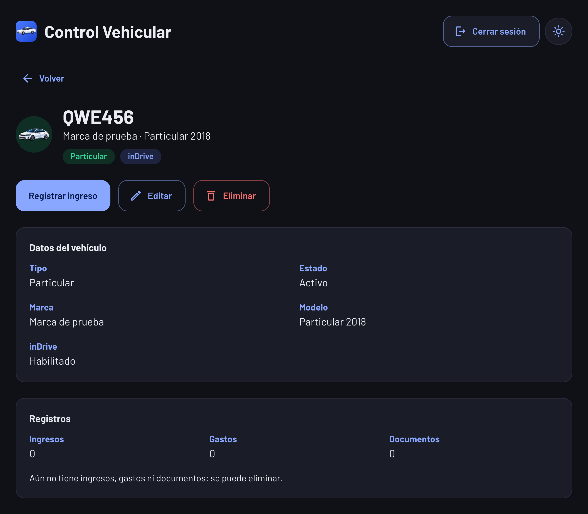

**Decisiones durante el prompt:** ninguna. Los puertos estaban libres.

**Lo que agregó Claude Code sin estar en la propuesta:** `imagenes.ts`, para que el ingreso y la guía visual usen la misma imagen con los mismos tamaños, y el script `procesar-imagenes.py`, para poder volver a generar las imágenes.

**Observaciones:**
- **La franja quedó un poco más alta,** porque la pareja nueva es más alta que el dibujo anterior: 154 px en lugar de 134 a 1280 px, y 113 en lugar de 99 a 360 px. El formulario sigue empezando en la mitad de arriba del celular.
- **El ícono sigue siendo el dibujo anterior del sedán.** Ahora tiene un estilo distinto al de las imágenes; si se quiere igualar, haría falta un ícono simplificado.
- **Gemini marca sus imágenes con una señal invisible (SynthID)**, según su documentación. No se ve ni cambia la imagen.

### Mi prueba en el navegador con Neon y Hasura Cloud (27 de noviembre de 2026)

Con core-service conectado a Hasura Cloud y Neon, y mi cuenta de prueba, revisé en Microsoft Edge:
- la pantalla de ingreso con la franja y las imágenes nuevas;
- la flota y el detalle, con el taxi y el sedán en las tarjetas;
- los formularios, con las etiquetas encima de las casillas;
- todo en modo claro y en modo oscuro.

Todo quedó bien. No lo probé en un celular real.

## 6. Problemas encontrados

- **Los puertos de la prueba estaban ocupados.** Mis servidores usaban el 3000 y el 5173, y core-service solo acepta la web-app en el 5173. Claude Code no los detuvo: hizo primero los cambios y las comprobaciones que no usan puertos, y me pidió detenerlos para la prueba en Chrome.
- **La primera prueba usó Node 22.** Claude Code la lanzó desde la carpeta de la prueba, que no tiene el archivo `.node-version`, y core-service no arrancó. No quedó ningún proceso encendido. La repitió desde el repositorio, con Node 24.22.2.
- **Fallas falsas en la letra.** La segunda prueba marcó la letra como falla en todas las páginas, aunque Barlow estaba cargada: el script esperaba `"Barlow"`, con comillas, y Chrome responde `Barlow`. Claude Code corrigió la comparación y repitió la prueba completa.
- **El encabezado a 360 px**, en dos líneas: ver «Decisiones durante el prompt» del prompt 1. Al repetir la prueba, Claude Code borró las capturas de la anterior, así que la del encabezado en dos líneas no se conservó.
- **Fallas falsas en la prueba del prompt 3.** La primera vuelta midió la distancia hasta el borde dibujado del campo, que empieza 5 px más arriba que la casilla visible, y dio 1 px en lugar de 6. Después se detuvo en la guía visual, porque buscaba un `<label>` y la lista de opciones no lo tiene. Claude Code corrigió las dos mediciones en el script, sin tocar la app, y repitió la prueba completa: 149 de 149.
- **Se sobrescribieron las capturas de la prueba del prompt 2.** En el prompt 4, Claude Code volvió a correr `prueba-ingreso.mjs`, que guarda sus capturas en la misma carpeta `capturas-ingreso/`. Ahora esa carpeta tiene la versión con las imágenes nuevas. Las capturas del prompt 2 que usa esta evidencia (6 a 9) están a salvo en `docs/evidencia-sesion-11/capturas/`.
- **El color de la línea de vía no compiló.** En el prompt 2, la primera versión armaba el color con `mainChannel`, el azul en números, y TypeScript la rechazó: «Property 'mainChannel' does not exist on type 'PaletteColor | (PaletteColor & PaletteColorChannel)'». Claude Code la cambió por `theme.alpha()` de Material UI, y la prueba en Chrome confirmó el color en los dos modos.

## 7. Pendientes y próximo paso

| Pendiente | Responsable | Fecha |
|---|---|---|
| Mi prueba en el navegador con Neon y Hasura Cloud: ingreso, flota y detalle en claro y oscuro | Ivan | Hecho el 27 de noviembre de 2026, en Edge |
| Commits `feat` y `docs`, y la documentación de cierre: AGENTS.md, contexto, README, guía de desarrollo y notas en las evidencias 4, 8 y 10 | Ivan, con Claude Code | Hecho el 27 de noviembre de 2026 |
| Subir los commits a GitHub y crear la etiqueta `sesion-11-v1.0` | Ivan, con Claude Code | Cuando lo decida |
| Mostrarle a Katerin las pantallas de la app con las imágenes nuevas y las etiquetas encima de las casillas: aprobó las imágenes, pero no las vio en la app | Ivan | Por definir |
| El encabezado de la pantalla de ingresos a 360 px, en dos líneas (observación del prompt 3) | Ivan, con Claude Code | Sesión 13 |
| A1 y A5: renovar la sesión en un solo paso y probar dos renovaciones a la vez | Ivan, con Claude Code | Por definir: con la semana 8 de la cartilla, después de las sesiones 13 a 15 |
| Límite de la recarga doble (evidencia de sesión 9) | Ivan, con Claude Code | Después de presentar el trabajo final en el SENA |

## Fuentes

- Maqueta del ingreso, en una página privada, y su copia en `Asesor_Técnico/Sesión_11/maquetas-ingreso/`.
- Repositorio de la app Android, github.com/Tecno85/vehicle-control-app, consultado el 26 de noviembre de 2026: sus ilustraciones de taxi y particular, como referencia.
- Modern Web Guidance, consultada sin nombres del proyecto ni de personas: guías `visually-stable-font-fallbacks` e `icons`. En la maqueta se aplicaron también `autofill-sign-in-form`, `validate-input-after-interaction` y `forms`, en el prompt 3, otra vez `forms`, y en el prompt 4, `performance` y `deliver-optimized-decorative-images`.
- Letra Barlow, de Google Fonts, con licencia SIL Open Font License, y el paquete `@fontsource/barlow` de npm.
- Imágenes del sedán, generada por mí con ChatGPT, y del taxi, generada por mí con Gemini, el 27 de noviembre de 2026. Los originales y el script que las prepara están en `Asesor_Técnico/Sesión_11/imagenes-ia/`.
- [Evidencia de sesión 8](evidencia-sesion-8-base-visual.md), sobre la identidad basada en Android.

## Historial de versiones

| Versión | Fecha | Cambios |
|---|---|---|
| 0.1 | 26 de noviembre de 2026 | Borrador: las decisiones del 25 y 26 de noviembre, el diseño aprobado, las pruebas previstas y los dos prompts, pendientes de revisión y envío. |
| 0.2 | 26 de noviembre de 2026 | Los carros reemplazan los íconos de los vehículos, la revisión de Katerin y el prompt 1 ejecutado, con sus comprobaciones, cinco capturas y la decisión sobre el encabezado a 360 px. |
| 0.3 | 26 de noviembre de 2026 | El prompt 2 ejecutado, con sus comprobaciones, cuatro capturas y mi decisión de dejar el Enter del correo. |
| 0.4 | 27 de noviembre de 2026 | El prompt 3: las etiquetas fijas encima de las casillas en todos los formularios, con sus comprobaciones y cuatro capturas. |
| 0.5 | 27 de noviembre de 2026 | El prompt 4: las imágenes del sedán y el taxi generadas con IA en el ingreso y las tarjetas, la aprobación de Katerin, sus comprobaciones y cuatro capturas. Nota posterior sobre la numeración y la semana 8. |
| 1.0 | 27 de noviembre de 2026 | Versión de cierre. Mi prueba en Edge con Neon y Hasura Cloud. Commit del código de los prompts 3 y 4, notas en las evidencias 4, 8 y 10, y README, contexto, guía de desarrollo y `AGENTS.md` actualizados. PDF. |
