# Diseño de pantallas de VehicleControlApp Web

- **Actividad:** Sesión 3 — Diseño de pantallas y prototipo interactivo
- **Responsable:** Ivan Dario Madrid Daza, trabajo individual
- **Empresa desarrolladora:** DazaDev
- **Usuaria inicial:** Katerin, propietaria y administradora de una pequeña flota
- **Fecha de preparación:** 18 de octubre de 2026
- **Fecha de entrega indicada por el instructor:** 22 de octubre de 2026
- **Estado:** Borrador de evidencia y prototipo navegable. La prueba con Katerin está prevista para el 21 de octubre y sigue pendiente.

## 1. Propósito y fuentes

En esta actividad convierto los requerimientos priorizados en pantallas y recorridos para revisar antes de implementar la aplicación. Tomo como base el contexto del proyecto, la evidencia de sesión 2 y la guía y plantilla de sesión 3. El alcance es una Web App responsive para escritorio y móvil; las pantallas móviles son adaptaciones de la misma aplicación, no una aplicación nativa.

Preparé un [prototipo navegable](../prototipo-web-sesion-3/) con datos ficticios. GitHub Pages es el destino elegido para compartirlo; la publicación y el enlace siguen pendientes. La publicación puede quedar accesible públicamente; conservaré únicamente datos de demostración.

## 2. Contexto, alcance y decisiones

### Antecedentes

- Katerin administra una pequeña flota y hoy lleva el control en un cuaderno. El 28 de septiembre revisó el flujo general; el 2 de octubre pidió adjuntar documentos para consultarlos en la aplicación. El 8 de octubre comentó que le gustaba el avance Android. Estas revisiones no validan las pantallas web de esta evidencia.
- El 12 de octubre realicé la consulta de requerimientos de sesión 2. Jean Carlos no utilizará la Web App. Mantengo separados estos eventos y sus resultados; los acuerdos están en [la evidencia de sesión 2](evidencia-sesion-2-requerimientos-backlog.md).

### Decisiones para el MVP

- Cada cuenta tiene su propia flota. El diseño contempla registro propio, acceso con correo y contraseña y recuperación por correo; no define roles para compartir flotas.
- Los vehículos se editan. Si tienen registros, se desactivan para conservarlos; si no, se pueden eliminar con confirmación. Ingresos y gastos se editan o eliminan definitivamente con confirmación.
- Los documentos se editan y admiten reemplazar el archivo. Al eliminar un documento también se elimina su archivo, previa confirmación. Se puede guardar el registro antes de adjuntar un archivo; se contempla uno por registro.
- Las categorías se pueden agregar y renombrar. Si ya se usan, se desactivan para conservar los gastos anteriores.
- En taxis se registra el valor recibido y el motivo sin cambiar la cuota configurada. La vigencia de una cuota nueva sigue pendiente. En particulares habilitados se registra el total diario variable de inDrive.

### Propuesta visual

Propongo una identidad de «bitácora vehicular contemporánea»: fondo cálido, verde petróleo, acento latón y tipografía diferenciada para títulos y placas. Es una propuesta visual; Katerin aún debe revisarla.

### Límites del prototipo

El prototipo simula la navegación y algunas acciones. No verifica cuentas, envía correos ni guarda datos en un servidor; los cambios se pierden al recargar y los archivos solo se muestran localmente en el navegador. Nombres, placas, importes, vencimientos y archivos son ficticios. No es una aplicación implementada ni se ha publicado.

## 3. Personas y acceso

| Persona | Qué puede hacer en el diseño |
|---|---|
| Titular de la cuenta | Crear su cuenta, ingresar, recuperar la contraseña y administrar su flota según las reglas acordadas. |
| Katerin | Usuaria inicial y participante prevista de la prueba. Aún no ha probado estas pantallas. |
| Ivan Dario Madrid Daza | Soy el desarrollador responsable de DazaDev y preparo individualmente esta evidencia. |

No agrego colaboradores ni flotas compartidas. El acceso está diseñado, pero no implementado.

## 4. Recorrido principal

**Crear cuenta o ingresar → ver la flota → crear y clasificar un vehículo → abrir su detalle → registrar ingresos, gastos o documentos → consultar los registros del vehículo → abrir el soporte guardado.**

En un taxi se muestra la cuota diaria de referencia y se permite guardar el valor recibido y el motivo para una fecha. Para un particular habilitado para inDrive, se registra el total variable del día. En documentos, se puede guardar primero el nombre y el vencimiento y adjuntar después un archivo.

### Relación entre historias y recorridos

“Ruta” significa aquí un recorrido propuesto entre pantallas; el prototipo navega por estado y no cambia la URL. Las rutas de la aplicación definitiva siguen sin definirse.

| Historia | Pantallas relacionadas | Recorrido y resultado esperado |
|---|---|---|
| HU-01 · Crear y clasificar vehículos | 08–12, 27–28 | Mis vehículos → Crear vehículo → elegir taxi o particular → guardar → consultar el detalle; editar y confirmar desactivación o eliminación según existan registros. |
| HU-02 · Registrar ingresos | 11–12, 17–18, 31–32, 33 | Detalle del taxi o particular habilitado para inDrive → registrar ingreso del tipo correspondiente → consultar el registro; editarlo o confirmar su eliminación definitiva. |
| HU-03 · Registrar gastos y gestionar categorías | 19–25, 34 | Detalle del vehículo → registrar gasto → administrar categorías si se requiere → consultar el gasto → editarlo o confirmar su eliminación definitiva. |
| HU-04 · Registrar y consultar documentos | 13–16, 26, 29–30, 35 | Detalle del vehículo → registrar nombre y vencimiento → guardar sin archivo o adjuntarlo → consultar, visualizar o descargar; editar o confirmar la eliminación del registro y su archivo. |
| HU-05 · Consultar por vehículo | 08, 11–12, 23, 26, 33–35 | Mis vehículos → elegir uno → consultar sus datos, ingresos, gastos y documentos asociados. |
| Acceso transversal | 01–07 | Iniciar sesión, crear cuenta o recorrer la recuperación de contraseña hasta la confirmación. Es una simulación; no crea cuentas ni envía correos. |

## 5. Mapa de pantallas de escritorio

El mapa describe pantallas y estados previstos para el MVP. Algunas filas son modos de un mismo formulario o cuadros de confirmación, no páginas independientes. Los IDs son propios de este mapa y no corresponden al prefijo de las capturas. El prototipo adapta el contenido al tamaño de la ventana y usa navegación por estado, sin rutas URL.

| N.º | Pantalla | Elementos principales y acciones | Destino o resultado en el prototipo |
|---:|---|---|---|
| 01 | Iniciar sesión | Marca, correo, contraseña, botón Ingresar, enlaces para crear cuenta y recuperar contraseña, nota de cuenta propia. | Ingresar abre la flota; los enlaces abren registro o recuperación. |
| 02 | Crear cuenta | Nombre, correo, contraseña, confirmación y acciones para crear cuenta o volver al acceso. | Crear cuenta abre la confirmación de demostración; volver regresa al acceso. |
| 03 | Cuenta creada | Mensaje de confirmación y acción para iniciar sesión. | Vuelve al acceso. |
| 04 | Recuperar contraseña | Campo de correo, envío de instrucciones y regreso al acceso. | Enviar abre una confirmación que no revela si el correo está registrado. |
| 05 | Solicitud de recuperación | Confirma que, si existe una cuenta, llegará un enlace; incluye acción de demostración. | La acción abre la pantalla para crear una contraseña nueva. |
| 06 | Crear contraseña nueva | Nueva contraseña, confirmación, guardar o cancelar. | Guardar abre la confirmación; cancelar vuelve a recuperación. |
| 07 | Contraseña actualizada | Confirmación del cambio y acción para iniciar sesión. | Vuelve al acceso. |
| 08 | Mis vehículos: lista y estado vacío | Navegación principal, conteos, próximos vencimientos, tarjetas y estado vacío cuando no hay vehículos. | Elegir un vehículo abre el detalle; «Agregar vehículo» abre el formulario. Si no hay vehículos, el estado vacío ofrece crear el primero. |
| 09 | Crear o editar vehículo particular | Placa, marca, modelo, tipo, opción de inDrive, guardar y cancelar. | Al seleccionar particular se muestran sus campos; guardar crea o actualiza el detalle de demostración. |
| 10 | Variante del formulario para taxi | Placa, marca, modelo, conductor y cuota diaria, además de guardar y cancelar. | Al seleccionar taxi, estos campos aparecen en el mismo formulario; guardar abre el detalle del taxi. |
| 11 | Detalle de vehículo particular | Datos de demostración, acciones para documento, ingreso inDrive y gasto, y áreas para documentos e ingresos/gastos. | Cada acción abre el formulario correspondiente. |
| 12 | Detalle de taxi | Tipo y cuota de referencia, con acciones para registrar ingreso diario, gasto y documento. | Abre los formularios correspondientes. |
| 13 | Registrar documento | Vehículo, tipo (SOAT o tecnomecánica), nombre, vencimiento, archivo opcional, guardar o cancelar. | Se puede guardar sin archivo o adjuntarlo durante el registro. |
| 14 | Documento guardado sin archivo | Confirma nombre y vencimiento, informa que falta el soporte y permite adjuntarlo después. | Adjuntar abre el estado con archivo; volver regresa al vehículo. |
| 15 | Documento con archivo | Datos de demostración, nombre de archivo y acciones Visualizar y Descargar. | Visualizar abre la vista previa; Descargar inicia la descarga simulada. |
| 16 | Vista previa del soporte | Representación del archivo con aviso de que es una demostración, descargar y volver. | Descargar inicia la descarga simulada; volver regresa al registro con archivo. |
| 17 | Registrar ingreso inDrive | Vehículo particular, fecha, total variable del día, nota opcional, guardar y cancelar. | Guardar vuelve al detalle particular. |
| 18 | Registrar ingreso de taxi | Fecha, valor recibido, motivo y referencia de la cuota diaria configurada. | Guardar vuelve al detalle del taxi; el formulario aclara que no cambia la cuota. |
| 19 | Registrar gasto | Vehículo, fecha, valor, descripción, categoría, administración de categorías, guardar y cancelar. | Administración abre categorías; guardar vuelve al vehículo. |
| 20 | Categorías de gasto | Lista de categorías, estado y acciones para agregar, editar, desactivar o volver al gasto. | Agregar y editar abren el formulario; desactivar abre confirmación; volver regresa al gasto. |
| 21 | Editar gasto | Campos de fecha, valor, descripción y categoría; acciones para guardar, eliminar o cancelar. | Guardar vuelve al listado; eliminar pide confirmación. |
| 22 | Confirmar eliminación de gasto | Explica que el borrado es permanente y afecta historial y totales; permite cancelar o eliminar. | Cancelar conserva el registro; confirmar lo elimina definitivamente. |
| 23 | Gastos recientes del vehículo | Sección del detalle con gastos ficticios y acciones para registrar, editar o pedir eliminación. | Las acciones abren el formulario o el cuadro de confirmación correspondiente. |
| 24 | Agregar o renombrar categoría | Formulario integrado en la pantalla de categorías, con nombre y acciones para guardar o cancelar. | Guarda la categoría o vuelve a la administración sin aplicar el cambio. |
| 25 | Confirmar desactivación de categoría | Explica que dejará de aparecer en nuevos gastos y se conservará en los anteriores. | Permite conservarla o desactivarla y volver a categorías. |
| 26 | Descargar soporte | Acción disponible desde la vista del documento cuando hay un archivo adjunto. | Inicia la descarga del archivo seleccionado en la demostración; no abre una pantalla nueva. |
| 27 | Editar vehículo | Permite cambiar los datos del vehículo y guardar los cambios. | Vuelve al detalle del vehículo. |
| 28 | Confirmar desactivación o eliminación del vehículo | Si tiene registros, informa que se desactivará para conservarlos; si no tiene registros, confirma su eliminación. | Confirma la acción o permite cancelarla. |
| 29 | Editar documento | Permite cambiar tipo, nombre, vencimiento o reemplazar el archivo. | Vuelve a la confirmación del documento guardado. |
| 30 | Confirmar eliminación de documento | Aclara que también se elimina el archivo asociado, si existe. | Confirma la eliminación o permite cancelarla. |
| 31 | Editar ingreso | Permite corregir la fecha, el valor y la nota o motivo. | Vuelve al detalle del vehículo. |
| 32 | Confirmar eliminación de ingreso | Informa que el borrado es definitivo y afecta el historial y los totales. | Confirma la eliminación o permite cancelarla. |
| 33 | Lista de ingresos | Muestra los ingresos asociados a vehículos y sus acciones de consulta. | Elegir un registro abre el vehículo; la lista vacía ofrece elegir vehículo. |
| 34 | Lista de gastos | Muestra gastos de distintos vehículos y permite abrir, editar o solicitar eliminación. | «Registrar gasto» lleva a elegir un vehículo antes del formulario. |
| 35 | Lista de documentos | Muestra documentos asociados a vehículos y sus acciones de consulta. | Elegir un registro abre el documento; para crear uno se elige primero un vehículo. |

La navegación lateral del diseño presenta Vehículos, Ingresos, Gastos y Documentos. En el prototipo HTML, esos accesos navegan a sus pantallas; para registrar un ingreso se elige primero un vehículo.

### 5.1 Fichas individuales de las pantallas

Para no repetir la explicación, cada ficha resume su objetivo, usuario/historia, acción principal, regreso y captura. Las variantes y confirmaciones se incluyen en la ficha de su recorrido; no son rutas URL independientes.

#### Ficha 01 · Iniciar sesión
**Objetivo:** acceder a la flota. **Quién/HU:** titular · acceso transversal. **Continuar:** «Ingresar» abre la flota simulada; los enlaces abren registro o recuperación. **Volver:** esta es la entrada del flujo.

#### Ficha 02 · Crear cuenta
**Objetivo:** representar el registro propio. **Quién/HU:** persona que crea una cuenta · acceso transversal. **Guardar:** muestra confirmación simulada. **Cancelar:** vuelve al acceso.

#### Ficha 03 · Cuenta creada
**Objetivo:** confirmar el registro de demostración. **Quién/HU:** titular · acceso transversal. **Continuar o volver:** regresa al acceso; no crea una cuenta real.

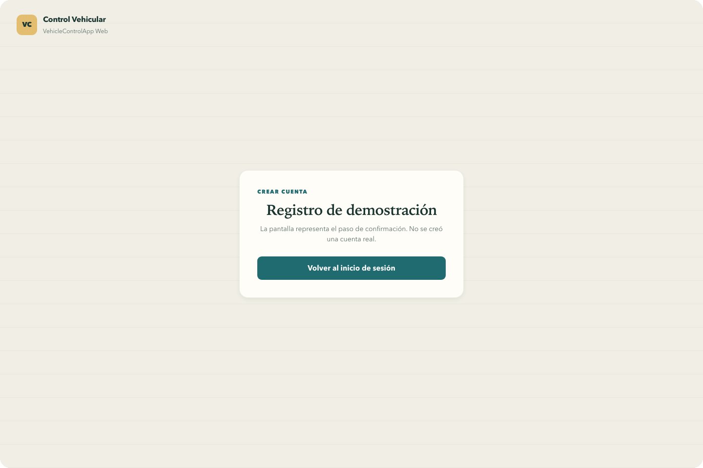

#### Ficha 04 · Recuperar contraseña
**Objetivo:** solicitar recuperación con el correo. **Quién/HU:** titular · acceso transversal. **Continuar:** muestra confirmación genérica. **Cancelar:** vuelve al acceso.

#### Ficha 05 · Solicitud de recuperación
**Objetivo:** confirmar que se enviarán instrucciones si existe la cuenta. **Quién/HU:** titular · acceso transversal. **Continuar:** abre el siguiente paso de demostración. **Cancelar:** vuelve al acceso.

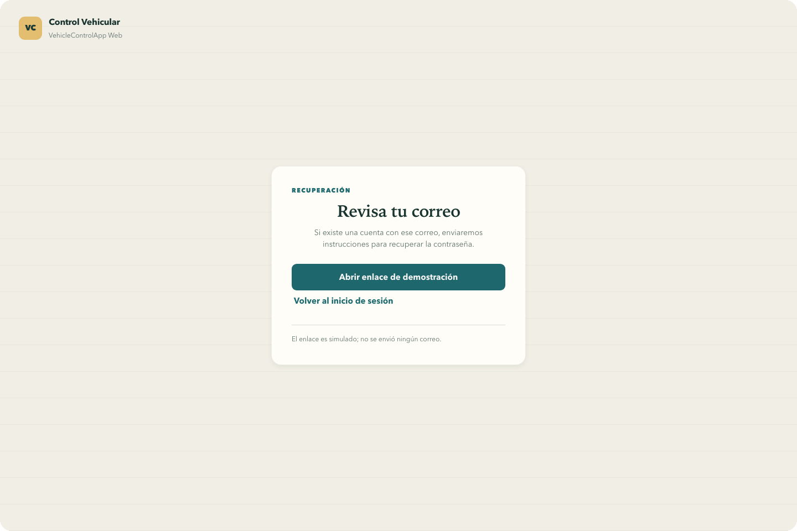

#### Ficha 06 · Crear contraseña nueva
**Objetivo:** representar el cambio de contraseña. **Quién/HU:** titular · acceso transversal. **Guardar:** muestra confirmación simulada. **Cancelar:** vuelve a recuperación.

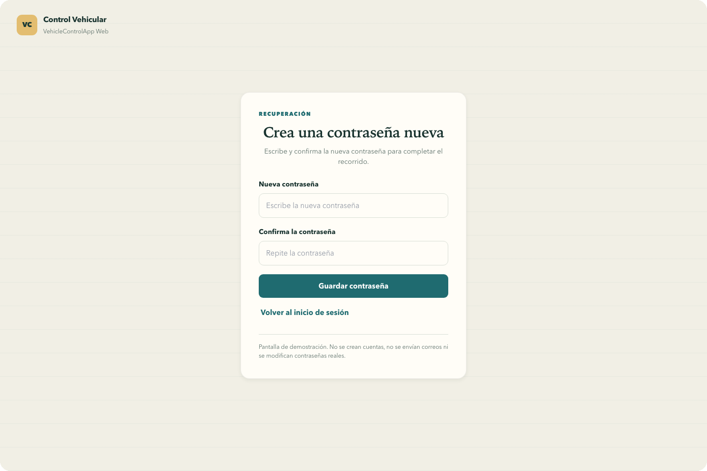

#### Ficha 07 · Contraseña actualizada
**Objetivo:** confirmar el final del recorrido simulado. **Quién/HU:** titular · acceso transversal. **Continuar o volver:** regresa al acceso; no cambia una contraseña real.

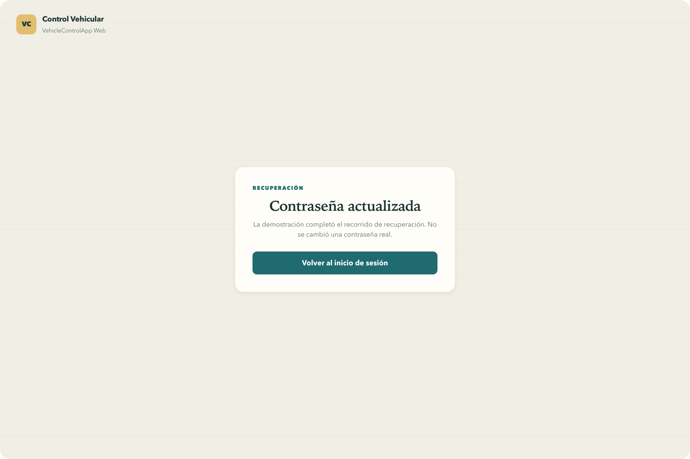

#### Ficha 08 · Mis vehículos
**Objetivo:** consultar la flota, conteos y vencimientos. **Quién/HU:** titular · HU-01, HU-05. **Continuar:** agregar abre el formulario; elegir una tarjeta abre el detalle. El estado vacío permite crear el primer vehículo. **Salir:** vuelve al acceso.

#### Ficha 09 · Crear o editar vehículo
**Objetivo:** clasificar y guardar los datos del vehículo. **Quién/HU:** titular · HU-01. **Variantes:** particular muestra la opción inDrive; taxi muestra conductor y cuota. **Guardar:** abre el detalle. **Cancelar:** vuelve a la flota al crear o al detalle al editar.

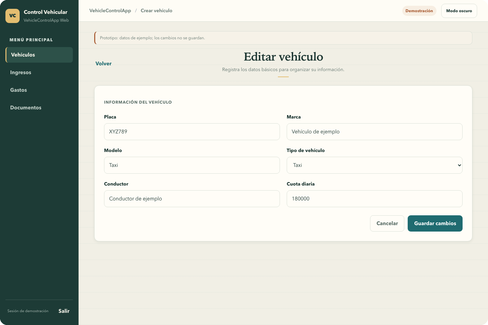

#### Ficha 10 · Detalle del vehículo
**Objetivo:** consultar datos, documentos, ingresos y gastos. **Quién/HU:** titular · HU-01 a HU-05. **Continuar:** permite editar o iniciar registros; taxi muestra cuota e inDrive aparece en particulares habilitados. **Volver:** regresa a la flota. Si tiene movimientos, se ofrece desactivar; sin ellos, eliminar con confirmación.

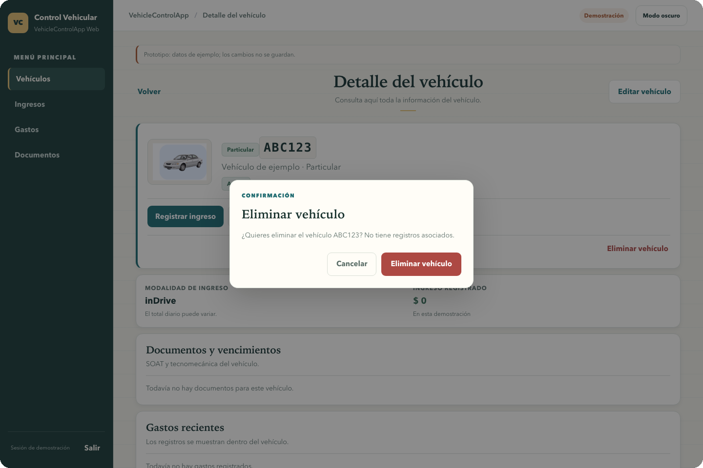

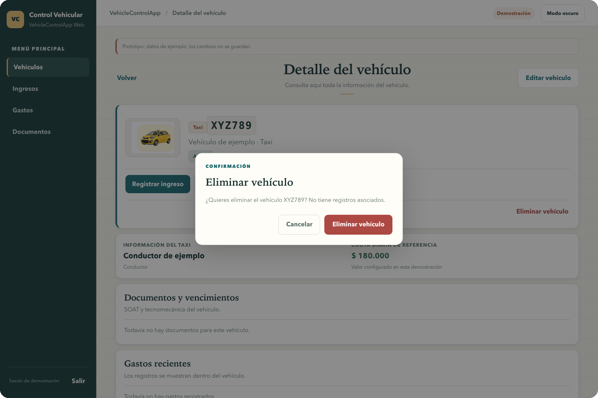

#### Ficha 11 · Registrar o editar ingreso
**Objetivo:** registrar el ingreso del día. **Quién/HU:** titular · HU-02. **Variantes:** taxi, valor recibido y motivo; inDrive, total variable y nota. **Guardar/cancelar:** vuelve al detalle; un valor menor o cero no cambia la cuota. **Eliminar:** requiere confirmación definitiva.

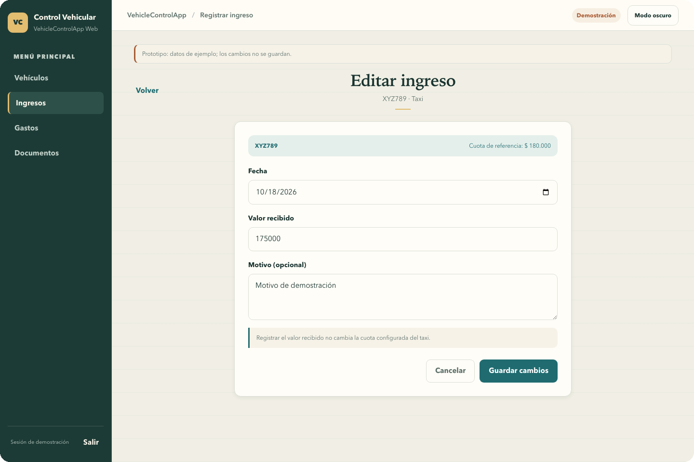
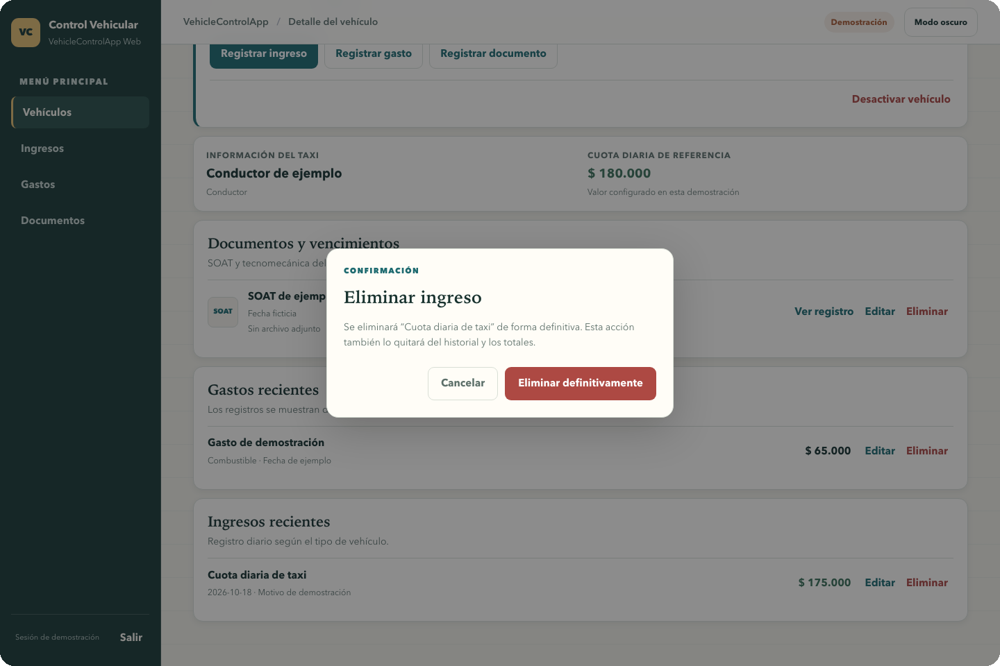

#### Ficha 12 · Ingresos
**Objetivo:** consultar ingresos y elegir un vehículo para registrar otro. **Quién/HU:** titular · HU-02. **Continuar:** permite abrir o editar registros; elegir vehículo lleva a la flota. **Volver:** navegación principal. La captura muestra el estado vacío.

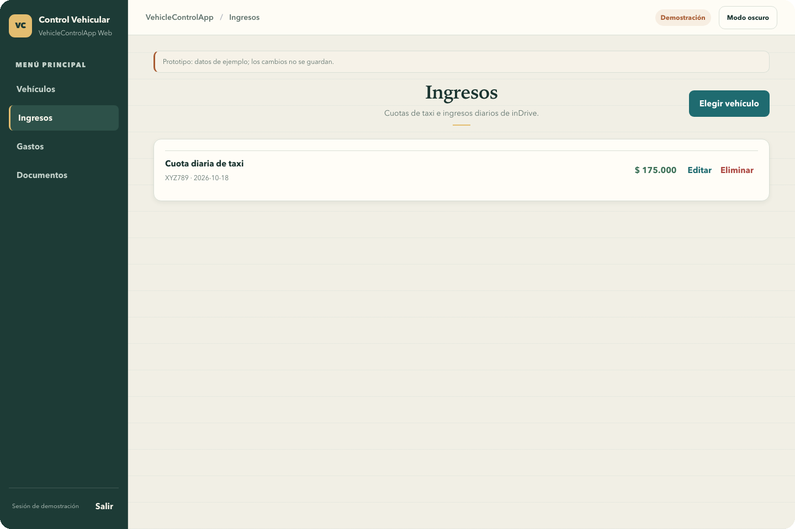

#### Ficha 13 · Registrar o editar gasto
**Objetivo:** registrar fecha, valor, descripción y categoría. **Quién/HU:** titular · HU-03. **Guardar/cancelar:** vuelve al detalle. Administrar categorías abre esa pantalla; editar carga el gasto. **Eliminar:** pide confirmación y borra definitivamente.

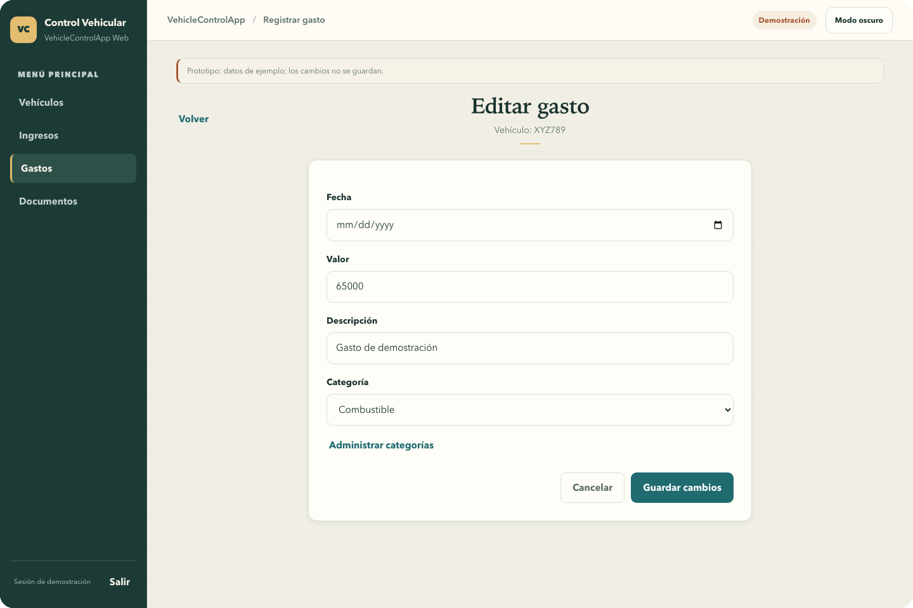

#### Ficha 14 · Gastos
**Objetivo:** consultar gastos y abrir el vehículo o un registro. **Quién/HU:** titular · HU-03, HU-05. **Continuar:** permite registrar después de elegir vehículo, editar o solicitar eliminación. **Volver:** navegación principal.

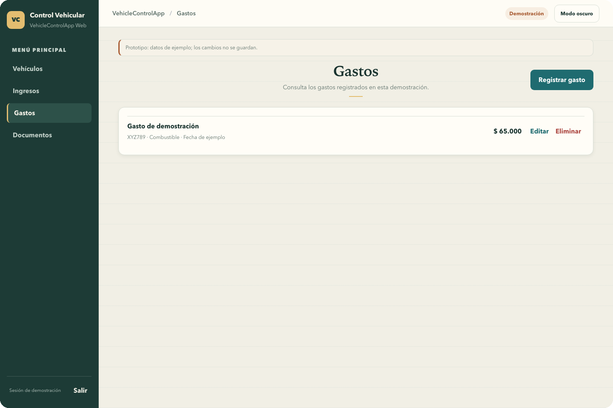

#### Ficha 15 · Categorías de gasto
**Objetivo:** agregar, renombrar o desactivar categorías. **Quién/HU:** titular · HU-03. **Continuar:** desactivar abre confirmación; los gastos anteriores conservan la categoría. **Cancelar o volver:** regresa al formulario de gasto.

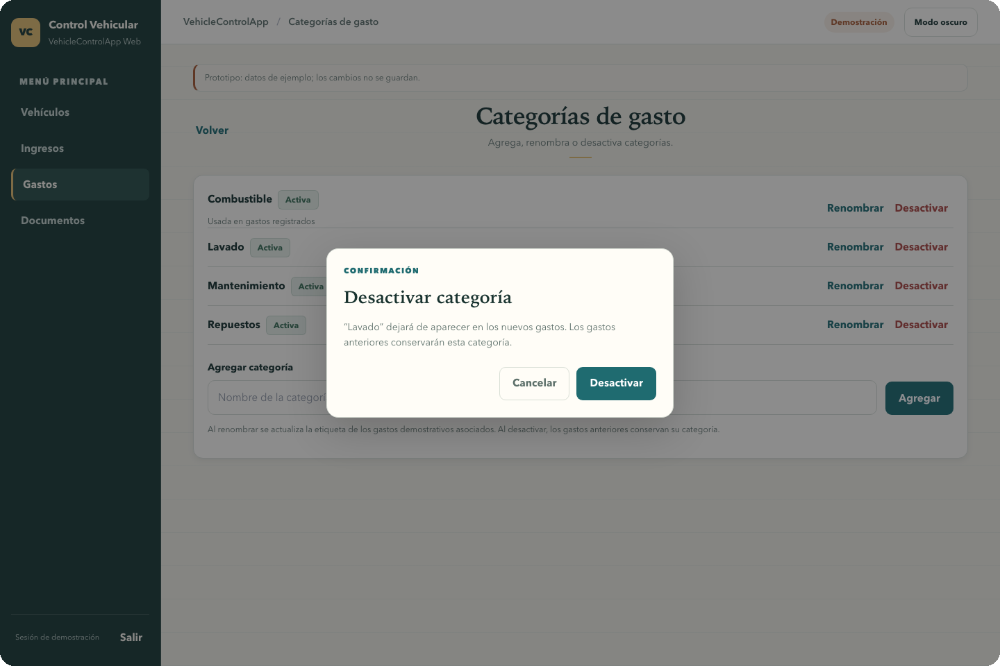

#### Ficha 16 · Documentos
**Objetivo:** consultar documentos de los vehículos. **Quién/HU:** titular · HU-04, HU-05. **Continuar:** permite abrir, editar o pedir eliminación; para crear, se elige primero un vehículo. **Volver:** navegación principal.

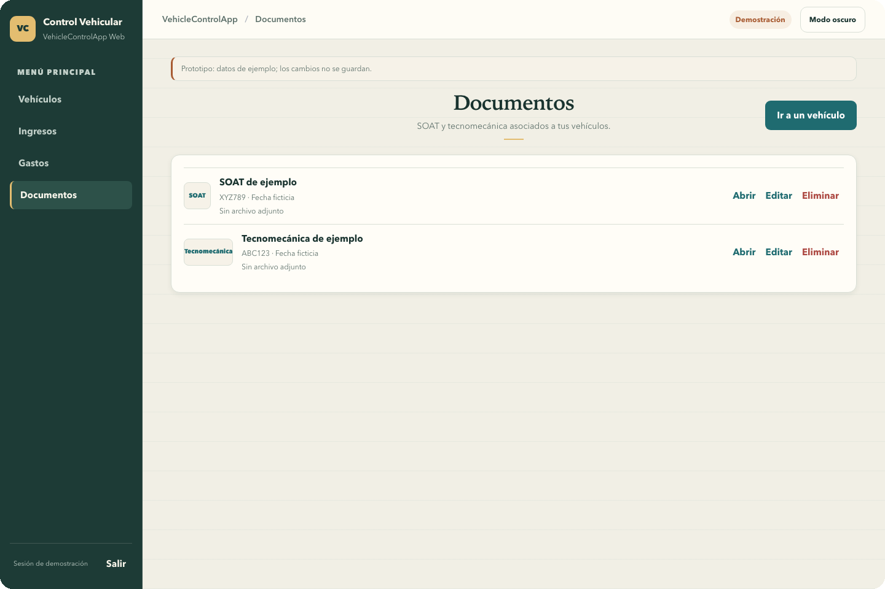

#### Ficha 17 · Registrar, editar o adjuntar documento
**Objetivo:** guardar tipo, nombre y vencimiento, y adjuntar o reemplazar un archivo. **Quién/HU:** titular · HU-04. **Guardar:** muestra confirmación; el archivo queda en la sesión del navegador. **Cancelar:** vuelve al detalle. **Eliminar:** pide confirmar el borrado del registro y archivo.

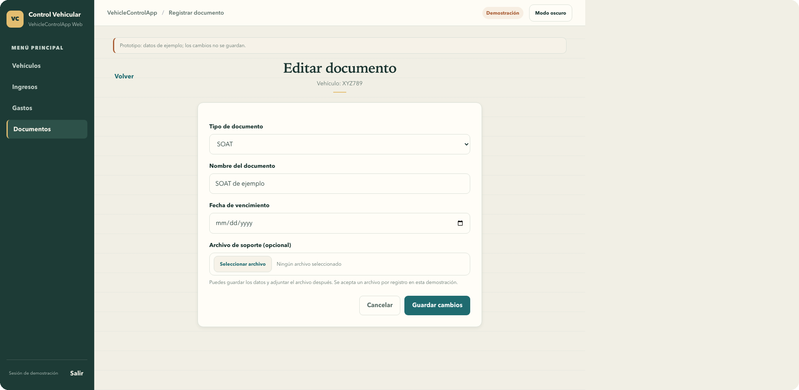

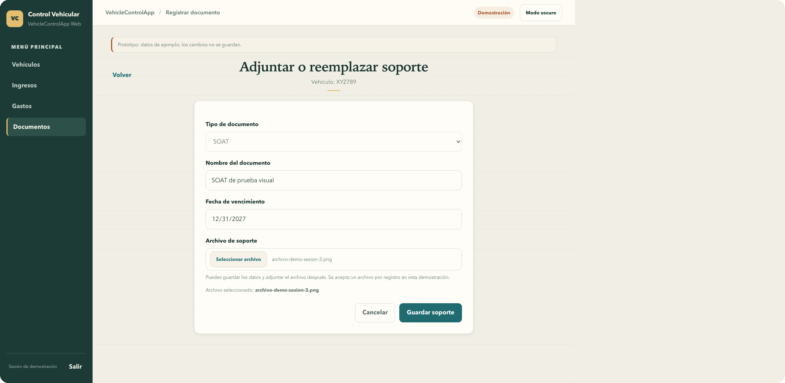
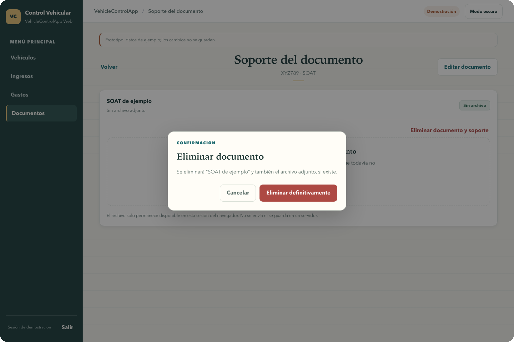

#### Ficha 18 · Documento guardado
**Objetivo:** confirmar el registro e indicar si falta adjuntar soporte. **Quién/HU:** titular · HU-04. **Continuar:** adjunta el archivo o permite visualizarlo. **Volver:** regresa al detalle.

#### Ficha 19 · Ver soporte
**Objetivo:** consultar, visualizar o descargar el archivo. **Quién/HU:** titular · HU-04, HU-05. **Continuar:** con archivo, ofrece vista previa o descarga; sin archivo, muestra el registro. **Volver:** regresa al detalle. El archivo de demostración es ficticio.

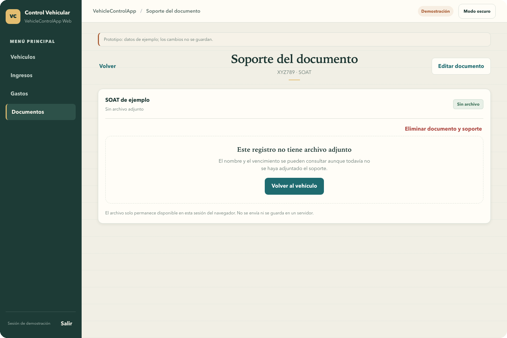

## 6. Vistas responsive para móvil

Revisé el detalle del taxi a 360 × 800 px. Para dejar espacio a las tareas, organicé la información en una columna, las acciones rápidas en dos y «Registrar documento» a todo el ancho. Esta es la vista responsive de la Web App en una pantalla móvil. Aún falta revisar las demás pantallas móviles, incluidas las etiquetas, la legibilidad y el orden con teclado.

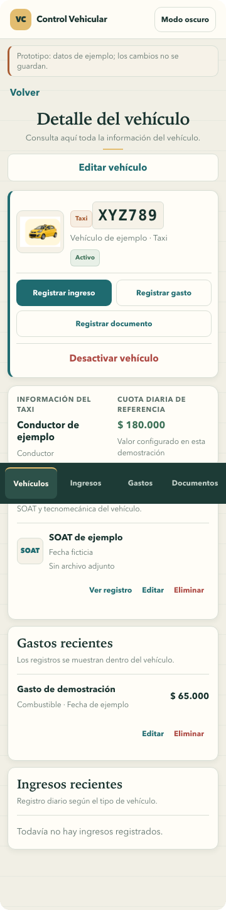

## 7. Elementos comunes, mensajes y estados

La guía propone responder «¿dónde estoy?», «¿qué puedo hacer?» y «¿qué resultado obtuve?». En el diseño uso títulos y el vehículo visible, acciones directas y confirmaciones breves. Falta validar los textos con Katerin.

Matriz propuesta para el recorrido del vehículo y sus documentos. Los textos son borradores; no todos aparecen en el prototipo.

| Estado | Mensaje propuesto | Situación |
|---|---|---|
| Carga | «Guardando el documento…» | Pendiente; no hay servicio conectado. |
| Vacío | «Este vehículo aún no tiene documentos. Registra el SOAT o la tecnomecánica.» | Pendiente para documentos; la demostración sí incluye el estado vacío de vehículos e ingresos. |
| Éxito | «Documento guardado. Puedes adjuntar el soporte ahora o después.» | Simulado en la confirmación. |
| Dato incorrecto | «Completa el nombre y la fecha de vencimiento.» | Propuesta; falta representar la validación de campos. |
| Regla del negocio | «Este vehículo tiene registros. Desactívalo para conservar su historial.» | Regla y confirmación representadas; texto por validar con Katerin. |
| Error de servicio | «No pudimos guardar el documento. Inténtalo de nuevo.» | Pendiente; el prototipo no se conecta a un servicio. |

| Elemento común | Uso |
|---|---|
| Encabezado y navegación | Identifican el producto y llevan a vehículos, ingresos, gastos y documentos. |
| Formularios | Mantienen etiquetas visibles y acciones para guardar o cancelar. |
| Confirmaciones | Se usan para eliminaciones permanentes y desactivaciones. |
| Soportes | Distinguen registro sin archivo, adjunto, vista previa y descarga simulada. |

## 8. Reglas de edición y eliminación reflejadas

| Dato | Regla de edición/eliminación del MVP | Cómo aparece en el diseño |
|---|---|---|
| Vehículo | Se edita. Sin registros asociados se puede eliminar con confirmación; si tiene registros, se desactiva. | El prototipo permite editar. En el detalle presenta desactivación cuando hay registros o eliminación cuando no los hay. |
| Ingreso o gasto | Se edita o se elimina definitivamente con confirmación. Al borrarlo, desaparece del historial y totales. | El prototipo permite editar y muestra una confirmación antes del borrado definitivo. |
| Documento | Se editan sus datos, se puede reemplazar el archivo y al eliminar se borra también el adjunto, con confirmación. | El prototipo permite editar, reemplazar el archivo y confirmar el borrado del registro y su soporte. |
| Categoría | Se agrega o renombra. Si una categoría ya está usada, se desactiva para conservar los gastos anteriores. | El prototipo permite agregar, renombrar y desactivar categorías. Los gastos asociados conservan su etiqueta al desactivarla; al renombrar, se actualiza la etiqueta de los gastos demostrativos. |

Estas reglas corresponden a decisiones del producto para el MVP; no son resultado de una prueba con Katerin.

## 9. Prueba de usabilidad pendiente

**Participante:** Katerin. **Responsable:** Ivan Dario Madrid Daza. **Fecha prevista:** 21 de octubre de 2026. La sesión aún no se ha realizado.

| Tarea que propondré | Qué observaré |
|---|---|
| Crear un vehículo y abrir su detalle. | Si distingue taxi y particular y encuentra la información. |
| Registrar un ingreso diario. | Si entiende la diferencia entre cuota de taxi e ingreso variable de inDrive. |
| Registrar un gasto. | Si encuentra la categoría y entiende cómo corregir o cancelar. |
| Guardar un SOAT sin archivo, adjuntarlo después y abrirlo. | Si encuentra y visualiza el soporte desde el vehículo. |
| Revisar una eliminación. | Si entiende que el ingreso o gasto se borra definitivamente y puede cancelar. |

Durante la sesión plantearé cada tarea y observaré sin indicar dónde hacer clic. Después registraré la dificultad, el comentario de Katerin, el ajuste decidido y el resultado al volver a probarlo. No usaré como resultado sus revisiones anteriores.

## 10. Pendientes

- Revisar los demás recorridos móviles, el orden con teclado y los mensajes de validación.
- Realizar la prueba con Katerin y registrar observaciones y un ajuste real.
- Preparar la publicación de revisión en GitHub Pages y verificar el enlace antes de incorporarlo. Aún no se ha publicado.
- Precisar la vigencia de cambios en la cuota, las reglas técnicas de acceso y los formatos, tamaño y conservación de archivos antes de implementar.

## 11. Revisión de entrega

| Elemento | Estado |
|---|---|
| Recorrido, mapa y fichas con capturas | Incluidos. |
| Elementos comunes y estados | Incluidos; algunos estados siguen como propuesta o pendiente. |
| Recorrido móvil a 360 px y ajuste visual | Incluido para el detalle del taxi; faltan las demás pantallas. |
| Prototipo y enlace accesible | Prototipo local incluido; URL de GitHub Pages pendiente. |
| Prueba, observaciones y ajuste | Pendientes de la sesión con Katerin. |

## Fuentes

- Instructor, *Sesión 03 — Diseño de Pantallas*, *Plantilla de Diseño de Pantallas* y *Ejemplo de Diseño de Pantallas — Horizonte*. Uso el ejemplo solo como referencia de estructura.
- [Contexto del proyecto](contexto-proyecto.md).
- [Evidencia de requerimientos y backlog de sesión 2](evidencia-sesion-2-requerimientos-backlog.md).
- Conversaciones y decisiones de Ivan sobre acceso, cuentas y reglas de edición y eliminación.
