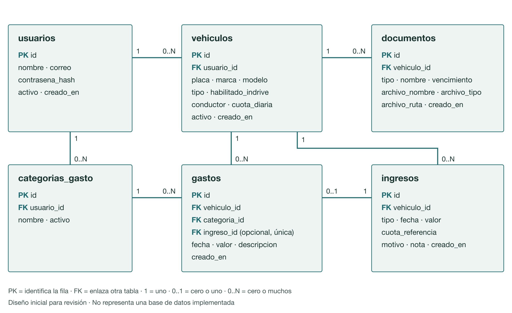

# Modelo de datos y servicios de VehicleControlApp Web

| Proyecto | Integrantes y versión |
|---|---|
| VehicleControlApp Web · DazaDev | Ivan Dario Madrid Daza, trabajo individual. Versión 0.4 del 28 de octubre de 2026: apartados 1 y 2 ajustados al alcance de la primera versión y modelo cargado en Neon y Hasura, para la revisión del 29 de octubre de 2026. |

- **Actividad:** Sesiones 4 y 5 — Modelo de datos y servicios del MVP
- **Usuaria inicial:** Katerin, propietaria y administradora de una pequeña flota
- **Estado:** modelo inicial para revisión. Las tablas ya están creadas en Neon y expuestas por Hasura con datos de prueba ficticios; no hay aplicación, servicios, autenticación ni permisos implementados.

Esta evidencia sigue la plantilla del instructor. En esta versión desarrollo los apartados 1 y 2, que corresponden a la semana 4. Los apartados 3 (servicios) y 4 (revisión y compromisos) se completan para el 5 de noviembre de 2026.

Parto de las historias HU-01 a HU-05 de la [evidencia de sesión 2](evidencia-sesion-2-requerimientos-backlog.md), de las pantallas, reglas y ajustes de la [evidencia de sesión 3](evidencia-sesion-3-diseno-pantallas.md), de las validaciones del prototipo y de la retroalimentación del instructor técnico sobre la sesión 3. Los datos del ejemplo son ficticios.

## 1. Proceso y entidades

### Alcance de la primera versión

El 27 de octubre de 2026 el instructor técnico revisó la evidencia de sesión 3 y recomendó reducir el alcance de implementación para conservar un MVP viable. El 28 de octubre de 2026 acepté la recomendación y ajusté el modelo a esa primera versión.

- **Entra en la primera versión:**
  - Vehículos taxi y particular, con la cuota del taxi y la opción de inDrive.
  - Ingresos diarios, gastos y categorías.
  - Registro de SOAT y tecnomecánica con nombre y vencimiento.
  - Consulta por vehículo.
  - Ingreso con correo y contraseña a una cuenta creada previamente.
- **Pasa a una fase posterior:**
  - Registro propio de cuentas, verificación del correo y recuperación de contraseña.
  - Almacenamiento, visualización y descarga de archivos de soporte.
  - Pago automático al conductor y otras automatizaciones contables.
  - Resumen mensual.

Las necesidades que expresó Katerin se conservan: adjuntar el soporte del documento (2 de octubre) y replicar su resultado contable con el pago al conductor (20 de octubre). Solo cambia la fase en que se implementan. En la primera versión, el pago al conductor se registra como un gasto más.

**Pantallas de la primera versión.** De las 35 pantallas del mapa de la [evidencia de sesión 3](evidencia-sesion-3-diseno-pantallas.md), la primera versión usa 26. Pasan a la fase posterior las 9 que dependen de las funciones aplazadas:
- 02 y 03: crear cuenta.
- 04 a 07: recuperar la contraseña.
- 15: documento con archivo.
- 16: vista previa del soporte.
- 26: descargar el soporte.

La propuesta de resumen mensual (P) también queda para después. Cuatro pantallas se simplifican: la 13 (registrar documento) y la 29 (editar documento) quedan sin archivo, la 14 (documento guardado) queda sin la opción de adjuntar y la 30 (confirmar eliminación) ya no menciona un archivo.

### Proceso del MVP

El MVP registra la información diaria de cada vehículo de la flota y permite consultarla en un solo lugar. Cada cuenta tiene su propia flota y no hay roles compartidos. El recorrido principal, con datos ficticios, es el siguiente:

1. La titular ingresa con el correo y la contraseña de su cuenta y ve su flota.
2. Crea el taxi XYZ789 con una cuota diaria de $60.000.
3. Registra el ingreso de un día por $60.000 y, aparte, el gasto de $5.000 del pago al conductor.
4. Registra el SOAT del taxi con su nombre y vencimiento.
5. Consulta el taxi y ve el ingreso de $60.000, el gasto de $5.000 y el SOAT. Si intenta registrar otro día por $40.000 sin escribir el motivo, la aplicación rechaza el ingreso y no guarda nada.

### Qué información necesitamos guardar

| Entidad o tabla | Para qué sirve |
|---|---|
| `usuarios` | Identificar a la persona titular de cada cuenta y permitirle ingresar. |
| `vehiculos` | Conservar los vehículos de cada cuenta, su clasificación como taxi o particular, la cuota del taxi y si un particular trabaja con inDrive. |
| `ingresos` | Guardar el ingreso diario de cada vehículo: el valor recibido del taxi frente a su cuota o el total variable de inDrive. |
| `categorias_gasto` | Conservar las categorías de gasto de cada cuenta y saber cuáles siguen activas. |
| `gastos` | Guardar los gastos de cada vehículo con fecha, valor, descripción y categoría, incluido el pago al conductor. |
| `documentos` | Guardar el SOAT y la tecnomecánica de cada vehículo con su nombre y vencimiento. |

### Historias y tablas

| Historia | Tablas que utiliza |
|---|---|
| Acceso: ingresar a la cuenta | `usuarios` |
| HU-01 · Crear y clasificar vehículos | `vehiculos`, `usuarios` |
| HU-02 · Registrar ingresos y ajustar la cuota del taxi | `ingresos`, `vehiculos` |
| HU-03 · Registrar gastos y mantener categorías | `gastos`, `categorias_gasto`, `vehiculos` |
| HU-04 · Registrar y consultar documentos (sin archivo en la primera versión) | `documentos`, `vehiculos` |
| HU-05 · Consultar información por vehículo | `vehiculos`, `ingresos`, `gastos`, `documentos` |

### Trabajo en dos semanas

| Semana y encuentro | Avance esperado | Revisión |
|---|---|---|
| 4 · 22 de octubre | Proceso, entidades, diagrama y campos iniciales (esta versión). | 29 de octubre |
| 5 · 29 de octubre | Modelo ajustado, servicios principales y comprobación del flujo. | 5 de noviembre |

Además de lo que pasa a la fase posterior, quedan para después del MVP:
- Las novedades, los impuestos, las alertas y recordatorios de vencimiento, los reportes y las facturas.
- Los roles para compartir una flota.

## 2. Modelo de datos

Cada vehículo pertenece a una cuenta. Los ingresos, gastos y documentos pertenecen a un vehículo y, a través de él, a la misma cuenta. Las categorías también son de cada cuenta. PK identifica la fila y FK la conecta con otra tabla.

### Campos de cada tabla

En **Tipo** uso tipos simples y, entre paréntesis, su equivalente en PostgreSQL:
- Los valores en dinero son pesos colombianos sin decimales.
- `fecha` es el día del registro que elige la titular.
- `creado_en` es la fecha y hora en que el servidor guarda la fila.

**Tabla: `usuarios`**

| Campo | Tipo | Regla o explicación |
|---|---|---|
| id | entero (`integer`) | PK. Lo genera el sistema. |
| nombre | texto (`varchar(80)`) | Obligatorio. Nombre visible de la titular. |
| correo | texto (`varchar(120)`) | Obligatorio y único. Sirve para ingresar. |
| contrasena_hash | texto (`text`) | Obligatorio. Contraseña protegida mediante hash; nunca se muestra ni se devuelve. |
| activo | sí/no (`boolean`) | Propuesta. Inicia en sí y permitiría desactivar una cuenta sin borrar sus datos. No hay reglas acordadas para desactivar cuentas. |
| creado_en | fecha y hora (`timestamptz`) | La establece el servidor. |

**Tabla: `vehiculos`**

| Campo | Tipo | Regla o explicación |
|---|---|---|
| id | entero (`integer`) | PK. Lo genera el sistema. |
| usuario_id | entero (`integer`) | FK obligatoria a `usuarios.id`. Se toma de la sesión, no del formulario. |
| placa | texto (`varchar(10)`) | Obligatoria y en mayúsculas. Única dentro de la misma cuenta. Otra cuenta puede registrar la misma placa. |
| marca | texto (`varchar(60)`) | Obligatoria. |
| modelo | texto (`varchar(60)`) | Obligatorio. Modelo o año. |
| tipo | texto (`varchar(12)`) | Obligatorio: TAXI o PARTICULAR. |
| habilitado_indrive | sí/no (`boolean`) | Inicia en no. Solo puede ser sí en un vehículo particular. |
| conductor | texto (`varchar(80)`) | Opcional. Solo aplica al taxi. |
| cuota_diaria | entero (`integer`) | Obligatoria en el taxi y mayor o igual a cero; vacía en el particular. Es la cuota vigente; Katerin puede cambiarla. |
| activo | sí/no (`boolean`) | Inicia en sí. Un vehículo con registros se desactiva en lugar de eliminarse. |
| creado_en | fecha y hora (`timestamptz`) | La establece el servidor. |

**Tabla: `ingresos`**

| Campo | Tipo | Regla o explicación |
|---|---|---|
| id | entero (`integer`) | PK. Lo genera el sistema. |
| vehiculo_id | entero (`integer`) | FK obligatoria a `vehiculos.id`. El vehículo debe estar activo y pertenecer a la cuenta. |
| tipo | texto (`varchar(10)`) | Obligatorio: TAXI o INDRIVE. Debe coincidir con el vehículo: TAXI para un taxi e INDRIVE para un particular habilitado. |
| fecha | fecha (`date`) | Obligatoria. Solo un ingreso por vehículo y fecha; para corregirlo se edita el registro. |
| valor | entero (`integer`) | Obligatorio y mayor o igual a cero. Se admite cero cuando no hubo ingreso. |
| cuota_referencia | entero (`integer`) | Solo en el taxi. Copia la cuota del vehículo al registrar, para que un cambio de cuota no altere los ingresos anteriores. |
| motivo | texto (`text`) | Obligatorio en el taxi cuando el valor es distinto de la cuota de referencia. |
| nota | texto (`text`) | Opcional. Se usa en inDrive. |
| creado_en | fecha y hora (`timestamptz`) | La establece el servidor. |

**Tabla: `categorias_gasto`**

| Campo | Tipo | Regla o explicación |
|---|---|---|
| id | entero (`integer`) | PK. Lo genera el sistema. |
| usuario_id | entero (`integer`) | FK obligatoria a `usuarios.id`. Cada cuenta tiene sus categorías. |
| nombre | texto (`varchar(40)`) | Obligatorio y único dentro de la cuenta, sin distinguir mayúsculas. Al crear la cuenta se generan Combustible, Lavado, Mantenimiento y Repuestos. |
| activo | sí/no (`boolean`) | Inicia en sí. Una categoría desactivada no aparece en gastos nuevos y se conserva en los anteriores. |

**Tabla: `gastos`**

| Campo | Tipo | Regla o explicación |
|---|---|---|
| id | entero (`integer`) | PK. Lo genera el sistema. |
| vehiculo_id | entero (`integer`) | FK obligatoria a `vehiculos.id`. El vehículo debe estar activo y pertenecer a la cuenta. |
| categoria_id | entero (`integer`) | FK obligatoria a `categorias_gasto.id`. Debe ser una categoría activa de la misma cuenta. |
| fecha | fecha (`date`) | Obligatoria. |
| valor | entero (`integer`) | Obligatorio y mayor que cero. |
| descripcion | texto (`varchar(120)`) | Obligatoria. |
| creado_en | fecha y hora (`timestamptz`) | La establece el servidor. |

En la primera versión, el pago al conductor se registra a mano como cualquier otro gasto. La conexión automática con el ingreso del taxi queda para la fase posterior.

**Tabla: `documentos`**

| Campo | Tipo | Regla o explicación |
|---|---|---|
| id | entero (`integer`) | PK. Lo genera el sistema. |
| vehiculo_id | entero (`integer`) | FK obligatoria a `vehiculos.id`. |
| tipo | texto (`varchar(15)`) | Obligatorio: SOAT o TECNOMECANICA. |
| nombre | texto (`varchar(80)`) | Obligatorio. Por ejemplo, «SOAT 2026». |
| vencimiento | fecha (`date`) | Obligatoria. |
| creado_en | fecha y hora (`timestamptz`) | La establece el servidor. |

En la primera versión el documento se registra sin archivo. Los campos del soporte se agregan en la fase posterior, como se describe más abajo.

### Datos que se calculan

Estos datos no se guardan en una columna, para evitar copias que puedan quedar desactualizadas:
- Totales de ingresos y gastos por vehículo y por mes, y el neto.
- Próximos vencimientos de la flota.
- Si un documento está vigente o vencido, a partir de `vencimiento`.
- Si un vehículo tiene registros, que decide si se desactiva o se puede eliminar.

### Cómo se relacionan las tablas

| Relación | Explicación y campo que conecta | Hasura |
|---|---|---|
| `usuarios` con `vehiculos` | Uno a muchos: una cuenta tiene cero o muchos vehículos; cada vehículo pertenece a una cuenta. FK obligatoria `vehiculos.usuario_id`. | `usuario.vehiculos`: array. `vehiculo.usuario`: object. |
| `usuarios` con `categorias_gasto` | Uno a muchos: una cuenta tiene sus categorías; cada categoría pertenece a una cuenta. FK obligatoria `categorias_gasto.usuario_id`. | `usuario.categorias_gasto`: array. `categoria_gasto.usuario`: object. |
| `vehiculos` con `ingresos` | Uno a muchos: un vehículo tiene cero o muchos ingresos, uno por fecha. FK obligatoria `ingresos.vehiculo_id`. | `vehiculo.ingresos`: array. `ingreso.vehiculo`: object. |
| `vehiculos` con `gastos` | Uno a muchos: un vehículo tiene cero o muchos gastos. FK obligatoria `gastos.vehiculo_id`. | `vehiculo.gastos`: array. `gasto.vehiculo`: object. |
| `vehiculos` con `documentos` | Uno a muchos: un vehículo tiene cero o muchos documentos. FK obligatoria `documentos.vehiculo_id`. | `vehiculo.documentos`: array. `documento.vehiculo`: object. |
| `categorias_gasto` con `gastos` | Uno a muchos: una categoría clasifica cero o muchos gastos. FK obligatoria `gastos.categoria_id`. | `categoria_gasto.gastos`: array. `gasto.categoria`: object. |

No hay relaciones muchos a muchos, así que no se necesita una tabla intermedia.

**Regla de pertenencia:** cada ingreso, gasto o documento llega a su cuenta a través de `vehiculos.usuario_id`. La categoría de un gasto debe pertenecer a la misma cuenta que el vehículo.

### Modelo cargado en Neon y Hasura

Por indicación del instructor, el 28 de octubre de 2026 me registré en Neon y en Hasura Cloud y cargué en ellos el modelo de la primera versión. No es una aplicación implementada: no hay pantallas conectadas, servicios de NestJS, autenticación ni permisos por cuenta.

| Paso | Resultado |
|---|---|
| Base de datos en Neon | Proyecto `vehicle-control-app-web` en AWS US East 2 (Ohio). Ejecuté [`modelo-inicial.sql`](evidencia-sesion-4/modelo-inicial.sql) sin errores: seis tablas y cuatro índices. |
| API GraphQL en Hasura Cloud | Proyecto `vehicle-control-app` en el plan gratuito y en la misma región. Se conecta a Neon mediante una variable de entorno; la cadena de conexión y el secreto de administración no se guardan en el repositorio. |
| Tablas y relaciones | Registré las seis tablas y las seis relaciones en ambos sentidos con los nombres de este documento, por ejemplo `vehiculo.ingresos` (array) y `gasto.categoria` (object). |

Probé el recorrido del proceso con datos ficticios:
- Se guardaron la titular de prueba, sus categorías, el taxi XYZ789 con cuota de $60.000, un ingreso de $60.000, el gasto de $5.000 del pago al conductor y el SOAT.
- El ingreso de $40.000 sin motivo se rechazó por la restricción de la tabla `ingresos` y no se guardó.
- La consulta del taxi devolvió en una sola respuesta su titular, su ingreso, su gasto y su SOAT.

Dos hallazgos para la semana 5:
- Hasura propuso `usuario.categorias_gasto` como object porque el índice único de categorías usa `lower(nombre)`. La registré a mano como array, que es lo que define el modelo.
- Hasura responde al rechazo del motivo con el código `permission-error`. El servicio deberá traducirlo a un mensaje claro y al código HTTP que se defina en los contratos.

### Cómo crece el modelo en la fase posterior

Esta tabla es una propuesta para las funciones que pasan a la fase posterior. No forma parte de la primera versión ni del diagrama.

| Función | Cambio propuesto en el modelo |
|---|---|
| Archivos de soporte | En `documentos`: `archivo_nombre`, `archivo_tipo` y `archivo_ruta`, opcionales y que se guardan o se vacían juntos. Un archivo por registro; al eliminar el documento se elimina también su archivo. |
| Pago automático al conductor | En `gastos`: `ingreso_id`, FK opcional y única a `ingresos.id`, para saber qué ingreso generó cada pago. Es una relación de uno a cero o uno; en Hasura, `ingreso.pago_conductor` y `gasto.ingreso` serían object. La categoría «Conductor» se crearía con el primer pago. |
| Registro, verificación y recuperación | Datos para verificar el correo y enlaces de recuperación con vigencia. La tabla y sus campos están por definir. |

Preguntas abiertas de esa fase:
- Formatos, tamaño, almacenamiento y conservación de los archivos.
- Si el pago al conductor es siempre de $5.000 o puede ser distinto en cada taxi, y dónde se guarda ese valor.
- Qué pasa con el gasto del conductor al editar o eliminar su ingreso.
- Reglas de verificación del correo y vigencia del enlace de recuperación.

### Decisiones y pendientes del modelo

El 26 de octubre de 2026 tomé estas decisiones de diseño como responsable del producto. No son decisiones de Katerin ni están implementadas:

- Los ingresos de taxi e inDrive van en una sola tabla con el campo `tipo`.
- Solo hay un ingreso por vehículo y fecha. Esto resuelve el pendiente de duplicados que dejó abierto la evidencia de sesión 2.
- La placa es única dentro de cada cuenta.
- Las categorías son de cada cuenta. Al crear la cuenta se generan Combustible, Lavado, Mantenimiento y Repuestos.

Ese día también decidí conectar el pago automático al conductor con su ingreso mediante `gastos.ingreso_id`, crear la categoría «Conductor» con el primer pago y eliminar ese gasto si el pago no se hizo. Con la retroalimentación del 27 de octubre, esas decisiones pasan a la fase posterior junto con la automatización.

El 28 de octubre de 2026, al aplicar esa retroalimentación, decidí para la primera versión:

- El acceso es un ingreso con correo y contraseña a una cuenta creada previamente. El registro propio, la verificación del correo y la recuperación pasan a la fase posterior.
- El pago al conductor se registra a mano como un gasto normal.
- Los documentos se registran con tipo, nombre y vencimiento, sin archivo.

Frente al borrador de la sección 9.3 de la evidencia de sesión 3:
- Agrego el `nombre` del documento, que exige HU-04.
- Calculo el estado del documento en lugar de guardarlo.
- Quito las marcas `conductorPagado` y `esConductor`. En la primera versión el pago al conductor es un gasto normal, y su conexión con el ingreso queda para la fase posterior.

| Pendiente de la primera versión | Fecha |
|---|---|
| Qué pasa con los ingresos guardados si un vehículo cambia de taxi a particular o al revés, o si un particular deja de estar habilitado para inDrive, ya que `ingresos.tipo` debe coincidir con el vehículo. Se define con los servicios de la semana 5. | 5 de noviembre de 2026 |
| Desde cuándo aplica una cuota nueva del taxi. El modelo ya conserva la cuota de referencia de cada ingreso. | Por definir |
| Si se puede reactivar un vehículo o una categoría. El campo `activo` lo permitiría. | Por definir |
| Cómo se crea la cuenta de la titular, que en la primera versión ya debe existir antes de ingresar. | Por definir |
| Reglas de la contraseña para el ingreso y si una cuenta se puede desactivar. | Por definir |

### Dudas para la revisión del 29 de octubre

1. ¿Es adecuado reunir los ingresos de taxi e inDrive en una sola tabla con `tipo`, o es preferible separarlos?
2. ¿Conviene guardar el dinero como entero en pesos (`integer`) o como `numeric`?
3. ¿Es suficiente para la primera versión un ingreso con correo y contraseña a una cuenta creada previamente, dejando el registro propio y la recuperación para después?

La orientación técnica del instructor es React, NestJS, Hasura GraphQL Engine y PostgreSQL en Neon. La uso como referencia para los tipos y las relaciones; no es una decisión cerrada. Los apartados 3 y 4 se completan para el 5 de noviembre de 2026.

La plantilla sugiere la carpeta `docs/04-datos-servicios`. Conservo la convención del repositorio: la evidencia en `docs/evidencia-sesion-4-modelo-datos-servicios.md` y el diagrama en `docs/evidencia-sesion-4/`.

## Historial de versiones

| Versión | Fecha | Cambios |
|---|---|---|
| 0.1 | 26 de octubre de 2026 | Proceso, entidades, diagrama, campos y relaciones iniciales para la revisión del 29 de octubre. |
| 0.2 | 26 de octubre de 2026 | Ajustes antes de la revisión: `usuarios.activo` queda como propuesta; el gasto del conductor se elimina si ese día no se pagó; se completa la lista de decisiones con las categorías iniciales de cada cuenta; se agregan los pendientes del valor del pago al conductor, del cambio de tipo o de habilitación para inDrive de un vehículo con ingresos y de la desactivación de cuentas; las evidencias de sesiones 2 y 3 enlazan a esta. |
| 0.3 | 28 de octubre de 2026 | Aplica la retroalimentación del instructor técnico del 27 de octubre: se define el alcance de la primera versión, con 26 de las 35 pantallas de la sesión 3; salen `gastos.ingreso_id` y los campos de archivo; el acceso queda como ingreso básico; se agrega cómo crece el modelo en la fase posterior; se actualizan el proceso, las historias, los pendientes y las dudas, incluido quién crea la cuenta de la titular. |
| 0.4 | 28 de octubre de 2026 | Registra la carga del modelo en Neon y Hasura Cloud por indicación del instructor, la prueba con datos ficticios y dos hallazgos para la semana 5. |

## Fuentes

- Instructor: *Sesiones 04 y 05 — Modelo de Datos y Contratos de API*, *Plantilla de Datos y API* y *Ejemplo de Datos y API — Horizonte*. Uso el ejemplo solo como referencia de estructura.
- Retroalimentación del instructor técnico sobre la evidencia de sesión 3, recibida el 27 de octubre de 2026.
- [Evidencia de requerimientos y backlog de sesión 2](evidencia-sesion-2-requerimientos-backlog.md).
- [Evidencia de diseño de pantallas de sesión 3](evidencia-sesion-3-diseno-pantallas.md).
- [Contexto del proyecto](contexto-proyecto.md).
- Indicación del instructor de registrarse en Neon y Hasura Cloud.
- Prototipo de sesión 3: las validaciones de vehículos, ingresos, gastos, categorías y documentos.
