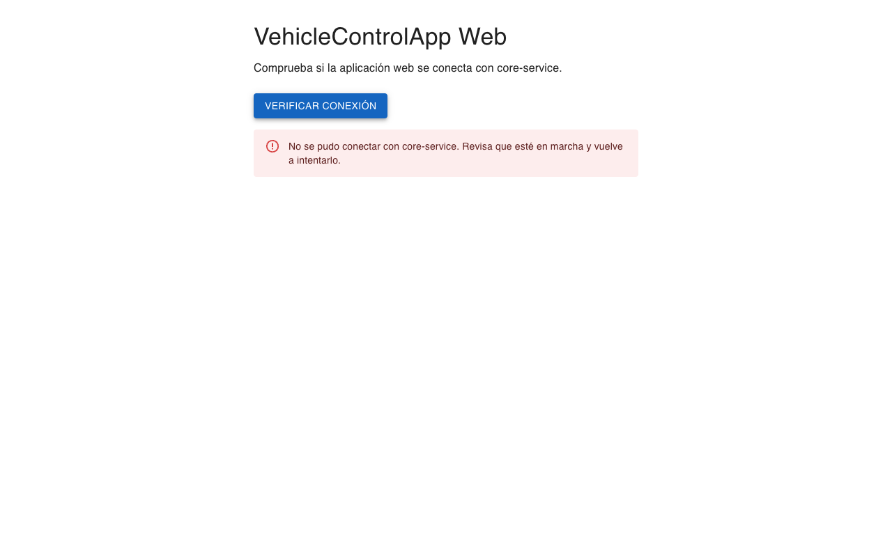
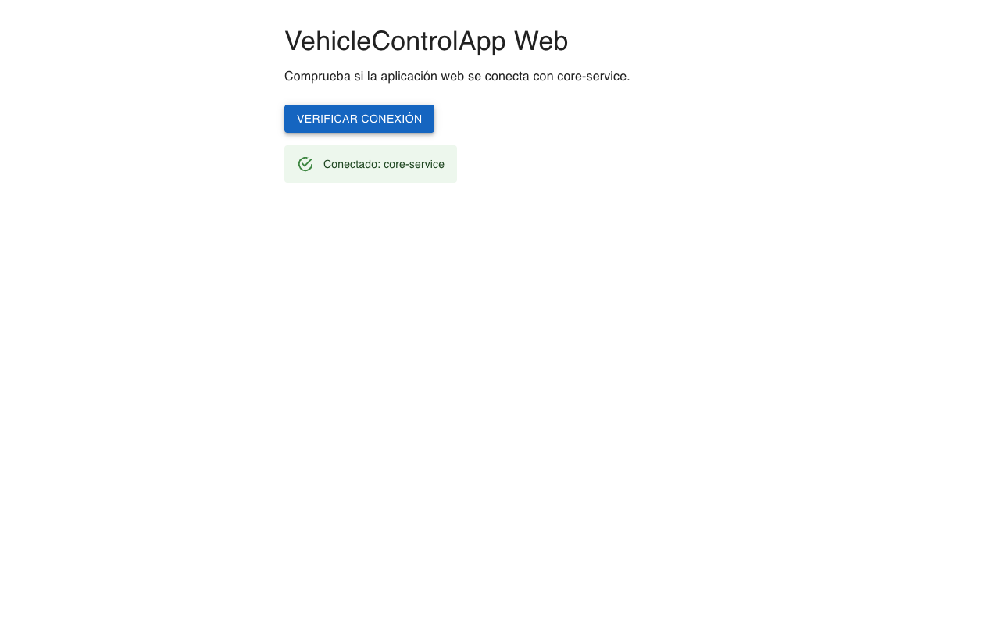

# Evidencia de sesión 6: monorepo con React y NestJS

| Proyecto | Integrantes y versión |
|---|---|
| VehicleControlApp Web · DazaDev | Ivan Dario Madrid Daza, trabajo individual. Versión 0.1 del 8 de noviembre de 2026, para la entrega del 12 de noviembre de 2026. |

## 1. Cumplimiento de la entrega

| Punto pedido | Dónde se ve | Resultado comprobado |
|---|---|---|
| Repositorio monorepo con `web-app` y `core-service` | `package.json` (workspaces) y `apps/` | Subido a GitHub en el commit `1b7ccc9` ([repositorio](https://github.com/Tecno85/vehicle-control-app-web)), con `main` al día con `origin/main` |
| README y `.env.example` para arrancar | README, apartado «Ejecutar el monorepo», y `apps/web-app/.env.example` | README con «Ejecutar el monorepo» y «Solución de problemas». Sus pasos y el `.env.example` se probaron tras una instalación limpia (`npm ci`) |
| Interfaz React con éxito, error y recuperación | Apartado 5 y capturas 01 a 03 | Tres fases recorridas en la misma pestaña |
| Registro de tres prompts con comprobaciones | Apartado 6 | Prompts 1 a 3 registrados, con sus comprobaciones |

**Alcance.** La pantalla de verificación es técnica: solo sirve para comprobar la conexión y no forma parte del MVP. En esta entrega no incluí la conexión con Hasura y Neon, que la clase llama «el siguiente nivel», ni las pantallas del MVP de Katerin, ni el acceso con correo y contraseña.

**Autoría.** Escribo en primera persona lo que decidí, aprobé o pedí hacer. Claude Code redactó y ejecutó los prompts y las comprobaciones, hizo los ajustes técnicos de cada prompt, y redactó y corrigió esta evidencia según lo que le pedí.

## 2. Registro de trabajo real

| Fecha real | Trabajo realizado | Comprobación o resultado | Archivos |
|---|---|---|---|
| 7 nov 2026 | Registré la entrega de la evidencia de sesiones 4 y 5. DeepSeek revisó el plan y lo ajusté. Ejecuté los prompts 1 y 2, pasé core-service a NestJS 12 con Node 24 LTS, repetí las comprobaciones y ejecuté el prompt 3, con sus capturas. Después agregué en la raíz los atajos de pruebas y lint, ordené el índice de evidencias del README y compacté esta evidencia, agrupando las comprobaciones repetidas | Commits `b189467`, del paso 0, `1b7ccc9`, del código, y `be915cf`, de los atajos, subidos a `origin/main`. Con los atajos pasan las mismas pruebas: 2 unitarias y 1 e2e. Las pruebas de conexión están en el apartado 5, y las de cada prompt, en el 6 | README, AGENTS.md, contexto, configuración de la raíz, `apps/` y capturas |
| 8 nov 2026 | Corregí esta evidencia después de revisarla con Claude Code: el orden de instalación al rehacer core-service, los casos de error que no probé aparte y las decisiones que se habían quedado sin autor. También dejé como opcional en AGENTS.md guardar la planificación en la carpeta de cada sesión. Después reescribí los párrafos en lenguaje sencillo y en primera persona, y dejé esa regla en AGENTS.md | Commits del 8 de noviembre, subidos a `origin/main`. El texto de los tres prompts no cambió | Esta evidencia y AGENTS.md |

## 3. Estructura del monorepo

Un monorepo guarda varias aplicaciones en un solo repositorio. Aquí uso los workspaces de npm, que instalan las dos apps con un solo comando desde la raíz y un solo lockfile, el archivo que fija las versiones exactas de las dependencias.

```text
.
├── .node-version             # Node 24 para este proyecto
├── package.json              # Workspaces de npm y atajos
├── package-lock.json         # Un solo lockfile para las dos apps
├── apps/
│   ├── core-service/         # NestJS: GET /api/health
│   └── web-app/              # React, TypeScript, Vite y Material UI
├── docs/                     # Contexto, evidencias y capturas
└── prototipo-web-sesion-3/   # Fuera de los workspaces, con su propio npm
```

| Atajo, desde la raíz | Qué hace | Dirección |
|---|---|---|
| `npm run dev:api` | Arranca core-service en modo desarrollo | http://localhost:3000/api |
| `npm run dev:web` | Arranca web-app con Vite | http://localhost:5173 |
| `npm run build` | Compila las dos apps | — |
| `npm test` | Pruebas unitarias de las apps que las tienen; hoy, core-service | — |
| `npm run test:e2e` | Prueba de `GET /api/health` con el origen de la web | — |
| `npm run lint` | Revisión de estilo con oxlint en las dos apps | — |

| Pieza | Versiones instaladas |
|---|---|
| Entorno | Node 24.22.2 y npm 11.19.1 |
| core-service | NestJS 12.4.0, TypeScript 6.0.3, Vitest 4.1.12 y oxlint 1.92.0 |
| web-app | React 19.3.1, Vite 8.3.6, TypeScript 7.0.2, Material UI 9.5.0 y oxlint 1.92.0 |

- **Archivos de entorno.** Solo web-app usa uno: `apps/web-app/.env`, copiado de `.env.example`. Define `VITE_API_URL=http://localhost:3000/api`, la dirección a la que llama la web, y no lo subo al repositorio. core-service no usa `.env` y siempre arranca en el puerto 3000.
- **Prototipo de la sesión 3.** Lo dejé fuera de `apps/*`, con su propio `package-lock.json` y su publicación en GitHub Pages con Node 22.

## 4. Cómo funciona la verificación

Al pulsar «Verificar conexión», `checkHealth()` lee la dirección de `VITE_API_URL` y llama a `${VITE_API_URL}/health` con `fetch`. core-service atiende esa llamada en `GET /api/health`, un endpoint de salud: una dirección que sirve para saber si el servicio está en marcha. Responde `{ status: 'ok', service: 'core-service' }` y usa el prefijo `api`. Con CORS, la regla del navegador que decide qué páginas pueden leer la respuesta, solo permite `http://localhost:5173`. La web revisa que la respuesta tenga la forma esperada y muestra una sola alerta: el éxito o un mensaje claro para cada error. Los casos que probé están en el apartado 5. El mensaje que se ve con el servicio detenido también aparece si la dirección configurada apunta a un lugar donde no responde nada o si el navegador bloquea la respuesta por CORS. El código además tiene un mensaje de respaldo, «Ocurrió un error inesperado. Vuelve a intentarlo.», para un fallo imprevisto. No probé aparte esos dos casos ni ese respaldo.

| Papel, según la clase | Archivo | Responsabilidad |
|---|---|---|
| Portero | `core-service/src/health/health.controller.ts` | Recibe la petición y delega en el servicio |
| Motor | `core-service/src/health/health.service.ts` | Produce la respuesta |
| Contrato | `core-service/src/health/health-response.dto.ts` | Define la forma de la respuesta |
| Ensamblador | `core-service/src/health/health.module.ts` | Une el controlador y el servicio. `AppModule` lo importa |
| Configuración común | `core-service/src/configure-app.ts` | Prefijo `api` y CORS solo para `http://localhost:5173`. La usan `main.ts` y la prueba e2e |
| Escenario | `web-app/src/App.tsx` y `main.tsx` | Monta la app con `StrictMode` y `CssBaseline`, y muestra el título, una frase de explicación y el panel |
| Interfaz | `web-app/src/components/HealthPanel.tsx` | Botón, estado de carga y una sola alerta |
| Mensajero | `web-app/src/api/health.api.ts` | `checkHealth()` llama al servicio, revisa el código HTTP y la forma de la respuesta, y lanza `HealthCheckError` con el mensaje para la pantalla |
| Espejo | `web-app/src/types/health.ts` | `HealthResponse`, copia de `HealthResponseDto` en la web |

## 5. Pruebas de conexión

**Cómo las hice.** El 7 de noviembre de 2026 probé la pantalla en Chrome 156, sin abrir una ventana y a 1280 × 800, con un script temporal que dejé fuera del repositorio. El script detuvo core-service con SIGINT, la misma señal de Ctrl+C, y lo volvió a arrancar con `npm run dev:api`. Hice las tres fases en la misma pestaña, sin recargar. No edité las capturas; la 01 y la 03 se ven iguales porque muestran el mismo estado.

| Fase | Acción | Resultado esperado | Resultado obtenido | Captura |
|---|---|---|---|---|
| 1. Servicio activo | Pulsar «Verificar conexión» | «Conectado: core-service» | «Conectado: core-service». La petición a `/api/health` respondió 200 | 01 |
| 2. Servicio detenido | Detener core-service y pulsar | Error visible y botón habilitado | «No se pudo conectar con core-service. Revisa que esté en marcha y vuelve a intentarlo.» El navegador registró `net::ERR_CONNECTION_REFUSED` y el botón quedó habilitado | 02 |
| 3. Recuperación | Arrancar core-service y pulsar de nuevo | «Conectado: core-service» | «Conectado: core-service», con 200 | 03 |

**Captura 01.** Servicio activo: la web muestra «Conectado: core-service».


**Captura 02.** Servicio detenido: la web muestra el error y el botón sigue disponible.



**Captura 03.** Servicio reiniciado: en la misma pestaña, la web vuelve a mostrar «Conectado: core-service».



**Otras comprobaciones**

| Comprobación | Cómo | Resultado |
|---|---|---|
| Estado de carga | Latencia simulada de 1,5 s en Chrome; leí el botón a los 0,3 s de pulsarlo | Botón desactivado con «Verificando…» y ninguna alerta. Después, «Conectado: core-service» |
| Forma inesperada | web-app con `VITE_API_URL=http://localhost:3999/api`. Un servidor falso responde 200 con `{"status":"down","service":"core-service"}` | «core-service respondió, pero con un formato inesperado.» |
| Error HTTP | `VITE_API_URL=http://localhost:3999/error/api`, que responde 500 | «core-service respondió con un error (HTTP 500).» |
| Falta la variable | `VITE_API_URL` vacía en el entorno. Vite le da prioridad sobre el `.env`, que no se tocó | «Falta configurar VITE_API_URL en apps/web-app/.env.», sin ninguna petición |
| Móvil 360 × 800 | Emulación de dispositivo en Chrome, no un dispositivo real, con éxito y con el error, que es el texto más largo | Sin desplazamiento horizontal: el ancho del contenido y el de la ventana son de 360 px. El error se ajusta en tres líneas |
| Teclado | Tab desde una carga nueva, y luego Enter | El foco llega al botón con `:focus-visible` y la clase `Mui-focusVisible`. Enter muestra «Conectado: core-service» |
| Accesibilidad básica | Lectura del DOM | `lang="es"`, título «VehicleControlApp Web», un solo `h1`, botón con el nombre «Verificar conexión» y una sola alerta con `role="alert"` |
| Instalación limpia | Borrar `node_modules` y `dist`, ejecutar `npm ci` y repetir el build, las pruebas, el lint y todas las fases | Todo da el mismo resultado. `npm audit`: 0 vulnerabilidades |

## 6. Registro de prompts

| Rol | Quién o qué herramienta |
|---|---|
| Redacción y ejecución | Claude Code (Claude Opus 5.5) |
| Revisión con IA | DeepSeek V4.1 Flash Free (OpenCode) revisó el plan que contenía los tres prompts. Lo que dijo de cada uno está en su prompt |
| Revisión y envío | Ivan Dario Madrid Daza aprobó cada texto del documento de prompts y pidió ejecutarlo |

### Prompt 1 · Base del monorepo (7 de noviembre de 2026)

**Revisión con IA:** DeepSeek no pidió cambios en este prompt.

Texto exacto enviado:

```text
[Rol] Actúa como desarrollador full stack con experiencia en monorepos de npm, React, TypeScript, Vite y NestJS. Explícame cada paso en lenguaje sencillo.

[Objetivo] Crea la base del monorepo de VehicleControlApp Web en este repositorio: apps/web-app con React, TypeScript y Vite, y apps/core-service con NestJS 11. Las dos apps se deben instalar y arrancar desde la raíz.

[Contexto]
- VehicleControlApp Web es una Web App responsive para que Katerin controle su flota pequeña: taxis con cuota diaria y particulares en inDrive.
- El repositorio ya tiene docs/, con las evidencias de las sesiones 1 a 5, y el prototipo de la sesión 3 en prototipo-web-sesion-3/, que se publica en GitHub Pages con su propio package-lock.
- En la sesión 6 el instructor pidió organizar el proyecto como monorepo con apps/web-app y apps/core-service. No copies el ejemplo HATS de la clase.

[Datos o archivos]
- Comandos de referencia, adaptados de la clase:
  npm create vite@latest apps/web-app -- --template react-ts --no-interactive
  npx --yes @nestjs/cli@11 new core-service --directory apps/core-service --package-manager npm --skip-git --skip-install
- El .gitignore de la raíz.
- .github/workflows/publish-session-3-prototype.yml

[Restricciones]
- Crea un package.json raíz privado, con workspaces apps/* y los atajos dev:api, dev:web y build.
- En apps/web-app/vite.config.ts fija server: { port: 5173, strictPort: true }.
- No instales Material UI todavía, ni dependencias aparte de las que generan Vite y NestJS.
- No modifiques docs/, el prototipo ni el flujo de GitHub Pages.
- No conectes Hasura ni Neon.
- No hagas commits ni push.

[Formato de salida] Archivos creados o cambiados, con una frase cada uno; los comandos ejecutados y una tabla de comprobaciones con su resultado real.

[Criterios de aceptación]
- npm install desde la raíz termina sin errores y deja un solo package-lock.json, en la raíz.
- npm run dev:api arranca core-service en el puerto 3000.
- npm run dev:web arranca web-app en el 5173 y no cambia de puerto si está ocupado.
- npm run build compila las dos apps.
- git status no muestra node_modules, dist ni .env.
- El prototipo de la sesión 3 sigue instalando y compilando por separado.
```

> Estos resultados son con NestJS 11. El código actual usa NestJS 12: lo explico en «Cambio a NestJS 12 tras el prompt 2», más abajo.

**Archivos creados o cambiados**

| Archivo | Para qué sirve |
|---|---|
| `package.json` (raíz) | Declara los workspaces `apps/*` y los atajos `dev:api`, `dev:web` y `build` |
| `package-lock.json` (raíz) | Fija las versiones instaladas de las dos apps en un solo archivo |
| `apps/web-app/` | Plantilla `react-ts` de create-vite 9.3.4: React 19.3.1, Vite 8.3.6, TypeScript 7.0.2 y oxlint |
| `apps/web-app/vite.config.ts` | Fija el puerto 5173 con `strictPort`, porque core-service solo aceptará peticiones desde ese origen |
| `apps/core-service/` | Plantilla de la CLI de Nest 11.0.24: NestJS 11.2.8, TypeScript 5.9.3, Jest y ESLint |

**Comprobaciones**

| Comprobación | Comando | Resultado real |
|---|---|---|
| Un solo lockfile | `find . -name package-lock.json -not -path '*/node_modules/*'` | Solo el de la raíz, más el del prototipo, que es aparte |
| Workspaces | `npm ls --workspaces --depth=0` | `core-service@0.0.1` y `web-app@0.0.0`, sin errores |
| Dos TypeScript | `npm ls typescript` | 7.0.2 en web-app; 5.9.3 en core-service, que también usan `typescript-eslint` 8.72.1 y `ts-jest` 29.4.15; sin «invalid» |
| Versión de Nest | `npm ls @nestjs/core` | 11.2.8 |
| core-service arranca | `npm run dev:api` y `curl -i localhost:3000` | «Nest application successfully started» y HTTP 200 con «Hello World!», de la plantilla |
| web-app arranca | `npm run dev:web` y `curl localhost:5173` | `Local: http://localhost:5173/` y HTTP 200 |
| Puerto estricto | Una segunda copia de `npm run dev:web` | «Error: Port 5173 is already in use», con código de salida 1; no pasa al 5174 |
| Compilación | `npm run build` | Código de salida 0: `nest build`, y `tsc -b && vite build`, con `dist/` en cada app |
| Git sin artefactos | `git status --short` y `git check-ignore -v` | Solo `package.json`, `package-lock.json` y `apps/`; `node_modules` y `dist` quedan ignorados |
| Prototipo aparte | En su carpeta, `npm ci` y `npm run build:pages` con la salida en una carpeta temporal | Los dos con código de salida 0, y sin cambios en el prototipo ni en `.github/` |

**Ajustes:** no hice ninguno en los comandos.

**Observaciones y decisiones:**
- **core-service sin `.gitignore` propio.** Al usar `--skip-git`, la CLI de Nest no lo crea. No hace falta, porque el `.gitignore` de la raíz ya cubre `node_modules`, `dist` y `coverage`.
- **Avisos de npm.** `npm install` informó 30 avisos de seguridad (5 bajos, 23 moderados y 2 altos, estos de `multer` 2.4.0), y que `eslint` 9.39.5 y `glob` 10.5.0 están obsoletos. El 7 de noviembre decidí aplicar `npm audit fix`, sin `--force`, pero no corrigió `multer` (apartado 7).
- **README en inglés.** Quité los de las dos plantillas, porque el README de la raíz explica cómo ejecutar todo.

### Prompt 2 · Endpoint de salud en NestJS (7 de noviembre de 2026)

**Revisión con IA:** DeepSeek pidió reescribir las pruebas generadas y escribir completos los comandos `nest g`. El prompt ya incluye esos cambios.

Texto exacto enviado:

```text
[Rol] Actúa como desarrollador backend con NestJS y tutor.

[Objetivo] Agrega a core-service el endpoint GET /api/health, que responda { "status": "ok", "service": "core-service" }, para que la web-app compruebe la conexión.

[Contexto]
- El monorepo de VehicleControlApp Web ya tiene apps/web-app y apps/core-service, creados en el prompt anterior.
- En la clase vimos que el módulo ensambla, el controlador recibe la petición, el servicio produce el resultado y el DTO define la salida.
- La web-app llamará a este endpoint desde http://localhost:5173.
- El servicio no se conecta todavía a Hasura ni a Neon.

[Datos o archivos]
- apps/core-service/src/main.ts, src/app.module.ts y test/app.e2e-spec.ts, generados por la CLI.
- El contrato de la clase: HealthResponseDto con status: 'ok' y service: string.
- Las pruebas que genera la CLI: src/health/health.controller.spec.ts y src/health/health.service.spec.ts. Hay que reescribirlas para que comprueben el objeto exacto y para que el módulo de prueba del controlador provea HealthService.

[Restricciones]
- Crea src/health/ con health.module.ts, health.controller.ts, health.service.ts y health-response.dto.ts, y registra el módulo en AppModule.
- Pon el prefijo global api y app.enableCors({ origin: 'http://localhost:5173' }) en una función configureApp(app). La usan main.ts y la prueba e2e. Nunca uses '*'.
- El puerto es 3000, sin .env, @nestjs/config ni dotenv.
- Quita el ejemplo «Hello World» de la CLI y su prueba.
- Ajusta health.controller.spec.ts para que el módulo de prueba incluya providers: [HealthService] y para que controller.check() devuelva exactamente { status: 'ok', service: 'core-service' }.
- Ajusta health.service.spec.ts para que service.check() devuelva exactamente { status: 'ok', service: 'core-service' }.
- No dejes las pruebas generadas con solo toBeDefined().
- No hagas commits ni push.

[Formato de salida] Cambios por archivo, con una frase sobre su responsabilidad, y una tabla de comprobaciones con su resultado real.

[Criterios de aceptación]
- GET http://localhost:3000/api/health responde 200 con el JSON exacto.
- Con Origin: http://localhost:5173, la respuesta trae Access-Control-Allow-Origin: http://localhost:5173.
- GET /api ya no responde «Hello World!».
- Pasan las pruebas unitarias del controlador y del servicio, con el objeto exacto, y la e2e de /api/health.
- npm run build -w apps/core-service compila.
```

> Estos resultados son con NestJS 11. El código actual usa NestJS 12: lo explico en «Cambio a NestJS 12 tras el prompt 2», justo después.

Comandos de la CLI de Nest:

```bash
npm exec -w apps/core-service -- nest g module health
npm exec -w apps/core-service -- nest g controller health
npm exec -w apps/core-service -- nest g service health
```

La CLI creó el módulo, el controlador, el servicio y sus pruebas, los registró en `HealthModule` e importó `HealthModule` en `AppModule`.

**Archivos creados o cambiados** en `apps/core-service/`, además de los cinco de la tabla del apartado 4:

| Archivo | Responsabilidad |
|---|---|
| `src/health/health.controller.spec.ts` y `health.service.spec.ts` | Comprueban el objeto exacto. El módulo de prueba del controlador provee `HealthService` |
| `src/main.ts` | Arranca la aplicación con `configureApp` en el puerto 3000 fijo |
| `src/app.module.ts` | Solo importa `HealthModule` |
| `test/app.e2e-spec.ts` | Prueba `GET /api/health` con el origen de la web-app |
| `src/app.controller.ts`, `src/app.service.ts` y `src/app.controller.spec.ts` | Quitados: eran el ejemplo «Hello World» |

**Comprobaciones**

| Comprobación | Comando | Resultado real |
|---|---|---|
| Pruebas generadas por la CLI | Lectura de `health.controller.spec.ts` antes de cambiarla | Solo comprobaba `toBeDefined()` y no proveía `HealthService` |
| Compila | `npm run build -w apps/core-service` | Código de salida 0 |
| Pruebas unitarias | `npm test -w apps/core-service` | 2 de 2 pasan, con el objeto exacto |
| Prueba e2e | `npm run test:e2e -w apps/core-service` | 1 de 1 pasa: 200, `Access-Control-Allow-Origin: http://localhost:5173` y el JSON exacto |
| Estilo | `npm run lint -w apps/core-service` | Sin errores ni avisos, después de los dos ajustes de abajo |
| Ruta registrada | `npm run dev:api` | «Mapped {/api/health, GET} route» y «Nest application successfully started» |
| Respuesta real | `curl -i localhost:3000/api/health` | `HTTP/1.1 200 OK` y `{"status":"ok","service":"core-service"}` |
| CORS | `curl -i -H 'Origin: http://localhost:5173' …/api/health` | `Access-Control-Allow-Origin: http://localhost:5173` y `Vary: Origin` |
| Nunca `*` | `curl -i -H 'Origin: http://otro.example' …/api/health` | El encabezado sigue siendo `http://localhost:5173`, así que el navegador bloquea el otro origen |
| Sin «Hello World» | `curl localhost:3000/api` y `curl localhost:3000/` | 404 en los dos |
| Prefijo obligatorio | `curl localhost:3000/health` | 404 |

**Ajustes:**
- **Coma final en `health.module.ts`.** La CLI no la puso, y `npm run lint` la agregó con Prettier, el formateador de código, porque usa `--fix`, la opción que corrige lo que puede. Fue el único cambio que hizo.
- **`void bootstrap();` en `main.ts`.** Quita el aviso `no-floating-promises`, que el lint marca cuando una promesa queda sin esperar, como en esa línea de la plantilla.

### Cambio a NestJS 12 tras el prompt 2 (7 de noviembre de 2026)

**Mi decisión.** Decidí usar la versión estable recomendada de cada herramienta y no exactamente la que sugiere la clase, porque esas versiones cambian con frecuencia. NestJS 12.4.0 es la versión `latest` en npm, la 11 aparece como `legacy`, y la 12 corrige el aviso de `multer` (apartado 7). Aprobé instalar Node 24 LTS, la versión con soporte a largo plazo, porque la CLI de NestJS 12 falla con Node 22.13.0 y npm 10 no instala su plantilla (apartado 7), y rehacer core-service con esa CLI. No cambié los textos de los prompts 1 y 2: sus tablas registran lo que pasó con NestJS 11, y este apartado, lo que pasó al repetir el trabajo con NestJS 12, que es el código actual.

**Pasos**
- **Instalé Node 24 LTS** con fnm, un gestor de versiones de Node (`fnm install 24`): quedó Node 24.22.2 con npm 11.19.1. Mi computador sigue usando por defecto la 22.13.0, y `.node-version` indica la 24 para este proyecto.
- **Rehíce core-service.** Guardé fuera del repositorio una copia con NestJS 11, quité la carpeta, `node_modules` y `package-lock.json`, y lo volví a crear:
  ```bash
  npx --yes @nestjs/cli@12 new core-service --directory apps/core-service --package-manager npm --skip-git --skip-install
  ```
  De la plantilla quité tres cosas: el `README.md`; el `AGENTS.md`, con instrucciones para agentes que promueven NestJS Observe, porque el repositorio ya tiene el suyo; y `@nestjs/mau` con el script `deploy`, que sirven para desplegar en la nube de NestJS (apartado 7). Conservé `.gitattributes`, que solo fija el fin de línea. Después instalé con `npm install` desde la raíz.
- **Repetí el prompt 2** con los mismos comandos `nest g` y los mismos archivos. Ahora las importaciones relativas terminan en `.js`, porque la plantilla usa ESM, el sistema de módulos estándar de JavaScript.

**Diferencias entre las plantillas 11 y 12**

| Aspecto | NestJS 11 | NestJS 12 |
|---|---|---|
| Módulos | CommonJS | ESM: `"type": "module"` e importaciones relativas con `.js` |
| Pruebas | Jest 30 con ts-jest | Vitest 4.1.12 |
| Estilo | ESLint 9; `npm run lint` corrige el formato con Prettier | oxlint 1.92.0 con revisión de tipos (`--type-aware`); el formato va aparte, con `npm run format` |
| TypeScript | 5.9.3 | 6.0.3 |
| Arranque en `main.ts` | `void bootstrap();` | `await bootstrap();`, como trae la plantilla |
| DTO | `status!: 'ok'` | `status: 'ok'`, porque la plantilla desactiva `strictPropertyInitialization` |

**Comprobaciones con NestJS 12**, en Node 24.22.2 y npm 11.19.1

| Comprobación | Comando | Resultado real |
|---|---|---|
| Avisos de seguridad | `npm install` y `npm audit` | 0 vulnerabilidades; con NestJS 11 eran 30 |
| Versiones | `npm ls @nestjs/core multer typescript` | NestJS 12.4.0 con `multer` 2.5.0. TypeScript 6.0.3 en core-service, también para la CLI de Nest, y 7.0.2 en web-app, sin «invalid» |
| Formato | `npm run format -w apps/core-service` | Prettier solo cambió `health.module.ts`: agregó la coma final que no puso la CLI |
| Estilo | `npm run lint -w apps/core-service` | oxlint sin mensajes y con código de salida 0. Comprobé aparte, en un archivo de prueba fuera del repositorio, que sí marca una promesa sin `await` |
| Prototipo aparte | Con Node 22, como el flujo de GitHub Pages: `npm ci` y `npm run build:pages`, con la salida en una carpeta temporal | Los dos con código de salida 0, y sin cambios en el prototipo ni en `.github/` |
| Git sin artefactos | `git status --short` y `git check-ignore -v` | Solo `.node-version`, `package.json`, `package-lock.json`, `apps/` y este borrador; `node_modules` y `dist` quedan ignorados. Más tarde apareció `tsconfig.build.tsbuildinfo` sin ignorar (apartado 7) |
| Sin secretos | `git grep --untracked` de cadenas de conexión de PostgreSQL y del secreto de administración de Hasura | Sin coincidencias |
| Las demás de los prompts 1 y 2 | Un solo lockfile, workspaces, arranque de la plantilla y de web-app, puerto estricto, compilación, pruebas unitarias y e2e, ruta registrada, respuesta real, CORS, nunca `*`, sin «Hello World» y prefijo obligatorio | Mismo resultado que con NestJS 11: 2 de 2 pruebas unitarias, 1 de 1 e2e, 200 con el JSON exacto y el encabezado CORS, y 404 sin el prefijo |

### Prompt 3 · Panel de verificación en React (7 de noviembre de 2026)

**Revisión con IA:** DeepSeek solo comentó que `src/env.d.ts` es opcional y que, si se mantiene, declare solo `VITE_API_URL`, como quedó.

Texto exacto enviado:

```text
[Rol] Actúa como desarrollador de React con TypeScript y Material UI, atento a la accesibilidad, y tutor.

[Objetivo] Crea en web-app una pantalla que verifique la conexión con core-service. Debe mostrar carga, éxito y error, y permitir volver a intentar.

[Contexto]
- core-service ya responde GET /api/health y permite CORS solo desde http://localhost:5173.
- Esta pantalla es técnica: aún no es una pantalla del MVP de Katerin.
- La clase propone cuatro piezas:
  - App.tsx y main.tsx como escenario.
  - components/HealthPanel.tsx como interfaz.
  - api/health.api.ts como mensajero.
  - types/health.ts como espejo del DTO.

[Datos o archivos] apps/core-service/src/health/health-response.dto.ts, y src/App.tsx, src/main.tsx e index.html de web-app.

[Restricciones]
- Instala solo npm install -w apps/web-app @mui/material @emotion/react @emotion/styled y usa fetch nativo.
- Lee la URL de VITE_API_URL, que incluye /api, y llama a ${baseUrl}/health. Documéntala en apps/web-app/.env.example.
- Muestra un error claro en estos casos:
  - Falta la variable.
  - El servicio no responde.
  - El servicio responde con un código HTTP de error.
  - La respuesta no tiene la forma esperada (status === 'ok' y service de tipo texto).
- El botón dice «Verificar conexión» y, mientras verifica, queda desactivado y dice «Verificando…».
- Muestra un solo resultado a la vez, en una alerta de MUI con role="alert".
- Usa lang="es", el título «VehicleControlApp Web», el foco visible de MUI y el tema por defecto, y textos sencillos en español.
- Quita la demostración de Vite.
- Importa los tipos con import type, porque la plantilla usa verbatimModuleSyntax.
- No toques core-service ni el prototipo.
- No hagas commits ni push.

[Formato de salida] Cambios por archivo y una tabla de comprobaciones con su resultado real.

[Criterios de aceptación]
- Con el servicio activo, al pulsar aparece «Conectado: core-service» y la petición responde 200.
- Con el servicio detenido, aparece un error visible y el botón queda habilitado.
- Al reiniciar el servicio y pulsar de nuevo, vuelve «Conectado: core-service».
- Una respuesta con forma inesperada, un error HTTP y la falta de la variable muestran su propio mensaje.
- La pantalla se ve bien a 360 × 800 y en escritorio.
- Se usa con teclado.
- npm run build y npm run lint (oxlint) de web-app pasan.
```

Comando de instalación: `npm install -w apps/web-app @mui/material @emotion/react @emotion/styled`. Instaló Material UI 9.5.0, `@emotion/react` 11.14.0 y `@emotion/styled` 11.14.1.

**Archivos creados o cambiados** en `apps/web-app/`, además de las piezas de la tabla del apartado 4:

| Archivo | Responsabilidad |
|---|---|
| `index.html` | `lang="es"`, título «VehicleControlApp Web» y sin el ícono de Vite |
| `.env.example` | Documenta `VITE_API_URL=http://localhost:3000/api`. El `.env` local se copió de aquí y está ignorado |
| `src/env.d.ts` | Declara `VITE_API_URL` como texto opcional |
| `package.json` | Agrega Material UI y Emotion |
| `src/App.css`, `src/index.css`, `src/assets/` y `public/` | Quitados: eran la demostración de Vite, con su ícono |

**Comprobaciones**

| Comprobación | Comando | Resultado real |
|---|---|---|
| Compila | `npm run build -w apps/web-app` | Código de salida 0: `tsc -b` sin errores y `vite build` con 358 módulos |
| Estilo | `npm run lint -w apps/web-app` | oxlint sin mensajes y con código de salida 0 |
| Tipo de la variable | Un archivo temporal que asignaba `import.meta.env.VITE_API_URL` a un número, revisado con `tsc` y luego borrado | `tsc` lo rechazó porque el tipo es `string \| undefined`, no `any` |
| `.env` ignorado | `git check-ignore -v apps/web-app/.env` | Ignorado por la regla `.env` del `.gitignore` de la raíz; `.env.example` sí se sube |
| Fases y otros casos | Script temporal con Chrome, sin abrir una ventana | Ver el apartado 5: las tres fases, la carga, los tres errores, 360 × 800, el teclado, la accesibilidad básica y la instalación limpia |

**Ajustes:**
- **Importaciones con extensión.** Las rutas relativas llevan `.ts` o `.tsx`, como en la plantilla de Vite, y los tipos van con `import type`, como pide el prompt.
- **Presentación.** El contenedor es un `main`, para que la página tenga una región principal. El botón no ocupa todo el ancho, y el título usa el tamaño `h4` de Material UI (MUI), aunque sigue siendo un `h1`.
- **Servidor falso.** El plan decía que fuera un archivo aparte, pero quedó dentro del mismo script temporal. Responde en el puerto 3999 con el encabezado CORS de `http://localhost:5173`.

**Observaciones:**
- **Botón y foco.** El tema por defecto de MUI muestra el botón en mayúsculas, «VERIFICAR CONEXIÓN», aunque el lector de pantalla lee «Verificar conexión». Su foco de teclado es un brillo discreto sobre el color del botón.
- **Mi decisión, el 7 de noviembre de 2026:** dejo por ahora el botón y su foco como los muestra el tema por defecto de MUI. Si más adelante quiero cambiarlos, lo haré en otro momento.
- **Aviso de npm 11.** `fsevents` 2.3.3 tiene scripts de instalación que su lista de permitidos (`allowScripts`) aún no cubre. Es un paquete opcional de macOS para vigilar archivos, y la instalación terminó sin errores.

## 7. Problemas encontrados

| Síntoma | Causa | Solución |
|---|---|---|
| `npm audit` marca 2 avisos altos en `multer` 2.4.0 y `npm audit fix` no los corrige | `@nestjs/platform-express` 11.2.8, la última versión 11, exige exactamente `multer` 2.4.0. La versión corregida, 2.5.0, solo la usa NestJS 12 | Decidí pasar a NestJS 12 (apartado 6). `npm audit` queda en 0 avisos |
| La CLI de NestJS 12 se detiene con `ERR_REQUIRE_CYCLE_MODULE` | Node 22.13.0, la versión por defecto de mi computador, no resuelve un ciclo al cargar con `require` módulos ESM de la CLI. Con Node 22.23.1 y 24.22.2 sí arranca. En una copia del repositorio con el lockfile, Node 22.13.0 instala bien con `npm ci`, pero el build de core-service falla con el mismo error | Node 24 LTS para este proyecto, en `.node-version`. El README lo indica como requisito y en «Solución de problemas» |
| npm 10 no logra instalar la plantilla de NestJS 12: «Cannot read properties of null (reading 'edgesOut')» | Falla al resolver las `peerDependencies`, con npm 10.9.2 (Node 22.13.0) y 10.9.8 (Node 22.23.1) | Node 24 LTS, que trae npm 11 e instala sin errores |
| Con `@nestjs/mau`, la plantilla de NestJS 12 da 5 avisos (2 bajos, 1 moderado y 2 altos), en `undici` y `tmp` | Es un paquete para desplegar en la nube de NestJS, y esos avisos vienen de sus dependencias | Lo quité, junto con el script `deploy`, porque el despliegue está fuera del alcance. Sin él, 0 avisos |
| Después de compilar, `git status` mostraba `apps/core-service/tsconfig.build.tsbuildinfo` | La plantilla activa la compilación incremental, y TypeScript guarda ese archivo junto al `tsconfig`, fuera de `dist/` | Agregué `*.tsbuildinfo` al `.gitignore` de la raíz |
| El script temporal de comprobación se detuvo con «setTypeOfService EINVAL» | El `fetch` de Node 24.22.2 lanzó ese error fuera del `try` al comprobar si los puertos respondían | El script usa `node:http` para esas comprobaciones. No afecta a la app: en el navegador, `fetch` funcionó en todas las fases |

## 8. Pendientes y próximo paso

| Pendiente | Responsable | Fecha |
|---|---|---|
| Conectar core-service con Hasura y Neon | Ivan | Por definir |
| Pantallas del MVP | Ivan | Por definir |

## Fuentes

- Diapositivas de la sesión 6, «React and NestJS Monorepo Architecture». En la portada dice «Sesión 05», pero la actividad es la de la sesión 6.
- [Evidencia de sesión 3](evidencia-sesion-3-diseno-pantallas.md) y [evidencia de sesiones 4 y 5](evidencia-sesion-4-modelo-datos-servicios.md).
- [README del repositorio](../README.md).

## Historial de versiones

| Versión | Fecha | Cambios |
|---|---|---|
| 0.1 | 8 de noviembre de 2026 | Primera versión: base del monorepo, prueba de conexión y registro de los tres prompts. La empecé el 7 de noviembre y la corregí y reescribí en lenguaje sencillo el 8. |
