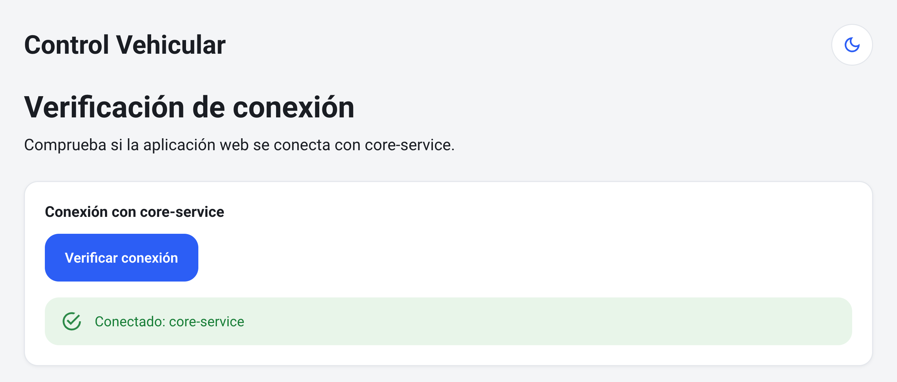
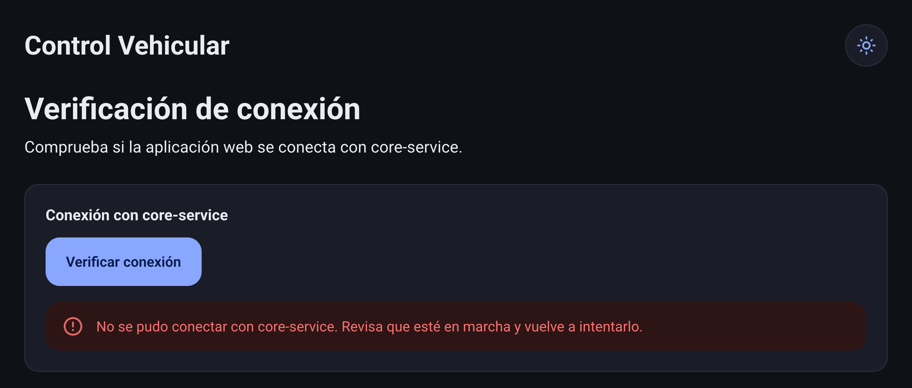
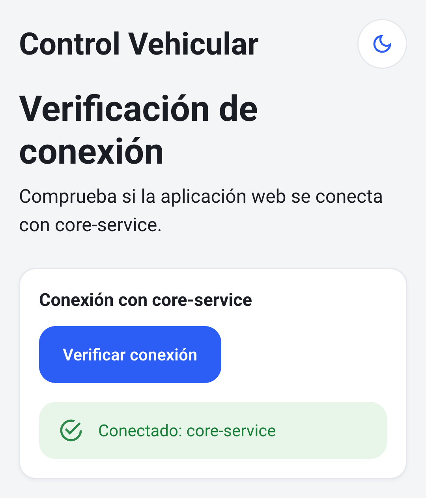
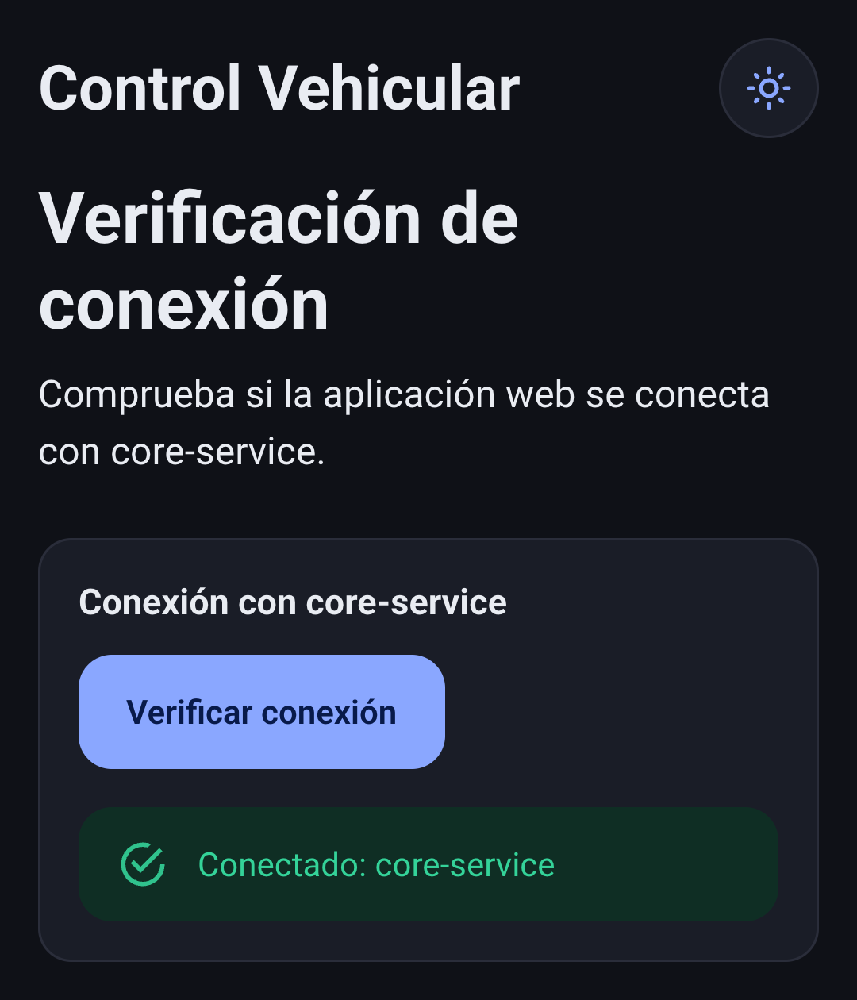
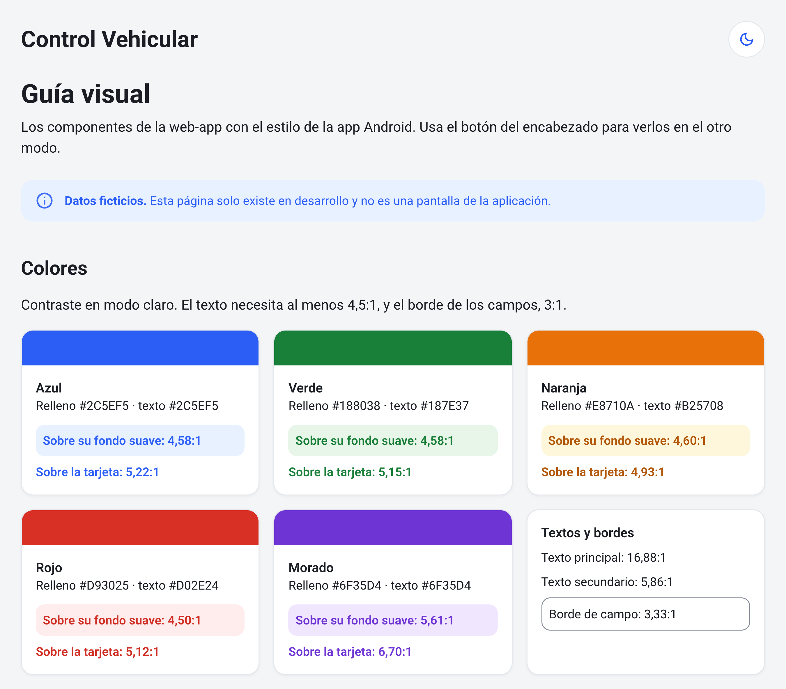
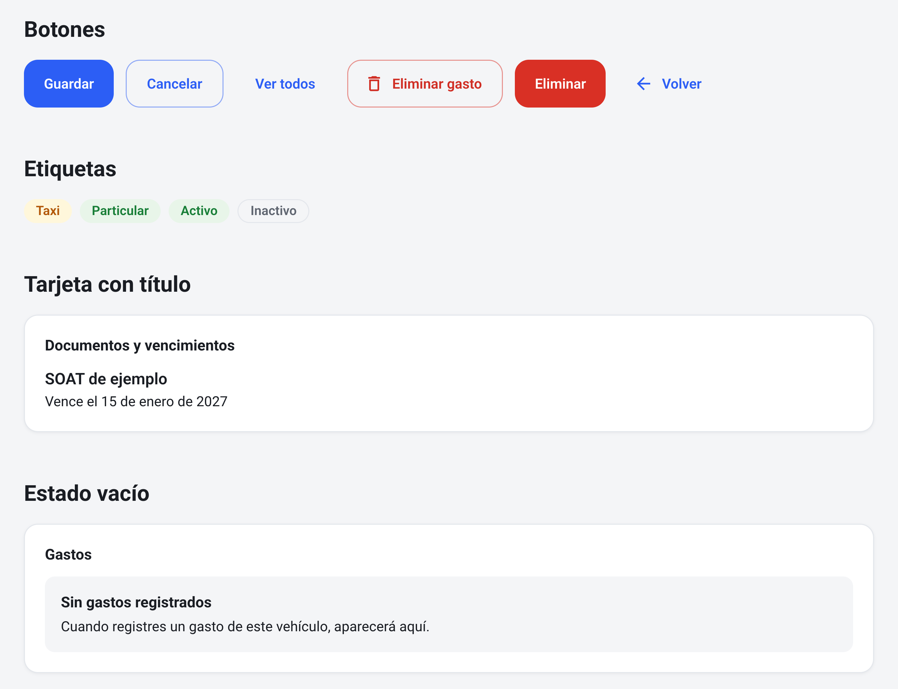
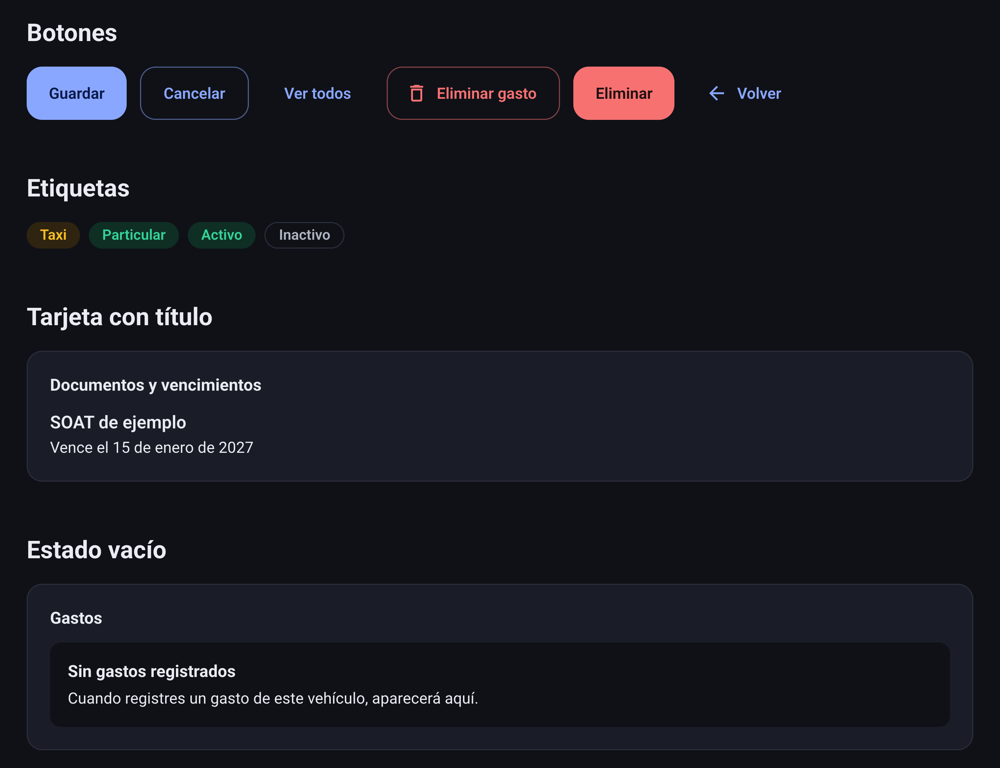
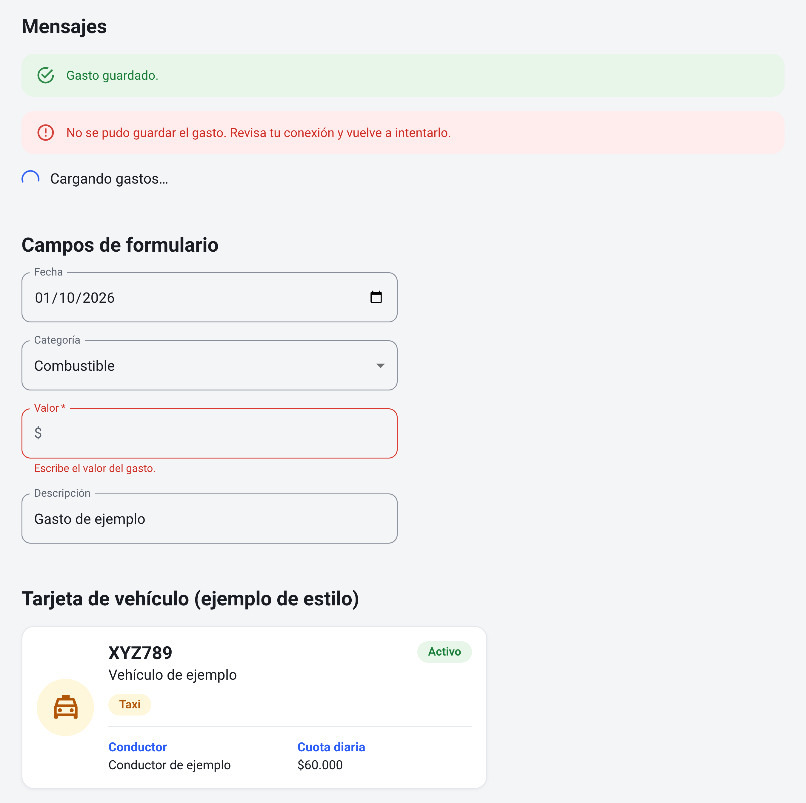
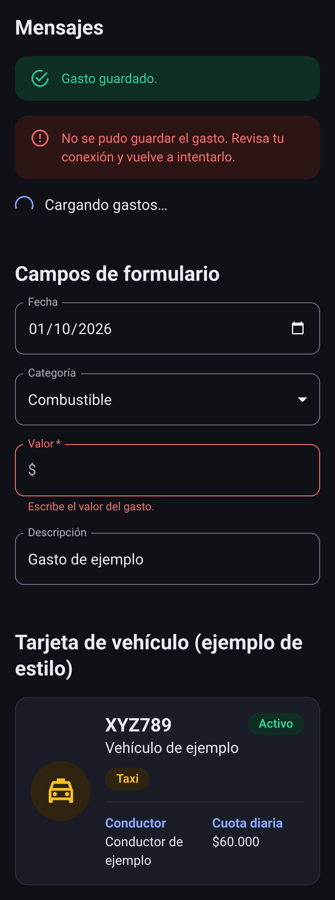

# Evidencia de sesión 8: base visual de la web-app

| Proyecto | Integrantes y versión |
|---|---|
| VehicleControlApp Web · DazaDev | Ivan Dario Madrid Daza, trabajo individual. Versión 0.1 del 22 de noviembre de 2026. Cierre: por definir. |

**Por qué hago esta base.** Hasta ahora, la web-app real solo tiene el panel de verificación, con el tema de Material UI tal como viene: azul y botones en mayúsculas. El 20 de noviembre de 2026 decidí trabajar en la parte visual real de la web-app antes de seguir con la cartilla, y basar su aspecto en el de la app Android de VehicleControlApp, para irlo mejorando con el tiempo. El 22 de noviembre de 2026 decidí numerarla como sesión 8, en el orden en que vengo trabajando, sin esperar una indicación del instructor.

**Mis decisiones del 20 de noviembre:**
- La base incluye el tema, la estructura común, el panel con el nuevo estilo y una «Guía visual» solo para desarrollo.
- Uso la letra Roboto en todos los equipos.
- Incluyo el modo oscuro desde ahora, con un botón.
- La web-app muestra el nombre «Control Vehicular».

**Cambio de identidad.** El prototipo de la sesión 3 tiene la identidad de «bitácora vehicular contemporánea» (verde petróleo y latón), que a Katerin le pareció adecuada el 20 de octubre de 2026. La web-app real usará la de Android, que Katerin también conoce: la evidencia de sesión 2 registra que le gusta su organización visual y funcional como punto de partida, y el 8 de octubre revisó esa app. El prototipo no cambia y queda como registro.

**Alcance.** Es una base visual: no incluye las pantallas del MVP, el login ni rutas, y no cambia core-service, Hasura ni la base de datos. De Android tomo el estilo, no sus pantallas ni sus funciones.

**Autoría.** Escribo en primera persona lo que decidí, aprobé o pedí hacer. Claude Code redactó y ejecutó los prompts y las comprobaciones, y redactó esta evidencia según lo que le pedí.

## 1. Relación con la cartilla

Esta base no es una semana de la cartilla: es una decisión mía. Adelanta lo que piden las semanas 3 y 7 sobre la interfaz.

| Lo que pide la cartilla | Dónde se ve | Resultado comprobado |
|---|---|---|
| Semana 3, paso 3: definir componentes comunes, tipografía, espaciado y comportamiento en móvil | Tema y estructura común (prompts 1 y 2) | El panel y la guía se ven completos a 360 × 800 y 1280 × 800, en claro y oscuro, sin desplazamiento horizontal |
| Semana 3, paso 4: etiquetas, mensajes, foco de teclado y estados de carga, error y vacío | Foco del tema, panel y guía (prompts 1 a 3) | Foco con contorno de 2 px. Mensajes de éxito, error y carga, y estado vacío. Los 4 campos tienen etiqueta, y los textos cumplen el contraste |
| Semana 3, entregable: catálogo de componentes | «Guía visual» (prompt 3) | 9 secciones, solo en desarrollo (capturas 05 a 09) |
| Semana 3, criterio: diseño para móvil y estados alternativos | Capturas a 360 × 800 y estados de la guía | Capturas 03, 04 y 09, en emulación del navegador. El panel muestra sus tres fases |
| Semana 7: listado, detalle y formulario con Material UI, con carga, vacío, error y éxito | Componentes de la guía | Quedan listos la tarjeta con título, el estado vacío, las etiquetas, los mensajes y los campos. Las pantallas siguen pendientes |

**Dos diferencias con la cartilla:**
- **Sin React Router.** La semana 3 propone organizar rutas y layouts con React Router. La estructura común será el futuro layout, pero el router llega con el login (semana 6).
- **Sin pantallas del MVP.** La semana 7 construye listado, detalle y formulario con su API. Aquí solo quedan listos los componentes.

## 2. Registro de trabajo real

| Fecha real | Trabajo realizado | Comprobación o resultado | Archivos |
|---|---|---|---|
| 20 nov 2026 | Revisé con Claude Code lo que falta de la cartilla y decidí trabajar antes en la parte visual. Elegí basarla en la app Android y aprobé el plan, con mis decisiones sobre alcance, letra, modo oscuro y nombre | Plan copiado en `Asesor_Técnico`. Claude Code leyó el repositorio Android sin modificarlo y midió el contraste de sus colores (apartado 3) | Esta evidencia |
| 20 nov 2026 | Aprobé los tres prompts y Claude Code ejecutó los dos primeros: el tema con la identidad de Android y la estructura común con el panel | Compilación, lint y pruebas sin errores. Cumplen las 62 combinaciones de contraste, y el panel conserva sus tres fases (apartado 5) | `apps/web-app/` |
| 20 nov 2026 | Claude Code ejecutó el prompt 3: la guía visual, tres componentes y la sección del README | Compilación, lint y pruebas sin errores. La guía no queda en el código compilado. Se corrigió el contraste del texto de error de los campos (apartado 5) | `apps/web-app/` y `README.md` |
| 20 nov 2026 | Le dije a Claude Code que me gustó el diseño que estamos definiendo y que siguiéramos. Revisé en mi navegador el foco con Tab y el modo guardado | Funcionan bien. Registré la decisión de la identidad visual en el contexto y en `AGENTS.md` | `docs/contexto-proyecto.md` y `AGENTS.md` |
| 21 nov 2026 | Antes de empezar el ingreso con correo y contraseña, le pedí a Claude Code hacer los commits de la base visual, para que su código no se mezclara con el del ingreso | `0d0a536 feat: crear la base visual de la web-app` y `1a35a79 docs` con README, contexto y `AGENTS.md`, sin push. Antes, compilación, lint, 19 pruebas unitarias y 2 e2e sin errores, y `npm audit` con 0 vulnerabilidades | `apps/web-app/`, README, contexto y `AGENTS.md` |
| 22 nov 2026 | Decidí numerar las sesiones en el orden en que vengo trabajando: esta base visual es la sesión 8, y el ingreso con correo y contraseña, la 9 | Esta evidencia y sus capturas pasaron a `evidencia-sesion-8-base-visual.md` y `evidencia-sesion-8/` | Esta evidencia, README, contexto y `AGENTS.md` |

## 3. Qué tomo de la app Android

| Android | En la web-app |
|---|---|
| `ui/theme/Color.kt` y `Theme.kt`: azul `#2C5EF5`, verde `#188038`, naranja `#E8710A`, rojo `#D93025` y morado; fondo `#F4F5F7`, tarjetas blancas, textos `#1A1D23` y `#5F6570`, borde `#E4E7EC`, fondos suaves y su versión oscura | Colores del tema en claro y oscuro |
| `ui/theme/Type.kt`: letra del sistema (Roboto), títulos en negrita de 30, 26, 22 y 20, subtítulos en seminegrita de 17 y 15, y cuerpo de 16, 14 y 12, sin espacio extra entre letras | Tipografía del tema, con Roboto |
| `presentation/components`: esquinas de 14, etiquetas redondeadas, botones altos, sombra suave, «Volver» con flecha y eliminar en rojo | Formas y componentes del tema |
| `docs/07-diseño-ui.md`: estilo claro y ordenado, con tarjetas, etiquetas de estado, botones visibles, estado vacío en un recuadro suave y modo claro y oscuro | Estructura común, componentes y guía |

**Contraste.** El contraste mide cuánto se distingue un texto de su fondo. Para texto normal, la guía de accesibilidad WCAG pide al menos 4,5:1; para bordes, foco e iconos, 3:1. Medí los colores de Android contra su fondo:

| Combinación | Contraste | Texto normal |
|---|---|---|
| Azul sobre blanco | 5,22 | Cumple |
| Blanco sobre azul (botón) | 5,22 | Cumple |
| Verde sobre verde suave (etiqueta «Activo») | 4,46 | No cumple |
| Naranja sobre blanco | 3,09 | No cumple |
| Naranja sobre amarillo suave (etiqueta «Taxi») | 2,88 | No cumple |
| Rojo sobre blanco | 4,77 | Cumple |
| Texto secundario sobre el fondo | 5,37 | Cumple |
| Texto principal sobre el fondo | 15,48 | Cumple |
| Azul del modo oscuro sobre su tarjeta | 7,25 | Cumple |
| Naranja del modo oscuro sobre su tarjeta | 10,07 | Cumple |

En la web, el verde y el naranja usados como texto son un poco más oscuros, hasta cumplir. El color de relleno no cambia. Al aplicarlo en el prompt 1 se sumó el rojo, que sobre su fondo suave daba 4,20.

## 4. Pruebas

Las hizo Claude Code con scripts que controlan Chrome sin pantalla, es decir, sin abrir una ventana. Las de 360 × 800 son emulación del navegador, no un teléfono real. El detalle de cada comprobación está en el registro de su prompt (apartado 5).

| Prueba | Resultado | Captura |
|---|---|---|
| Contraste del tema real, en claro y oscuro | Cumplen las 62 combinaciones (prompt 1) | 05 |
| Panel en sus tres fases, en las 4 combinaciones de modo y ancho | Los mismos mensajes de la sesión 6, sin desplazamiento horizontal (prompt 2). La caída de core-service se simuló en el navegador | 01 a 04 |
| Foco con Tab y modo guardado | Contorno azul de 2 px en el botón de modo y en «Verificar conexión». El modo oscuro se mantiene al recargar (prompt 2) | — |
| Guía visual en las 4 combinaciones de modo y ancho | Completa, sin desplazamiento horizontal y con etiqueta en los 4 campos (prompt 3) | 05 a 09 |
| Código compilado | No incluye la guía ni sus datos, ni «hasura» o «admin-secret» (prompt 3) | — |
| Revisión en mi navegador: teclado y modo | Funcionan bien (20 de noviembre) | — |

**Captura 01.** Panel en modo claro, a 1280 × 800: core-service responde.



**Captura 02.** Panel en modo oscuro, a 1280 × 800: core-service no responde y el botón sigue disponible.



**Captura 03.** Panel en modo claro, a 360 × 800, después de recuperar la conexión.



**Captura 04.** Lo mismo en modo oscuro.



**Captura 05.** Inicio de la guía visual, en modo claro, con el aviso de datos ficticios y los colores con su contraste.



**Captura 06.** Botones, etiquetas, tarjeta con título y estado vacío, en modo claro.



**Captura 07.** Lo mismo en modo oscuro.



**Captura 08.** Mensajes, campos de formulario y tarjeta de vehículo de ejemplo, en modo claro. El campo «Valor» muestra un error.



**Captura 09.** Lo mismo en modo oscuro, a 360 × 800.



## 5. Registro de prompts

| Rol | Quién o qué herramienta |
|---|---|
| Redacción y ejecución | Claude Code (Claude Opus 5.5) |
| Revisión y envío | Ivan Dario Madrid Daza revisa cada texto del documento y pide ejecutarlo |

### Prompt 1 · Tema con la identidad de Android (20 de noviembre de 2026)

**Antes de enviarlo:** el 20 de noviembre revisé los tres prompts y le dije a Claude Code que estaba de acuerdo con ellos y que siguiera, sin pegarlos.

Texto exacto enviado:

```text
[Rol] Actúa como desarrollador frontend con experiencia en React, TypeScript, Material UI y accesibilidad. Explícame las decisiones en lenguaje sencillo.

[Objetivo] Crea el tema de Material UI de la web-app con la identidad visual de la app Android de VehicleControlApp (colores, letras y formas), en modo claro y oscuro, y con el contraste mínimo de accesibilidad.

[Contexto]
- apps/web-app usa React 19, Vite 8 y Material UI 9.5.0 con el tema por defecto, y hoy solo muestra el panel de verificación de la sesión 6.
- El 20 de noviembre de 2026 decidí basar el aspecto de la web en el de la app Android, que usa Material Design 3, y mejorarlo con el tiempo. Sus pantallas y funciones no forman parte del diseño web.
- Decidí usar Roboto en todos los equipos, incluir el modo oscuro y mostrar el nombre «Control Vehicular».
- Como texto, tres colores de Android no alcanzan 4,5:1: naranja sobre blanco (3,09), naranja sobre amarillo suave (2,88) y verde sobre verde suave (4,46).
- El monorepo usa npm 12, que bloquea los scripts de instalación de las dependencias que no estén en allowScripts.

[Datos o archivos]
- Del repositorio Android github.com/Tecno85/vehicle-control-app, solo para leer: app/src/main/java/com/ivanmadrid/vehiclecontrolapp/ui/theme/Color.kt, Theme.kt y Type.kt; presentation/components/AppButtons.kt; docs/07-diseño-ui.md.
- apps/web-app/package.json, index.html y src/main.tsx.

[Restricciones]
- Agrega @fontsource-variable/roboto y @mui/icons-material en su versión latest; @mui/icons-material debe coincidir con la versión de @mui/material. Si alguna trae scripts de instalación, detente y avísame.
- Crea src/theme/colors.ts con los colores de Android en claro y oscuro, indicando de dónde vienen. Solo para texto, oscurece el tono que no llegue a 4,5:1 sobre su fondo; para bordes, foco e iconos basta 3:1. No cambies los colores de relleno.
- Crea src/theme/theme.ts con createTheme: colorSchemes light y dark; cssVariables con selector de clase; la tipografía de Type.kt con Roboto y sin espacio extra entre letras; esquinas de 14 px; botones sin mayúsculas, en seminegrita y con altura mínima de 48 px; tarjetas con borde y sombra suave; etiquetas en forma de píldora; mensajes con fondo suave, y un foco visible de 2 px con separación en :focus-visible.
- Crea src/theme/AppTheme.tsx con ThemeProvider, CssBaseline y la importación de Roboto, para usarlo en cualquier página.
- En src/main.tsx usa AppTheme. En index.html cambia el título a «Control Vehicular» y agrega meta theme-color.
- No cambies el panel, el cliente HTTP ni core-service. No modifiques el repositorio Android ni el prototipo de la sesión 3.
- No hagas commits ni push.

[Formato de salida] Archivos creados o cambiados, con una frase cada uno; los comandos ejecutados; una tabla de comprobaciones con su resultado real, y una tabla con el contraste de cada color de texto sobre su fondo, en claro y oscuro.

[Criterios de aceptación]
- npm run build y npm run lint terminan bien desde la raíz, y npm audit no muestra vulnerabilidades.
- npm install-scripts ls no muestra paquetes bloqueados nuevos.
- En claro y oscuro, todos los colores de texto del tema llegan a 4,5:1 sobre su fondo, y los de bordes y foco a 3:1.
- El panel se ve con Roboto, los colores de Android y el botón sin mayúsculas, y sigue funcionando igual.
```

**Archivos creados o cambiados**

| Archivo | Para qué sirve |
|---|---|
| `apps/web-app/package.json` y `package-lock.json` | Suman `@fontsource-variable/roboto` 5.3.0 y `@mui/icons-material` 9.5.0, la misma versión de `@mui/material` |
| `apps/web-app/src/theme/colors.ts` | Los colores de Android en claro y oscuro. Cada color tiene relleno, tono de texto y fondo suave, y además están el borde de los campos y los fondos |
| `apps/web-app/src/theme/theme.ts` | El tema: colores, mensajes con fondos suaves, letras de `Type.kt`, esquinas de 14 px y ajustes de botones, tarjetas, etiquetas, campos y foco |
| `apps/web-app/src/theme/AppTheme.tsx` | Aplica el tema y Roboto a cualquier página |
| `apps/web-app/src/main.tsx` | La app usa `AppTheme` |
| `apps/web-app/index.html` | Título «Control Vehicular» y colores de la barra del navegador en claro y oscuro |

**Comprobaciones**, con Node 24.22.2 y npm 12.2.3:

| Comprobación | Comando | Resultado real |
|---|---|---|
| Dependencias | `npm install … --workspace apps/web-app` | Se agregaron 2 paquetes; 0 vulnerabilidades |
| Scripts de instalación | `npm install-scripts ls` | «No packages with unreviewed install scripts.» |
| Compilación | `npm run build` | Código 0. La web incluye Roboto en 9 archivos, uno por grupo de alfabetos, y el navegador solo descarga los que usa la página |
| Lint | `npm run lint` | Código 0, sin avisos |
| Pruebas | `npm test` y `npm run test:e2e` | 19 de 19 unitarias y 2 de 2 e2e: core-service no cambió |
| Auditoría | `npm audit` | 0 vulnerabilidades |
| Contraste del tema real | Script con Chrome sin pantalla que lee los colores del tema en la página, en claro y oscuro | Las 62 combinaciones cumplen (tabla abajo) |
| Letra y botón | La misma página | Roboto cargada; el botón dice «Verificar conexión», sin mayúsculas |

**Contraste del tema.** El script abrió la web en Chrome, en modo claro y en modo oscuro, y leyó los colores que Material UI aplica de verdad. Revisó 31 combinaciones en cada modo:
- texto principal, secundario y de color sobre el fondo y sobre las tarjetas;
- cada tono de texto sobre su fondo suave;
- los cuatro tipos de mensaje;
- el texto sobre los botones rellenos;
- el borde de los campos.

Estas son las combinaciones más justas, todas en modo claro:

| Combinación | Contraste | Mínimo |
|---|---|---|
| Rojo de texto `#D02E24` sobre su fondo suave `#FFECEC` (mensaje de error) | 4,50 | 4,5 |
| Naranja de texto `#B25708` sobre el fondo `#F4F5F7` | 4,52 | 4,5 |
| Azul `#2C5EF5` y verde `#187E37` sobre su fondo suave | 4,58 | 4,5 |
| Borde de campo `#878D99` sobre el fondo | 3,06 | 3 |

En modo oscuro, la combinación más baja es el borde de campo, con 3,41 sobre las tarjetas. Los textos van de 6,08 a 15,95.

En dos botones rellenos de modo claro, el naranja y el rojo, Material UI elige el color de texto automáticamente. Para el naranja eligió texto oscuro (6,80): el blanco solo daba 3,09.

**Ajustes:** no hice ninguno en el texto del prompt.

**Observaciones y decisiones:**
- **Tres tonos de texto cambian, y muy poco.** El verde pasa de `#188038` a `#187E37`, el naranja de `#E8710A` a `#B25708` y el rojo de `#D93025` a `#D02E24`. El rojo no estaba en la medición inicial: sobre su fondo suave daba 4,20. Los rellenos son los de Android.
- **Iconos de los mensajes.** En Android, el icono naranja sobre el amarillo suave tiene 2,88, que no llega ni al 3:1 de los iconos. En la web, el texto y el icono de cada mensaje usan el tono de texto.
- **Borde de los campos.** El borde de Android (`#E4E7EC`) no se distingue del fondo, porque tiene 1,2:1. Los campos usan `#878D99` en claro y `#6B7080` en oscuro. Las tarjetas conservan el borde suave de Android, porque no son controles.
- **Modo claro u oscuro.** Al abrir, la web sigue el modo del dispositivo: Chrome en modo oscuro aplicó la clase `dark`. El botón para cambiarlo llega en el prompt 2.

### Prompt 2 · Estructura común y panel (20 de noviembre de 2026)

Texto exacto enviado:

```text
[Rol] Actúa como desarrollador frontend con React y Material UI, con experiencia en diseño adaptable y accesibilidad. Explícame las decisiones en lenguaje sencillo.

[Objetivo] Crea la estructura común de la web-app con el estilo de Android y aplícala al panel de verificación, sin cambiar su comportamiento.

[Contexto]
- El tema con la identidad de Android, en claro y oscuro, ya existe en apps/web-app/src/theme/ (prompt anterior).
- En Android, la pantalla principal tiene un encabezado con el nombre y un botón sol/luna, y cada bloque de información es una tarjeta con título, como «Documentos y vencimientos».
- La web debe funcionar en el celular (360 px) y en el escritorio. Todavía no hay rutas: React Router llegará con el login.
- El panel de la sesión 6 muestra éxito, error y recuperación con mensajes que no deben cambiar.

[Datos o archivos]
- apps/web-app/src/App.tsx y src/components/HealthPanel.tsx
- Del repositorio Android, solo para leer: presentation/screens/vehicles/VehicleListScreen.kt (encabezado y ThemeToggleButton) y VehicleDetailCards.kt (tarjetas con título).

[Restricciones]
- Crea src/components/layout/AppShell.tsx: un encabezado (<header>) con «Control Vehicular» y el botón de modo, y el contenido (<main>) con márgenes de 16 px en el celular y un ancho máximo en el escritorio.
- Crea src/components/layout/ColorModeToggle.tsx con useColorScheme de Material UI: al inicio sigue la configuración del dispositivo y luego recuerda la elección. Usa un icono de sol o luna, con un aria-label en español que diga qué modo activa.
- Crea src/components/SectionCard.tsx: una tarjeta con título, como las de Android.
- Pon el panel dentro de una SectionCard «Conexión con core-service». No cambies sus mensajes ni su comportamiento, ni api-client.ts ni health.api.ts.
- No agregues dependencias ni rutas.
- No hagas commits ni push.

[Formato de salida] Archivos creados o cambiados, con una frase cada uno; los comandos ejecutados y una tabla de comprobaciones con su resultado real.

[Criterios de aceptación]
- npm run build y npm run lint terminan bien desde la raíz.
- A 360 × 800 y a 1280 × 800, en claro y oscuro, la página se ve completa y sin desplazamiento horizontal.
- El panel muestra las tres fases de la sesión 6 con los mismos mensajes: conectado, core-service detenido y recuperación.
- Con Tab, el foco se ve en el botón de modo y en «Verificar conexión», y el modo elegido se mantiene al recargar.
```

**Archivos creados o cambiados**

| Archivo | Para qué sirve |
|---|---|
| `apps/web-app/src/components/layout/AppShell.tsx` | Encabezado con «Control Vehicular» y el botón de modo, y el contenido. Márgenes de 16 px en el celular y de 24 px desde 600 px; ancho máximo de 900 px |
| `apps/web-app/src/components/layout/ColorModeToggle.tsx` | Botón redondo de 42 px con sol o luna, como en Android. Dice «Cambiar a modo oscuro» o «Cambiar a modo claro» |
| `apps/web-app/src/components/SectionCard.tsx` | Tarjeta con título, como `DetailSectionCard` de Android |
| `apps/web-app/src/components/HealthPanel.tsx` | El panel queda dentro de la tarjeta «Conexión con core-service», con los mismos mensajes |
| `apps/web-app/src/App.tsx` | Usa la estructura común. El título de la página pasa a ser «Verificación de conexión» |
| `apps/web-app/src/theme/theme.ts` | Ajuste del foco de los botones (ver observaciones) |

**Comprobaciones**, con Node 24.22.2 y npm 12.2.3. Las de 360 × 800 son emulación del navegador, no un teléfono real:

| Comprobación | Comando o forma | Resultado real |
|---|---|---|
| Compilación y lint | `npm run build` y `npm run lint` | Código 0 en los dos |
| Pruebas | `npm test` y `npm run test:e2e` | 19 de 19 unitarias y 2 de 2 e2e |
| Auditoría | `npm audit` | 0 vulnerabilidades |
| Tres fases del panel | Script con Chrome sin pantalla, en claro y oscuro, a 360 × 800 y 1280 × 800 | En las 4 combinaciones: «Conectado: core-service»; luego «No se pudo conectar con core-service. Revisa que esté en marcha y vuelve a intentarlo.»; y de nuevo «Conectado: core-service» |
| Desplazamiento horizontal | El mismo script, en las 12 capturas | Ninguna lo tiene |
| Foco con Tab | El mismo script, en modo claro | El primer Tab llega a «Cambiar a modo oscuro» y el segundo a «Verificar conexión». Los dos muestran un contorno azul `#2C5EF5` de 2 px |
| Modo guardado | El mismo script: pulsar el botón y recargar | Al pulsarlo, la página pasa a oscuro y el navegador guarda `mui-mode: dark`. Al recargar, sigue en oscuro y el botón dice «Cambiar a modo claro» |
| Teclado y modo en mi navegador | Revisión manual, el 20 de noviembre | Funcionan bien: el foco se ve con Tab y el modo oscuro se mantiene al recargar |

**Ajustes:** no hice ninguno en el texto del prompt.

**Observaciones y decisiones:**
- **Fase «core-service detenido».** core-service ya estaba en marcha en modo desarrollo. Para no detenerlo, el script hizo que Chrome bloqueara las peticiones a `localhost:3000`. El panel recibe el mismo fallo de conexión que cuando el servicio está apagado. En la sesión 6 lo detuve de verdad; aquí la caída se simuló en el navegador.
- **Foco de los botones.** En la primera captura con Tab, además del contorno, Material UI aclaraba el botón con una onda y el texto blanco se distinguía menos. La quité en los botones (`disableFocusRipple`): el contorno de 2 px ya marca el foco.
- **Título de la página.** «Control Vehicular» va en el encabezado como texto destacado y no como título. Así la página tiene un solo título principal, «Verificación de conexión», en lugar de «VehicleControlApp Web». La descripción del panel no cambia.
- **Botón de modo.** En el primer instante, Material UI todavía no sabe qué modo usa la página. Por eso el botón aparece justo después del resto.

### Prompt 3 · Guía visual y README (20 de noviembre de 2026)

Texto exacto enviado:

```text
[Rol] Actúa como desarrollador frontend con React y Material UI, y como diseñador de interfaces. Explícame las decisiones en lenguaje sencillo.

[Objetivo] Crea una «Guía visual», solo para desarrollo, que muestre los componentes de la web-app con el estilo de Android, para revisarlos y mejorarlos sin construir pantallas del MVP.

[Contexto]
- La web-app ya tiene el tema en claro y oscuro, la estructura común (AppShell) y SectionCard.
- La cartilla del instructor pide en la semana 3 un catálogo de componentes y los estados de carga, vacío, error y éxito, y en la semana 7 listado, detalle y formulario con Material UI.
- Las pantallas del MVP se construirán más adelante, con su API. La guía usa datos ficticios.
- Los datos de prueba de infra/hasura tienen el taxi ficticio XYZ789, con cuota de $60.000.

[Datos o archivos]
- apps/web-app/src/theme/, src/components/ y README.md
- Del repositorio Android, solo para leer: presentation/components/AppButtons.kt; presentation/screens/vehicles/VehicleListScreen.kt (VehicleCard, VehicleTypeChip y VehicleStatusChip) y VehicleDetailCards.kt (estado vacío); docs/07-diseño-ui.md.

[Restricciones]
- Crea apps/web-app/guia-visual.html y src/guia/main.tsx como una segunda página de Vite que use AppTheme y AppShell. No la agregues a la compilación de producción: solo debe abrirse con npm run dev:web.
- Crea src/components/EmptyState.tsx (recuadro suave con título y texto), StatusChip.tsx (etiquetas de tipo y estado) y BackButton.tsx («Volver» con flecha).
- Crea src/guia/GuiaVisual.tsx con un aviso de «Datos ficticios» y estas secciones: colores con su contraste, tipografía, botones (principal, secundario, de texto, eliminar y «Volver»), etiquetas (Taxi, Particular, Activo e Inactivo), tarjeta con título, estado vacío, mensajes de éxito, error y carga, campos de formulario con uno en error y una tarjeta de vehículo de ejemplo con el taxi XYZ789.
- La tarjeta de vehículo es solo un ejemplo de estilo dentro de la guía: no crees la pantalla de vehículos ni un componente de vehículo.
- Agrega al README cómo abrir la guía y para qué sirve.
- No agregues dependencias ni rutas.
- No hagas commits ni push.

[Formato de salida] Archivos creados o cambiados, con una frase cada uno; los comandos ejecutados y una tabla de comprobaciones con su resultado real.

[Criterios de aceptación]
- npm run build, npm run lint, npm test y npm run test:e2e terminan bien desde la raíz.
- La guía se abre en http://localhost:5173/guia-visual.html y se ve completa en claro y oscuro, a 360 × 800 y a 1280 × 800, sin desplazamiento horizontal.
- El código compilado de la web (dist) no contiene la guía, «hasura» ni «admin-secret».
- Los textos de la guía están en español sencillo, y cada campo de formulario tiene su etiqueta.
```

**Archivos creados o cambiados**

| Archivo | Para qué sirve |
|---|---|
| `apps/web-app/guia-visual.html` | Segunda página de Vite, solo para desarrollo, con el título «Guía visual · Control Vehicular» |
| `apps/web-app/src/guia/main.tsx` | Arranca la guía con el mismo tema que la app |
| `apps/web-app/src/guia/GuiaVisual.tsx` | La guía: el aviso de datos ficticios y 9 secciones, de los colores a la tarjeta de vehículo |
| `apps/web-app/src/components/EmptyState.tsx` | Recuadro suave con título y texto, para una sección sin datos |
| `apps/web-app/src/components/StatusChip.tsx` | Etiqueta de tipo o de estado con un color del tema, o en gris para estados apagados |
| `apps/web-app/src/components/BackButton.tsx` | «Volver» con flecha |
| `apps/web-app/src/theme/theme.ts` | El texto de error de los campos usa el rojo de texto (ver observaciones) |
| `README.md` | Sección «Guía visual (solo en desarrollo)»: cómo abrirla, qué muestra y dónde está el código |

**Comprobaciones**, con Node 24.22.2 y npm 12.2.3. Las de 360 × 800 son emulación del navegador, no un teléfono real:

| Comprobación | Comando o forma | Resultado real |
|---|---|---|
| Compilación, lint y pruebas | `npm run build`, `npm run lint`, `npm test` y `npm run test:e2e` | Código 0 en los cuatro: 19 de 19 unitarias y 2 de 2 e2e |
| Auditoría y scripts de instalación | `npm audit` y `npm install-scripts ls` | 0 vulnerabilidades. «No packages with unreviewed install scripts.» |
| La guía en el navegador | Script con Chrome sin pantalla en http://localhost:5173/guia-visual.html, en claro y oscuro, a 360 × 800 y 1280 × 800 | Se ve completa en las 4 combinaciones, sin desplazamiento horizontal |
| Etiquetas de los campos | El mismo script | Los 4 campos tienen su etiqueta |
| Contraste que muestra la guía | El mismo script | Coincide con la medición del prompt 1; por ejemplo, 4,58, 16,88 y 3,33 en claro, y 3,41 en oscuro |
| Texto de error de los campos | Script que mide su color en la página | En modo claro, 4,38 antes del ajuste y 4,70 después. En oscuro, 6,82 |
| Código compilado | `find` y `grep -ril` en `apps/web-app/dist` | Solo hay `index.html`. Ningún archivo contiene «guia», «Guía visual», «Datos ficticios», «XYZ789», «hasura» ni «admin-secret». Roboto está incluida |
| Prototipo de la sesión 3 | `git diff --stat prototipo-web-sesion-3` | Sin cambios |
| Revisión en mi navegador | Revisión manual, el 20 de noviembre | El foco con Tab y el modo guardado funcionan bien. Me gustó el diseño |

**Ajustes:** no hice ninguno en el texto del prompt.

**Observaciones y decisiones:**
- **Datos de ejemplo.** Vienen de `infra/hasura/seeds/default/datos_ficticios.sql`:
  - el taxi XYZ789, «Vehículo de ejemplo», con «Conductor de ejemplo» y cuota de $60.000;
  - el «SOAT de ejemplo», que vence el 15 de enero de 2027;
  - la fecha del formulario, el 1 de octubre de 2026.

  Las categorías del campo son las iniciales del proyecto.
- **Texto de error de los campos.** En la captura de la guía, la etiqueta «Valor *» y el mensaje «Escribe el valor del gasto.» usaban el rojo de relleno. Lo medí: 4,38 sobre el fondo gris en modo claro. Sobre una tarjeta blanca daba 4,77, pero un formulario puede ir directo sobre el fondo. Ahora usan el tono de texto del rojo, con 4,70. El borde del campo con error no cambia.
- **Fórmula del contraste.** La primera versión de la guía usaba `getContrastRatio` de Material UI, que redondea la luminancia: mostraba 16,94 donde la medición daba 16,88. Ahora usa la fórmula de WCAG sin redondeos, y sus valores coinciden con los del prompt 1.
- **Etiqueta «Inactivo».** Android no la tiene. En la web va en gris con borde, porque los vehículos tienen el campo `activo` en el modelo de datos.
- **«Particular» y «Activo».** Como en Android, las dos etiquetas son verdes, así que un vehículo particular activo mostraría dos etiquetas verdes. Lo dejo anotado en los pendientes.
- **Tarjeta de vehículo.** Es solo un ejemplo dentro de la guía. No hay un componente de vehículo ni una pantalla de vehículos.

## 6. Problemas encontrados

| Problema | Causa | Solución |
|---|---|---|
| La compilación del tema falló con el error TS2353: `Alert` no existía en el tipo `PaletteOptions` (prompt 1) | Los colores de los mensajes van en la paleta de cada modo, que tiene otro tipo | Usar el tipo de paleta por modo, `ColorSystemOptions['palette']` |
| Al revisar el código, vi que el primer ajuste del borde de los campos taparía el cambio de color al pasar el mouse, con foco o con error (prompt 1) | El ajuste tenía más prioridad que los estados de Material UI | Cambiar solo el borde en reposo |
| El rojo de Android (`#D93025`) sobre su fondo suave daba 4,20 (prompt 1) | La medición inicial no incluía esa combinación | Tono de texto `#D02E24`, con 4,50 |
| Con Tab, una onda aclaraba el botón y el texto blanco se distinguía menos (prompt 2) | El efecto de foco de Material UI | Quitar la onda de foco: el contorno de 2 px marca el foco |
| `error TS2307: Cannot find module '@mui/icons-material/DeleteOutline' or its corresponding type declarations.` (prompt 3) | En esta versión, el icono se llama `DeleteOutlined` | Usar `DeleteOutlined` |
| La guía mostraba un contraste unas centésimas distinto a la medición (prompt 3) | `getContrastRatio` redondea la luminancia | Fórmula de WCAG sin redondeos |
| El texto de error de los campos daba 4,38 en modo claro (prompt 3) | Usaba el rojo de relleno | Usar el tono de texto del rojo, con 4,70 |

## 7. Pendientes y próximo paso

| Pendiente | Responsable | Fecha |
|---|---|---|
| Mostrarle a Katerin la base visual, junto con la segunda prueba del prototipo | Ivan | Por definir |
| Agregar React Router con el login, en la sesión 9 | Ivan | Por definir |
| Decidir si «Particular» necesita otro color, porque comparte el verde con «Activo» | Ivan | Por definir |

## Fuentes

- «Cartilla de acompañamiento técnico» del instructor: semana 3, «Navegación, mockups y experiencia de usuario», y semana 7, «CRUD completo a través del core service».
- Repositorio de la app Android: github.com/Tecno85/vehicle-control-app, consultado el 20 de noviembre de 2026 (último commit del 18 de agosto de 2026).
- Datos de prueba ficticios de `infra/hasura/seeds/default/datos_ficticios.sql`, para los ejemplos de la guía.
- [Evidencia de sesión 2](evidencia-sesion-2-requerimientos-backlog.md), sobre la referencia visual de Android, y [evidencia de sesión 3](evidencia-sesion-3-diseno-pantallas.md), sobre la identidad del prototipo.

## Historial de versiones

| Versión | Fecha | Cambios |
|---|---|---|
| 0.1 | 22 de noviembre de 2026 | Primera versión: plan aprobado, lo que tomo de Android, el contraste medido y los tres prompts, con sus resultados, pruebas y capturas. La empecé el 20 de noviembre, el 21 hice los commits del código y el 22 le asigné el número de sesión. |
