# Evidencia de sesión 9: ingreso con correo y contraseña

| Proyecto | Integrantes y versión |
|---|---|
| VehicleControlApp Web · DazaDev | Ivan Dario Madrid Daza, trabajo individual. Versión 0.1 del 23 de noviembre de 2026. Cierre: por definir. |

**Por qué hago este trabajo.** La web-app ya tiene su base: el monorepo, la conexión de core-service con Hasura y la base visual. Pero todavía no sabe de quién son los datos, porque nadie ingresa. Cada vehículo pertenece a una cuenta, así que el ingreso va antes que cualquier pantalla con datos. Por eso sigo con la **semana 6 de la cartilla del instructor, «Login y autorización en el core service»**. El 22 de noviembre de 2026 decidí numerarla como sesión 9, en el orden en que vengo trabajando: la sesión 8 es la base visual.

**Mis decisiones del 21 de noviembre de 2026:**
- Si la usuaria deja de usar la web-app, se le vuelve a pedir la contraseña después de 7 días.
- Incluyo tres cosas que la cartilla necesita para demostrar el acceso por cuenta:
  - una tabla `sesiones`, en una migración nueva;
  - una segunda cuenta ficticia, con un vehículo particular;
  - un servicio de solo lectura, `GET /api/vehiculos/:id`.
- Aprobé los valores del acceso del apartado 3. Hasta ahora estaban pendientes.
- Antes de empezar, hice los commits de la base visual, para que su código no se mezcle con el del ingreso.

**Mis decisiones del 22 de noviembre de 2026.** Revisé los tres prompts y le dije a Claude Code que me parecen acertados. Le pedí validar que cumplan lo que pide el instructor, pero ajustados a lo que de verdad se puede aplicar bien en el proyecto, porque no todo se puede aplicar al pie de la letra. Con esa validación (apartado 1):
- aprobé cinco ajustes a los prompts;
- decidí que la sesión dure como máximo 30 días desde el ingreso con contraseña, aunque se siga usando.

**Mi decisión del 23 de noviembre de 2026.** Una prueba mostró que recargar dos veces en menos de un segundo cierra la sesión (apartado 6). Decidí dejarlo como límite conocido y resolverlo después de presentar el trabajo final en el SENA, porque voy a seguir trabajando en el proyecto. Solo obliga a escribir otra vez la contraseña y no expone datos.

**Alcance.** Solo el ingreso con correo y contraseña a una cuenta creada antes, como acordamos para la primera versión.
- **Quedan para una fase posterior:** el registro propio, la recuperación de la contraseña y la verificación del correo.
- **Siguen pendientes:** las demás pantallas y servicios del MVP (semana 7).
- **No se publica en internet:** todo funciona en mi equipo.

**Autoría.** Escribo en primera persona lo que decidí, aprobé o pedí hacer. Claude Code redactó los prompts y esta evidencia según lo que le pedí, y ejecutó los prompts y las comprobaciones a medida que se los envié.

## 1. Cumplimiento de la semana 6 de la cartilla

La cartilla pide, como entregable, login integrado, matriz de autorización, cuentas ficticias y evidencia de rechazo. La columna de la derecha resume lo comprobado en el apartado 5.

| Lo que pide la cartilla | Dónde se cubre | Resultado comprobado |
|---|---|---|
| Paso 1: login, perfil, renovación y cierre de sesión, con límite de intentos | Prompt 2 | Comprobado en la e2e y en la prueba real con Neon y Hasura Cloud (19 de 19). El límite de intentos, también en Chrome |
| Paso 2: validación del token y matriz de roles | Prompt 2 y matriz del apartado 3 | Comprobado: el guard exige un token válido en toda ruta que no sea pública (pruebas unitarias y e2e). Matriz implementada en el prompt 2 |
| Paso 3: acceso por recurso en los servicios, no solo por rol | Prompt 2, `GET /api/vehiculos/:id` | Comprobado: el vehículo de otra cuenta responde 404, en la e2e y en la prueba real |
| Paso 4: login y rutas protegidas en React con la API del core | Prompt 3 | Comprobado en Chrome con el Hasura falso: 17 de 17, y en Edge con Neon y las dos cuentas (captura 11) |
| Paso 5: probar token inválido o vencido, datos ajenos y operaciones sin permiso | Pruebas e2e del prompt 2 y demostración con las dos cuentas | Comprobado: token alterado o vencido, 401; datos de otra cuenta, 404; renovación reutilizada, 401, y desde otro sitio, 403 |
| Apertura: dos sesiones y una petición que intenta ver datos de otra cuenta | Dos navegadores, uno por cuenta, y el script de demostración | Comprobado con Neon y Hasura Cloud: el script, 19 de 19, y las dos cuentas con sesión a la vez en dos ventanas de Edge (captura 11) |
| Contraseñas con un hash adecuado, por ejemplo Argon2id | Prompt 1 | Comprobado: Argon2id con la configuración mínima de OWASP (4 pruebas unitarias). Las dos cuentas de Neon tienen su hash |
| Guardar solo el hash del token de renovación | Prompt 1 (tabla) y prompt 2 | Comprobado: la tabla solo acepta 64 caracteres hexadecimales, la forma de un SHA-256, y la e2e revisa que las respuestas no lleven tokens de renovación en el cuerpo |
| Evaluar SameSite, CORS y CSRF según los dominios | Prompt 2: cookie SameSite=Strict, CORS con el origen exacto de la web-app y la protección contra CSRF de NestJS | Comprobado: la cookie lleva sus 4 protecciones, y desde otro sitio la API responde 403. En Chrome, la cookie funciona entre la web (puerto 5173) y core-service (3000) |
| Criterio: el cliente no asigna roles ni propietarios | Prompt 2: la cuenta sale del token | Comprobado: las rutas no leen la cuenta del cuerpo ni de la dirección, y un token alterado responde 401 |
| Criterio: las APIs impiden el acceso a datos ajenos | Prompt 2 | Comprobado: 404 en la e2e y en la prueba real |
| Criterio: los errores no revelan credenciales | Prompt 2 | Comprobado: la misma respuesta para un correo inexistente, una contraseña equivocada y una cuenta desactivada, y ninguna respuesta lleva hashes, contraseñas ni tokens de renovación |
| Criterio: el cierre y la renovación tienen un comportamiento documentado | Apartado 3 | Documentado y comprobado en la e2e, en la prueba real y en Chrome |

### Validación del 22 de noviembre

A mi pedido, Claude Code revisó la cartilla completa, no solo la semana 6:
- la arquitectura (páginas 3 y 4);
- las semanas 7, 10 y 11, que dependen del acceso;
- el anexo A;
- las tres referencias de la semana 6: R20, la guía de autenticación de NestJS, y R23 y R24, las guías de OWASP para guardar contraseñas y manejar sesiones.

Comparó cada pedido con lo que se puede aplicar bien en este proyecto.

**Se aplica tal cual:**
- Contraseñas con Argon2id y la configuración que recomienda OWASP (R23). Node 24 incluye esa función desde la versión 24.7.0, y su documentación no la marca como experimental.
- Token de acceso breve en memoria y renovación rotatoria en una cookie HttpOnly y Secure. La base solo guarda el hash de la renovación.
- La cuenta sale del token firmado, y Hasura solo recibe la credencial privada de core-service.
- La consulta de un vehículo filtra por su id y por la cuenta de la sesión, como el ejemplo del anexo A.
- Un correo que no existe y una contraseña equivocada reciben el mismo error, y tardan lo mismo en responder.
- El límite de intentos usa `@nestjs/throttler`, el paquete que indica la guía de NestJS.
- El cierre revoca la renovación. Este documento explica qué pasa con el token de acceso que ya estaba emitido.

**Se adapta a nuestro proyecto:**
- **Un solo rol, la titular.** La cartilla habla de roles, asignación y ámbito, pero el MVP no comparte flotas. Su anexo C dice que solo se agregan roles cuando el problema los requiere.
- **Un recurso de otra cuenta responde 404, no 403,** como decidió la evidencia de sesiones 4 y 5, para no revelar que existe.
- **`GET /api/health` sigue público,** aunque la cartilla pide identidad en todas las APIs expuestas a React, porque no devuelve datos.
- **El ingreso se valida sin una librería.** Son dos campos, y los demás se ignoran. La validación con DTO y una librería llega en la semana 7, cuando la cartilla la pide para muchos formularios.
- **El límite de intentos vive en memoria.** Se reinicia si core-service se reinicia. Basta mientras haya un solo core-service en mi equipo, y se revisa al publicar.
- **Se pide la contraseña después de 7 días sin uso.** OWASP (R24) pone como ejemplo de 15 a 30 minutos de inactividad en aplicaciones de bajo riesgo. Elegí 7 días para que Katerin no escriba la contraseña cada vez que abre la web-app en su propio equipo. Es una excepción consciente, y el límite total de 30 días la compensa.
- **La cookie funciona porque la web y core-service están en el mismo sitio.** En mi equipo, los dos están en `localhost`. Al publicar en la semana 11 tendrán que seguir en el mismo sitio, o habrá que cambiar la cookie.

**No uso `@nestjs/authentication`.** La guía de NestJS que cita la cartilla (R20) ahora explica ese paquete nuevo. Usa las mismas ideas de este diseño:
- todas las rutas exigen sesión, salvo las públicas;
- la renovación cambia en cada uso;
- si una renovación se reutiliza, se cierra ese ingreso.

No lo uso por tres razones:
- envía la renovación en el cuerpo de la respuesta, no en una cookie HttpOnly como pide la cartilla;
- está en la versión 0.1.7, se publicó por primera vez el 29 de septiembre de 2026 y ya lleva 9 versiones, y mi regla es usar versiones estables;
- la tabla `sesiones` tendría que tomar la forma que exige el paquete.

En su lugar uso `@nestjs/jwt` 12.0.5, el paquete de JWT que NestJS mantiene para su versión 12.

**Ajustes que aprobé el 22 de noviembre:**
1. Usar los nombres de carpeta de la página 4 de la cartilla: `src/auth/` en core-service, y `src/features/auth/` y `src/app/routes/` en la web-app. El cliente HTTP sigue en `src/api/`, como se decidió en la sesión 7.
2. Usar la protección contra CSRF que trae NestJS 12.4 (`app.enableCsrfProtection()`), en vez de revisar el origen a mano.
3. Si una renovación se reutiliza, cerrar solo ese ingreso, no todas las sesiones de la cuenta. Así, un corte de red en el celular no cierra también la sesión del computador.
4. Poner un límite total de 30 días desde el ingreso con contraseña, como pide OWASP (R24).
5. Marcar cada renovación como usada con una sola operación, que solo funciona si nadie la usó antes. Así, dos renovaciones al mismo tiempo no crean dos sesiones.

## 2. Registro de trabajo real

| Fecha real | Trabajo realizado | Comprobación o resultado | Archivos |
|---|---|---|---|
| 21 nov 2026 | Revisé con Claude Code en qué habíamos quedado y elegí seguir con la semana 6. Aprobé el plan con mis decisiones sobre la duración de la sesión y lo que se incluye | Plan copiado en `Asesor_Técnico` | Esta evidencia |
| 21 nov 2026 | Claude Code hizo los commits de la base visual, sin push: `0d0a536` con el código y `1a35a79` con los documentos | Antes de los commits, compilación, lint, 19 pruebas unitarias y 2 e2e sin errores, y `npm audit` con 0 vulnerabilidades | `apps/web-app/`, README, contexto y `AGENTS.md` |
| 22 nov 2026 | Revisé los tres prompts y le dije a Claude Code que me parecen acertados. Le pedí validar que cumplan la cartilla, ajustada a lo que de verdad se puede aplicar en el proyecto | Claude Code revisó la cartilla completa y sus referencias. Aprobé cinco ajustes y un límite total de 30 días, que ya están en los prompts (apartado 1) | Esta evidencia |
| 22 nov 2026 | Le pedí a Claude Code ejecutar el prompt 1. Creó la migración de `sesiones`, la segunda cuenta ficticia, el módulo de contraseñas, el script y sus pruebas | Migraciones y datos aplicados, deshechos y vueltos a aplicar en un PostgreSQL 15.18 temporal. Compilación, lint, 23 pruebas unitarias (4 nuevas) y 2 e2e sin errores, `npm audit` con 0 vulnerabilidades y 0 hashes en git (apartado 5) | `infra/hasura/` y `apps/core-service/` |
| 22 nov 2026 | Creé las contraseñas de las dos cuentas con el script y las guardé en mi gestor. En Neon creé la tabla `sesiones`, cargué la segunda cuenta y guardé el hash de cada cuenta | Al escribir las contraseñas no apareció nada. Las dos cuentas quedaron activas, con el hash en el formato esperado y 0 sesiones (apartado 5) | Base de datos en Neon |
| 23 nov 2026 | Registré la tabla `sesiones` y sus dos relaciones en Hasura y exporté la metadata. Agregué `JWT_SECRET` a `apps/core-service/.env` | La consulta de prueba respondió sin sesiones para las dos cuentas. Claude Code revisó la metadata, sin secretos, y la copió sin cambios. El secreto tiene 44 caracteres. Hasura rechazó una consulta sin el secreto de administración, con `access-denied` (apartado 5) | `infra/hasura/metadata/metadata.json` y `.env`, que no se versiona |
| 23 nov 2026 | Le pedí a Claude Code ejecutar el prompt 2. Implementó el acceso en core-service: ingreso, renovación, cierre, perfil, guard, límite de intentos, protección contra CSRF y la consulta de un vehículo | Compilación y lint sin avisos, 62 pruebas unitarias y 17 e2e sin errores, 0 vulnerabilidades y ningún script de instalación nuevo. Arranque real con Node y demostración con un Hasura falso: 19 de 19 (apartado 5) | `apps/core-service/` y `package-lock.json` |
| 23 nov 2026 | Probé el prompt 2 con mi `.env`, contra Neon y Hasura Cloud, con el script de demostración y las dos cuentas ficticias | 19 de 19 comprobaciones como se esperaba. Cada cuenta recibió 404 al pedir el vehículo de la otra (apartado 5) | Ninguno |
| 23 nov 2026 | Le pedí a Claude Code seguir con el prompt 3. Agregó la página de ingreso, el inicio protegido, el proveedor de sesión y el botón para cerrar sesión, y actualizó el README | Compilación y lint sin avisos, 62 pruebas unitarias y 17 e2e sin errores, 0 vulnerabilidades y código compilado sin secretos. Recorrido en Chrome con el Hasura falso: 17 de 17, y 9 capturas | `apps/web-app/`, `package-lock.json`, README y capturas 2 a 10 |
| 23 nov 2026 | Probé el ingreso con Neon y Hasura Cloud: en Edge, con las dos cuentas a la vez, una de ellas en una ventana InPrivate, y después en Safari | Cada ventana siguió con su cuenta al recargar. El cierre con el teclado, Atrás y la recarga después de cerrar funcionaron como se esperaba. Safari acepta la cookie `Secure` en http://localhost (apartado 5) | Captura 11 |
| 23 nov 2026 | Claude Code probó recargar dos veces seguidas mientras la sesión se renueva | Si la segunda recarga llega a 700 ms o menos de la primera, se pierde la sesión. Decidí dejarlo como límite conocido y resolverlo después de presentar el trabajo final en el SENA (apartados 6 y 7) | Ninguno |
| 23 nov 2026 | Claude Code recuperó del historial de la sesión los scripts de prueba, que se borraron al reiniciarse, y los guardó en mi carpeta `Asesor_Técnico/Sesión_9`, junto con la solución propuesta para el límite | Desde allí, `recorrido.mjs` dio 17 de 17 y `doble-recarga.mjs`, el mismo resultado | Fuera del repositorio |
| 23 nov 2026 | Claude Code hizo el commit del código, sin push: `c214446` | Antes del commit, compilación, lint, 62 pruebas unitarias y 17 e2e sin errores, `npm audit` con 0 vulnerabilidades y 0 secretos en los archivos | `apps/`, `infra/hasura/` y `package-lock.json` |

## 3. Cómo funcionará el acceso

Este apartado describe el diseño aprobado. Al ejecutar los prompts, registro lo que cambie.

**Algunas palabras que uso:**
- **Hash:** un resumen de la contraseña que no se puede revertir. Se guarda el hash, nunca la contraseña.
- **Token:** un permiso firmado por core-service, que la web-app envía en cada petición.
- **Cookie:** un dato que el navegador guarda y envía solo al servidor que lo creó.
- **Guard:** una revisión de NestJS que se ejecuta antes de cada ruta.
- **Familia:** las renovaciones que salen de un mismo ingreso con contraseña.

**Ciclo de la sesión:**
1. **Ingreso.** La titular escribe su correo y su contraseña, y core-service compara la contraseña con su hash.
2. **Dos permisos.** Si coinciden, core-service entrega:
   - un **token de acceso** de 15 minutos, que la web-app guarda solo en memoria;
   - un **token de renovación**, en una cookie que JavaScript no puede leer.
3. **Renovación.** Cuando vence el token de acceso, o al recargar la página, la web-app pide uno nuevo con la cookie. Cada renovación cambia la cookie, así que un token de renovación sirve una sola vez.
4. **Vencimiento.** Se vuelve a pedir la contraseña si pasan 7 días sin usar la web-app, o 30 días desde el ingreso con contraseña aunque se siga usando.
5. **Reutilización.** Si llega una renovación que ya se usó, alguien más puede tenerla. core-service revoca toda su familia, y la titular vuelve a escribir la contraseña en ese equipo. Las sesiones de sus otros equipos siguen abiertas. Límite conocido: también pasa si la página se recarga dos veces en menos de un segundo (apartado 6).
6. **Cierre.** Revoca la renovación y borra la cookie.

**Matriz de autorización:**

| Endpoint | Acceso | Qué comprueba |
|---|---|---|
| `GET /api/health` | Público | Nada |
| `POST /api/sesion` | Público, máximo 5 intentos por minuto | Correo y contraseña, y que la cuenta esté activa |
| `POST /api/sesion/renovar` | Cookie de renovación y protección contra CSRF | Que el token exista y no esté revocado ni vencido, que no haya pasado el límite total de su familia y que la cuenta siga activa |
| `DELETE /api/sesion` | Cookie de renovación y protección contra CSRF | Revoca esa renovación |
| `GET /api/perfil` | Sesión | Devuelve el nombre y el correo de la cuenta del token |
| `GET /api/health/hasura` | Sesión (antes era público) | Cuenta solo los vehículos de la cuenta de la sesión |
| `GET /api/vehiculos/:id` | Sesión y propietaria | El vehículo debe ser de la cuenta del token. Si no, 404 |

**Valores que aprobé el 21 y el 22 de noviembre de 2026:**

| Tema | Valor |
|---|---|
| Token de acceso | JWT HS256 de 15 minutos. Solo lleva el id de la cuenta, la fecha de emisión y la de vencimiento |
| Renovación | 7 días desde el último uso. Cambia en cada renovación |
| Límite total | 30 días desde el ingreso con contraseña, aunque se siga usando |
| Renovación ya usada | Se rechaza y se revoca toda su familia, porque puede ser un token robado. Las sesiones de otros equipos siguen abiertas |
| Intentos de ingreso | 5 por minuto desde la misma dirección. Después, 429 `DEMASIADOS_INTENTOS` |
| Cuenta desactivada | No puede ingresar. Recibe el mismo 401 que una contraseña equivocada |
| Contraseña de las cuentas de prueba | Mínimo 12 caracteres, escrita dos veces en el script |
| Correo | Se compara sin espacios y en minúsculas |
| Hash de la contraseña | Argon2id con la configuración mínima de OWASP: 19 MiB de memoria, 2 pasadas y 1 hilo |
| Formato de los errores nuevos | `{ "codigo": "...", "mensaje": "..." }`, como define la evidencia de sesiones 4 y 5 |

**Protección de la cookie.** La cookie `sesion_renovacion` lleva cuatro protecciones:
- **HttpOnly:** JavaScript no puede leerla.
- **Secure:** solo viaja por conexiones seguras.
- **SameSite=Strict:** el navegador no la envía si la petición nace en otro sitio.
- **Ruta `/api/sesion`:** solo viaja a la renovación y al cierre.

Además, core-service solo acepta peticiones del navegador que vengan de la web-app (CORS), y usa la protección contra CSRF de NestJS. Esa protección rechaza las peticiones que cambian datos cuando el navegador indica que vienen de otro origen, salvo las de la web-app. Así, otra página no puede usar la cookie para renovar o cerrar la sesión de la titular sin que ella lo sepa: es la protección contra CSRF que pide la cartilla.

**Preguntas de revisión de la cartilla:**
- **¿Qué autorización aplica cada endpoint?** La de la matriz. La cuenta siempre sale del token firmado, nunca del formulario ni de la dirección.
- **¿Qué pasa con un token emitido antes del logout?** El cierre revoca la renovación, así que ya no se puede pedir un token nuevo. El token de acceso que ya estaba emitido sigue sirviendo hasta que vence, como máximo 15 minutos. Por eso dura poco.

**Siguen «Por definir»:**
- verificación del correo;
- vigencia del enlace de recuperación;
- reglas de contraseña para el registro propio;
- limpieza de las filas viejas de `sesiones`;
- cómo mantener la web y core-service en el mismo sitio al publicar (semana 11).

## 4. Pruebas previstas

| Prueba | Cómo se hará | Resultado |
|---|---|---|
| Migraciones y datos de prueba | PostgreSQL temporal en el scratchpad: subir, cargar datos, bajar y volver a subir | Hecha: el ciclo completo funcionó (prompt 1) |
| Hash de contraseñas | Pruebas unitarias | Hecha: 4 pruebas sin errores (prompt 1) |
| Ingreso, renovación, cierre y rechazos | Pruebas e2e con un Hasura simulado en memoria y las dos cuentas ficticias | Hecha: 11 casos sin errores (prompt 2) |
| Páginas de ingreso e inicio | Chrome sin pantalla, con un Hasura falso local, en claro y oscuro, a 1280 × 800 y 360 × 800 | Hecha: 17 de 17 en el recorrido y 9 capturas sin desplazamiento horizontal (prompt 3) |
| Teclado y foco | Chrome sin pantalla y revisión en mi navegador | Hecha: ingreso y cierre solo con el teclado, con foco visible, en Chrome sin pantalla (prompt 3) y en mi navegador, Edge (23 de noviembre) |
| Secretos | `git grep` y búsqueda en el código compilado de la web | Hecha: 0 hashes ni secretos en el repositorio, y 0 menciones de Hasura ni de JWT en el código compilado (prompt 3) |
| Clon limpio | `npm ci`, compilación y pruebas sin `.env` | Hecha con una copia del repositorio sin `.env` ni `node_modules`: todo sin errores (prompt 3) |
| Prueba real con Neon | Ingreso con las dos cuentas en dos navegadores y el script de demostración, que ejecuto yo | Script: 19 de 19. Dos ventanas de Edge, una por cuenta: las dos con sesión a la vez (23 de noviembre) |

## 5. Registro de prompts

| Rol | Quién o qué herramienta |
|---|---|
| Redacción y ejecución | Claude Code (Claude Opus 5.5) |
| Revisión y envío | Ivan Dario Madrid Daza revisa cada texto del documento y pide ejecutarlo |

### Prompt 1 · Base de datos y contraseñas (22 de noviembre de 2026)

**Antes de enviarlo:** el 22 de noviembre le dije a Claude Code que los tres prompts me parecen acertados y aprobé los ajustes de la validación (apartado 1). Después le pedí ejecutar el prompt 1, sin pegarlo.

Texto exacto enviado:

```text
[Rol] Actúa como desarrollador backend con experiencia en PostgreSQL, Hasura, NestJS y seguridad de contraseñas. Explícame las decisiones en lenguaje sencillo.

[Objetivo] Prepara la base de datos y las contraseñas para el ingreso con correo y contraseña: una migración con la tabla sesiones, una segunda cuenta ficticia y un script que crea el hash Argon2id de una contraseña sin guardarla en el repositorio.

[Contexto]
- Sigo la semana 6 de la cartilla del instructor, «Login y autorización en el core service». Pide guardar contraseñas con un hash adecuado, por ejemplo Argon2id con configuración revisada; guardar solo el hash del token de renovación, y demostrar que una cuenta no ve los datos de otra.
- El 20 de noviembre de 2026 el instructor recomendó crear la cuenta de prueba y sus cinco categorías con un script SQL, y dejar el registro propio y la recuperación de contraseña para una fase posterior. La contraseña real no se guarda en el repositorio.
- infra/hasura/ tiene la migración inicial de seis tablas y los datos ficticios de la cuenta «Titular de prueba», cuyo contrasena_hash no sirve para entrar. Los cambios del esquema van en migraciones nuevas.
- core-service usa NestJS 12 con ESM y Vitest, en Node 24.22.2, que trae crypto.argon2.
- Decidí que se vuelva a pedir la contraseña después de 7 días sin usar la web-app, o 30 días después del ingreso con contraseña aunque se siga usando, y que la contraseña de las cuentas de prueba tenga al menos 12 caracteres.
- La cartilla organiza el acceso de core-service en la carpeta src/auth/.

[Datos o archivos]
- infra/hasura/migrations/default/1794872424463_modelo_inicial/up.sql y down.sql
- infra/hasura/seeds/default/datos_ficticios.sql
- apps/core-service/package.json, nest-cli.json y tsconfig.build.json
- docs/evidencia-sesion-4-modelo-datos-servicios.md: la tabla usuarios y la ficha de S01

[Restricciones]
- Crea la migración infra/hasura/migrations/default/<marca de tiempo>_sesiones, con up.sql y down.sql. La tabla sesiones tiene id, usuario_id (referencia a usuarios), token_hash único de 64 caracteres (el SHA-256 del token en hexadecimal), familia (un uuid que comparten todas las renovaciones de un mismo ingreso), familia_vence_en (el límite total de 30 días de ese ingreso), expira_en, revocada_en opcional y creado_en, más un índice por usuario_id y otro por familia. Explica en un comentario para qué sirve. No cambies la migración inicial.
- Crea infra/hasura/seeds/default/segunda_cuenta_prueba.sql con «Segunda titular de prueba» (segunda.prueba@example.com), sus cinco categorías iniciales y un vehículo particular ficticio habilitado para inDrive, relacionados por correo y placa como en datos_ficticios.sql. En contrasena_hash usa un texto que no sirva como contraseña. No cambies datos_ficticios.sql.
- Crea apps/core-service/src/auth/contrasenas.ts con dos funciones: una crea el hash Argon2id en formato PHC, con 19 MiB de memoria, 2 pasadas y 1 hilo (la configuración mínima de OWASP), sal de 16 bytes y resultado de 32 bytes; la otra lo verifica con una comparación de tiempo constante. Un hash mal formado o de otro formato devuelve falso, sin lanzar error. Usa crypto.argon2 asíncrono de Node, sin dependencias nuevas.
- Crea un script que se ejecute con npm run contrasena --workspace apps/core-service. Pide la contraseña dos veces sin mostrarla en pantalla, exige al menos 12 caracteres e imprime solo el hash. No escribe archivos ni registros.
- Agrega pruebas unitarias de contrasenas.ts.
- Comprueba las migraciones y los datos en un PostgreSQL temporal en el scratchpad, sin tocar Neon.
- No modifiques Neon, Hasura Cloud ni los .env. No hagas commits ni push.

[Formato de salida] Archivos creados o cambiados, con una frase cada uno; los comandos ejecutados; una tabla de comprobaciones con su resultado real, y los pasos que debo hacer yo en Neon y en Hasura, con el SQL listo para copiar y sin contraseñas.

[Criterios de aceptación]
- npm run build, npm test, npm run test:e2e y npm run lint terminan bien desde la raíz.
- En el PostgreSQL temporal, las dos migraciones y los dos archivos de datos se aplican sin errores; el down.sql de sesiones borra la tabla y su up.sql se vuelve a aplicar.
- Las pruebas comprueban que la contraseña correcta verifica; que una equivocada, el texto de los datos de prueba y un hash mal formado no verifican, sin error, y que dos hashes de la misma contraseña son distintos.
- El script rechaza una contraseña corta o dos contraseñas distintas, y no muestra la contraseña.
- git grep no encuentra hashes Argon2 en el repositorio.
```

**Archivos creados o cambiados**

| Archivo | Para qué sirve |
|---|---|
| `infra/hasura/migrations/default/1795392786279_sesiones/up.sql` | Crea la tabla `sesiones` con un índice por cuenta y otro por familia. El comentario explica qué guarda cada fila. El número es la hora de creación en milisegundos, como lo nombra la CLI de Hasura: 22 de noviembre de 2026, 19:13 |
| `infra/hasura/migrations/default/1795392786279_sesiones/down.sql` | Deshace la migración: borra la tabla y las sesiones guardadas. Quien tenga una sesión abierta tendrá que volver a ingresar |
| `infra/hasura/seeds/default/segunda_cuenta_prueba.sql` | Crea la «Segunda titular de prueba» (`segunda.prueba@example.com`), sus cinco categorías y el particular ficticio KLM456, habilitado para inDrive. Su contraseña guardada no sirve para entrar |
| `apps/core-service/src/auth/contrasenas.ts` | Crea el hash Argon2id y lo verifica. Lo guarda en formato PHC: un solo texto con el algoritmo, la configuración, la sal y el hash. La verificación compara en tiempo constante, es decir, tarda lo mismo sin importar cuántos bytes coincidan, para no dar pistas. Si el hash guardado está mal formado o pide una configuración fuera de unos límites razonables, como más de 256 MiB de memoria, devuelve falso sin calcular nada |
| `apps/core-service/src/auth/contrasenas.spec.ts` | Cuatro pruebas unitarias del módulo |
| `apps/core-service/src/auth/crear-hash-contrasena.ts` | El script. Pide la contraseña dos veces, exige 12 caracteres e imprime solo el hash. En la terminal no muestra lo que se escribe. Si la contraseña llega desde otro programa, la lee línea por línea. Las preguntas y los errores van por la salida de errores, así que la salida normal solo tiene el hash |
| `apps/core-service/package.json` | Agrega el atajo `npm run contrasena`, que compila core-service con `nest build` y ejecuta el script compilado |

**Comprobaciones en un PostgreSQL 15.18 temporal**, creado en una carpeta fuera del repositorio y que solo aceptaba conexiones del mismo computador:

| Comprobación | Comando | Resultado real |
|---|---|---|
| Migraciones y datos en una base vacía, en el orden de Hasura | `psql -v ON_ERROR_STOP=1 --single-transaction -f` con los dos `up.sql`, `datos_ficticios.sql` y `segunda_cuenta_prueba.sql` | Los cuatro con código de salida 0 |
| Las dos cuentas | Una consulta por cuenta | `titular.prueba@example.com`: 5 categorías y el taxi XYZ789. `segunda.prueba@example.com`: 5 categorías y KLM456, `PARTICULAR`, con `habilitado_indrive` en `true`. Las dos guardan `sin-contrasena: cuenta de prueba` |
| Segunda cuenta repetida | Cargar otra vez `segunda_cuenta_prueba.sql` | `ERROR: duplicate key value violates unique constraint "usuarios_correo_key"`. Siguen 2 cuentas |
| Estructura | `\d sesiones` | Las 8 columnas pedidas, los índices `sesiones_usuario_id_idx` y `sesiones_familia_idx`, el índice único de `token_hash` y la clave foránea a `usuarios` |
| Reglas de la tabla | Seis `insert` | Se acepta una fila válida. Se rechazan, cada una con su restricción: un `token_hash` repetido, en mayúsculas o corto; una renovación que vence después del límite total, y una cuenta que no existe |
| Renovación condicionada | Dos veces `update sesiones set revocada_en = now() where token_hash = … and revocada_en is null` | El primero afecta 1 fila y el segundo, 0. Así core-service sabrá que ese token ya se usó |
| Deshacer `sesiones` | El `down.sql` de la migración nueva | La tabla ya no existe y siguen las 2 cuentas |
| Volver a aplicar | Su `up.sql` otra vez | La tabla existe, vacía |
| Ciclo completo | Los dos `down.sql` en orden inverso y después todo otra vez | 0 tablas en `public`. Después, 7 tablas, 2 cuentas y 2 vehículos |
| Limpieza | `pg_ctl stop` y borrado de la carpeta | Base temporal borrada |

**Comprobaciones en el repositorio**, desde la raíz, con Node 24.22.2 y npm 12.2.3:

| Comprobación | Comando | Resultado real |
|---|---|---|
| Compilación | `npm run build` | Código de salida 0 |
| Pruebas unitarias | `npm test` | 23 pruebas en 5 archivos, sin errores. Las 4 nuevas comprueban el formato PHC con la configuración de OWASP; que la contraseña correcta verifica y una equivocada o vacía no; que dos hashes de la misma contraseña son distintos, y que el texto de los datos de prueba y 8 hashes mal formados devuelven falso sin error |
| Pruebas e2e | `npm run test:e2e` | 2 pruebas, sin errores |
| Lint | `npm run lint` | Código de salida 0, sin avisos. Antes de un ajuste hubo 2 avisos (apartado 6) |
| Dependencias | `npm audit` | `found 0 vulnerabilities` |
| Contraseña corta | `npm run contrasena --workspace apps/core-service`, con la contraseña por tubería | Código 1 y «La contraseña debe tener al menos 12 caracteres.». La salida normal queda vacía |
| Dos contraseñas distintas | El mismo comando | Código 1 y «Las dos contraseñas no coinciden.». La salida normal queda vacía |
| Sin contraseña | El mismo comando, sin entrada | Código 1 y «No se recibió la contraseña.» |
| Contraseña válida | El mismo comando, con una contraseña de prueba de 18 caracteres que no se usa en ninguna cuenta | Código 0. La salida normal solo tiene el hash (`$argon2id$v=19$m=19456,t=2,p=1$…`), y la contraseña aparece 0 veces en la salida y en los errores. Ese hash verifica la contraseña y no otra |
| Hashes en el repositorio | `git grep --untracked` con la forma de un hash Argon2 completo | 0 coincidencias |
| Archivos que no debían cambiar | `git diff --stat` de la migración inicial, `datos_ficticios.sql`, la metadata y los `.env` | Sin cambios |

**Ajustes:** no hice ninguno en el texto del prompt.

**Observaciones:**
- **Dos reglas más en la tabla.** Además de lo que pedía el prompt, `sesiones` rechaza un `token_hash` que no tenga 64 caracteres hexadecimales en minúscula y una renovación que venza después del límite total de su familia. Son reglas de una misma fila; las demás las aplica core-service.
- **La entrada oculta la comprobé yo.** Las pruebas del script mandaron la contraseña por tubería, que no es una terminal. Claude Code iba a probarlo en una terminal simulada y detuve esa prueba. La comprobé al crear las contraseñas reales: al escribirlas no apareció nada en pantalla (ver abajo).
- **Cómo se cuentan los 12 caracteres.** Como los ve una persona: una letra con tilde o un emoji cuentan como uno.
- **El script compila antes de ejecutarse.** `npm run contrasena` ejecuta `nest build`, que borra y vuelve a crear `apps/core-service/dist/`, igual que `npm run build`.
- **Tiempo de cada hash.** En las pruebas, crear un hash tardó unos 20 ms en este equipo.
- **Versión de PostgreSQL.** Probé con la 15.18, que es la que tengo instalada. Neon usa la 18.7, y la migración solo usa tipos y reglas que existen en las dos.
- **La segunda cuenta sí va a Neon.** `datos_ficticios.sql` no se cargó allí, porque Neon ya tenía su propio caso ficticio (sesión 7). La segunda cuenta no existe en Neon, así que `segunda_cuenta_prueba.sql` sí se ejecuta allí (apartado 7).

**Después del prompt 1: mis pasos en Neon y Hasura (22 y 23 de noviembre).** Claude Code me guio paso a paso. Yo ejecuté cada paso y le mostré los resultados con capturas y textos, sin contraseñas, hashes ni secretos.

| Paso | Qué hice | Resultado real |
|---|---|---|
| 1. Contraseñas | Ejecuté `npm run contrasena --workspace apps/core-service` dos veces, una por cuenta, y guardé las contraseñas en mi gestor de contraseñas | Al escribirlas no apareció nada en pantalla. Obtuve dos hashes |
| 2. Neon | En el SQL Editor (rama production, base neondb) consulté las cuentas, ejecuté el `up.sql` de `sesiones` y `segunda_cuenta_prueba.sql`, y guardé cada hash con un `update` | Dos cuentas: `titular@ejemplo.test`, la del caso ficticio del 28 de octubre, y `segunda.prueba@example.com`. Las dos están activas, con el hash en el formato esperado y 0 sesiones guardadas |
| 3. Hasura | Registré la tabla `sesiones` (Track). Hasura registró solo sus dos relaciones, con los nombres `public_usuario` y `public_sesiones`, y las renombré `usuario` y `sesiones` (apartado 6). Después exporté la metadata | La consulta `{ sesiones { id } usuarios { correo sesiones { id } } }` respondió `"sesiones": []`, y las dos cuentas, cada una con `"sesiones": []` |
| Revisión de la metadata | Claude Code la revisó con un script que no muestra el contenido y la copió sin cambios a `infra/hasura/metadata/metadata.json` | La conexión usa `from_env: PG_DATABASE_URL`. Hay 0 coincidencias de direcciones de base, `secret`, `password`, `token`, `neon.tech` y `hasura.app`. Solo cambian la tabla `sesiones`, la relación `usuarios.sesiones` y el contador `resource_version`. No hay permisos |
| 4. `JWT_SECRET` | Lo agregué al final de `apps/core-service/.env` con `printf '\nJWT_SECRET=%s\n' "$(openssl rand -base64 32)" >> apps/core-service/.env`, sin verlo | Una línea `JWT_SECRET`, con 44 caracteres |
| 5. Hasura sin el secreto | Envié a Hasura la consulta `{ usuarios { correo } }` sin el secreto de administración, con `node --env-file=apps/core-service/.env` y `fetch` | `{"errors":[{"message":"\"x-hasura-admin-secret\" required, but not found","extensions":{"path":"$","code":"access-denied"}}]}`. No devolvió ningún correo |

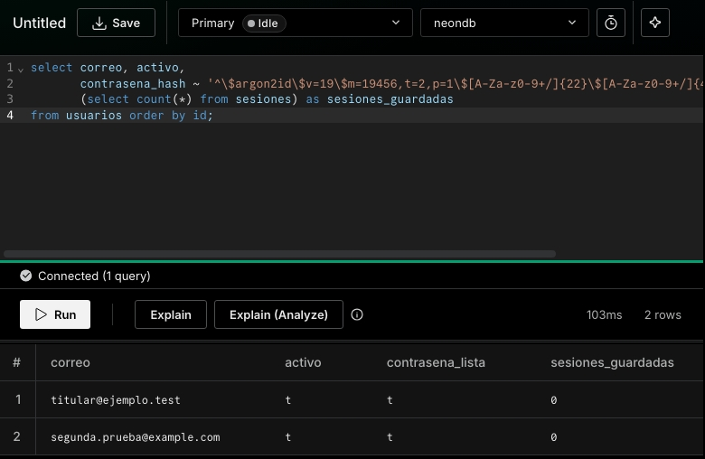

*Captura 1. Comprobación en Neon del 22 de noviembre de 2026. La consulta revisa la forma de cada hash sin mostrarlo. La recorté para dejar solo el editor y el resultado.*

### Prompt 2 · Acceso en core-service (23 de noviembre de 2026)

**Antes de enviarlo:** terminé mis pasos del prompt 1 en Neon y Hasura y agregué `JWT_SECRET`. El 23 de noviembre le pedí a Claude Code ejecutar el prompt 2, sin pegarlo.

Texto exacto enviado:

```text
[Rol] Actúa como desarrollador backend con experiencia en NestJS, autenticación con JWT y seguridad de APIs. Explícame las decisiones en lenguaje sencillo.

[Objetivo] Implementa en core-service el ingreso con correo y contraseña, el perfil, la renovación y el cierre de la sesión, con límite de intentos, y la autorización por cuenta en todas las rutas, incluida la consulta de un vehículo.

[Contexto]
- Sigo la semana 6 de la cartilla. Pide que NestJS verifique las credenciales y emita la credencial de sesión; un token de acceso breve en memoria y una renovación rotatoria en cookie HttpOnly y Secure; guardar solo el hash de la renovación; que el cierre revoque la renovación; comprobar el acceso por recurso en los servicios, y que los errores no revelen credenciales.
- core-service consulta Hasura con el secreto de administración mediante HasuraService (src/hasura). Ese secreto no representa a la persona: la autorización la hace NestJS.
- La evidencia de sesiones 4 y 5 define S01 (POST /api/sesion) y estas reglas: la cuenta sale de la sesión y nunca del formulario; un recurso de otra cuenta responde 404, sin roles ni 403, y los errores devuelven { codigo, mensaje }.
- La guía de autenticación de NestJS que cita la cartilla ahora explica @nestjs/authentication 0.1.7. No lo uso, porque envía la renovación en el cuerpo de la respuesta y no en una cookie HttpOnly, y todavía no tiene una versión estable. NestJS 12.4 trae app.enableCsrfProtection().
- Con el prompt 1 ya existen la tabla sesiones, con su familia y su límite total, la segunda cuenta y src/auth/contrasenas.ts.
- Aprobé estos valores: token de acceso JWT HS256 de 15 minutos, solo con sub, iat y exp; renovación de 7 días desde el último uso, que cambia en cada uso, con un límite total de 30 días desde el ingreso con contraseña; si llega una renovación ya usada, se revoca toda su familia, sin cerrar otros ingresos de la cuenta; 5 intentos de ingreso por minuto, y una cuenta desactivada no ingresa.
- La web-app corre en http://localhost:5173 y core-service en http://localhost:3000/api.

[Datos o archivos]
- apps/core-service/src: main.ts, configure-app.ts, app.module.ts, hasura/, health/ y auth/contrasenas.ts
- apps/core-service/test/app.e2e-spec.ts y apps/core-service/.env.example
- infra/hasura/migrations/default/ (las dos migraciones)
- docs/evidencia-sesion-4-modelo-datos-servicios.md, apartado 3

[Restricciones]
- Organiza el código como la estructura de la cartilla: el acceso en src/auth/ y la consulta del vehículo en src/vehiculos/.
- Agrega @nestjs/jwt, @nestjs/throttler y cookie-parser, con @types/cookie-parser, en su versión latest. Si alguna trae scripts de instalación, detente y avísame.
- Lee JWT_SECRET de apps/core-service/.env como lo hace hasura.config.ts: si falta, core-service arranca y el ingreso responde 503 ACCESO_NO_CONFIGURADO; si tiene menos de 32 caracteres, detiene el arranque. Agrégalo a .env.example sin valor.
- POST /api/sesion recibe { correo, contrasena }. Valida que existan y su longitud máxima (400 DATOS_INVALIDOS), compara el correo sin espacios y en minúsculas, y verifica el hash. Si el correo no existe o la cuenta está desactivada, verifica igual contra un hash de relleno y responde el mismo 401 CREDENCIALES_INVALIDAS. Si es correcto, guarda en sesiones el SHA-256 de un token de renovación aleatorio de 32 bytes, con una familia nueva y su límite total de 30 días, y responde 200 con { token_acceso, vence_en, titular: { nombre, correo } } y la cookie sesion_renovacion (HttpOnly, Secure, SameSite=Strict, ruta /api/sesion, 7 días).
- Limita POST /api/sesion a 5 intentos por minuto desde la misma dirección; el sexto responde 429 DEMASIADOS_INTENTOS.
- Activa en configure-app.ts la protección contra CSRF de NestJS (app.enableCsrfProtection), con el origen de la web-app como único origen de confianza, para que la e2e use la misma configuración.
- POST /api/sesion/renovar comprueba que el token exista y no esté vencido ni revocado, que no haya pasado el límite total de su familia y que la cuenta siga activa. Lo marca como usado con una actualización que solo afecta la fila si revocada_en sigue vacío, y crea el siguiente solo si esa actualización afectó una fila. El nuevo conserva la familia y su límite total; él y su cookie vencen a los 7 días o en el límite total, lo que llegue antes. Si el token ya estaba revocado, revoca toda su familia. DELETE /api/sesion revoca la renovación y borra la cookie. Cualquier rechazo de la renovación responde 401 SESION_VENCIDA y borra la cookie.
- Un guard global exige Authorization: Bearer con un token válido, solo HS256, en toda ruta que no esté marcada como pública. Sin token, o con uno alterado o vencido, responde 401 SESION_REQUERIDA. Son públicas GET /api/health, POST /api/sesion, POST /api/sesion/renovar y DELETE /api/sesion.
- GET /api/perfil devuelve { nombre, correo } de la cuenta del token.
- GET /api/vehiculos/:id busca el vehículo con el id y el usuario_id de la sesión y devuelve sus datos. Si no existe o es de otra cuenta, 404 VEHICULO_NO_ENCONTRADO; si el id no es un entero entre 1 y 2147483647, 400 DATOS_INVALIDOS.
- GET /api/health/hasura pasa a exigir sesión y cuenta solo los vehículos de esa cuenta.
- Los errores nuevos usan { codigo, mensaje }, en lenguaje sencillo. Si Hasura falla, responde 503 SERVICIO_NO_DISPONIBLE con un mensaje amable. Ninguna respuesta ni registro incluye contraseñas, hashes, tokens de renovación ni secretos.
- CORS sigue aceptando solo http://localhost:5173, ahora con credenciales.
- Agrega pruebas unitarias del guard, de la sesión y de los vehículos con HasuraService simulado, y una prueba e2e nueva que use AppModule con un Hasura simulado en memoria con las dos cuentas.
- No cambies la web-app, Neon, Hasura Cloud ni los .env. No hagas commits ni push.

[Formato de salida] Archivos creados o cambiados, con una frase cada uno; los comandos ejecutados; la matriz de autorización de cada endpoint; una tabla de comprobaciones con su resultado real, y los pasos para que yo pruebe con mi .env.

[Criterios de aceptación]
- npm run build, npm test, npm run test:e2e, npm run lint y npm audit terminan bien desde la raíz, y npm install-scripts ls no muestra paquetes bloqueados nuevos.
- La e2e comprueba: el ingreso correcto, con los atributos de la cookie; la misma respuesta para un correo inexistente, una contraseña equivocada y una cuenta desactivada; el sexto intento responde 429; el perfil con token responde 200, y sin token, con un token alterado o vencido, 401; el vehículo propio responde 200, el de otra cuenta 404 y un id inválido 400; la renovación cambia la cookie; una renovación reutilizada responde 401 y revoca su familia, sin cerrar otro ingreso de la misma cuenta; renovar después del límite total responde 401; después del cierre, renovar responde 401, y una renovación o un cierre desde otro origen responde 403.
- Ninguna respuesta de la e2e contiene contrasena_hash, el hash ni el token de renovación en el cuerpo.
- GET /api/health responde igual que antes.
```

**Archivos creados o cambiados** (todos en `apps/core-service/`, salvo el `package-lock.json` de la raíz)

| Archivo | Para qué sirve |
|---|---|
| `package.json` y `package-lock.json` | Agrega `@nestjs/jwt` 12.0.5, `@nestjs/throttler` 6.8.0 y `cookie-parser` 1.4.7, y para el desarrollo `@types/cookie-parser` 1.4.10. Son la versión `latest` de cada uno y ninguno trae scripts de instalación |
| `.env.example` | Agrega `JWT_SECRET`, sin valor, con la instrucción para crearlo |
| `src/configure-app.ts` | Agrega `cookie-parser`, CORS con credenciales y la protección contra CSRF de NestJS, con la web-app como único origen de confianza |
| `src/app.module.ts` | Suma los módulos de acceso y de vehículos, y el filtro de errores para toda la API |
| `src/common/errores.ts` | Crea los errores con la forma `{ codigo, mensaje }` |
| `src/common/errores.filter.ts` | Da esa forma a tres errores que no nacen en los servicios: una falla de Hasura (503 `SERVICIO_NO_DISPONIBLE`), el rechazo por CSRF (403 `ORIGEN_NO_PERMITIDO`) y un cuerpo que no es JSON válido (400 `DATOS_INVALIDOS`) |
| `src/common/ids.ts` | Lee un id escrito como texto: debe ser un entero entre 1 y 2147483647, el mayor de la base |
| `src/auth/auth.config.ts` | Lee `JWT_SECRET` como `hasura.config.ts`: si falta, core-service arranca igual; si tiene menos de 32 caracteres, se detiene |
| `src/auth/sesion.reglas.ts` | Reúne los valores aprobados: 15 minutos, 7 días, 30 días y 5 intentos |
| `src/auth/token-acceso.service.ts` | Crea y verifica el token de acceso: un JWT HS256 de 15 minutos, solo con `sub`, `iat` y `exp` |
| `src/auth/sesion.guard.ts` | Es el guard de toda la API: exige `Authorization: Bearer` con un token válido, salvo en las rutas marcadas con `@Publico()` |
| `src/auth/publico.decorator.ts` y `cuenta-actual.decorator.ts` | `@Publico()` marca las rutas abiertas, y `@CuentaActual()` entrega el id de la cuenta que viene en el token |
| `src/auth/limite-ingreso.guard.ts` | Permite 5 intentos de ingreso por minuto desde la misma dirección. El sexto responde 429 `DEMASIADOS_INTENTOS` |
| `src/auth/cookie-renovacion.ts` | Guarda, lee y borra la cookie `sesion_renovacion` con sus protecciones |
| `src/auth/sesion.service.ts` | Maneja el ciclo de la sesión: ingreso, renovación, reutilización, cierre y perfil |
| `src/auth/sesion.controller.ts` y `perfil.controller.ts` | Atienden `POST /api/sesion`, `POST /api/sesion/renovar`, `DELETE /api/sesion` y `GET /api/perfil`. El cuerpo del ingreso se valida a mano |
| `src/auth/auth.module.ts` | Une las piezas del acceso y aplica el guard a toda la API |
| `src/vehiculos/` (servicio, controller y módulo) | Atiende `GET /api/vehiculos/:id` y busca a la vez por id y por cuenta |
| `src/hasura/hasura.errors.ts` | Agrega `formatoInesperado()`, que ya usaba `health` y ahora usan también los servicios nuevos |
| `src/health/health.controller.ts` y `health.service.ts` | `/api/health` queda pública; `/api/health/hasura` exige sesión y cuenta solo los vehículos de la cuenta |
| Pruebas unitarias | Nuevas: `auth.config.spec.ts` (3), `sesion.guard.spec.ts` (8), `sesion.service.spec.ts` (18) y `vehiculos.spec.ts` (10). También cambian las dos de `health` |
| `test/acceso.e2e-spec.ts` y `test/hasura-simulado.ts` | Prueba e2e del acceso, con 11 casos. Usa `AppModule` y un Hasura simulado en memoria con tres cuentas ficticias: las dos de prueba y una desactivada |
| `test/app.e2e-spec.ts` | Conserva el caso de `/api/health` y agrega 4: `health/hasura` con y sin sesión, y el ingreso sin `JWT_SECRET` o sin Hasura |

**Matriz de autorización implementada**

| Endpoint | Acceso | Respuestas |
|---|---|---|
| `GET /api/health` | Público | 200, igual que antes |
| `POST /api/sesion` | Público, con 5 intentos por minuto y protección contra CSRF | 200 con `{ token_acceso, vence_en, titular }` y la cookie. Errores: 400 `DATOS_INVALIDOS`, 401 `CREDENCIALES_INVALIDAS`, 403 `ORIGEN_NO_PERMITIDO`, 429 `DEMASIADOS_INTENTOS` y 503 `ACCESO_NO_CONFIGURADO` o `SERVICIO_NO_DISPONIBLE` |
| `POST /api/sesion/renovar` | Cookie de renovación, con protección contra CSRF | 200 con un token de acceso y una cookie nuevos. Errores: 401 `SESION_VENCIDA`, que también borra la cookie, y 403 |
| `DELETE /api/sesion` | Cookie de renovación, con protección contra CSRF | 204, revoca la renovación y borra la cookie. Error: 403 |
| `GET /api/perfil` | Sesión | 200 con `{ nombre, correo }`. Error: 401 `SESION_REQUERIDA` |
| `GET /api/health/hasura` | Sesión | 200 con el conteo de vehículos de la cuenta. Errores: 401 y 503, este con el mensaje de la sesión 7 |
| `GET /api/vehiculos/:id` | Sesión, y la cuenta debe ser la dueña | 200 con el vehículo. Errores: 400 `DATOS_INVALIDOS`, 401 y 404 `VEHICULO_NO_ENCONTRADO`, tanto si el vehículo es de otra cuenta como si no existe |

En `vence_en` va la hora en que vence el token de acceso, no la renovación.

**Comprobaciones**, desde la raíz, con Node 24.22.2 y npm 12.2.3:

| Comprobación | Comando | Resultado real |
|---|---|---|
| Dependencias nuevas | `npm view <paquete>@latest` antes de instalar | Las cuatro están en `latest` y no tienen `preinstall`, `install` ni `postinstall` |
| Scripts de instalación | `npm install-scripts ls`, y búsqueda de `hasInstallScript` en lo que cambió del `package-lock.json` | «No packages with unreviewed install scripts.» Ninguno de los 20 paquetes nuevos del lock trae scripts |
| Compilación | `npm run build` | Código de salida 0 |
| Lint | `npm run lint` | Código de salida 0, sin avisos |
| Pruebas unitarias | `npm test` | 62 pruebas en 9 archivos, sin errores. 39 son nuevas |
| Pruebas e2e | `npm run test:e2e` | 17 pruebas en 2 archivos, sin errores: 11 del acceso y 6 de `app.e2e-spec.ts` |
| Dependencias vulnerables | `npm audit` | `found 0 vulnerabilities` |
| Hashes en el repositorio | `git grep --untracked` con la forma de un hash Argon2 completo | 0 coincidencias |
| Arranque real con Node | `node dist/main.js` desde una carpeta sin `.env` | Arranca. `/api/health` responde 200, `/api/health/hasura` 401 y el ingreso 503 `ACCESO_NO_CONFIGURADO`. Con un `JWT_SECRET` de prueba y sin Hasura, el ingreso responde 503 `SERVICIO_NO_DISPONIBLE`. Desde otro sitio, 403 `ORIGEN_NO_PERMITIDO`. Con un `JWT_SECRET` corto, se detiene con código 1 y el mensaje «JWT_SECRET debe tener al menos 32 caracteres. Créalo con: openssl rand -base64 32» |
| Demostración con un Hasura falso | core-service compilado, conectado por HTTP a un Hasura falso local con dos cuentas ficticias, y el script `demo-dos-cuentas.mjs`, que queda fuera del repositorio | «Resultado: 19 de 19 comprobaciones como se esperaba.» El registro de core-service solo muestra los avisos de reutilización, sin tokens ni correos |

La e2e del acceso comprueba lo que pide el prompt:
- el ingreso correcto, con los cuatro atributos de la cookie y el correo escrito con mayúsculas y espacios;
- la misma respuesta, sin cookie, para un correo inexistente, una contraseña equivocada y una cuenta desactivada;
- datos incompletos y JSON mal escrito;
- el sexto intento, que responde 429 aunque la contraseña sea correcta;
- el perfil con token (200) y sin token, con uno alterado o con uno vencido (401);
- el vehículo propio (200), el de otra cuenta y uno inexistente (404, con la misma respuesta) y un id inválido (400);
- la renovación, que cambia la cookie y el token;
- la reutilización, que cierra su familia sin cerrar otro ingreso de la misma cuenta;
- el límite total: con renovaciones en los días 6, 12, 18, 24 y 29, la del día 30 responde 401;
- el cierre, después del cual renovar responde 401;
- el 403 para el ingreso, la renovación y el cierre desde otro sitio, y desde `localhost:4000`, que es el mismo sitio pero no la web-app.

Después de cada caso, la prueba revisa que ninguna respuesta contenga `contrasena_hash`, un hash Argon2, las contraseñas ni los tokens de renovación.

**Ajustes:** no hice ninguno en el texto del prompt.

**Observaciones:**
- **Errores de JSON mal escrito.** Node repite en algunos de esos errores el comienzo del texto recibido, que podría ser una contraseña. Ahora responden 400 con un mensaje propio (apartado 6).
- **Filtros como variables.** Las consultas de `sesiones` reciben sus filtros como variables de tipo `sesiones_bool_exp`, `sesiones_set_input` y `sesiones_insert_input`, los nombres que Hasura genera para cada tabla. Así no dependen del nombre que Hasura le da al tipo `char(64)`. Mi prueba real con Hasura Cloud confirmó que funcionan (ver abajo).
- **Cuenta desactivada con un token vigente.** El guard no consulta la base en cada petición. Una cuenta desactivada conserva su token de acceso hasta por 15 minutos, pero no puede renovarlo, y su perfil ya responde 401.
- **La protección contra CSRF cubre también el ingreso.** Se aplica a todo POST y DELETE de la API.
- **El panel de la web-app no cambia.** Solo llama a `/api/health`, que sigue siendo pública.
- **El límite de intentos vive en memoria.** Se reinicia si core-service se reinicia, como estaba previsto.
- **Registros sin datos sensibles.** core-service solo registra el tipo de falla de Hasura y el aviso de una renovación reutilizada.

**Prueba real con Neon y Hasura Cloud (23 de noviembre).** Encendí core-service con mi `.env` (`npm run dev:api`) y, en otra terminal, ejecuté `node demo-dos-cuentas.mjs`, el script de demostración que Claude Code dejó fuera del repositorio. Escribí las dos contraseñas sin que se vieran en pantalla. Esto es lo que imprimió, tal cual:

```text
Contraseña de titular@ejemplo.test:
OK    Ingreso de titular@ejemplo.test: esperado 200, obtenido 200 (Titular de prueba)
OK    Cookie de titular@ejemplo.test con sus 4 protecciones: esperado 4, obtenido 4 (HttpOnly, Secure, SameSite=Strict, Path=/api/sesion)
Contraseña de segunda.prueba@example.com:
OK    Ingreso de segunda.prueba@example.com: esperado 200, obtenido 200 (Segunda titular de prueba)
OK    Cookie de segunda.prueba@example.com con sus 4 protecciones: esperado 4, obtenido 4 (HttpOnly, Secure, SameSite=Strict, Path=/api/sesion)
OK    Perfil de titular@ejemplo.test: esperado titular@ejemplo.test, obtenido titular@ejemplo.test
OK    Perfil de segunda.prueba@example.com: esperado segunda.prueba@example.com, obtenido segunda.prueba@example.com
      Vehículos de titular@ejemplo.test: XYZ789 (id 1)
OK    Prueba de conexión de titular@ejemplo.test cuenta sus vehículos: esperado 1, obtenido 1
      Vehículos de segunda.prueba@example.com: KLM456 (id 2)
OK    Prueba de conexión de segunda.prueba@example.com cuenta sus vehículos: esperado 1, obtenido 1
OK    segunda.prueba@example.com pide XYZ789 de la otra cuenta: esperado 404, obtenido 404 (VEHICULO_NO_ENCONTRADO)
OK    titular@ejemplo.test pide KLM456 de la otra cuenta: esperado 404, obtenido 404 (VEHICULO_NO_ENCONTRADO)
OK    Vehículo sin token: esperado 401, obtenido 401
OK    Vehículo con token alterado: esperado 401, obtenido 401
OK    Id de vehículo inválido: esperado 400, obtenido 400
OK    Renovación de la cuenta 1: esperado 200, obtenido 200 (cookie nueva)
OK    Reutilizar la renovación anterior: esperado 401, obtenido 401
OK    La renovación nueva queda cerrada por la reutilización: esperado 401, obtenido 401
OK    Cierre de sesión de la cuenta 2: esperado 204, obtenido 204
OK    Renovar después del cierre: esperado 401, obtenido 401
OK    Renovación desde otro sitio: esperado 403, obtenido 403

Resultado: 19 de 19 comprobaciones como se esperaba.
```

Con esta prueba se cumple la apertura de la semana 6: abrí sesión con dos cuentas y, desde cada una, pedí el vehículo de la otra; las dos peticiones respondieron 404. También confirma que las consultas a `sesiones` funcionan con los tipos que genera Hasura Cloud. En Neon, XYZ789 tiene el id 1 y KLM456 el id 2. Las sesiones que abrió la prueba quedaron cerradas en la tabla `sesiones`.

### Prompt 3 · Ingreso y rutas protegidas en React (23 de noviembre de 2026)

**Antes de enviarlo:** probé el prompt 2 con Neon y Hasura Cloud (19 de 19). El 23 de noviembre le pedí a Claude Code seguir con el prompt 3, sin pegarlo.

Texto exacto enviado:

```text
[Rol] Actúa como desarrollador frontend con experiencia en React, TypeScript, Material UI, React Router y accesibilidad. Explícame las decisiones en lenguaje sencillo.

[Objetivo] Construye en la web-app la página de ingreso y una página de inicio protegida, que usen la API de core-service para ingresar, mantener la sesión al recargar y cerrarla.

[Contexto]
- Sigo el paso 4 de la semana 6 de la cartilla: login y rutas protegidas en React con la API del core. El frontend protege la navegación; el backend impone el acceso.
- Con el prompt 2, core-service tiene POST /api/sesion, POST /api/sesion/renovar, DELETE /api/sesion y GET /api/perfil. El token de acceso dura 15 minutos y se guarda solo en memoria; la renovación va en una cookie HttpOnly que el navegador envía solo a /api/sesion.
- Si la misma renovación llega dos veces, core-service cierra ese ingreso y hay que volver a escribir la contraseña. En desarrollo, StrictMode monta los componentes dos veces, y la usuaria puede tener varias pestañas abiertas.
- La cartilla organiza la web-app con src/app/routes/ y src/features/. En la sesión 7, el cliente HTTP quedó en src/api/.
- La web-app tiene la base visual con la identidad de Android (src/theme, AppShell y SectionCard) y el panel de verificación de la sesión 6, que usa src/api/api-client.ts.
- La pantalla 01 de la evidencia de sesión 3 diseña el ingreso con correo, contraseña y el botón Ingresar. El registro propio y la recuperación de contraseña son de una fase posterior.
- La sesión 3 propone las rutas /ingresar (pública) y /vehiculos (titular). La flota llega en la semana 7; por ahora, la página protegida es el inicio, en /.

[Datos o archivos]
- apps/web-app/src: main.tsx, App.tsx, api/, components/ (AppShell, SectionCard y HealthPanel) y theme/
- docs/evidencia-sesion-3-diseno-pantallas.md: la pantalla 01 y las rutas propuestas
- README.md

[Restricciones]
- Organiza lo nuevo como la cartilla: las rutas y la página de inicio en src/app/routes/, y el proveedor de sesión, la página de ingreso y la ruta protegida en src/features/auth/. El cliente HTTP sigue en src/api/.
- Agrega react-router en su versión latest y úsalo en modo declarativo. Si trae scripts de instalación, detente y avísame.
- Extiende api-client.ts para enviar el método, un cuerpo JSON y el token, e incluir las credenciales en /sesion. ApiError guarda el estado HTTP y el codigo, y muestra el mensaje de core-service cuando lo trae. El panel de verificación conserva sus mensajes.
- Crea un proveedor de sesión que guarde el token solo en memoria (ni localStorage ni sessionStorage), intente renovar al abrir la página y, ante un 401, renueve una vez y repita la petición. Haz las renovaciones una por una con navigator.locks, para que ni StrictMode ni dos pestañas usen dos veces la misma renovación.
- /ingresar: campos de correo (autocomplete username) y contraseña (current-password), con un botón para mostrarla; botón Ingresar con estado de carga, y los mensajes de error y de demasiados intentos en una alerta que el lector de pantalla anuncie. Con sesión, lleva a /.
- / (protegida): «Hola, {nombre}», una tarjeta «Tu cuenta» con el nombre y el correo de GET /api/perfil, y el panel de verificación sin cambios. Mientras se comprueba la sesión, muestra un estado de carga; sin sesión, lleva a /ingresar.
- Con sesión, el encabezado muestra un botón «Cerrar sesión»; a 360 px, solo el ícono, con una etiqueta accesible. Al cerrar o al vencer la sesión, vuelve a /ingresar con un aviso. Las demás rutas llevan a /.
- Usa el tema y los componentes existentes, con textos en español sencillo que le hablen directamente a la usuaria.
- En el README agrega la sección «Ingresar con las cuentas de prueba» (contraseñas con el script, SQL en Neon, JWT_SECRET y la matriz resumida) y filas en «Solución de problemas» para el acceso no configurado, los demasiados intentos y la cookie que no se guarda.
- No cambies core-service, la guía visual, Neon, Hasura Cloud ni los .env. No hagas commits ni push.

[Formato de salida] Archivos creados o cambiados, con una frase cada uno; los comandos ejecutados; una tabla de comprobaciones con su resultado real, y capturas de las páginas en claro y oscuro, a 1280 × 800 y 360 × 800.

[Criterios de aceptación]
- npm run build, npm test, npm run test:e2e, npm run lint y npm audit terminan bien desde la raíz.
- En el navegador: ingresar lleva al inicio con el nombre; un error muestra el mensaje de core-service; recargar no vuelve a pedir la contraseña; cerrar sesión vuelve a /ingresar y Atrás no muestra el inicio, y con dos pestañas abiertas, recargar no cierra la sesión.
- Se puede ingresar y cerrar sesión solo con el teclado, con el foco visible, y las páginas no tienen desplazamiento horizontal a 360 px.
- El código compilado no contiene «hasura», «admin-secret» ni «JWT_SECRET».
```

**Resultado:** Claude Code agregó la página de ingreso, la página de inicio protegida, el proveedor de sesión y el botón para cerrar sesión, y actualizó el README. Lo comprobó en Chrome sin pantalla, con el Hasura falso local y las dos cuentas ficticias con claves falsas, sin tocar Neon, Hasura Cloud ni los `.env`.

**Archivos creados o cambiados** (todos en `apps/web-app/`, salvo el `package-lock.json` y el README de la raíz)

| Archivo | Para qué sirve |
|---|---|
| `package.json` y `package-lock.json` | Agrega `react-router` 8.5.2, la versión `latest`. Trae dos dependencias, `cookie-es` y `@remix-run/route-pattern`, y ninguna tiene scripts de instalación |
| `src/App.tsx` | Envuelve la web-app con el enrutador (`BrowserRouter`) y el proveedor de sesión |
| `src/app/routes/AppRoutes.tsx` | Define las rutas: `/ingresar` es pública, `/` exige sesión y cualquier otra dirección lleva a `/` |
| `src/app/routes/Inicio.tsx` | Página de inicio: «Hola, {nombre}», la tarjeta «Tu cuenta» y el panel de verificación, sin cambios |
| `src/api/api-client.ts` | Envía el método, el cuerpo JSON y el token, e incluye las credenciales solo en `/sesion`. `ApiError` guarda el estado HTTP y el `codigo`, y usa el mensaje de core-service cuando viene. El panel conserva sus mensajes |
| `src/api/sesion.api.ts` y `perfil.api.ts` | Piden el ingreso, la renovación, el cierre y el perfil, y revisan la forma de cada respuesta |
| `src/types/sesion.ts` | Tipos de la titular y de la sesión |
| `src/features/auth/acceso-context.ts` | Lo que el proveedor ofrece a las páginas, y el hook `useAcceso` |
| `src/features/auth/AccesoProvider.tsx` | Guarda el token solo en memoria y renueva al abrir la página. Ante un 401, renueva una vez y repite la petición. Hace las renovaciones una por una con `navigator.locks` |
| `src/features/auth/RutaProtegida.tsx` y `CargandoSesion.tsx` | Mientras se comprueba la sesión, muestran «Comprobando tu sesión…» con `role="status"`. Sin sesión, llevan a `/ingresar` |
| `src/features/auth/PaginaIngreso.tsx` | Página de ingreso: la pantalla 01 de la sesión 3, sin los enlaces de registro y recuperación |
| `src/features/auth/TarjetaCuenta.tsx` | Tarjeta «Tu cuenta» con el nombre y el correo de `GET /api/perfil`, y sus estados de carga y error |
| `src/features/auth/BotonCerrarSesion.tsx` | Botón «Cerrar sesión». En pantallas angostas solo se ve el ícono, con su etiqueta accesible |
| `src/components/layout/AppShell.tsx` | Recibe botones extra para el encabezado (`acciones`), junto al de modo |
| `README.md` | Agrega la sección «Ingresar con las cuentas de prueba» y siete filas en «Solución de problemas», y corrige lo que el prompt 2 dejó desactualizado (ver «Ajustes») |

**Comandos ejecutados**, desde la raíz, con Node 24.22.2 y npm 12.2.3:
- `npm view react-router@latest`, para ver la versión, sus dependencias y sus scripts antes de instalarlo;
- `npm install react-router@8.5.2 --workspace apps/web-app` y `npm install-scripts ls`;
- `npm run build`, `npm test`, `npm run test:e2e`, `npm run lint` y `npm audit`;
- `grep -ril` en `apps/web-app/dist`, para buscar secretos en el código compilado;
- `node recorrido.mjs`, `node control-sin-locks.mjs` y `node capturas.mjs`, tres scripts que Claude Code dejó fuera del repositorio. Encienden el Hasura falso, core-service compilado desde una carpeta sin `.env`, Vite con `VITE_API_URL` y Chrome sin pantalla, y cada arranque de core-service usa un `JWT_SECRET` de prueba distinto;
- en una copia del repositorio fuera de él, sin `.env` ni `node_modules`: `npm ci`, la compilación, las pruebas y el lint.

**Comprobaciones**

| Comprobación | Comando | Resultado real |
|---|---|---|
| Dependencia nueva | `npm view react-router@latest` antes de instalar | 8.5.2, sin `preinstall`, `install` ni `postinstall`. Pide React 19.2.7 o más; la web-app tiene la 19.3.1 |
| Scripts de instalación | `npm install-scripts ls`, y búsqueda de `hasInstallScript` en lo que cambió del `package-lock.json` | «No packages with unreviewed install scripts.» Ninguno de los 3 paquetes nuevos trae scripts |
| Compilación | `npm run build` | Código de salida 0 |
| Lint | `npm run lint` | Código de salida 0, sin avisos |
| Pruebas unitarias | `npm test` | 62 pruebas en 9 archivos, sin errores. La web-app no tiene pruebas automáticas; la comprobé en el navegador |
| Pruebas e2e | `npm run test:e2e` | 17 pruebas en 2 archivos, sin errores |
| Dependencias vulnerables | `npm audit` | `found 0 vulnerabilities` |
| Código compilado de la web | `grep -ril` en `apps/web-app/dist` | 0 archivos con «hasura», «admin-secret», «JWT_SECRET» o «jwt». `localStorage` aparece en 1, dentro de Material UI, que guarda ahí el modo claro u oscuro; el código de la web-app no lo usa. `sessionStorage`, en ninguno |
| Secretos en el repositorio | `git grep --untracked` | 0 hashes Argon2 completos, 0 `JWT_SECRET` con valor y 0 claves del Hasura falso. Los dos `.env` siguen ignorados por git |
| Recorrido en el navegador | `node recorrido.mjs` | «Resultado: 17 de 17 comprobaciones como se esperaba.» Detalle abajo |
| Prueba de control sin `navigator.locks` | `node control-sin-locks.mjs`, que quita `navigator.locks` solo dentro de Chrome | En la segunda recarga simultánea, una pestaña volvió a la página de ingreso, y core-service registró una renovación reutilizada. Con el bloqueo, el recorrido hizo tres recargas simultáneas sin ningún aviso |
| Capturas y ancho | `node capturas.mjs` | 9 capturas. En todas, el documento mide lo mismo que la ventana: no hay desplazamiento horizontal. A 360 px, el encabezado del inicio muestra solo los íconos de cerrar sesión y de modo. La consola, sin errores ni avisos |
| Recarga doble | `doble-recarga.mjs`, con el Hasura falso tardando 250 ms en cada consulta, como Hasura Cloud | Si la segunda recarga llega a 100, 300, 500 o 700 ms de la primera, se pierde la sesión y core-service registra una renovación reutilizada. A 900 y 1200 ms, la sesión sigue (apartado 6) |
| Copia limpia | `npm ci`, `npm run build`, `npm test`, `npm run test:e2e` y `npm run lint` | 0 archivos `.env`. Instalación con 0 vulnerabilidades, compilación y lint con código 0, 62 pruebas unitarias y 17 e2e sin errores |

**Recorrido en Chrome**, a 1280 × 800, con la web-app en modo de desarrollo, donde StrictMode monta cada componente dos veces:

| Comprobación | Resultado real |
|---|---|
| Sin sesión, `/` lleva a `/ingresar` | Ruta `/ingresar` y título de la pestaña «Ingresar · Control Vehicular». La renovación al abrir respondió 401 |
| Orden con Tab | Botón de modo → Correo → Contraseña → Mostrar contraseña → Ingresar, todos con foco visible |
| Enviar el formulario vacío | «Escribe tu correo y tu contraseña.», y el foco vuelve al correo |
| Contraseña equivocada | «El correo o la contraseña no coinciden.», el mensaje de core-service, en una alerta. El foco vuelve a la contraseña |
| Mostrar la contraseña | Con Enter, el campo pasa a texto y el botón cambia a «Ocultar contraseña» |
| Ingresar solo con el teclado | «Hola, Titular de prueba», la tarjeta con el correo y el título «Inicio · Control Vehicular» |
| Recargar | No pidió la contraseña. Hubo una sola renovación (200), aunque StrictMode monta la página dos veces |
| Dos pestañas que recargan al mismo tiempo, tres veces | 6 renovaciones, todas 200, y 0 avisos de reutilización en core-service |
| Ante un 401, renovar una vez y repetir | Con core-service reiniciado con otro `JWT_SECRET`, una dirección inexistente llevó a `/`. `/api/perfil` respondió 401 dos veces, una por cada montaje de StrictMode; hubo una sola renovación (200) y las dos peticiones se repitieron con 200 |
| Cerrar sesión con el teclado | El primer Tab llega a «Cerrar sesión». Con Enter, `DELETE /api/sesion` respondió 204 y la web volvió a `/ingresar` con «Cerraste tu sesión.» |
| Atrás después de cerrar | Sigue en `/ingresar`; no muestra el inicio |
| Recargar después de cerrar | La renovación responde 401 y sigue la página de ingreso |
| La otra pestaña | Sigue en el inicio mientras su token es válido, como explica el apartado 3 |
| Sesión terminada | Con otro `JWT_SECRET`, esa pestaña recibió 401 al pedir el perfil, no pudo renovar (401) y volvió a `/ingresar` con «Tu sesión terminó. Vuelve a ingresar.» |
| Segunda cuenta | «Hola, Segunda titular de prueba», sin datos de la primera cuenta |
| Demasiados intentos | Después de un ingreso correcto, el quinto intento equivocado del mismo minuto mostró «Hiciste demasiados intentos. Espera un minuto y vuelve a intentarlo.» |
| Consola | Sin errores ni avisos en las dos pestañas |

**Scripts de prueba.** Claude Code escribió los scripts de este apartado y el de demostración del prompt 2 fuera del repositorio, en una carpeta temporal. Se borraron al reiniciarse Claude Code el 23 de noviembre. Ese día los recuperó del historial de la sesión y los guardó en mi carpeta `Asesor_Técnico/Sesión_9/scripts-prueba-acceso/`, con una explicación de cada uno. Desde allí volvió a ejecutar `recorrido.mjs`, con 17 de 17, y `doble-recarga.mjs`, con el mismo resultado.

**Capturas.** Las tomó Claude Code con `capturas.mjs`, con las cuentas ficticias en el Hasura falso. Las de 360 × 800 son emulación del navegador, no un teléfono real.

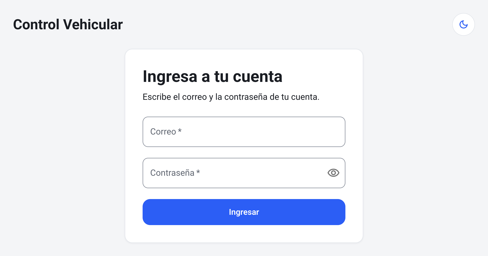

*Captura 2. Página de ingreso en modo claro, a 1280 × 800.*

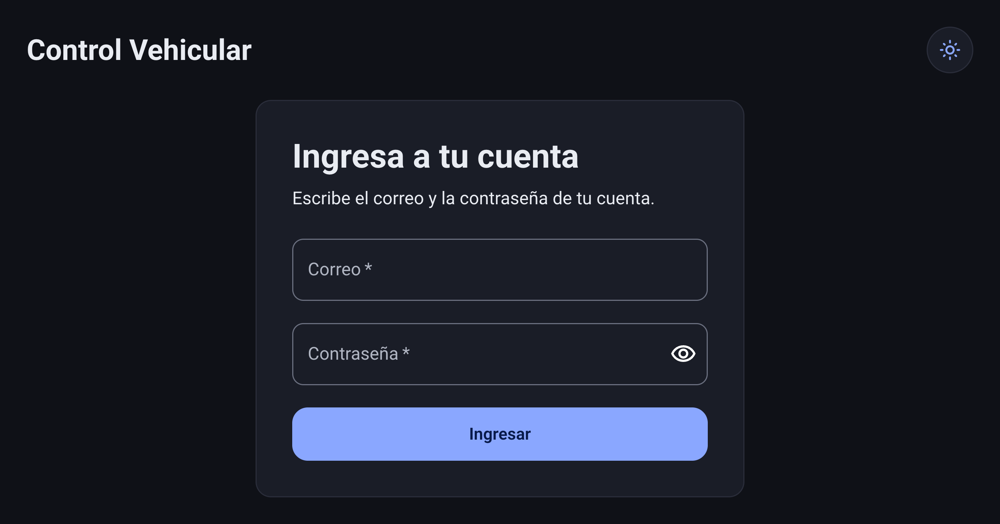

*Captura 3. Página de ingreso en modo oscuro, a 1280 × 800.*

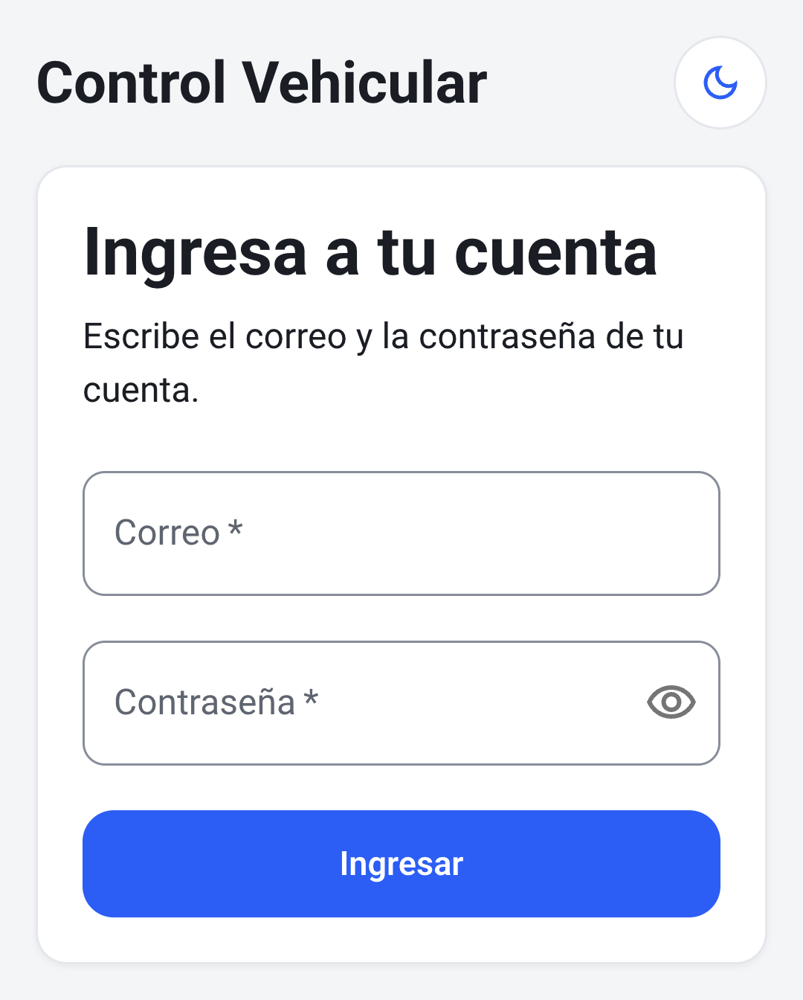

*Captura 4. Página de ingreso en modo claro, a 360 × 800.*

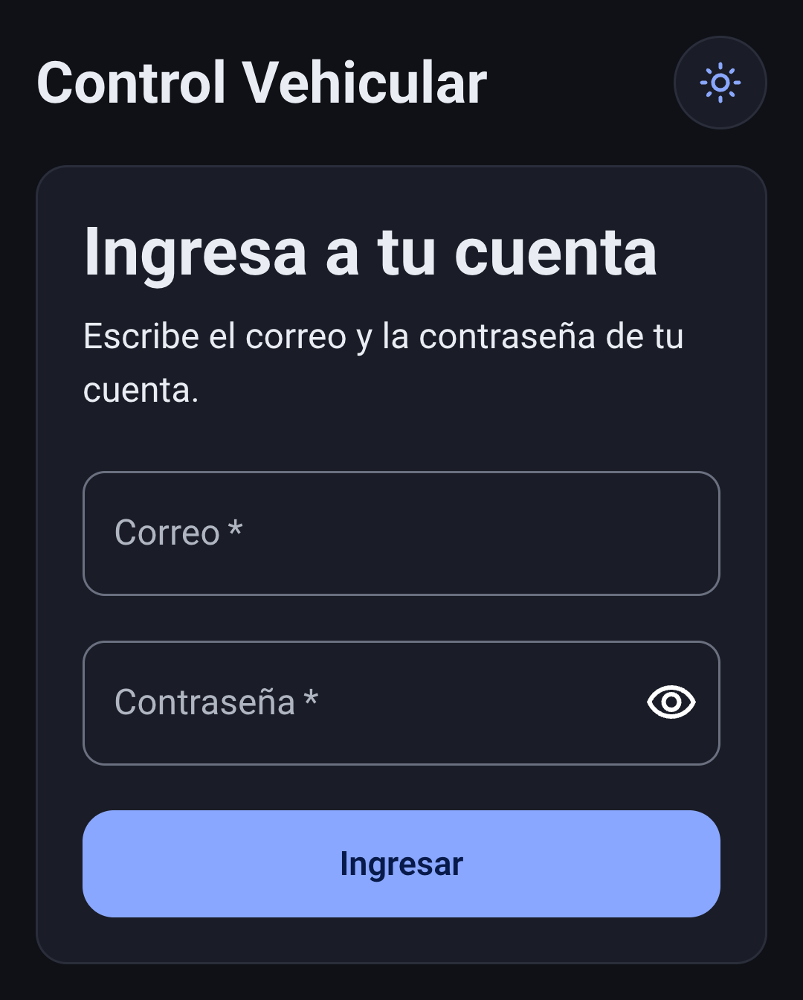

*Captura 5. Página de ingreso en modo oscuro, a 360 × 800.*

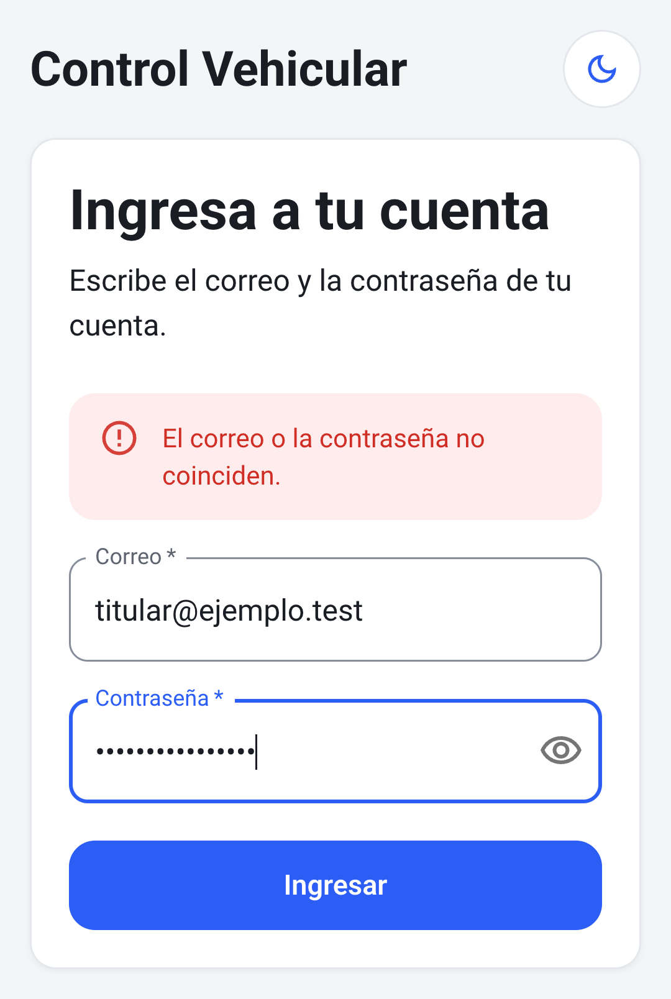

*Captura 6. Contraseña equivocada, a 360 × 800: el mensaje de core-service y el foco de vuelta en la contraseña.*

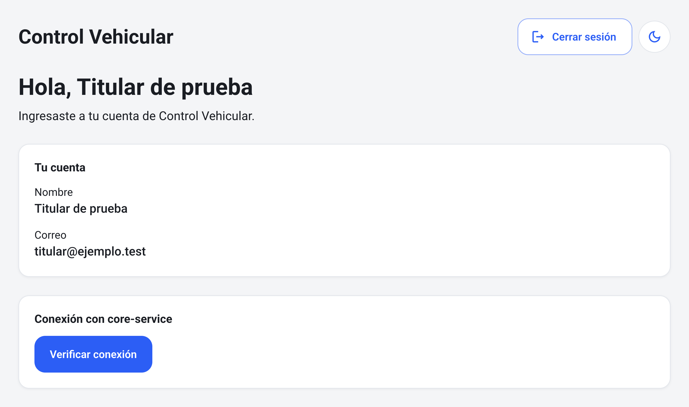

*Captura 7. Inicio en modo claro, a 1280 × 800.*

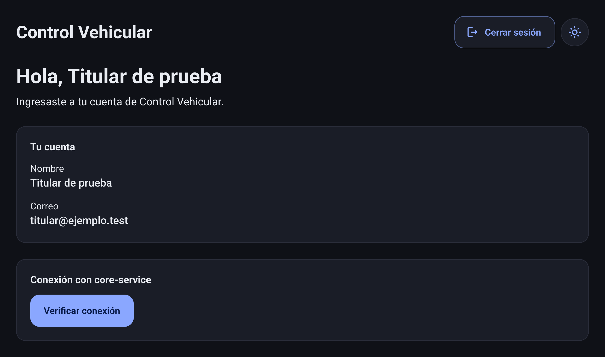

*Captura 8. Inicio en modo oscuro, a 1280 × 800.*

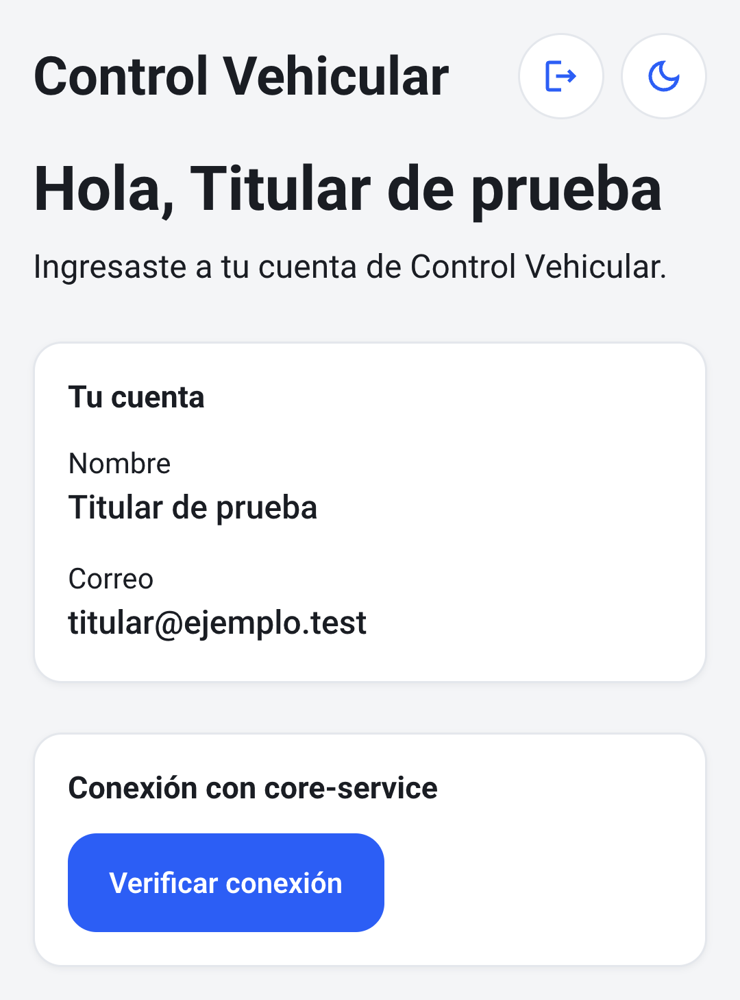

*Captura 9. Inicio en modo claro, a 360 × 800: «Cerrar sesión» queda como ícono, con su etiqueta accesible.*

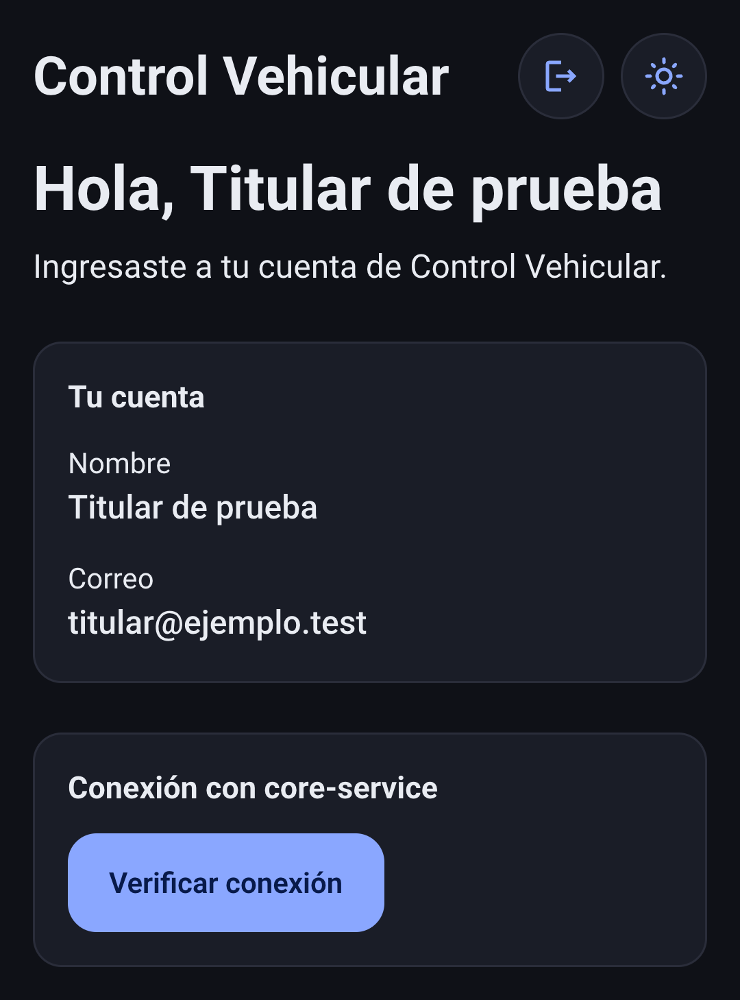

*Captura 10. Inicio en modo oscuro, a 360 × 800.*

**Ajustes:** no hice ninguno en el texto del prompt. En el README, además de lo que pedía, se corrigieron cuatro partes que el prompt 2 dejó desactualizadas, porque `GET /api/health/hasura` ahora exige sesión y el panel quedó en una página con sesión (apartado 6):
- el paso 5 de «Ejecutar el monorepo»;
- la descripción de `npm run test:e2e`;
- la comprobación de «Conectar core-service con Hasura», que ahora se hace al ingresar;
- la de «Reconstruir la base de datos y Hasura en un proyecto nuevo», que además lista la migración de `sesiones` y la segunda cuenta.

**Observaciones:**
- **StrictMode y varias pestañas.** El proveedor junta en una sola las renovaciones de una misma pestaña, y `navigator.locks` pone en fila las de varias. La prueba de control mostró que sin ese bloqueo dos pestañas que recargan a la vez pueden cerrar el ingreso.
- **Otras pestañas al cerrar sesión.** Cerrar sesión borra la cookie del navegador, pero otra pestaña conserva su token en memoria hasta por 15 minutos. Cuando ese token vence, o al recargar, vuelve a la página de ingreso.
- **Renueva cuando hace falta.** La web-app no renueva antes de que venza el token: espera el 401 y renueva una vez. Así, una página abierta sin uso no hace peticiones.
- **Títulos de página.** Cada página cambia el título de la pestaña con la etiqueta `<title>` de React 19. Así el lector de pantalla anuncia en qué página está.
- **Mensajes.** Los errores de core-service se muestran tal como él los escribe. La web-app solo agrega tres: el de los campos vacíos, el de conexión y el de una respuesta con formato inesperado.
- **Aviso de cierre.** «Cerraste tu sesión.» se oculta cuando la usuaria vuelve a intentar ingresar, para no mezclarlo con un error.
- **Navegadores.** Claude Code probó en Chrome sin pantalla, y yo en Edge y Safari. Los tres aceptan la cookie `Secure` en http://localhost.
- **Sin pruebas automáticas en la web-app.** Agregar Vitest y Testing Library sumaría dependencias que el prompt no pidió. El comportamiento quedó comprobado con los scripts de Chrome.

**Mi prueba con Neon y Hasura Cloud (23 de noviembre).** Encendí core-service con mi `.env` (`npm run dev:api`) y la web (`npm run dev:web`), e ingresé con las dos cuentas ficticias en Microsoft Edge, que funciona con el mismo motor de Chrome: una en una ventana normal y la otra en una ventana InPrivate, que guarda sus cookies por separado. Claude Code me guio paso a paso.

| Paso | Qué hice | Resultado real |
|---|---|---|
| 1. Primera cuenta | En una ventana normal abrí http://localhost:5173 e ingresé con `titular@ejemplo.test` | «Hola, Titular de prueba» y la tarjeta «Tu cuenta» con su correo |
| 2. Segunda cuenta | En una ventana InPrivate ingresé con `segunda.prueba@example.com`. Después recargué las dos ventanas | «Hola, Segunda titular de prueba» con su correo. Al recargar, cada ventana siguió con su cuenta sin pedir la contraseña |
| 3. Teclado, cierre y Atrás | En la ventana normal recorrí la página con Tab, cerré sesión con Enter, pulsé Atrás, recargué y volví a ingresar solo con el teclado | Todo como se esperaba: foco visible en cada botón, «Cerraste tu sesión.», Atrás y la recarga siguieron en la página de ingreso, y el nuevo ingreso mostró otra vez «Hola, Titular de prueba». La ventana InPrivate siguió con la segunda cuenta |
| 4. Safari | Ingresé con `titular@ejemplo.test` en Safari, recargué y cerré sesión | Igual que en Edge: al recargar siguió la sesión, así que Safari acepta la cookie `Secure` en http://localhost |

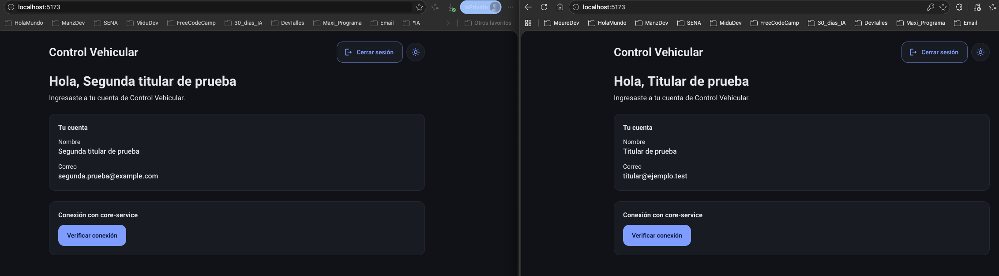

*Captura 11. Mi prueba del 23 de noviembre de 2026: dos sesiones a la vez, una por cuenta, con Neon y Hasura Cloud.*

## 6. Problemas encontrados

| Problema | Causa | Solución |
|---|---|---|
| El lint dio 2 avisos `no-misused-spread` en el script de contraseñas (prompt 1) | El script contaba los caracteres con `[...texto]`, que parte en varios pedazos algunos caracteres compuestos, como ciertos emojis | Contar con `Intl.Segmenter`, que separa el texto como lo ve una persona. Después, el lint quedó sin avisos |
| Después de registrar `sesiones` en Hasura, la consulta de prueba falló con `field 'sesiones' not found in type: 'usuarios'` (pasos posteriores al prompt 1) | Hasura registró solo las dos relaciones, pero las llamó `public_usuario` y `public_sesiones`, distinto de las demás | Las renombré `usuario` y `sesiones` con el botón Rename. Después, la consulta funcionó |
| Ante un cuerpo que no era JSON válido, NestJS respondía con el mensaje de Node, por ejemplo `Unexpected token 'c', "contrasena"... is not valid JSON` (prompt 2) | Node incluye en algunos de esos mensajes el comienzo del texto recibido, que podría ser una contraseña | El filtro de errores los cambia por 400 `DATOS_INVALIDOS`: «Los datos enviados no tienen el formato esperado.». Lo comprueba la e2e |
| El README seguía indicando abrir `/api/health/hasura` para comprobar Hasura, y pulsar «Verificar conexión» al abrir la web (prompt 3) | El prompt 2 protegió `/api/health/hasura`, y el prompt 3 dejó el panel en una página con sesión | Corregí esas instrucciones: ahora la conexión con Hasura se comprueba al ingresar, y la solución de problemas explica cada tipo de falla |
| Recargar dos veces en menos de un segundo cierra la sesión (comprobación del prompt 3, 23 de noviembre) | La primera recarga interrumpe la renovación: core-service ya cambió el token, pero el navegador no alcanza a recibir la cookie nueva. La segunda recarga envía el token anterior, y core-service lo toma como reutilizado y cierra el ingreso | Lo dejo como límite conocido, por decisión del 23 de noviembre. Solo obliga a escribir otra vez la contraseña: no expone datos, y la detección de una renovación robada sigue igual. Lo resolveré después de presentar el trabajo final en el SENA, con un margen de gracia en core-service: si vuelve un token que se cambió hace pocos segundos, y ese ingreso no se cerró, core-service entrega uno nuevo en vez de cerrar el ingreso (apartado 7). No lo resuelve la web-app, porque la primera página ya no existe cuando llega la segunda |

## 7. Pendientes y próximo paso

| Pendiente | Responsable | Fecha |
|---|---|---|
| Evitar que una recarga doble cierre la sesión, con un margen de gracia en core-service (se propusieron 30 segundos). El diseño está en `Asesor_Técnico/Sesión_9/pendiente-recarga-doble.md` | Ivan, con Claude Code | Por definir: después de presentar el trabajo final en el SENA |
| Push de los commits y cierre de la sesión, con su PDF | Ivan | Por definir |
| Definir la limpieza de las filas viejas de `sesiones` | Ivan | Por definir |
| Al publicar (semana 11), mantener la web y core-service en el mismo sitio, o cambiar la cookie de renovación | Ivan | Por definir |
| Registro propio, recuperación de contraseña y verificación del correo | Ivan | Fase posterior |

## Fuentes

- «Cartilla de acompañamiento técnico» del instructor: semana 6, «Login y autorización en el core service», páginas 16 y 17. Para la validación también se revisaron las páginas 3 y 4, las semanas 7, 10 y 11 y los anexos A y C.
- Referencias de la semana 6 en la cartilla, consultadas el 22 de noviembre de 2026: R20, NestJS, «Authentication» (docs.nestjs.com/security/authentication); R23, OWASP, «Password Storage Cheat Sheet», y R24, OWASP, «Session Management Cheat Sheet».
- Documentación de Node 24 sobre `crypto.argon2` y declaraciones de `app.enableCsrfProtection()` en NestJS 12.4.0, la versión instalada.
- Retroalimentación del instructor del 20 de noviembre de 2026 por Google Classroom, registrada en el [contexto del proyecto](contexto-proyecto.md).
- [Evidencia de sesiones 4 y 5](evidencia-sesion-4-modelo-datos-servicios.md): ficha de S01, reglas comunes de los servicios y códigos de respuesta.
- [Evidencia de sesión 3](evidencia-sesion-3-diseno-pantallas.md): pantalla 01 y rutas propuestas.
- [Evidencia de sesión 7](evidencia-sesion-7-conexion-hasura.md): cliente interno de Hasura y base de datos versionada.

## Historial de versiones

| Versión | Fecha | Cambios |
|---|---|---|
| Borrador | 21 de noviembre de 2026 | Plan aprobado, diseño del acceso y los tres prompts para revisar. |
| Borrador | 22 de noviembre de 2026 | Validación con la cartilla y sus referencias. Cinco ajustes a los prompts y un límite total de 30 días. Prompt 1 ejecutado, con sus comprobaciones. |
| 0.1 | 23 de noviembre de 2026 | Mis pasos en Neon y Hasura después del prompt 1, metadata actualizada, `JWT_SECRET` creado y comprobación de que Hasura rechaza las consultas sin el secreto. Prompt 2 ejecutado, con sus comprobaciones, y prueba real con Neon y Hasura Cloud: 19 de 19. Prompt 3 ejecutado, con sus comprobaciones y 9 capturas. Mi prueba en Edge y Safari, con la captura 11. La recarga doble queda como límite conocido, por mi decisión. Commit del código, scripts de prueba guardados en `Asesor_Técnico/Sesión_9` y README, contexto y `AGENTS.md` actualizados. |
